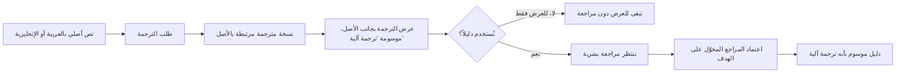

# الترجمة بين العربية والإنجليزية

<!-- BEGIN GENERATED: doc -->
| البند | القيمة |
|---|---|
| المعرّف | FEAT-AI-TRANSLATION |
| الإصدار | 0.1 |
| الحالة | مسودة |
| القدرة | CAP-12 المساعدة بالذكاء الاصطناعي |
| القدرة الفرعية | CAP-12.03 الاستخراج والترجمة (R2) |
| الأدوار | أي مستخدم مخوَّل |
| الشاشات | SCR-22 الادعاء والدليل والمصدر، SCR-45 المساعد الذكي |
| حالات الاستخدام | UC-072 |
| القصص | 4: 0 من المواصفة، و4 جديدة |
<!-- END GENERATED: doc -->

## 1. نظرة عامة

### 1.1 القيمة

يتيح ترجمة النصوص بين العربية والإنجليزية عند الطلب مع بقاء النص الأصلي محفوظًا كما هو.

### 1.2 النطاق

| البند | القيمة |
|---|---|
| المستخدمون | أي مستخدم مخوَّل يرى نصًا عربيًا أو إنجليزيًا |
| الشاشات | شاشة الادعاء والدليل والمصدر؛ شاشة المساعد الذكي |
| حالات الاستخدام | توليد نتيجة ذكاء اصطناعي، ومنها طلب ترجمة نص |
| المتطلبات | الترجمة بين العربية والإنجليزية عند الطلب دون استبدال النص الأصلي؛ كل مسودة ذكاء اصطناعي موسومة ولا تُنشر دون مراجعة بشرية حين تُستخدم دليلًا |
| خارج النطاق | الترجمة إلى لغات غير العربية والإنجليزية، وترجمة مستند أو منتج كامل (تُدرَج ضمن ميزات أخرى)، والتحقق الآلي من جودة الترجمة |

### 1.3 خريطة الميزة

**الشكل 1: مسار الترجمة من الطلب إلى اعتمادها دليلًا**



> **ملاحظة:** حالتا «تنتظر مراجعة» و«دليل معتمد» مستنتجتان من قاعدة الاستقلالية «AI-OP-05» (مراجعة بشرية مطلوبة فقط حين تُستخدم الترجمة دليلاً)، ولا يذكرهما تصريحًا مخطط حالات مستقل. **[Derived]**

## 2. القواعد المشتركة

تنطبق على كل قصص الميزة، فلا تتكرر داخل القصص. وكل قصة تذكر ما يخصها فقط.

### 2.1 السياق المشترك

كل قصة تبدأ من ثلاثة شروط: مستأجر نشط، وحزمة السياسات الأساسية مفعّلة، ومستخدم مسجّل الدخول ومخوَّل. وتشير إليها القصص بخطوة واحدة: «بفرض السياق المشترك للميزة».

### 2.2 الصلاحية وعدم الإفصاح

- من لا يحق له رؤية العنصر يتلقى ردًا بشكل «غير متاح» تمامًا، فلا يعرف أنه موجود.
- من يرى العنصر ولا يحق له الإجراء يتلقى «لا تملك صلاحية هذا الإجراء».

### 2.3 أوامر تغيير الحالة

- **منع التكرار:** يُرسل كل أمر بمفتاح فريد، فإعادة الطلب نفسه لا تُنفَّذ مرتين.
- **حماية التعديل المتزامن:** يُرسل كل أمر بإصدار البيانات الذي يراه المستخدم. فإن عدّلها غيره في الأثناء، يُرفض الأمر.
- **السجل:** إن نجح الأمر، يُكتب حدثه وسجل التدقيق في المعاملة نفسها.

### 2.4 الرفض المشترك

```gherkin
# language: ar
خاصية: الرفض المشترك لأوامر الميزة

  سيناريو مخطط: رفض مشترك لكل أمر في الميزة
    بفرض السياق المشترك للميزة
    و <الحالة>
    عندما يُرسل المستخدم أي أمر من أوامر الميزة
    اذاً يُرفض برمز <الرمز> ويرى "<الرسالة>"
    و لا يتغير شيء

    امثلة:
      | الحالة                                  | الرمز                  | الرسالة                                                 |
      | العنصر خارج صلاحياته                    | NOT_FOUND              | غير متاح                                                |
      | العنصر مرئي له ولا يحق له الإجراء       | AUTHZ_DENIED           | لا تملك صلاحية هذا الإجراء                              |
      | غيره عدّل العنصر بعد أن فتحه            | VERSION_CONFLICT       | تغيّرت البيانات منذ فتحتها. راجع التغييرات ثم أعد المحاولة |
      | أعاد مفتاح منع التكرار بمحتوى مختلف     | IDEMPOTENCY_KEY_REUSED | طلب مكرر بمحتوى مختلف                                   |
      | البيانات ناقصة أو غير صحيحة             | VALIDATION_FAILED      | بعض البيانات ناقصة أو غير صحيحة. راجع الحقول المعلَّمة      |

  سيناريو: إعادة الطلب نفسه لا تُنفَّذ مرتين
    بفرض السياق المشترك للميزة
    و أمر نجح بمفتاح منع تكرار
    عندما يُعاد الطلب نفسه بالمفتاح نفسه
    اذاً تُعاد النتيجة الأولى ولا يُكتب حدث ثانٍ
```

## 3. الجودة وتعريف الاكتمال

### 3.1 متطلبات الجودة

<!-- BEGIN GENERATED: quality -->
لا متطلبات جودة مرتبطة بمتطلبات هذه الميزة مباشرة. تنطبق متطلبات المنصة العامة (`FEAT-PLT-*`).
<!-- END GENERATED: quality -->

### 3.2 تعريف الاكتمال

القصة مكتملة حين تتحقق الشروط الخمسة:

1. سيناريوهاتها والقواعد المشتركة تمر في الاختبار الآلي.
2. فحوص البنية المعمارية تمر.
3. نصوص الواجهة والرسائل موجودة بالعربية والإنجليزية.
4. مراجعة الكود مكتملة.
5. ما تضيفه القصة نفسها في قسم «القواعد» تحقق.

## 4. فهرس القصص

<!-- BEGIN GENERATED: story-index -->
| المعرّف | القصة | النوع | الحالة |
|---|---|---|---|
| `US-DOM-AI-TRANSLATION-EVIDENCE` | اعتماد الترجمة دليلًا بعد مراجعة بشرية | أمر | مسودة |
| `US-DOM-AI-TRANSLATION-LINK` | حفظ الترجمة مرتبطة بأصلها | أمر | مسودة |
| `US-UI-SCR22-AI-TRANSLATE` | عرض الترجمة بجانب النص الأصلي | واجهة | مسودة |
| `US-UI-SCR45-AI-TRANSLATE-TEXT` | ترجمة نص من المساعد مع حفظ الأصل | واجهة | مسودة |
<!-- END GENERATED: story-index -->

## 5. القصص

### 5.1 US-DOM-AI-TRANSLATION-EVIDENCE — اعتماد الترجمة دليلًا بعد مراجعة بشرية

| النوع | الإصدار | الأولوية | دون اتصال | الحالة |
|---|---|---|---|---|
| أمر | R2 | Must | لا | مسودة |

> **كـ** أي مستخدم مخوَّل على العنصر الذي يستند إلى الترجمة، **أريد** أن أعتمد الترجمة الآلية دليلًا بعد مراجعتها بشريًا، **حتى** لا يُستشهد بترجمة لم يتحقق منها أحد.

**باختصار:** الترجمة الآلية تُعرض دون حاجة لمراجعة، لكن استخدامها دليلاً يستشهد به عنصر آخر يحتاج أولًا قبول مراجع مخوَّل على الهدف، فتصبح عندها دليلًا موسومًا بأنه ترجمة آلية.

#### القواعد

- **متى يُسمح:** الترجمة بانتظار المراجعة بصفتها نتيجة ذكاء اصطناعي، ويراد استخدامها دليلًا يستشهد به عنصر آخر، لا للعرض فقط. **[Derived]**
- **من يُسمح له:** المراجع المخوَّل على العنصر المستهدف الذي ستُستخدم الترجمة دليلًا له.
- **الأثر:** تصير الترجمة دليلًا موسومًا كمخرج ذكاء اصطناعي ومرتبطًا بنصها الأصلي ونموذجها؛ ولا تحل محل النص الأصلي أبدًا.

#### معايير القبول

```gherkin
# language: ar
خاصية: اعتماد الترجمة دليلًا بعد المراجعة

  سيناريو: قبول المراجع للترجمة لتُستخدم دليلًا
    بفرض السياق المشترك للميزة
    و ترجمة آلية بانتظار المراجعة ليُستشهد بها دليلًا
    عندما يقبلها المراجع المخوَّل على الهدف
    اذاً تصبح الترجمة دليلًا موسومًا بأنه ترجمة آلية
    و يُسجَّل حدث "اعتُمدت الترجمة دليلًا"

  سيناريو مخطط: رفض خاص باعتماد الترجمة دليلًا
    بفرض السياق المشترك للميزة
    و <الحالة>
    عندما يحاول اعتماد الترجمة دليلًا
    اذاً يُرفض برمز <الرمز> ويرى <الرسالة>
    و لا يتغير شيء

    امثلة:
      | الحالة                          | الرمز                               | الرسالة                                                   |
      | الترجمة ليست بانتظار المراجعة   | AI_RESULT_INVALID_STATE_TRANSITION  | الوضع الحالي لنتيجة الذكاء الاصطناعي لا يسمح بهذا الإجراء |
```

<details><summary>المراجع التقنية والتتبع</summary>

<!-- BEGIN GENERATED: refs US-DOM-AI-TRANSLATION-EVIDENCE -->
| البند | المعرّف | المعنى |
|---|---|---|
| المصدر | `10-ai/autonomy-matrix.md AI-OP-05` | — |
| المصدر | `US-BC07-AIRS-ACCEPT` | — |
| المصدر | `[Derived]` | — |
| المتطلب | REQ-AI-005 | The system shall label every AI-generated draft as AI output and shall prevent its publication without human… |
| حالات الاستخدام | UC-073، UC-074 | Review AI Result؛ Approve AI-Assisted Result |
<!-- END GENERATED: refs US-DOM-AI-TRANSLATION-EVIDENCE -->

</details>

### 5.2 US-DOM-AI-TRANSLATION-LINK — حفظ الترجمة مرتبطة بأصلها

| النوع | الإصدار | الأولوية | دون اتصال | الحالة |
|---|---|---|---|---|
| أمر | R2 | Must | لا | مسودة |

> **كـ** أي مستخدم مخوَّل، **أريد** أن تُحفظ كل ترجمة مرتبطة بنصها الأصلي لا بديلة عنه، **حتى** يبقى الأصل متاحًا دائمًا ويُعرف أن الترجمة آلية.

**باختصار:** عند طلب ترجمة نص، يُنشئ النظام نسخة مترجمة مرتبطة بالنص الأصلي ولغته، موسومة بأنها ترجمة آلية، دون أن يمسّ الأصل أو يستبدله.

#### القواعد

- **متى يُسمح:** عند طلب ترجمة نص موجود بين العربية والإنجليزية.
- **من يُسمح له:** أي مستخدم مخوَّل برؤية النص الأصلي.
- **البيانات:** لغة الهدف (عربية أو إنجليزية).
- **الأثر:** تُحفظ الترجمة كنسخة منفصلة مرتبطة بالنص الأصلي ولغته، موسومة «ترجمة آلية»؛ والنص الأصلي يبقى كما هو ولا يُعدَّل ولا يُحذف.

#### معايير القبول

```gherkin
# language: ar
خاصية: حفظ الترجمة مرتبطة بأصلها

  سيناريو: طلب ترجمة نص موجود
    بفرض السياق المشترك للميزة
    و نص أصله بالعربية مرئي للمستخدم
    عندما يطلب ترجمته إلى الإنجليزية
    اذاً تُحفظ ترجمة مرتبطة بالنص الأصلي وموسومة "ترجمة آلية"
    و يبقى النص الأصلي كما هو

  سيناريو مخطط: رفض خاص بطلب الترجمة
    بفرض السياق المشترك للميزة
    و <الحالة>
    عندما يطلب ترجمة النص
    اذاً يُرفض برمز <الرمز> ويرى <الرسالة>
    و لا يتغير شيء

    امثلة:
      | الحالة                            | الرمز              | الرسالة              |
      | لغة الهدف ليست عربية ولا إنجليزية | VALIDATION_FAILED  | لغة الهدف غير صحيحة  |
```

<details><summary>المراجع التقنية والتتبع</summary>

<!-- BEGIN GENERATED: refs US-DOM-AI-TRANSLATION-LINK -->
| البند | المعرّف | المعنى |
|---|---|---|
| المصدر | `13-verification/acceptance/SLC-10/invariants-slc10.md` | — |
| المصدر | `[Derived]` | — |
| المتطلب | REQ-AI-007 | The system shall translate between Arabic and English on request without replacing the original text. |
| حالة الاستخدام | UC-072 | Generate AI Result |
<!-- END GENERATED: refs US-DOM-AI-TRANSLATION-LINK -->

</details>

### 5.3 US-UI-SCR22-AI-TRANSLATE — عرض الترجمة بجانب النص الأصلي

| النوع | الإصدار | الأولوية | دون اتصال | الحالة |
|---|---|---|---|---|
| واجهة | R2 | Must | لا | مسودة |

> **كـ** المستخدم، **أريد** أن أرى الترجمة بجانب النص الأصلي موسومة بأنها آلية، **حتى** أفهم المحتوى دون أن ألتبس بين الأصل والترجمة.

**باختصار:** عند طلب الترجمة من شاشة الادعاء أو الدليل أو المصدر، تُعرض الترجمة بجانب النص الأصلي، في عزل اتجاهي يراعي اختلاف اتجاه اللغتين، وتحمل وسمًا ثابتًا «ترجمة آلية».

#### القواعد

- **العرض:** الترجمة تظهر بجانب النص الأصلي لا بدلًا منه، وكل منهما في عزل اتجاهي (RTL/LTR) يراعي لغته. **[Derived]**
- **الوسم:** الترجمة تحمل وسمًا ثابتًا «ترجمة آلية» يميزها عن النص الأصلي وعن أي نص بشري.

#### معايير القبول

```gherkin
# language: ar
خاصية: عرض الترجمة بجانب النص الأصلي

  سيناريو: طلب ترجمة نص على الشاشة
    بفرض السياق المشترك للميزة
    و نص بالعربية معروض في شاشة الادعاء والدليل والمصدر
    عندما يطلب المستخدم ترجمته
    اذاً تظهر الترجمة بجانب النص الأصلي موسومة "ترجمة آلية"
    و يبقى النص الأصلي بخطه واتجاهه كما هو

  سيناريو: إخفاء الترجمة يعيد عرض الأصل فقط
    بفرض السياق المشترك للميزة
    و ترجمة معروضة بجانب نص أصلي
    عندما يطلب المستخدم إخفاء الترجمة
    اذاً يبقى النص الأصلي وحده معروضًا
```

<details><summary>المراجع التقنية والتتبع</summary>

<!-- BEGIN GENERATED: refs US-UI-SCR22-AI-TRANSLATE -->
| البند | المعرّف | المعنى |
|---|---|---|
| المصدر | `21-ui-design.md §9` | — |
| المصدر | `10-ai/autonomy-matrix.md AI-OP-05` | — |
| الشاشة | SCR-22 | شاشة الادعاء والدليل والمصدر |
| المتطلب | REQ-AI-007 | The system shall translate between Arabic and English on request without replacing the original text. |
| حالة الاستخدام | UC-072 | Generate AI Result |
<!-- END GENERATED: refs US-UI-SCR22-AI-TRANSLATE -->

</details>

### 5.4 US-UI-SCR45-AI-TRANSLATE-TEXT — ترجمة نص من المساعد مع حفظ الأصل

| النوع | الإصدار | الأولوية | دون اتصال | الحالة |
|---|---|---|---|---|
| واجهة | R2 | Must | لا | مسودة |

> **كـ** المستخدم، **أريد** أن أطلب ترجمة نص من داخل محادثة المساعد الذكي، **حتى** أقرأه بلغتي دون أن يفقد المساعد النص الأصلي الذي استند إليه.

**باختصار:** من شاشة المساعد الذكي يطلب المستخدم ترجمة عبارة أو إجابة، فتُعرض الترجمة إلى جانب النص الأصلي بوسم «ترجمة آلية»، وتبقى استشهادات الإجابة الأصلية كما هي.

#### القواعد

- **العرض:** ترجمة عبارة من إجابة المساعد تُعرض بجانبها، وتبقى استشهاداتها مرتبطة بالنص الأصلي لا بالترجمة. **[Derived]**
- **الوسم:** الترجمة تحمل وسم «ترجمة آلية» كما في بقية الشاشات.

#### معايير القبول

```gherkin
# language: ar
خاصية: ترجمة نص من المساعد مع حفظ الأصل

  سيناريو: ترجمة عبارة من إجابة المساعد
    بفرض السياق المشترك للميزة
    و إجابة من المساعد الذكي بالعربية باستشهاداتها
    عندما يطلب المستخدم ترجمتها إلى الإنجليزية
    اذاً تُعرض الترجمة بجانب الإجابة الأصلية موسومة "ترجمة آلية"
    و تبقى الاستشهادات مرتبطة بالنص الأصلي

  سيناريو: طلب ترجمة إجابة غير مكتملة
    بفرض السياق المشترك للميزة
    و إجابة المساعد لا تزال قيد التوليد
    عندما يطلب المستخدم ترجمتها
    اذاً لا تتاح الترجمة إلى أن تكتمل الإجابة
```

<details><summary>المراجع التقنية والتتبع</summary>

<!-- BEGIN GENERATED: refs US-UI-SCR45-AI-TRANSLATE-TEXT -->
| البند | المعرّف | المعنى |
|---|---|---|
| حالة الاستخدام | UC-072 | Generate AI Result |
| الشاشة | SCR-45 | شاشة المساعد الذكي |
| المصدر | `[Derived]` | — |
| المتطلب | REQ-AI-007 | The system shall translate between Arabic and English on request without replacing the original text. |
| حالة الاستخدام | UC-072 | Generate AI Result |
<!-- END GENERATED: refs US-UI-SCR45-AI-TRANSLATE-TEXT -->

</details>

## 6. التتبع

<!-- BEGIN GENERATED: trace -->
| المتطلب | المعنى | القصص | الاختبار |
|---|---|---|---|
| REQ-AI-005 | The system shall label every AI-generated draft as AI output and shall prevent its publication without human… | `US-DOM-AI-TRANSLATION-EVIDENCE` | TST-AI-RESULT-SM، TST-SLC10-INVARIANTS |
| REQ-AI-007 | The system shall translate between Arabic and English on request without replacing the original text. | `US-DOM-AI-TRANSLATION-LINK`، `US-UI-SCR22-AI-TRANSLATE`، `US-UI-SCR45-AI-TRANSLATE-TEXT` | TST-AI-REQUEST-SM، TST-SLC10-INVARIANTS |
<!-- END GENERATED: trace -->

## 7. سجل التغييرات

| الإصدار | التاريخ | التغيير |
|---|---|---|
| 0.1 | — | هيكل مولَّد من خريطة الميزات |
| 0.2 | 2026-10-13 | كتابة القصص كاملة بمعيار القصص |
