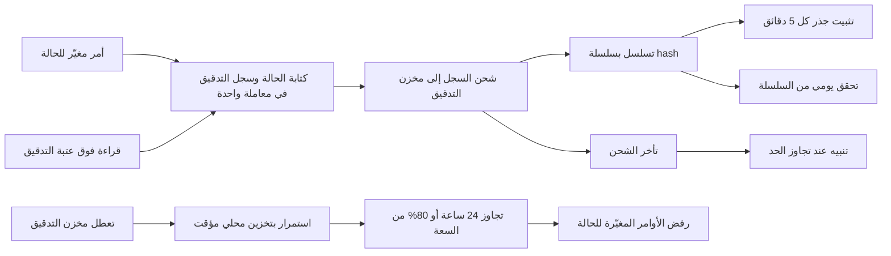

# التسجيل التلقائي للعمليات

<!-- BEGIN GENERATED: doc -->
| البند | القيمة |
|---|---|
| المعرّف | FEAT-GOV-AUDIT-CAPTURE |
| الإصدار | 0.2 |
| الحالة | مسودة |
| القدرة | CAP-13 الحوكمة والأمن والامتثال |
| القدرة الفرعية | CAP-13.02 التدقيق (R1) |
| الأدوار | النظام |
| الشاشات | — |
| حالات الاستخدام | UC-087 |
| القصص | 6: 0 من المواصفة، و6 جديدة |
<!-- END GENERATED: doc -->

## 1. نظرة عامة

### 1.1 القيمة

يضمن تسجيل كل تغيير وكل اطلاع على بيانات حساسة تلقائيًا مع الفاعل والغرض وقرار الوصول، دون أن يتمكن أحد من تعديل السجل أو حذفه.

### 1.2 النطاق

| البند | القيمة |
|---|---|
| المستخدمون | النظام نفسه عند كل أمر وقراءة؛ فريق التشغيل والأمن يتابع نتائج التحقق والتنبيهات |
| الشاشات | لا شاشات؛ قصص منصة وتشغيل بلا واجهة مستخدم |
| حالات الاستخدام | تغذية مراجعة سجل التدقيق (UC-087) بسجل كامل وسليم لكل عملية |
| المتطلبات | سجل تدقيق واحد مع كل أمر مغيّر للحالة وكل قراءة فوق عتبة التدقيق (REQ-FND-015)؛ سجل لا يقبل التعديل ويكشف العبث (REQ-FND-016) |
| خارج النطاق | البحث في السجل والتحقق منه من واجهة المدقق (ميزة «مراجعة سجل التدقيق»، `FEAT-GOV-AUDIT-TRAIL`) |

### 1.3 خريطة الميزة

**الشكل 1: التسجيل التلقائي للعمليات**



## 2. القواعد المشتركة

تنطبق على كل قصص الميزة، فلا تتكرر داخل القصص. وكل قصة تذكر ما يخصها فقط.

### 2.1 السياق المشترك

كل قصة تبدأ من ثلاثة شروط: مستأجر نشط، وحزمة السياسات الأساسية مفعّلة، ومستخدم مسجّل الدخول ومخوَّل. وتشير إليها القصص بخطوة واحدة: «بفرض السياق المشترك للميزة».

### 2.2 الصلاحية وعدم الإفصاح

- من لا يحق له رؤية العنصر يتلقى ردًا بشكل «غير متاح» تمامًا، فلا يعرف أنه موجود.
- من يرى العنصر ولا يحق له الإجراء يتلقى «لا تملك صلاحية هذا الإجراء».

### 2.3 أوامر تغيير الحالة

- **منع التكرار:** يُرسل كل أمر بمفتاح فريد، فإعادة الطلب نفسه لا تُنفَّذ مرتين.
- **حماية التعديل المتزامن:** يُرسل كل أمر بإصدار البيانات الذي يراه المستخدم. فإن عدّلها غيره في الأثناء، يُرفض الأمر.
- **السجل:** إن نجح الأمر، يُكتب حدثه وسجل التدقيق في المعاملة نفسها.

### 2.4 الرفض المشترك

```gherkin
# language: ar
خاصية: الرفض المشترك لأوامر الميزة

  سيناريو مخطط: رفض مشترك لكل أمر في الميزة
    بفرض السياق المشترك للميزة
    و <الحالة>
    عندما يُرسل المستخدم أي أمر من أوامر الميزة
    اذاً يُرفض برمز <الرمز> ويرى "<الرسالة>"
    و لا يتغير شيء

    امثلة:
      | الحالة                                  | الرمز                  | الرسالة                                                 |
      | العنصر خارج صلاحياته                    | NOT_FOUND              | غير متاح                                                |
      | العنصر مرئي له ولا يحق له الإجراء       | AUTHZ_DENIED           | لا تملك صلاحية هذا الإجراء                              |
      | غيره عدّل العنصر بعد أن فتحه            | VERSION_CONFLICT       | تغيّرت البيانات منذ فتحتها. راجع التغييرات ثم أعد المحاولة |
      | أعاد مفتاح منع التكرار بمحتوى مختلف     | IDEMPOTENCY_KEY_REUSED | طلب مكرر بمحتوى مختلف                                   |
      | البيانات ناقصة أو غير صحيحة             | VALIDATION_FAILED      | بعض البيانات ناقصة أو غير صحيحة. راجع الحقول المعلَّمة      |

  سيناريو: إعادة الطلب نفسه لا تُنفَّذ مرتين
    بفرض السياق المشترك للميزة
    و أمر نجح بمفتاح منع تكرار
    عندما يُعاد الطلب نفسه بالمفتاح نفسه
    اذاً تُعاد النتيجة الأولى ولا يُكتب حدث ثانٍ
```

## 3. الجودة وتعريف الاكتمال

### 3.1 متطلبات الجودة

<!-- BEGIN GENERATED: quality -->
| المرجع | الموقف | المطلوب |
|---|---|---|
| QAS-AUD-001 | executes a state-changing command | 100 % of commands audited with all fields |
| QAS-SEC-006 | modifies an audit record in storage | detected by next integrity check (≤ 24 h) |
<!-- END GENERATED: quality -->

### 3.2 تعريف الاكتمال

القصة مكتملة حين تتحقق الشروط الخمسة:

1. سيناريوهاتها والقواعد المشتركة تمر في الاختبار الآلي.
2. فحوص البنية المعمارية تمر.
3. نصوص الواجهة والرسائل موجودة بالعربية والإنجليزية.
4. مراجعة الكود مكتملة.
5. ما تضيفه القصة نفسها في قسم «القواعد» تحقق.

## 4. فهرس القصص

<!-- BEGIN GENERATED: story-index -->
| المعرّف | القصة | النوع | الحالة |
|---|---|---|---|
| `US-PLT-AUDIT-ATOMIC-WRITE` | سجل تدقيق واحد مع كل تغيير | منصة | مسودة |
| `US-PLT-AUDIT-BUFFER-FAILCLOSED` | الاستمرار عند تعطل مخزن التدقيق ثم الرفض | منصة | مسودة |
| `US-PLT-AUDIT-HASH-CHAIN` | سلسلة لا تقبل التعديل لسجلات التدقيق | منصة | مسودة |
| `US-PLT-AUDIT-SENSITIVE-READS` | تدقيق قراءة البيانات فوق عتبة المستأجر | منصة | مسودة |
| `US-OPS-AUDIT-DAILY-VERIFY` | تحقق يومي من سلاسل التدقيق واكتمالها | تشغيل | مسودة |
| `US-OPS-AUDIT-LAG-ALERT` | تنبيه عند تأخر شحن سجلات التدقيق | تشغيل | مسودة |
<!-- END GENERATED: story-index -->

## 5. القصص

### 5.1 US-PLT-AUDIT-ATOMIC-WRITE — سجل تدقيق واحد مع كل تغيير

| النوع | الإصدار | الأولوية | دون اتصال | الحالة |
|---|---|---|---|---|
| منصة | R1 | Must | لا ينطبق | مسودة |

> **كـ** فريق المنصة، **أريد** أن يُكتب سجل تدقيق واحد مع كل أمر مغيّر للحالة في المعاملة نفسها، **حتى** لا تنجح عملية دون أن يُعرف من فعلها ومتى وبأي قرار سياسة.

**باختصار:** كل أمر ناجح يكتب حالته الجديدة وسجل تدقيقه وبريده الصادر في معاملة واحدة لا تنجح جزئيًا، بالفاعل والإجراء والمورد والغرض وقرار السياسة والوقت ومعرف الارتباط.

#### معايير القبول

```gherkin
# language: ar
خاصية: سجل تدقيق واحد مع كل تغيير

  سيناريو: الأمر الناجح يكتب سجل تدقيق كاملًا
    بفرض السياق المشترك للميزة
    عندما ينجح أمر مغيّر للحالة
    اذاً يُكتب سجل تدقيق واحد في المعاملة نفسها بالفاعل والإجراء والمورد والغرض وقرار السياسة والوقت ومعرف الارتباط

  سيناريو: فشل كتابة السجل يسقط الأمر كله
    بفرض السياق المشترك للميزة
    عندما يتعذر كتابة سجل التدقيق أثناء معاملة الأمر
    اذاً لا تُحفظ الحالة الجديدة ولا بريد الحدث الصادر
    و لا يتغير شيء
```

<details><summary>المراجع التقنية والتتبع</summary>

<!-- BEGIN GENERATED: refs US-PLT-AUDIT-ATOMIC-WRITE -->
| البند | المعرّف | المعنى |
|---|---|---|
| الجودة | QAS-AUD-001 | executes a state-changing command → 100 % of commands audited with all fields |
| فحص البنية | FIT-04 | State change, audit record and outbox entry commit atomically |
| المتطلب | REQ-FND-015 | The system shall write an audit record for every state-changing command and for every read of data classified… |
| حالة الاستخدام | UC-087 | Review Audit Trail |
<!-- END GENERATED: refs US-PLT-AUDIT-ATOMIC-WRITE -->

</details>

### 5.2 US-PLT-AUDIT-BUFFER-FAILCLOSED — الاستمرار عند تعطل مخزن التدقيق ثم الرفض

| النوع | الإصدار | الأولوية | دون اتصال | الحالة |
|---|---|---|---|---|
| منصة | R1 | Should | لا ينطبق | مسودة |

> **كـ** فريق المنصة، **أريد** أن تستمر الأوامر عند تعطل مخزن التدقيق بتخزين مؤقت محلي، ثم تُرفض إن طال التعطل، **حتى** لا يُفقد سجل واحد ولا يستمر العمل دون تدقيق إلى الأبد.

**باختصار:** تعطل مخزن التدقيق لا يوقف الأوامر فورًا؛ بل تُخزَّن سجلاتها محليًا حتى يتجاوز التراكم 24 ساعة أو 80 % من سعته، فتُرفض الأوامر المغيّرة للحالة بعدها حتى يُستأنف الشحن.

#### معايير القبول

```gherkin
# language: ar
خاصية: الاستمرار عند تعطل مخزن التدقيق ثم الرفض

  سيناريو: تعطل قصير لا يوقف الأوامر
    بفرض أن مخزن التدقيق معطل منذ أقل من 24 ساعة وتراكمه دون 80 % من سعته
    عندما يُرسل أمر مغيّر للحالة
    اذاً ينجح الأمر ويُخزَّن سجل تدقيقه محليًا بانتظار الشحن

  سيناريو مخطط: تجاوز حد التراكم يرفض الأوامر
    بفرض <الحالة>
    عندما يُرسل أمر مغيّر للحالة
    اذاً يُرفض برمز AUDIT_UNAVAILABLE ويرى "تعذّر تسجيل العملية الآن، فلم تُنفَّذ"
    و لا يتغير شيء

    امثلة:
      | الحالة                                             |
      | تعطل مخزن التدقيق منذ أكثر من 24 ساعة              |
      | تراكم السجلات المحلية بلغ 80 % من سعتها أو أكثر    |

  سيناريو: استئناف الشحن يعيد قبول الأوامر
    بفرض أن مخزن التدقيق استأنف العمل وأُفرغ التراكم المحلي
    عندما يُرسل أمر مغيّر للحالة
    اذاً ينجح الأمر كالمعتاد
```

<details><summary>المراجع التقنية والتتبع</summary>

<!-- BEGIN GENERATED: refs US-PLT-AUDIT-BUFFER-FAILCLOSED -->
| البند | المعرّف | المعنى |
|---|---|---|
| المصدر | `17-security-design.md §7` | — |
| المصدر | `09-reliability/degradation-slc01.md §matrix` | — |
<!-- END GENERATED: refs US-PLT-AUDIT-BUFFER-FAILCLOSED -->

</details>

### 5.3 US-PLT-AUDIT-HASH-CHAIN — سلسلة لا تقبل التعديل لسجلات التدقيق

| النوع | الإصدار | الأولوية | دون اتصال | الحالة |
|---|---|---|---|---|
| منصة | R1 | Must | لا ينطبق | مسودة |

> **كـ** فريق المنصة، **أريد** أن تُسلسل سجلات التدقيق بسلسلة hash وتُثبَّت جذورها دوريًا، **حتى** يُكتشف أي تعديل أو حذف لسجل قديم فورًا عند أول تحقق.

**باختصار:** كل سجل تدقيق يحمل بصمة تربطه بالسجل السابق له في (المستأجر، الجزء) نفسه، ويُثبَّت جذر يجمعها كل 5 دقائق في مخزن لا يُكتب إلا مرة، فتغيير سجل قديم يكسر السلسلة.

#### معايير القبول

```gherkin
# language: ar
خاصية: سلسلة لا تقبل التعديل لسجلات التدقيق

  سيناريو: كل سجل جديد يرتبط بالسابق
    بفرض السياق المشترك للميزة
    عندما يُكتب سجل تدقيق جديد لمستأجر وجزء معينين
    اذاً يحمل بصمة تشمل بصمة السجل السابق له في نفس المستأجر والجزء

  سيناريو: تثبيت الجذر الدوري
    بفرض سجلات تدقيق كُتبت خلال خمس دقائق
    عندما يحين وقت التثبيت
    اذاً يُحسب جذر يجمعها ويُحفظ في مخزن لا يُكتب إلا مرة
```

<details><summary>المراجع التقنية والتتبع</summary>

<!-- BEGIN GENERATED: refs US-PLT-AUDIT-HASH-CHAIN -->
| البند | المعرّف | المعنى |
|---|---|---|
| المصدر | `17-security-design.md §7` | — |
| المتطلب | REQ-FND-016 | The system shall keep audit records append-only and tamper-evident. |
| حالة الاستخدام | UC-087 | Review Audit Trail |
<!-- END GENERATED: refs US-PLT-AUDIT-HASH-CHAIN -->

</details>

### 5.4 US-PLT-AUDIT-SENSITIVE-READS — تدقيق قراءة البيانات فوق عتبة المستأجر

| النوع | الإصدار | الأولوية | دون اتصال | الحالة |
|---|---|---|---|---|
| منصة | R1 | Must | لا ينطبق | مسودة |

> **كـ** فريق المنصة، **أريد** أن تُدقَّق قراءة أي بيانات تصنيفها عند عتبة تدقيق المستأجر أو أعلى منها، **حتى** يُعرف من اطّلع على البيانات الحساسة حتى دون أن يغيّرها.

**باختصار:** كل قراءة لبيانات تصنيفها عند عتبة تدقيق القراءة التي حددها المستأجر أو أعلى منها تكتب سجل تدقيق كأي أمر مغيّر للحالة، بالفاعل والمورد والغرض وقرار السياسة.

#### معايير القبول

```gherkin
# language: ar
خاصية: تدقيق قراءة البيانات فوق عتبة المستأجر

  سيناريو: قراءة فوق العتبة تُدقَّق
    بفرض السياق المشترك للميزة
    و عنصر تصنيفه عند عتبة تدقيق القراءة لدى المستأجر أو أعلى منها
    عندما يقرأه مستخدم مخوَّل
    اذاً يُكتب سجل تدقيق بالفاعل والمورد والغرض وقرار السياسة

  سيناريو: قراءة دون العتبة لا تُدقَّق
    بفرض السياق المشترك للميزة
    و عنصر تصنيفه دون عتبة تدقيق القراءة
    عندما يقرأه مستخدم مخوَّل
    اذاً لا يُكتب سجل تدقيق لهذه القراءة
```

<details><summary>المراجع التقنية والتتبع</summary>

<!-- BEGIN GENERATED: refs US-PLT-AUDIT-SENSITIVE-READS -->
| البند | المعرّف | المعنى |
|---|---|---|
| المصدر | `17-security-design.md §4` | — |
| المصدر | `17-security-design.md §7` | — |
| المتطلب | REQ-FND-015 | The system shall write an audit record for every state-changing command and for every read of data classified… |
| حالة الاستخدام | UC-087 | Review Audit Trail |
<!-- END GENERATED: refs US-PLT-AUDIT-SENSITIVE-READS -->

</details>

### 5.5 US-OPS-AUDIT-DAILY-VERIFY — تحقق يومي من سلاسل التدقيق واكتمالها

| النوع | الإصدار | الأولوية | دون اتصال | الحالة |
|---|---|---|---|---|
| تشغيل | R1 | Must | لا ينطبق | مسودة |

> **كـ** فريق التشغيل أو الأمن، **أريد** تحققًا يوميًا تلقائيًا من سلامة سلسلة التدقيق واكتمال شحنها، **حتى** يُكتشف أي عبث أو فجوة شحن خلال يوم واحد على الأكثر.

**باختصار:** مهمة مجدولة تعيد حساب سلاسل التسلسل يوميًا، وتقارن عدادات السجلات المشحونة بالمكتوبة، فتكتشف العبث أو فجوات الشحن دون انتظار بحث المدقق.

#### القواعد

- **متى يحدث:** يوميًا بجدول ثابت، إضافة إلى تحقق يبدؤه المدقق عند الطلب (القصة 5.2 في ميزة «مراجعة سجل التدقيق»).
- **الأثر:** عند العبث أو الفجوة، تُفتح حادثة حرجة (القصة 5.7 في ميزة «مراجعة سجل التدقيق»)، وتُحدَّث حالة آخر تحقق بالنتيجة.

#### معايير القبول

```gherkin
# language: ar
خاصية: تحقق يومي من سلاسل التدقيق واكتمالها

  سيناريو: التحقق اليومي سليم
    بفرض أن اليوم السابق لم تُكتب فيه سجلات معدَّلة أو محذوفة
    عندما يحين وقت التحقق اليومي
    اذاً تُحسب السلاسل من جديد وتطابق المحفوظة
    و يُسجَّل التحقق بنتيجة "سليم"

  سيناريو: التحقق اليومي يكشف فجوة شحن
    بفرض أن عداد السجلات المشحونة أقل من عداد السجلات المكتوبة
    عندما يحين وقت التحقق اليومي
    اذاً يُسجَّل التحقق بنتيجة "فجوة شحن" مع عدد السجلات الناقصة
```

<details><summary>المراجع التقنية والتتبع</summary>

<!-- BEGIN GENERATED: refs US-OPS-AUDIT-DAILY-VERIFY -->
| البند | المعرّف | المعنى |
|---|---|---|
| الجودة | QAS-SEC-006 | modifies an audit record in storage → detected by next integrity check (≤ 24 h) |
| المصدر | `17-security-design.md §6.1` | — |
| المتطلب | REQ-FND-016 | The system shall keep audit records append-only and tamper-evident. |
| حالة الاستخدام | UC-087 | Review Audit Trail |
<!-- END GENERATED: refs US-OPS-AUDIT-DAILY-VERIFY -->

</details>

### 5.6 US-OPS-AUDIT-LAG-ALERT — تنبيه عند تأخر شحن سجلات التدقيق

| النوع | الإصدار | الأولوية | دون اتصال | الحالة |
|---|---|---|---|---|
| تشغيل | R1 | Should | لا ينطبق | مسودة |

> **كـ** فريق التشغيل أو الأمن، **أريد** تنبيهًا فوريًا إذا تأخر شحن سجلات التدقيق عن حده المعتاد، **حتى** أتدخل قبل أن يقترب التراكم من حد رفض الأوامر.

**باختصار:** تأخر الشحن عن 5 ثوانٍ عند المئين 95 ينبّه، وتجاوزه 60 ثانية يستدعي الفريق فورًا، قبل الوصول إلى حد 24 ساعة الذي يرفض الأوامر.

#### القواعد

- **متى يحدث:** عند تجاوز تأخر الشحن 5 ثوانٍ (المئين 95)، وعند تجاوزه 60 ثانية.
- **الأثر:** تنبيه عادي عند 5 ثوانٍ؛ استدعاء فوري للفريق عند 60 ثانية.

#### معايير القبول

```gherkin
# language: ar
خاصية: تنبيه عند تأخر شحن سجلات التدقيق

  سيناريو: تأخر يتجاوز الحد المعتاد
    بفرض أن تأخر شحن السجلات عند المئين 95 دون 5 ثوانٍ
    عندما يتجاوز تأخر الشحن 5 ثوانٍ
    اذاً يُرسَل تنبيه إلى فريق التشغيل

  سيناريو: تأخر حرج يستدعي الفريق فورًا
    بفرض أن تأخر الشحن تجاوز 5 ثوانٍ
    عندما يتجاوز تأخر الشحن 60 ثانية
    اذاً يُستدعى فريق التشغيل أو الأمن فورًا

  سيناريو: لا تنبيه ضمن الحد الطبيعي
    بفرض أن تأخر الشحن أقل من 5 ثوانٍ
    عندما يُفحص التأخر دوريًا
    اذاً لا يُرسَل أي تنبيه
```

<details><summary>المراجع التقنية والتتبع</summary>

<!-- BEGIN GENERATED: refs US-OPS-AUDIT-LAG-ALERT -->
| البند | المعرّف | المعنى |
|---|---|---|
| المصدر | `09-reliability/observability-slc01.md §signals` | — |
<!-- END GENERATED: refs US-OPS-AUDIT-LAG-ALERT -->

</details>

## 6. التتبع

<!-- BEGIN GENERATED: trace -->
| المتطلب | المعنى | القصص | الاختبار |
|---|---|---|---|
| REQ-FND-015 | The system shall write an audit record for every state-changing command and for every read of data classified… | `US-PLT-AUDIT-ATOMIC-WRITE`، `US-PLT-AUDIT-SENSITIVE-READS` | TST-SLC01-INVARIANTS |
| REQ-FND-016 | The system shall keep audit records append-only and tamper-evident. | `US-OPS-AUDIT-DAILY-VERIFY`، `US-PLT-AUDIT-HASH-CHAIN` | TST-SLC01-INVARIANTS |
<!-- END GENERATED: trace -->

## 7. سجل التغييرات

| الإصدار | التاريخ | التغيير |
|---|---|---|
| 0.1 | — | هيكل مولَّد من خريطة الميزات |
| 0.2 | 2026-10-13 | كتابة القصص كاملة بمعيار القصص |
