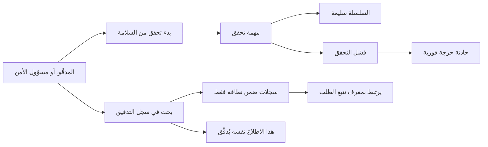

# مراجعة سجل التدقيق

<!-- BEGIN GENERATED: doc -->
| البند | القيمة |
|---|---|
| المعرّف | FEAT-GOV-AUDIT-TRAIL |
| الإصدار | 0.2 |
| الحالة | مسودة |
| القدرة | CAP-13 الحوكمة والأمن والامتثال |
| القدرة الفرعية | CAP-13.02 التدقيق (R1) |
| الأدوار | المدقِّق؛ مسؤول الأمن |
| الشاشات | SCR-69 التدقيق |
| حالات الاستخدام | UC-087 |
| القصص | 7: 2 من المواصفة، و5 جديدة |
<!-- END GENERATED: doc -->

## 1. نظرة عامة

### 1.1 القيمة

يتيح للمدقق ومسؤول الأمن البحث في سجل من فعل ماذا ومتى ولماذا والتحقق من أن السجل لم يُعبث به.

### 1.2 النطاق

| البند | القيمة |
|---|---|
| المستخدمون | المدقِّق؛ مسؤول الأمن |
| الشاشات | SCR-69 التدقيق |
| حالات الاستخدام | مراجعة سجل التدقيق (UC-087): البحث في من فعل ماذا ومتى ولماذا، والتحقق من أن السجل لم يُعبث به |
| المتطلبات | كتابة سجل تدقيق لكل أمر وكل قراءة حساسة (REQ-FND-015)؛ سجل لا يقبل التعديل ويكشف العبث (REQ-FND-016)؛ تتبع الطلب بمعرف ارتباط واحد عبر كل مكوناته (REQ-PLT-003) |
| خارج النطاق | كتابة سجل التدقيق نفسها عند كل أمر (ميزة «التسجيل التلقائي للعمليات»، `FEAT-GOV-AUDIT-CAPTURE`)؛ عرض سياق طلبات الذكاء الاصطناعي (استعلام منفصل في ميزة أخرى) |

### 1.3 خريطة الميزة

**الشكل 1: مراجعة سجل التدقيق**



## 2. القواعد المشتركة

تنطبق على كل قصص الميزة، فلا تتكرر داخل القصص. وكل قصة تذكر ما يخصها فقط.

### 2.1 السياق المشترك

كل قصة تبدأ من ثلاثة شروط: مستأجر نشط، وحزمة السياسات الأساسية مفعّلة، ومستخدم مسجّل الدخول ومخوَّل. وتشير إليها القصص بخطوة واحدة: «بفرض السياق المشترك للميزة».

### 2.2 الصلاحية وعدم الإفصاح

- من لا يحق له رؤية العنصر يتلقى ردًا بشكل «غير متاح» تمامًا، فلا يعرف أنه موجود.
- من يرى العنصر ولا يحق له الإجراء يتلقى «لا تملك صلاحية هذا الإجراء».

### 2.3 أوامر تغيير الحالة

- **منع التكرار:** يُرسل كل أمر بمفتاح فريد، فإعادة الطلب نفسه لا تُنفَّذ مرتين.
- **حماية التعديل المتزامن:** يُرسل كل أمر بإصدار البيانات الذي يراه المستخدم. فإن عدّلها غيره في الأثناء، يُرفض الأمر.
- **السجل:** إن نجح الأمر، يُكتب حدثه وسجل التدقيق في المعاملة نفسها.

### 2.4 الرفض المشترك

```gherkin
# language: ar
خاصية: الرفض المشترك لأوامر الميزة

  سيناريو مخطط: رفض مشترك لكل أمر في الميزة
    بفرض السياق المشترك للميزة
    و <الحالة>
    عندما يُرسل المستخدم أي أمر من أوامر الميزة
    اذاً يُرفض برمز <الرمز> ويرى "<الرسالة>"
    و لا يتغير شيء

    امثلة:
      | الحالة                                  | الرمز                  | الرسالة                                                 |
      | العنصر خارج صلاحياته                    | NOT_FOUND              | غير متاح                                                |
      | العنصر مرئي له ولا يحق له الإجراء       | AUTHZ_DENIED           | لا تملك صلاحية هذا الإجراء                              |
      | غيره عدّل العنصر بعد أن فتحه            | VERSION_CONFLICT       | تغيّرت البيانات منذ فتحتها. راجع التغييرات ثم أعد المحاولة |
      | أعاد مفتاح منع التكرار بمحتوى مختلف     | IDEMPOTENCY_KEY_REUSED | طلب مكرر بمحتوى مختلف                                   |
      | البيانات ناقصة أو غير صحيحة             | VALIDATION_FAILED      | بعض البيانات ناقصة أو غير صحيحة. راجع الحقول المعلَّمة      |

  سيناريو: إعادة الطلب نفسه لا تُنفَّذ مرتين
    بفرض السياق المشترك للميزة
    و أمر نجح بمفتاح منع تكرار
    عندما يُعاد الطلب نفسه بالمفتاح نفسه
    اذاً تُعاد النتيجة الأولى ولا يُكتب حدث ثانٍ
```

## 3. الجودة وتعريف الاكتمال

### 3.1 متطلبات الجودة

<!-- BEGIN GENERATED: quality -->
| المرجع | الموقف | المطلوب |
|---|---|---|
| QAS-AUD-001 | executes a state-changing command | 100 % of commands audited with all fields |
| QAS-OBS-001 | investigates a failed request | 100 % of requests traceable end to end |
| QAS-SEC-006 | modifies an audit record in storage | detected by next integrity check (≤ 24 h) |
<!-- END GENERATED: quality -->

### 3.2 تعريف الاكتمال

القصة مكتملة حين تتحقق الشروط الخمسة:

1. سيناريوهاتها والقواعد المشتركة تمر في الاختبار الآلي.
2. فحوص البنية المعمارية تمر.
3. نصوص الواجهة والرسائل موجودة بالعربية والإنجليزية.
4. مراجعة الكود مكتملة.
5. ما تضيفه القصة نفسها في قسم «القواعد» تحقق.

## 4. فهرس القصص

<!-- BEGIN GENERATED: story-index -->
| المعرّف | القصة | النوع | الحالة |
|---|---|---|---|
| `US-BC08-Q-AUD-SEARCH` | جلب: Audit records by actor, resource, time, correlation id | جلب | مسودة |
| `US-BC08-Q-AUD-VERIFY` | جلب: Start integrity verification job; returns job ref | جلب | مسودة |
| `US-UI-SCR69-AUDIT-SEARCH` | البحث في سجل التدقيق بمرشحات متعددة | واجهة | مسودة |
| `US-UI-SCR69-INTEGRITY-RESULT` | عرض نتيجة التحقق من سلامة السجل | واجهة | مسودة |
| `US-PLT-AUDIT-SEARCH-SELF-AUDIT` | تدقيق كل اطلاع على سجل التدقيق | منصة | مسودة |
| `US-PLT-AUDIT-TRACE-LINK` | ربط سجل التدقيق بتتبع الطلب | منصة | مسودة |
| `US-OPS-AUDIT-CHAIN-INCIDENT` | معالجة فشل سلامة السجل حادثًا حرجًا | تشغيل | مسودة |
<!-- END GENERATED: story-index -->

## 5. القصص

### 5.1 US-BC08-Q-AUD-SEARCH — جلب: Audit records by actor, resource, time, correlation id

| النوع | الإصدار | الأولوية | دون اتصال | الحالة |
|---|---|---|---|---|
| جلب | R1 | Must | لا | مسودة |

> **كـ** المدقِّق أو مسؤول الأمن، **أريد** أن أبحث في سجل التدقيق بالفاعل والمورد والفترة الزمنية ومعرف الارتباط، **حتى** أعرف من فعل ماذا ومتى ولماذا وبأي قرار.

**باختصار:** يعيد البحث سجلات التدقيق التي تقع ضمن نطاق المستخدم فقط، صفحة بعد صفحة بمؤشر، ولا يكشف عدد أو وجود سجلات محجوبة عنه. وهذا الاطلاع نفسه يُسجَّل في سجل التدقيق (القصة 5.5).

#### القواعد

- **من يُسمح له:** المدقِّق ومسؤول الأمن، كل حسب نطاق مؤسسته وقاعدة التصنيف؛ ولا يرى أحد سجلًا خارج نطاقه.
- **البيانات:** المرشحات: الفاعل، المورد، الفترة الزمنية، معرف الارتباط؛ والترقيم بمؤشر لا بالإزاحة.

#### معايير القبول

```gherkin
# language: ar
خاصية: البحث في سجل التدقيق

  سيناريو: يرى المستخدم سجلات نطاقه فقط
    بفرض السياق المشترك للميزة
    و سجلات تدقيق داخل نطاقه وأخرى خارجه
    عندما يبحث بالفاعل أو المورد أو الفترة أو معرف الارتباط
    اذاً تُعاد السجلات داخل نطاقه فقط
    و لا يكشف أي عدد أو اقتراح وجود سجل محجوب

  سيناريو: الصفحة التالية بالمؤشر
    بفرض السياق المشترك للميزة
    و نتائج بحثه أكثر من صفحة
    عندما يطلب الصفحة التالية بالمؤشر
    اذاً تُعاد السجلات التالية دون تكرار ولا فجوة
```

<details><summary>المراجع التقنية والتتبع</summary>

<!-- BEGIN GENERATED: refs US-BC08-Q-AUD-SEARCH -->
| البند | المعرّف | المعنى |
|---|---|---|
| الواجهة البرمجية | `GET /api/v1/governance/audit-records` | — |
| الاستعلام | `QRY-AUD-SEARCH` | Audit records by actor, resource, time, correlation id |
| السياسة | `POL-AUD-SEARCH` | org scope of subject roles ∩ classification rule |
| المتطلب | REQ-FND-015 | The system shall write an audit record for every state-changing command and for every read of data classified… |
| حالة الاستخدام | UC-087 | Review Audit Trail |
<!-- END GENERATED: refs US-BC08-Q-AUD-SEARCH -->

</details>

### 5.2 US-BC08-Q-AUD-VERIFY — جلب: Start integrity verification job; returns job ref

| النوع | الإصدار | الأولوية | دون اتصال | الحالة |
|---|---|---|---|---|
| جلب | R1 | Must | لا | مسودة |

> **كـ** المدقِّق، **أريد** أن أبدأ تحققًا من سلامة سجل التدقيق، **حتى** أتأكد أن أحدًا لم يعدّل السجل أو يحذف منه شيئًا.

**باختصار:** يبدأ المدقق مهمة تحقق من سلسلة التدقيق ويحصل على مرجعها، ليتابع نتيجتها في الشاشة (القصة 5.4).

#### القواعد

- **من يُسمح له:** المدقِّق فقط، ضمن نطاق مؤسسته.
- **البيانات:** لا مدخلات سوى معاملات المسار؛ المخرج مرجع مهمة التحقق.

#### معايير القبول

```gherkin
# language: ar
خاصية: بدء تحقق من سلامة سجل التدقيق

  سيناريو: بدء تحقق جديد
    بفرض السياق المشترك للميزة
    عندما يطلب المدقق تحقق سلامة السجل
    اذاً تبدأ مهمة تحقق ويُعاد مرجعها
    و لا تكشف نتيجتها عند اكتمالها أي سجل خارج نطاقه
```

<details><summary>المراجع التقنية والتتبع</summary>

<!-- BEGIN GENERATED: refs US-BC08-Q-AUD-VERIFY -->
| البند | المعرّف | المعنى |
|---|---|---|
| الواجهة البرمجية | `POST /api/v1/governance/audit-integrity-checks` | — |
| الاستعلام | `QRY-AUD-VERIFY` | Start integrity verification job; returns job ref |
| السياسة | `POL-AUD-VERIFY` | org scope of subject roles ∩ classification rule |
| المتطلب | REQ-FND-016 | The system shall keep audit records append-only and tamper-evident. |
| حالة الاستخدام | UC-087 | Review Audit Trail |
<!-- END GENERATED: refs US-BC08-Q-AUD-VERIFY -->

</details>

### 5.3 US-UI-SCR69-AUDIT-SEARCH — البحث في سجل التدقيق بمرشحات متعددة

| النوع | الإصدار | الأولوية | دون اتصال | الحالة |
|---|---|---|---|---|
| واجهة | R1 | Must | لا | مسودة |

> **كـ** المستخدم (المدقِّق أو مسؤول الأمن)، **أريد** شاشة بحث واحدة بمرشحات متعددة، **حتى** أصل لما أبحث عنه دون تنقل بين شاشات.

**باختصار:** تجمع شاشة التدقيق مرشحات الفاعل والمورد والفترة ومعرف الارتباط في نموذج واحد، وتعرض النتائج دون كشف وجود سجل محجوب. **[Derived]** لغياب تصميم تفصيلي للشاشة في المصدر.

#### معايير القبول

```gherkin
# language: ar
خاصية: البحث في سجل التدقيق بمرشحات متعددة

  سيناريو: تضييق البحث بأكثر من مرشح معًا
    بفرض السياق المشترك للميزة
    و المستخدم فتح شاشة التدقيق
    عندما يحدد الفاعل والفترة معًا ويبحث
    اذاً تُعرض فقط السجلات المطابقة للمرشحين معًا

  سيناريو: لا نتائج مطابقة
    بفرض السياق المشترك للميزة
    عندما لا تطابق أي سجلات المرشحات المحددة
    اذاً تظهر رسالة بلا نتائج دون أي إشارة إلى سبب الحجب
```

<details><summary>المراجع التقنية والتتبع</summary>

<!-- BEGIN GENERATED: refs US-UI-SCR69-AUDIT-SEARCH -->
| البند | المعرّف | المعنى |
|---|---|---|
| حالة الاستخدام | UC-087 | Review Audit Trail |
| الشاشة | SCR-69 | شاشة التدقيق |
| المصدر | `[Derived]` | — |
| المتطلب | REQ-FND-015 | The system shall write an audit record for every state-changing command and for every read of data classified… |
| حالة الاستخدام | UC-087 | Review Audit Trail |
<!-- END GENERATED: refs US-UI-SCR69-AUDIT-SEARCH -->

</details>

### 5.4 US-UI-SCR69-INTEGRITY-RESULT — عرض نتيجة التحقق من سلامة السجل

| النوع | الإصدار | الأولوية | دون اتصال | الحالة |
|---|---|---|---|---|
| واجهة | R1 | Must | لا | مسودة |

> **كـ** المدقِّق، **أريد** أن أرى نتيجة فحص سلامة السجل بوضوح: سليم أو فيه عبث، **حتى** أتصرف فورًا إن وُجد خلل.

**باختصار:** تعرض الشاشة حالة مهمة التحقق (جارية أو سليمة أو فاشلة)، وإن فشلت تعرض موضع السجل المتأثر. **[Derived]** لغياب تصميم تفصيلي للشاشة في المصدر.

#### معايير القبول

```gherkin
# language: ar
خاصية: عرض نتيجة التحقق من سلامة السجل

  سيناريو: التحقق سليم
    بفرض السياق المشترك للميزة
    و مهمة تحقق اكتملت بلا عبث
    عندما يفتح المدقق نتيجتها
    اذاً تظهر الحالة "سليم"

  سيناريو: التحقق يكشف عبثًا
    بفرض السياق المشترك للميزة
    و مهمة تحقق اكتملت وكشفت عبثًا في السلسلة
    عندما يفتح المدقق نتيجتها
    اذاً تظهر الحالة "فشل" مع موضع السجل المتأثر
```

<details><summary>المراجع التقنية والتتبع</summary>

<!-- BEGIN GENERATED: refs US-UI-SCR69-INTEGRITY-RESULT -->
| البند | المعرّف | المعنى |
|---|---|---|
| حالة الاستخدام | UC-087 | Review Audit Trail |
| الشاشة | SCR-69 | شاشة التدقيق |
| المصدر | `[Derived]` | — |
| المتطلب | REQ-FND-016 | The system shall keep audit records append-only and tamper-evident. |
| حالة الاستخدام | UC-087 | Review Audit Trail |
<!-- END GENERATED: refs US-UI-SCR69-INTEGRITY-RESULT -->

</details>

### 5.5 US-PLT-AUDIT-SEARCH-SELF-AUDIT — تدقيق كل اطلاع على سجل التدقيق

| النوع | الإصدار | الأولوية | دون اتصال | الحالة |
|---|---|---|---|---|
| منصة | R1 | Must | لا ينطبق | مسودة |

> **كـ** فريق المنصة، **أريد** أن يُسجَّل كل اطلاع على سجل التدقيق نفسه كسجل تدقيق، **حتى** يُحاسَب من يطّلع على من فعل ماذا كما يُحاسَب غيره.

**باختصار:** كل بحث أو تحقق في سجل التدقيق يكتب سجل تدقيق خاصًا به، بهوية من بحث والمرشحات المستخدمة والوقت، فلا يطّلع أحد على السجل دون أثر.

#### معايير القبول

```gherkin
# language: ar
خاصية: تدقيق الاطلاع على سجل التدقيق

  سيناريو: البحث في السجل يُسجَّل بدوره
    بفرض السياق المشترك للميزة
    عندما يبحث المدقق أو مسؤول الأمن في سجل التدقيق
    اذاً يُكتب سجل تدقيق بهوية من بحث والمرشحات المستخدمة والوقت
```

<details><summary>المراجع التقنية والتتبع</summary>

<!-- BEGIN GENERATED: refs US-PLT-AUDIT-SEARCH-SELF-AUDIT -->
| البند | المعرّف | المعنى |
|---|---|---|
| المصدر | `17-security-design.md §7` | — |
| المتطلب | REQ-FND-015 | The system shall write an audit record for every state-changing command and for every read of data classified… |
| حالة الاستخدام | UC-087 | Review Audit Trail |
<!-- END GENERATED: refs US-PLT-AUDIT-SEARCH-SELF-AUDIT -->

</details>

### 5.6 US-PLT-AUDIT-TRACE-LINK — ربط سجل التدقيق بتتبع الطلب

| النوع | الإصدار | الأولوية | دون اتصال | الحالة |
|---|---|---|---|---|
| منصة | R1 | Must | لا ينطبق | مسودة |

> **كـ** فريق المنصة، **أريد** أن يحمل كل سجل تدقيق معرف ارتباط الطلب نفسه، **حتى** يربط المدقق بين السجل وبين أثر الطلب الكامل عبر كل المكونات عند التحقيق.

**باختصار:** يحمل سجل التدقيق معرف الارتباط المرسل مع الطلب، فيتتبع المدقق مسار الطلب من البوابة إلى قاعدة البيانات. **[Derived]** لغياب تفصيل آلية الربط في واجهة البحث صريحًا.

#### معايير القبول

```gherkin
# language: ar
خاصية: ربط سجل التدقيق بتتبع الطلب

  سيناريو: البحث بمعرف الارتباط يعيد كل أثر الطلب
    بفرض السياق المشترك للميزة
    و طلب وُسم بمعرف ارتباط حمله عبر كل مكوناته
    عندما يبحث المدقق بمعرف الارتباط هذا
    اذاً تُعاد كل السجلات التي حملته، مرتبة بالوقت
```

<details><summary>المراجع التقنية والتتبع</summary>

<!-- BEGIN GENERATED: refs US-PLT-AUDIT-TRACE-LINK -->
| البند | المعرّف | المعنى |
|---|---|---|
| الجودة | QAS-OBS-001 | investigates a failed request → 100 % of requests traceable end to end |
| المصدر | `[Derived]` | — |
| المتطلبات | REQ-FND-015، REQ-PLT-003 | معانيها في القسم 6. التتبع |
| حالة الاستخدام | UC-087 | Review Audit Trail |
<!-- END GENERATED: refs US-PLT-AUDIT-TRACE-LINK -->

</details>

### 5.7 US-OPS-AUDIT-CHAIN-INCIDENT — معالجة فشل سلامة السجل حادثًا حرجًا

| النوع | الإصدار | الأولوية | دون اتصال | الحالة |
|---|---|---|---|---|
| تشغيل | R1 | Should | لا ينطبق | مسودة |

> **كـ** فريق التشغيل أو الأمن، **أريد** أن يُفتح حادث حرج فورًا إذا فشل التحقق من سلسلة التدقيق، **حتى** يُحقَّق في العبث قبل أن يتراكم أثره.

**باختصار:** فشل أي تحقق من سلامة سلسلة التدقيق يفتح حادثة بأعلى درجة خطورة ويستدعي فريق الأمن فورًا.

#### القواعد

- **متى يحدث:** عند أي نتيجة فشل في مهمة التحقق من سلسلة التدقيق، سواء اليومية (القصة 5.5 في ميزة «التسجيل التلقائي للعمليات») أو تحقق يبدؤه المدقق (القصة 5.2).
- **الأثر:** تُفتح حادثة بأعلى درجة خطورة تلقائيًا، ويُستدعى فريق الأمن فورًا، ويُسجَّل السجل المتأثر.

#### معايير القبول

```gherkin
# language: ar
خاصية: معالجة فشل سلامة السجل حادثًا حرجًا

  سيناريو: فشل التحقق يفتح حادثة حرجة
    بفرض مهمة تحقق من سلسلة التدقيق قيد التنفيذ
    عندما تكتمل المهمة وتكشف عبثًا في السلسلة
    اذاً تُفتح حادثة بأعلى درجة خطورة
    و يُستدعى فريق الأمن فورًا

  سيناريو: التحقق السليم لا يفتح حادثة
    بفرض مهمة تحقق من سلسلة التدقيق قيد التنفيذ
    عندما تكتمل المهمة دون عبث
    اذاً لا تُفتح أي حادثة
```

<details><summary>المراجع التقنية والتتبع</summary>

<!-- BEGIN GENERATED: refs US-OPS-AUDIT-CHAIN-INCIDENT -->
| البند | المعرّف | المعنى |
|---|---|---|
| المصدر | `09-reliability/observability-slc01.md §signals` | — |
| المصدر | `23-crosscutting.md §7` | — |
<!-- END GENERATED: refs US-OPS-AUDIT-CHAIN-INCIDENT -->

</details>

## 6. التتبع

<!-- BEGIN GENERATED: trace -->
| المتطلب | المعنى | القصص | الاختبار |
|---|---|---|---|
| REQ-FND-015 | The system shall write an audit record for every state-changing command and for every read of data classified… | `US-BC08-Q-AUD-SEARCH`، `US-PLT-AUDIT-SEARCH-SELF-AUDIT`، `US-PLT-AUDIT-TRACE-LINK`، `US-UI-SCR69-AUDIT-SEARCH` | TST-SLC01-INVARIANTS |
| REQ-FND-016 | The system shall keep audit records append-only and tamper-evident. | `US-BC08-Q-AUD-VERIFY`، `US-UI-SCR69-INTEGRITY-RESULT` | TST-SLC01-INVARIANTS |
| REQ-PLT-003 | The system shall emit metrics, logs and traces carrying a correlation id across every component, plus busines… | `US-PLT-AUDIT-TRACE-LINK` | — |
<!-- END GENERATED: trace -->

## 7. سجل التغييرات

| الإصدار | التاريخ | التغيير |
|---|---|---|
| 0.1 | — | هيكل مولَّد من خريطة الميزات |
| 0.2 | 2026-10-13 | كتابة القصص كاملة بمعيار القصص |
