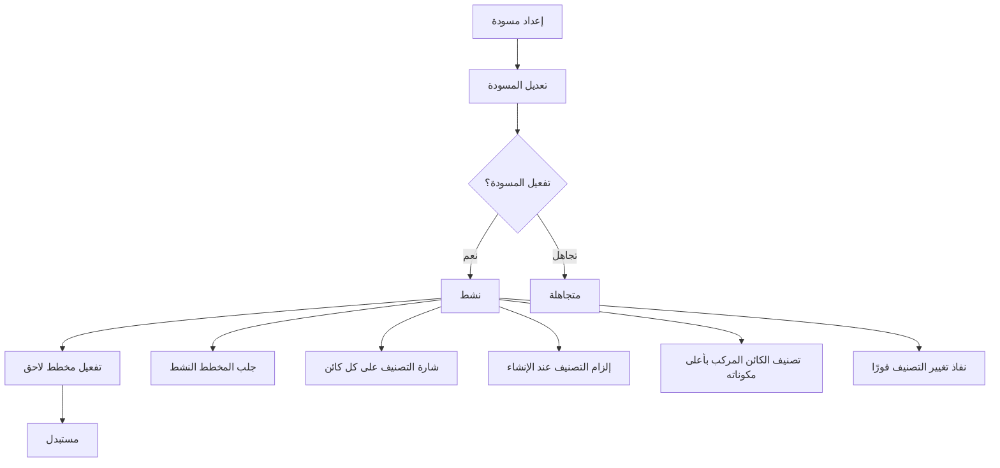
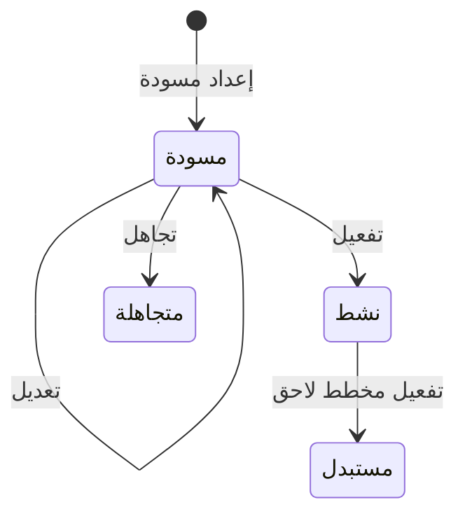

# مخطط التصنيف الأمني

<!-- BEGIN GENERATED: doc -->
| البند | القيمة |
|---|---|
| المعرّف | FEAT-GOV-CLASSIFICATION |
| الإصدار | 0.1 |
| الحالة | مسودة |
| القدرة | CAP-13 الحوكمة والأمن والامتثال |
| القدرة الفرعية | CAP-13.01 التصنيف والسياسات (R1) |
| الأدوار | مسؤول الأمن؛ أي مستخدم مخوَّل؛ النظام |
| الشاشات | SCR-67 التصنيف والتصاريح والاستثناءات |
| حالات الاستخدام | UC-085 |
| القصص | 11: 6 من المواصفة، و5 جديدة |
<!-- END GENERATED: doc -->

## 1. نظرة عامة

### 1.1 القيمة

يتيح لمسؤول الأمن تحديد مستويات السرية والحجرات وقيود الإفراج الخاصة بالمستأجر واعتمادها، ويعرضها لكل مستخدم.

### 1.2 النطاق

| البند | القيمة |
|---|---|
| المستخدمون | مسؤول الأمن؛ أي مستخدم مخوَّل يقرأ المخطط النشط؛ النظام |
| الشاشات | SCR-67 التصنيف والتصاريح والاستثناءات |
| حالات الاستخدام | إعداد مسودة مخطط التصنيف وتعديلها وتفعيلها أو تجاهلها؛ عرض المخطط النشط؛ تصنيف الكائنات وعرض شارتها عليها |
| المتطلبات | مخطط تصنيف لكل مستأجر بمستويات مرتبة وأقسام بلا حد وتحفظات إفراج (REQ-GOV-001)؛ إلزام التصنيف على كائنات الأهمية الأولى والثانية (REQ-GOV-002)؛ نفاذ تغيير التصنيف فورًا في كل مسارات القراءة (REQ-GOV-004)؛ توثيق كل تغيير سياسة بتاريخ نفاذه (REQ-GOV-009) |
| خارج النطاق | منح التصريح الأمني لمستخدم بعينه وتعليقه وسحبه (ميزة التصاريح الأمنية)؛ الاستثناءات الأمنية المؤقتة |

### 1.3 خريطة الميزة

**الشكل 1: دورة مخطط التصنيف وأثره على الكائنات**



**الشكل 2: حالات مخطط التصنيف**



## 2. القواعد المشتركة

تنطبق على كل قصص الميزة، فلا تتكرر داخل القصص. وكل قصة تذكر ما يخصها فقط.

### 2.1 السياق المشترك

كل قصة تبدأ من ثلاثة شروط: مستأجر نشط، وحزمة السياسات الأساسية مفعّلة، ومستخدم مسجّل الدخول ومخوَّل. وتشير إليها القصص بخطوة واحدة: «بفرض السياق المشترك للميزة».

### 2.2 الصلاحية وعدم الإفصاح

- من لا يحق له رؤية العنصر يتلقى ردًا بشكل «غير متاح» تمامًا، فلا يعرف أنه موجود.
- من يرى العنصر ولا يحق له الإجراء يتلقى «لا تملك صلاحية هذا الإجراء».

### 2.3 أوامر تغيير الحالة

- **منع التكرار:** يُرسل كل أمر بمفتاح فريد، فإعادة الطلب نفسه لا تُنفَّذ مرتين.
- **حماية التعديل المتزامن:** يُرسل كل أمر بإصدار البيانات الذي يراه المستخدم. فإن عدّلها غيره في الأثناء، يُرفض الأمر.
- **السجل:** إن نجح الأمر، يُكتب حدثه وسجل التدقيق في المعاملة نفسها.

### 2.4 الرفض المشترك

```gherkin
# language: ar
خاصية: الرفض المشترك لأوامر الميزة

  سيناريو مخطط: رفض مشترك لكل أمر في الميزة
    بفرض السياق المشترك للميزة
    و <الحالة>
    عندما يُرسل المستخدم أي أمر من أوامر الميزة
    اذاً يُرفض برمز <الرمز> ويرى "<الرسالة>"
    و لا يتغير شيء

    امثلة:
      | الحالة                                  | الرمز                  | الرسالة                                                 |
      | العنصر خارج صلاحياته                    | NOT_FOUND              | غير متاح                                                |
      | العنصر مرئي له ولا يحق له الإجراء       | AUTHZ_DENIED           | لا تملك صلاحية هذا الإجراء                              |
      | غيره عدّل العنصر بعد أن فتحه            | VERSION_CONFLICT       | تغيّرت البيانات منذ فتحتها. راجع التغييرات ثم أعد المحاولة |
      | أعاد مفتاح منع التكرار بمحتوى مختلف     | IDEMPOTENCY_KEY_REUSED | طلب مكرر بمحتوى مختلف                                   |
      | البيانات ناقصة أو غير صحيحة             | VALIDATION_FAILED      | بعض البيانات ناقصة أو غير صحيحة. راجع الحقول المعلَّمة      |

  سيناريو: إعادة الطلب نفسه لا تُنفَّذ مرتين
    بفرض السياق المشترك للميزة
    و أمر نجح بمفتاح منع تكرار
    عندما يُعاد الطلب نفسه بالمفتاح نفسه
    اذاً تُعاد النتيجة الأولى ولا يُكتب حدث ثانٍ
```

## 3. الجودة وتعريف الاكتمال

### 3.1 متطلبات الجودة

<!-- BEGIN GENERATED: quality -->
| المرجع | الموقف | المطلوب |
|---|---|---|
| QAS-SEC-003 | removes a user's compartment | effective on next request in every path, independent of index lag |
<!-- END GENERATED: quality -->

### 3.2 تعريف الاكتمال

القصة مكتملة حين تتحقق الشروط الخمسة:

1. سيناريوهاتها والقواعد المشتركة تمر في الاختبار الآلي.
2. فحوص البنية المعمارية تمر.
3. نصوص الواجهة والرسائل موجودة بالعربية والإنجليزية.
4. مراجعة الكود مكتملة.
5. ما تضيفه القصة نفسها في قسم «القواعد» تحقق.

## 4. فهرس القصص

<!-- BEGIN GENERATED: story-index -->
| المعرّف | القصة | النوع | الحالة |
|---|---|---|---|
| `US-BC08-CLS-ACTIVATE` | تفعيل مخطط التصنيف | أمر | مسودة |
| `US-BC08-CLS-DISCARD` | تجاهل مسودة مخطط التصنيف | أمر | مسودة |
| `US-BC08-CLS-DRAFT` | إعداد مسودة مخطط التصنيف | أمر | مسودة |
| `US-BC08-CLS-EDIT` | تعديل مخطط التصنيف | أمر | مسودة |
| `US-BC08-Q-CLS-ACTIVE` | جلب: Active scheme (labels only) | جلب | مسودة |
| `US-BC08-S-CLASSIFICATION-SCHEME-01` | تلقائي: successor activated (مخطط التصنيف) | نظام | مسودة |
| `US-UI-SCR67-SCHEME-EDITOR` | تحرير مستويات التصنيف وأقسامه وتحفظاته | واجهة | مسودة |
| `US-PLT-CLS-COMPOSITE-LABEL` | تصنيف الكائن المركب بأعلى مكوناته | منصة | مسودة |
| `US-PLT-CLS-LABEL-REQUIRED` | إلزام التصنيف عند إنشاء الكائنات المهمة | منصة | مسودة |
| `US-PLT-CLS-RECLASSIFY-PROPAGATION` | نفاذ تغيير التصنيف فورًا في كل المسارات | منصة | مسودة |
| `US-PLT-CLS-UI-BADGE` | شارة التصنيف على كل كائن ونموذج | منصة | مسودة |
<!-- END GENERATED: story-index -->

## 5. القصص

### 5.1 US-BC08-CLS-ACTIVATE — تفعيل مخطط التصنيف

| النوع | الإصدار | الأولوية | دون اتصال | الحالة |
|---|---|---|---|---|
| أمر | R1 | Must | لا | مسودة |

> **كـ** مسؤول الأمن، **أريد** تفعيل مسودة مخطط التصنيف بعد اعتمادها، **حتى** يصبح المخطط الجديد نشطًا وتُشتق منه كل قرارات الوصول في المستأجر.

**باختصار:** تفعيل المسودة ينقلها إلى «نشط» ويحوّل المخطط النشط السابق في المستأجر إلى «مستبدل» في المعاملة نفسها، ويرفع رقم الإصدار الأمني لكل مستخدمي المستأجر.

#### القواعد

- **متى يُسمح:** المخطط في حالة «مسودة»، وتاريخ النفاذ في المستقبل أو الآن.
- **من يُسمح له:** مسؤول الأمن، على ألا يكون هو من أعد المسودة (فصل المهام).
- **البيانات:** تاريخ النفاذ (effective_from) إلزامي.
- **الأثر:** يصبح المخطط «نشطًا»، ويتحول المخطط النشط السابق للمستأجر (إن وجد) إلى «مستبدل» في المعاملة نفسها؛ ويرتفع الإصدار الأمني لكل مستخدمي المستأجر، فيتوقف وصول من فقد الأهلية من اللحظة نفسها في كل مسارات القراءة (REQ-GOV-004). ويحتاج الإجراء تأكيد هوية مرة أخرى بحكم حساسيته.

#### معايير القبول

```gherkin
# language: ar
خاصية: تفعيل مخطط التصنيف

  سيناريو: تفعيل مسودة جاهزة
    بفرض السياق المشترك للميزة
    و مخطط تصنيف في حالة "مسودة" أعدّه مستخدم آخر، وتاريخ نفاذه اليوم أو بعده
    عندما يفعّله مسؤول الأمن
    اذاً تصبح حالته "نشط"
    و يصبح المخطط النشط السابق للمستأجر "مستبدل"
    و يُسجَّل حدث "فُعِّل مخطط التصنيف"

  سيناريو مخطط: رفض خاص بتفعيل مخطط التصنيف
    بفرض السياق المشترك للميزة
    و <الحالة>
    عندما يحاول مسؤول الأمن تفعيل المخطط
    اذاً يُرفض برمز <الرمز> ويرى <الرسالة>

    امثلة:
      | الحالة                                         | الرمز                                           | الرسالة                                                                            |
      | المخطط ليس في حالة "مسودة"                     | CLASSIFICATION_SCHEME_INVALID_STATE_TRANSITION  | الوضع الحالي لمخطط التصنيف لا يسمح بهذا الإجراء                                   |
      | تاريخ النفاذ في الماضي                          | SCHEME_INVALID                                  | مخطط التصنيف غير صحيح: الرموز المستخدمة لا تتغير، والمستويات مرتبة، ولا يُحذف مستوى بل يُوقف |
      | المفعِّل هو من أعدّ المسودة                     | SEGREGATION_OF_DUTIES                           | لا يجوز أن يعتمد الشخص نفسه ما قدّمه أو طلبه                                       |
      | تاريخ النفاذ ناقص أو غير صحيح                   | VALIDATION_FAILED                               | تاريخ النفاذ غير صحيح                                                             |
      | الجلسة تحتاج تأكيد هوية مرة أخرى                | MFA_STEP_UP_REQUIRED                            | هذا الإجراء يحتاج تأكيد هويتك مرة أخرى                                            |
```

<details><summary>المراجع التقنية والتتبع</summary>

<!-- BEGIN GENERATED: refs US-BC08-CLS-ACTIVATE -->
| البند | المعرّف | المعنى |
|---|---|---|
| الواجهة البرمجية | `POST /api/v1/governance/classification-schemes/{id}/actions/activate` | — |
| الأمر | `CMD-CLS-ACTIVATE` | تفعيل مخطط التصنيف |
| السياسة | `POL-CLS-ACTIVATE` | Security Officer؛ tenant match; subject ACTIVE; tenant ACTIVE (except TEN operations by platform) |
| الحدث | `EVT-CLS-ACTIVATED` | يصل إلى: Security-version service (EVT-SEC-VERSION-INCREMENTED); PEP decision caches; Projection security-ver… |
| الكيان | `AGG-CLASSIFICATION-SCHEME` | مخطط التصنيف |
| الجدول | `governance.classification_schemes` | الجدول الرئيسي لمخطط التصنيف |
| وحدة النشر | DU-03 | — |
| المتطلبات | REQ-GOV-001، REQ-GOV-004، REQ-GOV-009 | معانيها في القسم 6. التتبع |
| حالة الاستخدام | UC-085 | Manage Classification Scheme & Compartments |
| الاختبار | TST-CLASSIFICATION-SCHEME-SM، TST-SLC01-INVARIANTS | دورة حالات مخطط التصنيف، وثوابت الشريحة SLC-01 |
<!-- END GENERATED: refs US-BC08-CLS-ACTIVATE -->

</details>

### 5.2 US-BC08-CLS-DISCARD — تجاهل مسودة مخطط التصنيف

| النوع | الإصدار | الأولوية | دون اتصال | الحالة |
|---|---|---|---|---|
| أمر | R1 | Must | لا | مسودة |

> **كـ** مسؤول الأمن، **أريد** تجاهل مسودة مخطط تصنيف لم تعد مناسبة، **حتى** أتخلى عنها دون أن تؤثر في المخطط النشط الحالي.

**باختصار:** تجاهل المسودة ينهيها نهائيًا، ولا يمسّ المخطط النشط للمستأجر.

#### القواعد

- **متى يُسمح:** المخطط في حالة «مسودة».
- **من يُسمح له:** مسؤول الأمن.
- **البيانات:** لا مدخلات.
- **الأثر:** تصبح حالة المخطط «متجاهلة» نهائيًا، ولا يمكن استرجاعها.

#### معايير القبول

```gherkin
# language: ar
خاصية: تجاهل مسودة مخطط التصنيف

  سيناريو: تجاهل مسودة قائمة
    بفرض السياق المشترك للميزة
    و مخطط تصنيف في حالة "مسودة"
    عندما يتجاهله مسؤول الأمن
    اذاً تصبح حالته "متجاهلة"
    و يُسجَّل حدث "تُجوهلت مسودة مخطط التصنيف"

  سيناريو مخطط: رفض خاص بتجاهل المسودة
    بفرض السياق المشترك للميزة
    و <الحالة>
    عندما يحاول مسؤول الأمن تجاهل المخطط
    اذاً يُرفض برمز <الرمز> ويرى <الرسالة>

    امثلة:
      | الحالة                          | الرمز                                           | الرسالة                                          |
      | المخطط ليس في حالة "مسودة"      | CLASSIFICATION_SCHEME_INVALID_STATE_TRANSITION  | الوضع الحالي لمخطط التصنيف لا يسمح بهذا الإجراء |
```

<details><summary>المراجع التقنية والتتبع</summary>

<!-- BEGIN GENERATED: refs US-BC08-CLS-DISCARD -->
| البند | المعرّف | المعنى |
|---|---|---|
| الواجهة البرمجية | `POST /api/v1/governance/classification-schemes/{id}/actions/discard` | — |
| الأمر | `CMD-CLS-DISCARD` | تجاهل مسودة مخطط التصنيف |
| السياسة | `POL-CLS-DISCARD` | Security Officer؛ tenant match; subject ACTIVE; tenant ACTIVE (except TEN operations by platform) |
| الحدث | `EVT-CLS-DISCARDED` | يصل إلى: Search/Directory projection (BC01 read model); PDP bundle distributor |
| الكيان | `AGG-CLASSIFICATION-SCHEME` | مخطط التصنيف |
| الجدول | `governance.classification_schemes` | الجدول الرئيسي لمخطط التصنيف |
| وحدة النشر | DU-03 | — |
| المتطلبات | REQ-GOV-001، REQ-GOV-004، REQ-GOV-009 | معانيها في القسم 6. التتبع |
| حالة الاستخدام | UC-085 | Manage Classification Scheme & Compartments |
| الاختبار | TST-CLASSIFICATION-SCHEME-SM، TST-SLC01-INVARIANTS | دورة حالات مخطط التصنيف، وثوابت الشريحة SLC-01 |
<!-- END GENERATED: refs US-BC08-CLS-DISCARD -->

</details>

### 5.3 US-BC08-CLS-DRAFT — إعداد مسودة مخطط التصنيف

| النوع | الإصدار | الأولوية | دون اتصال | الحالة |
|---|---|---|---|---|
| أمر | R1 | Must | لا | مسودة |

> **كـ** مسؤول الأمن، **أريد** إعداد مسودة مخطط تصنيف جديد مبنية على مخطط موجود، **حتى** أضبط مستويات وأقسامًا وتحفظات جديدة دون أن يتأثر المخطط النشط.

**باختصار:** تُفتح مسودة جديدة مبنية على مخطط أساس، ولا يجوز أن توجد للمستأجر أكثر من مسودة واحدة في وقت واحد.

#### القواعد

- **متى يُسمح:** لا توجد مسودة أخرى قائمة للمستأجر.
- **من يُسمح له:** مسؤول الأمن.
- **البيانات:** المخطط الأساس (based_on) إلزامي.
- **الأثر:** يُنشأ مخطط تصنيف جديد بحالة «مسودة».

#### معايير القبول

```gherkin
# language: ar
خاصية: إعداد مسودة مخطط التصنيف

  سيناريو: إعداد مسودة جديدة
    بفرض السياق المشترك للميزة
    و لا توجد مسودة قائمة للمستأجر
    عندما يعدّ مسؤول الأمن مسودة مبنية على المخطط النشط
    اذاً تُنشأ مسودة جديدة بحالة "مسودة"
    و يُسجَّل حدث "أُعِدَّت مسودة مخطط التصنيف"

  سيناريو مخطط: رفض خاص بإعداد المسودة
    بفرض السياق المشترك للميزة
    و <الحالة>
    عندما يحاول مسؤول الأمن إعداد مسودة
    اذاً يُرفض برمز <الرمز> ويرى <الرسالة>

    امثلة:
      | الحالة                              | الرمز         | الرسالة                                  |
      | توجد مسودة قائمة لم تُحسم بعد       | DRAFT_EXISTS  | توجد مسودة قائمة لم تُحسم بعد            |
      | المخطط الأساس ناقص أو غير صحيح      | VALIDATION_FAILED | المخطط الأساس غير صحيح                |
```

<details><summary>المراجع التقنية والتتبع</summary>

<!-- BEGIN GENERATED: refs US-BC08-CLS-DRAFT -->
| البند | المعرّف | المعنى |
|---|---|---|
| الواجهة البرمجية | `POST /api/v1/governance/classification-schemes` | — |
| الأمر | `CMD-CLS-DRAFT` | إعداد مسودة مخطط التصنيف |
| السياسة | `POL-CLS-DRAFT` | Security Officer؛ tenant match; subject ACTIVE; tenant ACTIVE (except TEN operations by platform) |
| الحدث | `EVT-CLS-DRAFTED` | يصل إلى: Search/Directory projection (BC01 read model); PDP bundle distributor |
| الكيان | `AGG-CLASSIFICATION-SCHEME` | مخطط التصنيف |
| الجدول | `governance.classification_schemes` | الجدول الرئيسي لمخطط التصنيف |
| وحدة النشر | DU-03 | — |
| المتطلبات | REQ-GOV-001، REQ-GOV-004، REQ-GOV-009 | معانيها في القسم 6. التتبع |
| حالة الاستخدام | UC-085 | Manage Classification Scheme & Compartments |
| الاختبار | TST-CLASSIFICATION-SCHEME-SM، TST-SLC01-INVARIANTS | دورة حالات مخطط التصنيف، وثوابت الشريحة SLC-01 |
<!-- END GENERATED: refs US-BC08-CLS-DRAFT -->

</details>

### 5.4 US-BC08-CLS-EDIT — تعديل مخطط التصنيف

| النوع | الإصدار | الأولوية | دون اتصال | الحالة |
|---|---|---|---|---|
| أمر | R1 | Must | لا | مسودة |

> **كـ** مسؤول الأمن، **أريد** تعديل مستويات المسودة وأقسامها وتحفظاتها، **حتى** أضبطها قبل تفعيلها.

**باختصار:** التعديل يستبدل المستويات والأقسام والتحفظات وعتبة تدقيق القراءة والمستوى الافتراضي للمسودة، مع إبقاء كل رمز استُخدم من قبل بلا تغيير وترتيب المستويات محفوظًا، ولا يُحذف مستوى بل يُوقف.

#### القواعد

- **متى يُسمح:** المخطط في حالة «مسودة».
- **من يُسمح له:** مسؤول الأمن.
- **البيانات:** المستويات والأقسام والتحفظات وعتبة تدقيق القراءة والمستوى الافتراضي، كلها إلزامية.
- **الأثر:** لا تتغير حالة المخطط، ويرتفع إصداره.

#### معايير القبول

```gherkin
# language: ar
خاصية: تعديل مخطط التصنيف

  سيناريو: تعديل مسودة قائمة
    بفرض السياق المشترك للميزة
    و مخطط تصنيف في حالة "مسودة"
    عندما يعدّل مسؤول الأمن مستوياته وأقسامه وتحفظاته
    اذاً تبقى حالته "مسودة" ويرتفع إصداره
    و يُسجَّل حدث "عُدِّل مخطط التصنيف"

  سيناريو مخطط: رفض خاص بتعديل المخطط
    بفرض السياق المشترك للميزة
    و <الحالة>
    عندما يحاول مسؤول الأمن تعديل المخطط
    اذاً يُرفض برمز <الرمز> ويرى <الرسالة>

    امثلة:
      | الحالة                                              | الرمز                                           | الرسالة                                                                            |
      | المخطط ليس في حالة "مسودة"                          | CLASSIFICATION_SCHEME_INVALID_STATE_TRANSITION  | الوضع الحالي لمخطط التصنيف لا يسمح بهذا الإجراء                                   |
      | حذف مستوى مستخدم، أو تغيير ترتيب المستويات          | SCHEME_INVALID                                  | مخطط التصنيف غير صحيح: الرموز المستخدمة لا تتغير، والمستويات مرتبة، ولا يُحذف مستوى بل يُوقف |
      | المستويات ناقصة أو غير صحيحة                         | VALIDATION_FAILED                               | المستويات غير صحيحة                                                                |
```

<details><summary>المراجع التقنية والتتبع</summary>

<!-- BEGIN GENERATED: refs US-BC08-CLS-EDIT -->
| البند | المعرّف | المعنى |
|---|---|---|
| الواجهة البرمجية | `POST /api/v1/governance/classification-schemes/{id}/actions/edit` | — |
| الأمر | `CMD-CLS-EDIT` | تعديل مخطط التصنيف |
| السياسة | `POL-CLS-EDIT` | Security Officer؛ tenant match; subject ACTIVE; tenant ACTIVE (except TEN operations by platform) |
| الحدث | `EVT-CLS-EDITED` | يصل إلى: Search/Directory projection (BC01 read model); PDP bundle distributor |
| الكيان | `AGG-CLASSIFICATION-SCHEME` | مخطط التصنيف |
| الجدول | `governance.classification_schemes` | الجدول الرئيسي لمخطط التصنيف |
| وحدة النشر | DU-03 | — |
| المتطلبات | REQ-GOV-001، REQ-GOV-004، REQ-GOV-009 | معانيها في القسم 6. التتبع |
| حالة الاستخدام | UC-085 | Manage Classification Scheme & Compartments |
| الاختبار | TST-CLASSIFICATION-SCHEME-SM، TST-SLC01-INVARIANTS | دورة حالات مخطط التصنيف، وثوابت الشريحة SLC-01 |
<!-- END GENERATED: refs US-BC08-CLS-EDIT -->

</details>

### 5.5 US-BC08-Q-CLS-ACTIVE — جلب: Active scheme (labels only)

| النوع | الإصدار | الأولوية | دون اتصال | الحالة |
|---|---|---|---|---|
| جلب | R1 | Must | لا | مسودة |

> **كـ** أي مستخدم مخوَّل، **أريد** رؤية مخطط التصنيف النشط بأسماء مستوياته وأقسامه وتحفظاته فقط، **حتى** أعرف التصنيفات المتاحة عند تصنيف عنصر أو قراءة تصنيف كائن.

**باختصار:** تُعاد أسماء مخطط التصنيف النشط للمستأجر فقط، صفحة بعد صفحة بمؤشر، دون أي تفصيل أمني آخر من المخطط.

#### القواعد

- **من يُسمح له:** كل مستخدم مخوَّل ضمن نطاقه داخل المستأجر، ويُعاد فحص صلاحيته مع كل طلب.
- **البيانات:** المؤشر والحد، لا مرشحات أخرى.

#### معايير القبول

```gherkin
# language: ar
خاصية: جلب مخطط التصنيف النشط

  سيناريو: يرى المستخدم أسماء المخطط النشط فقط
    بفرض السياق المشترك للميزة
    و مخطط تصنيف نشط للمستأجر
    عندما يطلب المستخدم المخطط النشط
    اذاً تُعاد أسماء مستوياته وأقسامه وتحفظاته فقط
    و يُعاد فحص صلاحيته مع الطلب

  سيناريو: لا يحق له رؤية المخطط
    بفرض السياق المشترك للميزة
    و المستخدم خارج نطاق المخطط
    عندما يطلب المخطط النشط
    اذاً يُرفض الطلب بشكل "غير متاح" تمامًا
```

<details><summary>المراجع التقنية والتتبع</summary>

<!-- BEGIN GENERATED: refs US-BC08-Q-CLS-ACTIVE -->
| البند | المعرّف | المعنى |
|---|---|---|
| الواجهة البرمجية | `GET /api/v1/governance/classification-scheme` | — |
| الاستعلام | `QRY-CLS-ACTIVE` | Active scheme (labels only) |
| السياسة | `POL-CLS-ACTIVE` | org scope of subject roles ∩ classification rule |
| الكيان | `AGG-CLASSIFICATION-SCHEME` | مخطط التصنيف |
| الجدول | `governance.classification_schemes` | الجدول الرئيسي لمخطط التصنيف |
| وحدة النشر | DU-03 | — |
| المتطلب | REQ-GOV-001 | The system shall support a per-tenant classification scheme with ordered levels, an unlimited number of compa… |
| حالة الاستخدام | UC-085 | Manage Classification Scheme & Compartments |
| الاختبار | TST-CLASSIFICATION-SCHEME-SM، TST-SLC01-INVARIANTS | دورة حالات مخطط التصنيف، وثوابت الشريحة SLC-01 |
<!-- END GENERATED: refs US-BC08-Q-CLS-ACTIVE -->

</details>

### 5.6 US-BC08-S-CLASSIFICATION-SCHEME-01 — تلقائي: successor activated (مخطط التصنيف)

| النوع | الإصدار | الأولوية | دون اتصال | الحالة |
|---|---|---|---|---|
| نظام | R1 | Must | لا ينطبق | مسودة |

> **كـ** النظام، **أريد** نقل المخطط النشط السابق إلى «مستبدل» عند تفعيل خلف له، **حتى** يبقى للمستأجر مخطط نشط واحد فقط في كل وقت.

**باختصار:** فور تفعيل مخطط خلف، يتحول المخطط النشط السابق تلقائيًا إلى «مستبدل» في معاملة التفعيل نفسها، فلا يُستخدم للقرارات الأمنية بعد ذلك.

#### القواعد

- **الأثر:** حالة المخطط النشط السابق تصبح «مستبدلة»، ويُسجَّل حدثها وسجل تدقيق بهوية النظام.

#### معايير القبول

```gherkin
# language: ar
خاصية: استبدال مخطط التصنيف عند تفعيل خلف

  سيناريو: تفعيل مخطط خلف
    بفرض مخطط تصنيف نشط للمستأجر
    عندما يُفعَّل مخطط آخر خلفًا له
    اذاً تصبح حالة المخطط السابق "مستبدل"
    و يُسجَّل حدث "استُبدل مخطط التصنيف" وسجل تدقيق بهوية النظام

  سيناريو: لا مخطط خلف
    بفرض مخطط تصنيف نشط للمستأجر
    عندما لا يُفعَّل أي مخطط آخر
    اذاً تبقى حالته "نشط" ولا يُسجَّل أي استبدال
```

<details><summary>المراجع التقنية والتتبع</summary>

<!-- BEGIN GENERATED: refs US-BC08-S-CLASSIFICATION-SCHEME-01 -->
| البند | المعرّف | المعنى |
|---|---|---|
| المحفِّز | `SYS:successor activated` | system |
| الانتقال | ACTIVE ← SUPERSEDED | — |
| الحدث | `EVT-CLS-SUPERSEDED` | يصل إلى: Search/Directory projection (BC01 read model); PDP bundle distributor |
| الكيان | `AGG-CLASSIFICATION-SCHEME` | مخطط التصنيف |
| الجدول | `governance.classification_schemes` | الجدول الرئيسي لمخطط التصنيف |
| وحدة النشر | DU-03 | — |
| المتطلبات | REQ-GOV-001، REQ-GOV-004، REQ-GOV-009 | معانيها في القسم 6. التتبع |
| حالة الاستخدام | UC-085 | Manage Classification Scheme & Compartments |
| الاختبار | TST-CLASSIFICATION-SCHEME-SM، TST-SLC01-INVARIANTS | دورة حالات مخطط التصنيف، وثوابت الشريحة SLC-01 |
<!-- END GENERATED: refs US-BC08-S-CLASSIFICATION-SCHEME-01 -->

</details>

### 5.7 US-UI-SCR67-SCHEME-EDITOR — تحرير مستويات التصنيف وأقسامه وتحفظاته

| النوع | الإصدار | الأولوية | دون اتصال | الحالة |
|---|---|---|---|---|
| واجهة | R1 | Must | لا | مسودة |

> **كـ** مسؤول الأمن، **أريد** محررًا بشاشة واحدة لمستويات مخطط التصنيف وأقسامه وتحفظاته، **حتى** أعدّ المسودة وأعدلها وأتحقق من ترتيبها قبل تفعيلها.

**باختصار:** شاشة التصنيف والتصاريح والاستثناءات (SCR-67) تعرض مسودة المخطط بمستوياتها وأقسامها وتحفظاتها، وتمنع حفظ ترتيب غير صحيح أو حذف مستوى مستخدم، وتعرض زري التفعيل والتجاهل حسب حالة المسودة.

#### القواعد

- **البيانات:** مستويات المخطط وأقسامه وتحفظاته وعتبة تدقيق القراءة ومستواه الافتراضي.
- **الأثر:** تعديل في المحرر يرسل أمر التعديل، وزر التفعيل يظهر فقط حين تكون المسودة جاهزة للتفعيل **[Derived]**.

#### معايير القبول

```gherkin
# language: ar
خاصية: محرر مخطط التصنيف

  سيناريو: فتح محرر مسودة قائمة
    بفرض السياق المشترك للميزة
    و مسؤول الأمن فتح شاشة SCR-67 لمسودة مخطط تصنيف
    عندما تُحمَّل الشاشة
    اذاً تُعرض مستويات المسودة وأقسامها وتحفظاتها للتعديل
    و يظهر زرا التفعيل والتجاهل

  سيناريو: منع حذف مستوى مستخدم
    بفرض السياق المشترك للميزة
    و مسؤول الأمن يحاول حذف مستوى استُخدم من قبل
    عندما يضغط حفظ
    اذاً يُقترح إيقاف المستوى بدل حذفه
    و لا يُحفظ الحذف
```

<details><summary>المراجع التقنية والتتبع</summary>

<!-- BEGIN GENERATED: refs US-UI-SCR67-SCHEME-EDITOR -->
| البند | المعرّف | المعنى |
|---|---|---|
| حالة الاستخدام | UC-085 | Manage Classification Scheme & Compartments |
| الشاشة | SCR-67 | شاشة التصنيف والتصاريح والاستثناءات |
| المصدر | `[Derived]` | — |
| المتطلب | REQ-GOV-001 | The system shall support a per-tenant classification scheme with ordered levels, an unlimited number of compa… |
| حالة الاستخدام | UC-085 | Manage Classification Scheme & Compartments |
<!-- END GENERATED: refs US-UI-SCR67-SCHEME-EDITOR -->

</details>

### 5.8 US-PLT-CLS-COMPOSITE-LABEL — تصنيف الكائن المركب بأعلى مكوناته

| النوع | الإصدار | الأولوية | دون اتصال | الحالة |
|---|---|---|---|---|
| منصة | R1 | Must | لا ينطبق | مسودة |

> **كـ** فريق المنصة، **أريد** أن يحمل الكائن المركب أعلى تصنيف ومجموع أقسام مكوناته تلقائيًا، **حتى** لا يظهر كائن مركب بتصنيف أقل من أخطر مكوناته.

**باختصار:** حساب تصنيف الكائن المركب يأخذ أعلى مستوى بين مكوناته ومجموع أقسامها، إلا إذا وثّق صاحب السلطة خفضًا صريحًا يُسجَّل إصدارًا جديدًا (REQ-GOV-004).

#### القواعد

- **الأثر:** تصنيف الكائن المركب يُحسب تلقائيًا من أعلى تصنيف بين مكوناته، ولا يُخفَّض إلا بسلطة موثقة تفتح إصدارًا جديدًا.

#### معايير القبول

```gherkin
# language: ar
خاصية: تصنيف الكائن المركب بأعلى مكوناته

  سيناريو: حساب تصنيف كائن مركب من مكوناته
    بفرض السياق المشترك للميزة
    و كائن مركب من مكونات بتصنيفات مختلفة
    عندما يُحسب تصنيف الكائن المركب
    اذاً يأخذ أعلى مستوى بين المكونات ومجموع أقسامها
```

<details><summary>المراجع التقنية والتتبع</summary>

<!-- BEGIN GENERATED: refs US-PLT-CLS-COMPOSITE-LABEL -->
| البند | المعرّف | المعنى |
|---|---|---|
| المصدر | `17-security-design.md §4` | — |
| المتطلب | REQ-GOV-004 | When the classification of an object is changed, the system shall require the authority defined by tenant pol… |
| حالة الاستخدام | UC-085 | Manage Classification Scheme & Compartments |
<!-- END GENERATED: refs US-PLT-CLS-COMPOSITE-LABEL -->

</details>

### 5.9 US-PLT-CLS-LABEL-REQUIRED — إلزام التصنيف عند إنشاء الكائنات المهمة

| النوع | الإصدار | الأولوية | دون اتصال | الحالة |
|---|---|---|---|---|
| منصة | R1 | Must | لا ينطبق | مسودة |

> **كـ** فريق المنصة، **أريد** رفض إنشاء كائن من الطبقة الأولى أو الثانية للأهمية دون تصنيف، **حتى** لا يبقى كائن حساس بلا تصنيف محدَّد.

**باختصار:** كل كائن من طبقتَي الأهمية الأولى والثانية يحتاج تصنيفًا عند إنشائه، وإلا رُفض الإنشاء.

#### القواعد

- **الأثر:** إنشاء كائن من الطبقتين الأولى أو الثانية بلا تصنيف يُرفض فورًا.

#### معايير القبول

```gherkin
# language: ar
خاصية: إلزام التصنيف عند إنشاء الكائنات المهمة

  سيناريو: رفض إنشاء كائن مهم بلا تصنيف
    بفرض السياق المشترك للميزة
    و طلب إنشاء كائن من الطبقة الأولى أو الثانية للأهمية بلا تصنيف
    عندما يُرسل طلب الإنشاء
    اذاً يُرفض الإنشاء لأنه يحتاج تصنيفًا
    و لا يُنشأ الكائن

  سيناريو: إنشاء كائن مهم بتصنيف
    بفرض السياق المشترك للميزة
    و طلب إنشاء كائن من الطبقة الأولى أو الثانية للأهمية بتصنيف محدَّد
    عندما يُرسل طلب الإنشاء
    اذاً يُنشأ الكائن بتصنيفه
```

> **ملاحظة:** رمز هذا الرفض تذكره المتطلبات ولا يذكره كتالوج الأخطاء، فلا رسالة له بعد (`00-glossary.md` §4.8). **[Needs Review]**

<details><summary>المراجع التقنية والتتبع</summary>

<!-- BEGIN GENERATED: refs US-PLT-CLS-LABEL-REQUIRED -->
| البند | المعرّف | المعنى |
|---|---|---|
| المصدر | `17-security-design.md §4` | — |
| المصدر | `17-security-design.md §10` | — |
| المتطلب | REQ-GOV-002 | The system shall require a classification on every object of importance tier T1 or T2. |
<!-- END GENERATED: refs US-PLT-CLS-LABEL-REQUIRED -->

</details>

### 5.10 US-PLT-CLS-RECLASSIFY-PROPAGATION — نفاذ تغيير التصنيف فورًا في كل المسارات

| النوع | الإصدار | الأولوية | دون اتصال | الحالة |
|---|---|---|---|---|
| منصة | R1 | Must | لا ينطبق | مسودة |

> **كـ** فريق المنصة، **أريد** أن يتوقف ظهور كائن لمن لم يعد تصريحه كافيًا من لحظة تغيير تصنيفه في كل مسار قراءة، **حتى** لا يتأخر الحجب خلف فهرسة متأخرة.

**باختصار:** تغيير تصنيف الكائن يرفع رقم الإصدار الأمني، فيُعاد فحص كل مسار قراءة (البحث، الخريطة، التصدير، الواجهة البرمجية) عند الطلب التالي، بصرف النظر عن تأخر الفهرسة (QAS-SEC-003).

#### القواعد

- **الأثر:** إزالة قسم من تصريح مستخدم أو رفع تصنيف كائن يصبح نافذًا في كل مسار قراءة مع الطلب التالي، بلا اعتماد على فهرسة سابقة.

#### معايير القبول

```gherkin
# language: ar
خاصية: نفاذ تغيير التصنيف فورًا

  سيناريو: تغيير التصنيف يحجب كائنًا في كل المسارات
    بفرض السياق المشترك للميزة
    و مستخدم كان يرى كائنًا قبل تغيير تصنيفه
    عندما يُرفع تصنيف الكائن فوق تصريحه
    اذاً لا يُعيده البحث ولا الخريطة ولا التصدير ولا الواجهة البرمجية من الطلب التالي
    و لا يتوقف ذلك على اكتمال إعادة الفهرسة
```

<details><summary>المراجع التقنية والتتبع</summary>

<!-- BEGIN GENERATED: refs US-PLT-CLS-RECLASSIFY-PROPAGATION -->
| البند | المعرّف | المعنى |
|---|---|---|
| الجودة | QAS-SEC-003 | removes a user's compartment → effective on next request in every path, independent of index lag |
| المتطلب | REQ-GOV-004 | When the classification of an object is changed, the system shall require the authority defined by tenant pol… |
| حالة الاستخدام | UC-085 | Manage Classification Scheme & Compartments |
<!-- END GENERATED: refs US-PLT-CLS-RECLASSIFY-PROPAGATION -->

</details>

### 5.11 US-PLT-CLS-UI-BADGE — شارة التصنيف على كل كائن ونموذج

| النوع | الإصدار | الأولوية | دون اتصال | الحالة |
|---|---|---|---|---|
| منصة | R1 | Must | لا ينطبق | مسودة |

> **كـ** فريق المنصة، **أريد** عرض شارة تحمل اسم مستوى التصنيف على كل كائن وفي كل نموذج إنشاء، **حتى** يعرف المستخدم حساسية ما يراه قبل أن يتعامل معه.

**باختصار:** الشارة تعرض الاسم العربي أو الإنجليزي لمستوى تصنيف الكائن من المخطط النشط، وتظهر على كل كائن وفي كل نموذج إنشاء.

#### القواعد

- **الأثر:** كل عرض لكائن أو نموذج إنشائه يحمل شارة باسم مستوى تصنيفه.

#### معايير القبول

```gherkin
# language: ar
خاصية: شارة التصنيف

  سيناريو: عرض شارة التصنيف على كائن
    بفرض السياق المشترك للميزة
    و كائن له تصنيف من المخطط النشط
    عندما يُعرض الكائن أو نموذج إنشائه
    اذاً تظهر شارة باسم مستوى تصنيفه
```

<details><summary>المراجع التقنية والتتبع</summary>

<!-- BEGIN GENERATED: refs US-PLT-CLS-UI-BADGE -->
| البند | المعرّف | المعنى |
|---|---|---|
| المصدر | `21-ui-design.md §11` | — |
| المتطلب | REQ-GOV-002 | The system shall require a classification on every object of importance tier T1 or T2. |
<!-- END GENERATED: refs US-PLT-CLS-UI-BADGE -->

</details>

## 6. التتبع

<!-- BEGIN GENERATED: trace -->
| المتطلب | المعنى | القصص | الاختبار |
|---|---|---|---|
| REQ-GOV-001 | The system shall support a per-tenant classification scheme with ordered levels, an unlimited number of compa… | `US-BC08-CLS-ACTIVATE`، `US-BC08-CLS-DISCARD`، `US-BC08-CLS-DRAFT`، `US-BC08-CLS-EDIT`، `US-BC08-Q-CLS-ACTIVE`، `US-BC08-S-CLASSIFICATION-SCHEME-01`، `US-UI-SCR67-SCHEME-EDITOR` | TST-CLASSIFICATION-SCHEME-SM |
| REQ-GOV-002 | The system shall require a classification on every object of importance tier T1 or T2. | `US-PLT-CLS-LABEL-REQUIRED`، `US-PLT-CLS-UI-BADGE` | — |
| REQ-GOV-004 | When the classification of an object is changed, the system shall require the authority defined by tenant pol… | `US-BC08-CLS-ACTIVATE`، `US-BC08-CLS-DISCARD`، `US-BC08-CLS-DRAFT`، `US-BC08-CLS-EDIT`، `US-BC08-S-CLASSIFICATION-SCHEME-01`، `US-PLT-CLS-COMPOSITE-LABEL`، `US-PLT-CLS-RECLASSIFY-PROPAGATION` | TST-CLASSIFICATION-SCHEME-SM، TST-CLEARANCE-SM، TST-SLC01-INVARIANTS، TST-SLC05-INVARIANTS |
| REQ-GOV-009 | The system shall version, audit and time-stamp every policy and configuration change and apply each change fr… | كل قصص الأوامر والنظام في الميزة (5) | TST-CLASSIFICATION-SCHEME-SM، TST-POLICY-SET-SM |
<!-- END GENERATED: trace -->

## 7. سجل التغييرات

| الإصدار | التاريخ | التغيير |
|---|---|---|
| 0.1 | — | هيكل مولَّد من خريطة الميزات |
| 0.2 | 2026-10-13 | كتابة القصص كاملة بمعيار القصص |
