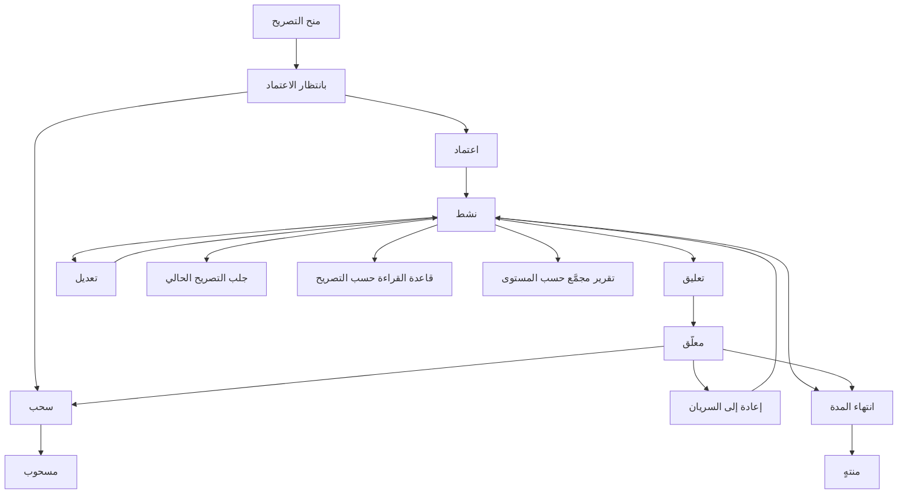
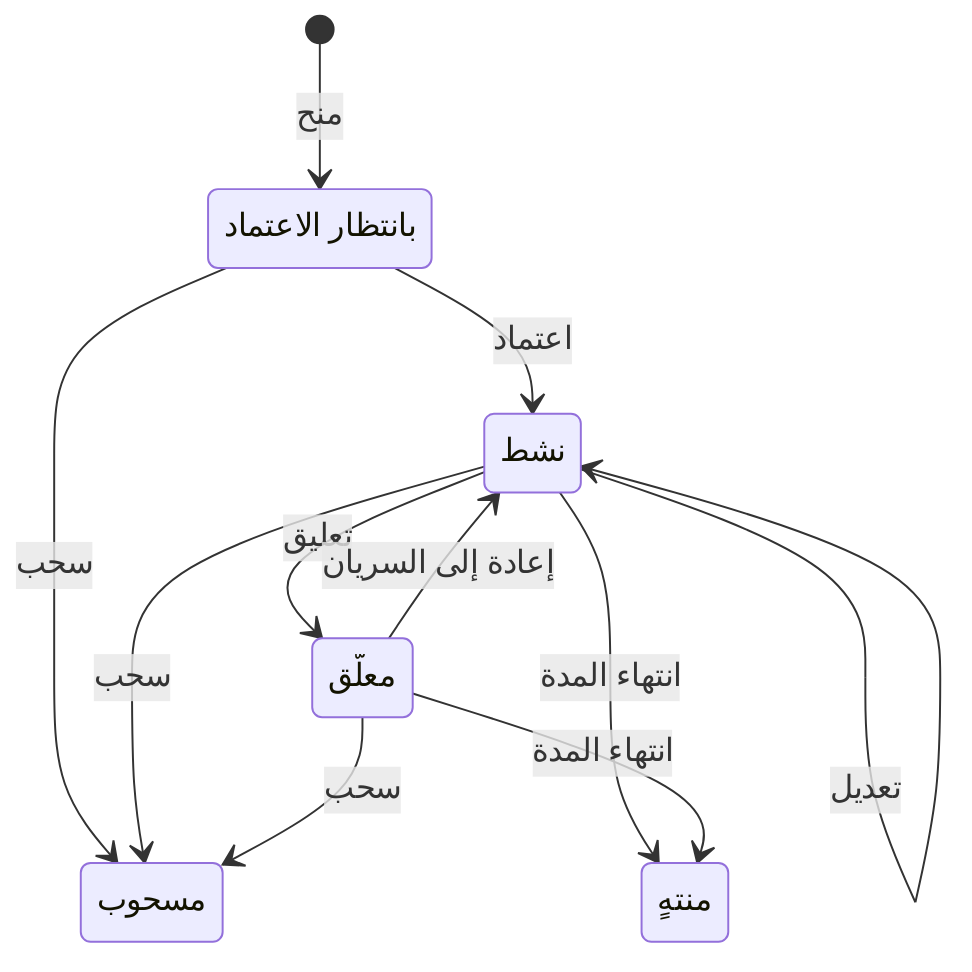

# التصاريح الأمنية للمستخدمين

<!-- BEGIN GENERATED: doc -->
| البند | القيمة |
|---|---|
| المعرّف | FEAT-GOV-CLEARANCE |
| الإصدار | 0.2 |
| الحالة | مسودة |
| القدرة | CAP-13 الحوكمة والأمن والامتثال |
| القدرة الفرعية | CAP-13.01 التصنيف والسياسات (R1) |
| الأدوار | مسؤول الأمن؛ أي مستخدم مخوَّل؛ النظام |
| الشاشات | SCR-67 التصنيف والتصاريح والاستثناءات |
| حالات الاستخدام | UC-089، UC-085 |
| القصص | 11: 8 من المواصفة، و3 جديدة |
<!-- END GENERATED: doc -->

## 1. نظرة عامة

### 1.1 القيمة

يتيح لمسؤول الأمن منح كل مستخدم مستوى سرية وحجرات محددة واعتمادها وتعديلها وتعليقها وسحبها، فلا يرى إلا ما يسمح به تصريحه.

### 1.2 النطاق

| البند | القيمة |
|---|---|
| المستخدمون | مسؤول الأمن؛ المستخدم الذي يُمنح له التصريح؛ النظام؛ فريق المنصة والتشغيل |
| الشاشات | SCR-67 التصنيف والتصاريح والاستثناءات |
| حالات الاستخدام | منح التصريح الأمني واعتماده وتعديله وتعليقه وإعادته وسحبه؛ عرض التصريح الحالي وحالة اعتماده؛ فرض قاعدة القراءة حسب التصريح؛ تقرير مجمَّع بالتصاريح |
| المتطلبات | السماح بالقراءة فقط إذا كان التصريح لا يقل عن مستوى الكائن ويشمل كل أقسامه (REQ-GOV-003)؛ نفاذ تغيير التصريح فورًا في كل مسارات القراءة (REQ-GOV-004) |
| خارج النطاق | إعداد مخطط التصنيف نفسه ومستوياته وأقسامه (ميزة مخطط التصنيف الأمني)؛ الاستثناءات الأمنية المؤقتة |

### 1.3 خريطة الميزة

**الشكل 1: دورة التصريح الأمني وقاعدة القراءة**



**الشكل 2: حالات التصريح الأمني**



## 2. القواعد المشتركة

تنطبق على كل قصص الميزة، فلا تتكرر داخل القصص. وكل قصة تذكر ما يخصها فقط.

### 2.1 السياق المشترك

كل قصة تبدأ من ثلاثة شروط: مستأجر نشط، وحزمة السياسات الأساسية مفعّلة، ومستخدم مسجّل الدخول ومخوَّل. وتشير إليها القصص بخطوة واحدة: «بفرض السياق المشترك للميزة».

### 2.2 الصلاحية وعدم الإفصاح

- من لا يحق له رؤية العنصر يتلقى ردًا بشكل «غير متاح» تمامًا، فلا يعرف أنه موجود.
- من يرى العنصر ولا يحق له الإجراء يتلقى «لا تملك صلاحية هذا الإجراء».

### 2.3 أوامر تغيير الحالة

- **منع التكرار:** يُرسل كل أمر بمفتاح فريد، فإعادة الطلب نفسه لا تُنفَّذ مرتين.
- **حماية التعديل المتزامن:** يُرسل كل أمر بإصدار البيانات الذي يراه المستخدم. فإن عدّلها غيره في الأثناء، يُرفض الأمر.
- **السجل:** إن نجح الأمر، يُكتب حدثه وسجل التدقيق في المعاملة نفسها.

### 2.4 الرفض المشترك

```gherkin
# language: ar
خاصية: الرفض المشترك لأوامر الميزة

  سيناريو مخطط: رفض مشترك لكل أمر في الميزة
    بفرض السياق المشترك للميزة
    و <الحالة>
    عندما يُرسل المستخدم أي أمر من أوامر الميزة
    اذاً يُرفض برمز <الرمز> ويرى "<الرسالة>"
    و لا يتغير شيء

    امثلة:
      | الحالة                                  | الرمز                  | الرسالة                                                 |
      | العنصر خارج صلاحياته                    | NOT_FOUND              | غير متاح                                                |
      | العنصر مرئي له ولا يحق له الإجراء       | AUTHZ_DENIED           | لا تملك صلاحية هذا الإجراء                              |
      | غيره عدّل العنصر بعد أن فتحه            | VERSION_CONFLICT       | تغيّرت البيانات منذ فتحتها. راجع التغييرات ثم أعد المحاولة |
      | أعاد مفتاح منع التكرار بمحتوى مختلف     | IDEMPOTENCY_KEY_REUSED | طلب مكرر بمحتوى مختلف                                   |
      | البيانات ناقصة أو غير صحيحة             | VALIDATION_FAILED      | بعض البيانات ناقصة أو غير صحيحة. راجع الحقول المعلَّمة      |

  سيناريو: إعادة الطلب نفسه لا تُنفَّذ مرتين
    بفرض السياق المشترك للميزة
    و أمر نجح بمفتاح منع تكرار
    عندما يُعاد الطلب نفسه بالمفتاح نفسه
    اذاً تُعاد النتيجة الأولى ولا يُكتب حدث ثانٍ
```

## 3. الجودة وتعريف الاكتمال

### 3.1 متطلبات الجودة

<!-- BEGIN GENERATED: quality -->
| المرجع | الموقف | المطلوب |
|---|---|---|
| QAS-SEC-002 | searches, lists, maps or receives alerts touching objects above clearance | 0 leakage in inference suite (counts, facets, ordering, timing, errors) |
| QAS-SEC-003 | removes a user's compartment | effective on next request in every path, independent of index lag |
<!-- END GENERATED: quality -->

### 3.2 تعريف الاكتمال

القصة مكتملة حين تتحقق الشروط الخمسة:

1. سيناريوهاتها والقواعد المشتركة تمر في الاختبار الآلي.
2. فحوص البنية المعمارية تمر.
3. نصوص الواجهة والرسائل موجودة بالعربية والإنجليزية.
4. مراجعة الكود مكتملة.
5. ما تضيفه القصة نفسها في قسم «القواعد» تحقق.

## 4. فهرس القصص

<!-- BEGIN GENERATED: story-index -->
| المعرّف | القصة | النوع | الحالة |
|---|---|---|---|
| `US-BC01-CLR-APPROVE` | اعتماد التصريح الأمني | أمر | مسودة |
| `US-BC01-CLR-GRANT` | منح التصريح الأمني | أمر | مسودة |
| `US-BC01-CLR-MODIFY` | تعديل التصريح الأمني | أمر | مسودة |
| `US-BC01-CLR-REINSTATE` | إعادة التصريح الأمني إلى السريان | أمر | مسودة |
| `US-BC01-CLR-REVOKE` | سحب التصريح الأمني | أمر | مسودة |
| `US-BC01-CLR-SUSPEND` | تعليق التصريح الأمني | أمر | مسودة |
| `US-BC01-Q-CLR-GET` | جلب: Current clearance (level/compartments) | جلب | مسودة |
| `US-BC01-S-CLEARANCE-01` | تلقائي: valid_to reached (التصريح الأمني) | نظام | مسودة |
| `US-UI-SCR67-CLEARANCE-VIEW` | عرض تصريح المستخدم وحالة اعتماده | واجهة | مسودة |
| `US-PLT-CLR-READ-RULE` | السماح بالقراءة حسب التصريح والأقسام | منصة | مسودة |
| `US-OPS-CLR-AGGREGATE-REPORT` | تقرير مجمّع بالتصاريح حسب المستوى | تشغيل | مسودة |
<!-- END GENERATED: story-index -->

## 5. القصص

### 5.1 US-BC01-CLR-APPROVE — اعتماد التصريح الأمني

| النوع | الإصدار | الأولوية | دون اتصال | الحالة |
|---|---|---|---|---|
| أمر | R1 | Must | لا | مسودة |

> **كـ** مسؤول الأمن، **أريد** اعتماد طلب التصريح الأمني المقدَّم لمستخدم، **حتى** يسري التصريح ويستطيع المستخدم الوصول إلى ما يسمح به.

**باختصار:** الاعتماد ينقل الطلب من «بانتظار الاعتماد» إلى «نشط»؛ وإذا كان المستوى هو الأعلى رتبة في المخطط، فيلزم مسؤول أمن ثانٍ يختلف عن طالب التصريح.

#### القواعد

- **متى يُسمح:** التصريح في حالة «بانتظار الاعتماد».
- **من يُسمح له:** مسؤول الأمن؛ وإن كان المستوى الأعلى رتبة في المخطط، فمسؤول أمن ثانٍ غير من طلب التصريح.
- **الأثر:** يصبح التصريح «نشطًا»، ويحتاج الإجراء تأكيد هوية مرة أخرى بحكم حساسيته.

#### معايير القبول

```gherkin
# language: ar
خاصية: اعتماد التصريح الأمني

  سيناريو: اعتماد طلب تصريح
    بفرض السياق المشترك للميزة
    و تصريح أمني في حالة "بانتظار الاعتماد"
    عندما يعتمده مسؤول الأمن
    اذاً تصبح حالته "نشط"
    و يُسجَّل حدث "مُنح التصريح الأمني"

  سيناريو مخطط: رفض خاص باعتماد التصريح
    بفرض السياق المشترك للميزة
    و <الحالة>
    عندما يحاول مسؤول الأمن اعتماد التصريح
    اذاً يُرفض برمز <الرمز> ويرى <الرسالة>

    امثلة:
      | الحالة                                                        | الرمز                              | الرسالة                                            |
      | التصريح ليس في حالة "بانتظار الاعتماد"                       | CLEARANCE_INVALID_STATE_TRANSITION | الوضع الحالي للتصريح الأمني لا يسمح بهذا الإجراء  |
      | المستوى الأعلى رتبة، والمعتمد هو من طلب التصريح نفسه         | SEGREGATION_OF_DUTIES              | لا يجوز أن يعتمد الشخص نفسه ما قدّمه أو طلبه       |
      | الجلسة تحتاج تأكيد هوية مرة أخرى                              | MFA_STEP_UP_REQUIRED               | هذا الإجراء يحتاج تأكيد هويتك مرة أخرى             |
```

<details><summary>المراجع التقنية والتتبع</summary>

<!-- BEGIN GENERATED: refs US-BC01-CLR-APPROVE -->
| البند | المعرّف | المعنى |
|---|---|---|
| الواجهة البرمجية | `POST /api/v1/foundation/clearances/{id}/actions/approve` | — |
| الأمر | `CMD-CLR-APPROVE` | اعتماد التصريح الأمني |
| السياسة | `POL-CLR-APPROVE` | Security Officer؛ tenant match; subject ACTIVE; tenant ACTIVE (except TEN operations by platform) |
| الحدث | `EVT-CLR-GRANTED` | يصل إلى: Security-version service (EVT-SEC-VERSION-INCREMENTED); PEP decision caches; Projection security-ver… |
| الكيان | `AGG-CLEARANCE` | التصريح الأمني |
| الجدول | `foundation.clearances` | الجدول الرئيسي للتصريح الأمني |
| وحدة النشر | DU-02 | — |
| المتطلبات | REQ-GOV-003، REQ-GOV-004 | معانيها في القسم 6. التتبع |
| حالات الاستخدام | UC-085، UC-089 | Manage Classification Scheme & Compartments؛ Manage User Clearance |
| الاختبار | TST-CLEARANCE-SM، TST-SLC01-INVARIANTS | دورة حالات التصريح الأمني، وثوابت الشريحة SLC-01 |
<!-- END GENERATED: refs US-BC01-CLR-APPROVE -->

</details>

### 5.2 US-BC01-CLR-GRANT — منح التصريح الأمني

| النوع | الإصدار | الأولوية | دون اتصال | الحالة |
|---|---|---|---|---|
| أمر | R1 | Must | لا | مسودة |

> **كـ** مسؤول الأمن، **أريد** منح تصريح أمني جديد لمستخدم بمستوى وأقسام محددة، **حتى** يُحدَّد ما يحق له رؤيته من البيانات المصنَّفة.

**باختصار:** المنح يفتح طلب تصريح بحالة «بانتظار الاعتماد»، على أن يكون المستوى والأقسام من المخطط النشط وألا يكون للمستخدم تصريح آخر غير منتهٍ، ولا يمنح الشخص تصريحًا لنفسه.

#### القواعد

- **متى يُسمح:** لا يوجد للمستخدم تصريح آخر غير نهائي، والمستوى والأقسام موجودان في المخطط النشط.
- **من يُسمح له:** مسؤول الأمن، على ألا يمنح تصريحًا لنفسه.
- **البيانات:** المستخدم والمستوى إلزاميان؛ الأقسام وخصائص التحفظ وتاريخ الانتهاء اختيارية.
- **الأثر:** يُفتح تصريح بحالة «بانتظار الاعتماد» بانتظار اعتماد مسؤول أمن.

#### معايير القبول

```gherkin
# language: ar
خاصية: منح التصريح الأمني

  سيناريو: منح تصريح جديد
    بفرض السياق المشترك للميزة
    و مستخدم بلا تصريح أمني قائم، ومستوى وأقسام من المخطط النشط
    عندما يمنحه مسؤول الأمن تصريحًا
    اذاً يُفتح تصريح بحالة "بانتظار الاعتماد"
    و يُسجَّل حدث "طُلب التصريح الأمني"

  سيناريو مخطط: رفض خاص بمنح التصريح
    بفرض السياق المشترك للميزة
    و <الحالة>
    عندما يحاول مسؤول الأمن منح التصريح
    اذاً يُرفض برمز <الرمز> ويرى <الرسالة>

    امثلة:
      | الحالة                                                  | الرمز                  | الرسالة                                      |
      | للمستخدم تصريح آخر غير منتهٍ، أو المستوى خارج المخطط النشط | CLEARANCE_EXISTS       | لهذا الشخص تصريح أمني قائم                   |
      | المانح يمنح تصريحًا لنفسه                                | SEGREGATION_OF_DUTIES  | لا يجوز أن يعتمد الشخص نفسه ما قدّمه أو طلبه |
      | المستخدم أو المستوى ناقص أو غير صحيح                      | VALIDATION_FAILED      | المستوى غير صحيح                             |
      | الجلسة تحتاج تأكيد هوية مرة أخرى                          | MFA_STEP_UP_REQUIRED   | هذا الإجراء يحتاج تأكيد هويتك مرة أخرى       |
```

<details><summary>المراجع التقنية والتتبع</summary>

<!-- BEGIN GENERATED: refs US-BC01-CLR-GRANT -->
| البند | المعرّف | المعنى |
|---|---|---|
| الواجهة البرمجية | `POST /api/v1/foundation/clearances` | — |
| الأمر | `CMD-CLR-GRANT` | منح التصريح الأمني |
| السياسة | `POL-CLR-GRANT` | Security Officer؛ tenant match; subject ACTIVE; tenant ACTIVE (except TEN operations by platform) |
| الحدث | `EVT-CLR-REQUESTED` | يصل إلى: Search/Directory projection (BC01 read model) |
| الكيان | `AGG-CLEARANCE` | التصريح الأمني |
| الجدول | `foundation.clearances` | الجدول الرئيسي للتصريح الأمني |
| وحدة النشر | DU-02 | — |
| المتطلبات | REQ-GOV-003، REQ-GOV-004 | معانيها في القسم 6. التتبع |
| حالات الاستخدام | UC-085، UC-089 | Manage Classification Scheme & Compartments؛ Manage User Clearance |
| الاختبار | TST-CLEARANCE-SM، TST-SLC01-INVARIANTS | دورة حالات التصريح الأمني، وثوابت الشريحة SLC-01 |
<!-- END GENERATED: refs US-BC01-CLR-GRANT -->

</details>

### 5.3 US-BC01-CLR-MODIFY — تعديل التصريح الأمني

| النوع | الإصدار | الأولوية | دون اتصال | الحالة |
|---|---|---|---|---|
| أمر | R1 | Must | لا | مسودة |

> **كـ** مسؤول الأمن، **أريد** تعديل مستوى تصريح نشط أو أقسامه، **حتى** أواكب تغيّر حاجة المستخدم دون سحب التصريح وإعادة منحه.

**باختصار:** التعديل يبقي التصريح «نشطًا» ويرفع إصداره، وفق قواعد المنح نفسها في المستوى والأقسام.

#### القواعد

- **متى يُسمح:** التصريح في حالة «نشط».
- **من يُسمح له:** مسؤول الأمن.
- **البيانات:** المستوى والأقسام إلزاميان؛ خصائص التحفظ اختيارية.
- **الأثر:** لا تتغير حالة التصريح، ويرتفع إصداره.

#### معايير القبول

```gherkin
# language: ar
خاصية: تعديل التصريح الأمني

  سيناريو: تعديل تصريح نشط
    بفرض السياق المشترك للميزة
    و تصريح أمني في حالة "نشط"
    عندما يعدّل مسؤول الأمن مستواه أو أقسامه
    اذاً تبقى حالته "نشط" ويرتفع إصداره
    و يُسجَّل حدث "عُدِّل التصريح الأمني"

  سيناريو مخطط: رفض خاص بتعديل التصريح
    بفرض السياق المشترك للميزة
    و <الحالة>
    عندما يحاول مسؤول الأمن تعديل التصريح
    اذاً يُرفض برمز <الرمز> ويرى <الرسالة>

    امثلة:
      | الحالة                                      | الرمز                              | الرسالة                                           |
      | التصريح ليس في حالة "نشط"                   | CLEARANCE_INVALID_STATE_TRANSITION | الوضع الحالي للتصريح الأمني لا يسمح بهذا الإجراء |
      | المستوى أو الأقسام خارج المخطط النشط         | CLEARANCE_INVALID                  | بيانات التصريح الأمني غير صحيحة                  |
      | المستوى أو الأقسام ناقص أو غير صحيح          | VALIDATION_FAILED                  | المستوى غير صحيح                                  |
```

<details><summary>المراجع التقنية والتتبع</summary>

<!-- BEGIN GENERATED: refs US-BC01-CLR-MODIFY -->
| البند | المعرّف | المعنى |
|---|---|---|
| الواجهة البرمجية | `POST /api/v1/foundation/clearances/{id}/actions/modify` | — |
| الأمر | `CMD-CLR-MODIFY` | تعديل التصريح الأمني |
| السياسة | `POL-CLR-MODIFY` | Security Officer؛ tenant match; subject ACTIVE; tenant ACTIVE (except TEN operations by platform) |
| الحدث | `EVT-CLR-MODIFIED` | يصل إلى: Security-version service (EVT-SEC-VERSION-INCREMENTED); PEP decision caches; Projection security-ver… |
| الكيان | `AGG-CLEARANCE` | التصريح الأمني |
| الجدول | `foundation.clearances` | الجدول الرئيسي للتصريح الأمني |
| وحدة النشر | DU-02 | — |
| المتطلبات | REQ-GOV-003، REQ-GOV-004 | معانيها في القسم 6. التتبع |
| حالات الاستخدام | UC-085، UC-089 | Manage Classification Scheme & Compartments؛ Manage User Clearance |
| الاختبار | TST-CLEARANCE-SM، TST-SLC01-INVARIANTS | دورة حالات التصريح الأمني، وثوابت الشريحة SLC-01 |
<!-- END GENERATED: refs US-BC01-CLR-MODIFY -->

</details>

### 5.4 US-BC01-CLR-REINSTATE — إعادة التصريح الأمني إلى السريان

| النوع | الإصدار | الأولوية | دون اتصال | الحالة |
|---|---|---|---|---|
| أمر | R1 | Must | لا | مسودة |

> **كـ** مسؤول الأمن، **أريد** إعادة تصريح معلّق إلى السريان، **حتى** يستعيد المستخدم وصوله بعد انتهاء سبب التعليق.

**باختصار:** الإعادة تنقل التصريح من «معلّق» إلى «نشط» ما دامت فترة صلاحيته لم تنتهِ.

#### القواعد

- **متى يُسمح:** التصريح في حالة «معلّق»، وفترة صلاحيته لم تنتهِ.
- **من يُسمح له:** مسؤول الأمن.
- **الأثر:** يصبح التصريح «نشطًا» من جديد.

#### معايير القبول

```gherkin
# language: ar
خاصية: إعادة التصريح الأمني إلى السريان

  سيناريو: إعادة تصريح معلّق لم تنتهِ فترته
    بفرض السياق المشترك للميزة
    و تصريح أمني في حالة "معلّق" لم تنتهِ فترة صلاحيته
    عندما يعيده مسؤول الأمن إلى السريان
    اذاً تصبح حالته "نشط"
    و يُسجَّل حدث "أُعيد التصريح الأمني إلى السريان"

  سيناريو مخطط: رفض خاص بإعادة التصريح
    بفرض السياق المشترك للميزة
    و <الحالة>
    عندما يحاول مسؤول الأمن إعادة التصريح إلى السريان
    اذاً يُرفض برمز <الرمز> ويرى <الرسالة>

    امثلة:
      | الحالة                          | الرمز                              | الرسالة                                           |
      | التصريح ليس في حالة "معلّق"     | CLEARANCE_INVALID_STATE_TRANSITION | الوضع الحالي للتصريح الأمني لا يسمح بهذا الإجراء |
```

> **ملاحظة:** رفض الإعادة بعد انتهاء فترة التصريح («period not ended») لا رمز خطأ مخصص له في المصدر، فيُفترض أنه يصدر بالرمز نفسه أعلاه حتى يُحسم في المواصفة. **[Needs Review]**

<details><summary>المراجع التقنية والتتبع</summary>

<!-- BEGIN GENERATED: refs US-BC01-CLR-REINSTATE -->
| البند | المعرّف | المعنى |
|---|---|---|
| الواجهة البرمجية | `POST /api/v1/foundation/clearances/{id}/actions/reinstate` | — |
| الأمر | `CMD-CLR-REINSTATE` | إعادة التصريح الأمني إلى السريان |
| السياسة | `POL-CLR-REINSTATE` | Security Officer؛ tenant match; subject ACTIVE; tenant ACTIVE (except TEN operations by platform) |
| الحدث | `EVT-CLR-REINSTATED` | يصل إلى: Security-version service (EVT-SEC-VERSION-INCREMENTED); PEP decision caches; Projection security-ver… |
| الكيان | `AGG-CLEARANCE` | التصريح الأمني |
| الجدول | `foundation.clearances` | الجدول الرئيسي للتصريح الأمني |
| وحدة النشر | DU-02 | — |
| المتطلبات | REQ-GOV-003، REQ-GOV-004 | معانيها في القسم 6. التتبع |
| حالات الاستخدام | UC-085، UC-089 | Manage Classification Scheme & Compartments؛ Manage User Clearance |
| الاختبار | TST-CLEARANCE-SM، TST-SLC01-INVARIANTS | دورة حالات التصريح الأمني، وثوابت الشريحة SLC-01 |
<!-- END GENERATED: refs US-BC01-CLR-REINSTATE -->

</details>

### 5.5 US-BC01-CLR-REVOKE — سحب التصريح الأمني

| النوع | الإصدار | الأولوية | دون اتصال | الحالة |
|---|---|---|---|---|
| أمر | R1 | Must | لا | مسودة |

> **كـ** مسؤول الأمن، **أريد** سحب تصريح قائم بسبب، **حتى** يُنهى وصول المستخدم فورًا ونهائيًا.

**باختصار:** السحب يحتاج سببًا، وينهي التصريح نهائيًا بحالة «مسحوب» من أي حالة غير نهائية.

#### القواعد

- **متى يُسمح:** التصريح في حالة «بانتظار الاعتماد» أو «نشط» أو «معلّق».
- **من يُسمح له:** مسؤول الأمن.
- **البيانات:** السبب إلزامي.
- **الأثر:** يصبح التصريح «مسحوبًا» نهائيًا.

#### معايير القبول

```gherkin
# language: ar
خاصية: سحب التصريح الأمني

  سيناريو: سحب تصريح قائم بسبب
    بفرض السياق المشترك للميزة
    و تصريح أمني في حالة "بانتظار الاعتماد" أو "نشط" أو "معلّق"
    عندما يسحبه مسؤول الأمن بسبب
    اذاً تصبح حالته "مسحوب"
    و يُسجَّل حدث "سُحب التصريح الأمني"

  سيناريو مخطط: رفض خاص بسحب التصريح
    بفرض السياق المشترك للميزة
    و <الحالة>
    عندما يحاول مسؤول الأمن سحب التصريح
    اذاً يُرفض برمز <الرمز> ويرى <الرسالة>

    امثلة:
      | الحالة                                  | الرمز                              | الرسالة                                           |
      | التصريح في حالة "منتهٍ" أو "مسحوب"      | CLEARANCE_INVALID_STATE_TRANSITION | الوضع الحالي للتصريح الأمني لا يسمح بهذا الإجراء |
      | لم يُذكر السبب                           | REASON_REQUIRED                    | اذكر السبب                                        |
      | السبب ناقص أو غير صحيح                   | VALIDATION_FAILED                  | السبب مطلوب                                       |
```

<details><summary>المراجع التقنية والتتبع</summary>

<!-- BEGIN GENERATED: refs US-BC01-CLR-REVOKE -->
| البند | المعرّف | المعنى |
|---|---|---|
| الواجهة البرمجية | `POST /api/v1/foundation/clearances/{id}/actions/revoke` | — |
| الأمر | `CMD-CLR-REVOKE` | سحب التصريح الأمني |
| السياسة | `POL-CLR-REVOKE` | Security Officer؛ tenant match; subject ACTIVE; tenant ACTIVE (except TEN operations by platform) |
| الحدث | `EVT-CLR-REVOKED` | يصل إلى: Security-version service (EVT-SEC-VERSION-INCREMENTED); PEP decision caches; Projection security-ver… |
| الكيان | `AGG-CLEARANCE` | التصريح الأمني |
| الجدول | `foundation.clearances` | الجدول الرئيسي للتصريح الأمني |
| وحدة النشر | DU-02 | — |
| المتطلبات | REQ-GOV-003، REQ-GOV-004 | معانيها في القسم 6. التتبع |
| حالات الاستخدام | UC-085، UC-089 | Manage Classification Scheme & Compartments؛ Manage User Clearance |
| الاختبار | TST-CLEARANCE-SM، TST-SLC01-INVARIANTS | دورة حالات التصريح الأمني، وثوابت الشريحة SLC-01 |
<!-- END GENERATED: refs US-BC01-CLR-REVOKE -->

</details>

### 5.6 US-BC01-CLR-SUSPEND — تعليق التصريح الأمني

| النوع | الإصدار | الأولوية | دون اتصال | الحالة |
|---|---|---|---|---|
| أمر | R1 | Must | لا | مسودة |

> **كـ** مسؤول الأمن، **أريد** تعليق تصريح نشط بسبب، **حتى** أوقف وصول المستخدم مؤقتًا دون سحب تصريحه نهائيًا.

**باختصار:** التعليق يحتاج سببًا، وينقل التصريح من «نشط» إلى «معلّق» حتى تُعاد إلى السريان أو يُسحب.

#### القواعد

- **متى يُسمح:** التصريح في حالة «نشط».
- **من يُسمح له:** مسؤول الأمن.
- **البيانات:** السبب إلزامي.
- **الأثر:** يصبح التصريح «معلّقًا»، فيتوقف وصول المستخدم حتى تُعاد إلى السريان أو يُسحب.

#### معايير القبول

```gherkin
# language: ar
خاصية: تعليق التصريح الأمني

  سيناريو: تعليق تصريح نشط بسبب
    بفرض السياق المشترك للميزة
    و تصريح أمني في حالة "نشط"
    عندما يعلّقه مسؤول الأمن بسبب
    اذاً تصبح حالته "معلّق"
    و يُسجَّل حدث "عُلِّق التصريح الأمني"

  سيناريو مخطط: رفض خاص بتعليق التصريح
    بفرض السياق المشترك للميزة
    و <الحالة>
    عندما يحاول مسؤول الأمن تعليق التصريح
    اذاً يُرفض برمز <الرمز> ويرى <الرسالة>

    امثلة:
      | الحالة                      | الرمز                              | الرسالة                                           |
      | التصريح ليس في حالة "نشط"  | CLEARANCE_INVALID_STATE_TRANSITION | الوضع الحالي للتصريح الأمني لا يسمح بهذا الإجراء |
      | لم يُذكر السبب               | REASON_REQUIRED                    | اذكر السبب                                        |
      | السبب ناقص أو غير صحيح      | VALIDATION_FAILED                  | السبب مطلوب                                       |
```

<details><summary>المراجع التقنية والتتبع</summary>

<!-- BEGIN GENERATED: refs US-BC01-CLR-SUSPEND -->
| البند | المعرّف | المعنى |
|---|---|---|
| الواجهة البرمجية | `POST /api/v1/foundation/clearances/{id}/actions/suspend` | — |
| الأمر | `CMD-CLR-SUSPEND` | تعليق التصريح الأمني |
| السياسة | `POL-CLR-SUSPEND` | Security Officer؛ tenant match; subject ACTIVE; tenant ACTIVE (except TEN operations by platform) |
| الحدث | `EVT-CLR-SUSPENDED` | يصل إلى: Security-version service (EVT-SEC-VERSION-INCREMENTED); PEP decision caches; Projection security-ver… |
| الكيان | `AGG-CLEARANCE` | التصريح الأمني |
| الجدول | `foundation.clearances` | الجدول الرئيسي للتصريح الأمني |
| وحدة النشر | DU-02 | — |
| المتطلبات | REQ-GOV-003، REQ-GOV-004 | معانيها في القسم 6. التتبع |
| حالات الاستخدام | UC-085، UC-089 | Manage Classification Scheme & Compartments؛ Manage User Clearance |
| الاختبار | TST-CLEARANCE-SM، TST-SLC01-INVARIANTS | دورة حالات التصريح الأمني، وثوابت الشريحة SLC-01 |
<!-- END GENERATED: refs US-BC01-CLR-SUSPEND -->

</details>

### 5.7 US-BC01-Q-CLR-GET — جلب: Current clearance (level/compartments)

| النوع | الإصدار | الأولوية | دون اتصال | الحالة |
|---|---|---|---|---|
| جلب | R1 | Must | لا | مسودة |

> **كـ** مسؤول الأمن، أو المستخدم عن نفسه، **أريد** رؤية مستوى التصريح الحالي وأقسامه، **حتى** أعرف ما يحق للمستخدم الوصول إليه، أو ما يحق لي.

**باختصار:** تُعاد بيانات التصريح الحالي لمن يملك الصلاحية فقط: مسؤول الأمن عن أي مستخدم ضمن نطاقه، أو المستخدم عن نفسه.

#### القواعد

- **من يُسمح له:** مسؤول الأمن يرى تصريح أي مستخدم ضمن نطاقه، والمستخدم يرى تصريحه فقط.
- **البيانات:** المؤشر والحد، لا مرشحات أخرى.

#### معايير القبول

```gherkin
# language: ar
خاصية: جلب التصريح الأمني الحالي

  سيناريو: مسؤول الأمن يرى تصريح مستخدم ضمن نطاقه
    بفرض السياق المشترك للميزة
    و مستخدم ضمن نطاق مسؤول الأمن وله تصريح أمني
    عندما يطلب مسؤول الأمن تصريحه
    اذاً تُعاد مستوى التصريح وأقسامه

  سيناريو: المستخدم يرى تصريحه هو فقط
    بفرض السياق المشترك للميزة
    و للمستخدم تصريح أمني قائم
    عندما يطلب تصريحه الحالي
    اذاً تُعاد مستوى تصريحه وأقسامه فقط
```

<details><summary>المراجع التقنية والتتبع</summary>

<!-- BEGIN GENERATED: refs US-BC01-Q-CLR-GET -->
| البند | المعرّف | المعنى |
|---|---|---|
| الواجهة البرمجية | `GET /api/v1/foundation/users/{user_id}/clearance` | — |
| الاستعلام | `QRY-CLR-GET` | Current clearance (level/compartments) |
| السياسة | `POL-CLR-GET` | org scope of subject roles ∩ classification rule |
| الكيان | `AGG-USER` | حساب المستخدم |
| الجدول | `foundation.users` | الجدول الرئيسي لحساب المستخدم |
| وحدة النشر | DU-02 | — |
| المتطلب | REQ-GOV-003 | The system shall permit read access to an object only if the subject's clearance is at least the object's lev… |
| حالة الاستخدام | UC-089 | Manage User Clearance |
| الاختبار | TST-USER-SM، TST-SLC01-INVARIANTS | دورة حالات حساب المستخدم، وثوابت الشريحة SLC-01 |
<!-- END GENERATED: refs US-BC01-Q-CLR-GET -->

</details>

### 5.8 US-BC01-S-CLEARANCE-01 — تلقائي: valid_to reached (التصريح الأمني)

| النوع | الإصدار | الأولوية | دون اتصال | الحالة |
|---|---|---|---|---|
| نظام | R1 | Must | لا ينطبق | مسودة |

> **كـ** النظام، **أريد** نقل التصريح الأمني إلى «منتهٍ» عند بلوغ تاريخ انتهائه، **حتى** يتوقف وصول من انتهت صلاحية تصريحه تلقائيًا.

**باختصار:** عند بلوغ تاريخ الانتهاء ينتقل التصريح من «نشط» أو «معلّق» إلى «منتهٍ» نهائيًا، ويُسجَّل الحدث وسجل التدقيق بهوية النظام.

#### القواعد

- **الأثر:** حالة التصريح تصبح «منتهية»، ويُسجَّل حدثها وسجل تدقيق بهوية النظام.

#### معايير القبول

```gherkin
# language: ar
خاصية: انتهاء مدة التصريح الأمني

  سيناريو: بلوغ تاريخ الانتهاء لتصريح نشط أو معلّق
    بفرض تصريح أمني في حالة "نشط" أو "معلّق" بلغ تاريخ انتهائه
    عندما يحين وقت فحص المجدول
    اذاً تصبح حالته "منتهٍ"
    و يُسجَّل حدث "انتهى التصريح الأمني" وسجل تدقيق بهوية النظام

  سيناريو: تصريح لم يبلغ تاريخ انتهائه
    بفرض تصريح أمني في حالة "نشط" لم يبلغ تاريخ انتهائه
    عندما يحين وقت فحص المجدول
    اذاً تبقى حالته "نشط" ولا يُسجَّل أي انتهاء
```

<details><summary>المراجع التقنية والتتبع</summary>

<!-- BEGIN GENERATED: refs US-BC01-S-CLEARANCE-01 -->
| البند | المعرّف | المعنى |
|---|---|---|
| المحفِّز | `SYS:valid_to reached` | system |
| الانتقال | ACTIVE, SUSPENDED ← EXPIRED | — |
| الحدث | `EVT-CLR-EXPIRED` | يصل إلى: Security-version service (EVT-SEC-VERSION-INCREMENTED); PEP decision caches; Projection security-ver… |
| الكيان | `AGG-CLEARANCE` | التصريح الأمني |
| الجدول | `foundation.clearances` | الجدول الرئيسي للتصريح الأمني |
| وحدة النشر | DU-02 | — |
| المتطلبات | REQ-GOV-003، REQ-GOV-004 | معانيها في القسم 6. التتبع |
| حالات الاستخدام | UC-085، UC-089 | Manage Classification Scheme & Compartments؛ Manage User Clearance |
| الاختبار | TST-CLEARANCE-SM، TST-SLC01-INVARIANTS | دورة حالات التصريح الأمني، وثوابت الشريحة SLC-01 |
<!-- END GENERATED: refs US-BC01-S-CLEARANCE-01 -->

</details>

### 5.9 US-UI-SCR67-CLEARANCE-VIEW — عرض تصريح المستخدم وحالة اعتماده

| النوع | الإصدار | الأولوية | دون اتصال | الحالة |
|---|---|---|---|---|
| واجهة | R1 | Should | لا | مسودة |

> **كـ** المستخدم، **أريد** رؤية تصريحي أو تصريح مستخدم آخر وحالته بوضوح في شاشة واحدة، **حتى** أعرف هل هو نشط أو بانتظار الاعتماد أو معلّق دون الرجوع إلى مصدر آخر.

**باختصار:** تعرض شاشة التصنيف والتصاريح والاستثناءات (SCR-67) مستوى التصريح وأقسامه وحالته وتاريخ انتهائه، وتعرض أزرار الاعتماد والتعليق والسحب حسب الحالة وصلاحية المستخدم.

#### القواعد

- **البيانات:** مستوى التصريح وأقسامه وحالته وتاريخ انتهائه.
- **الأثر:** أزرار الاعتماد والتعليق والإعادة والسحب تظهر فقط حين تسمح حالة التصريح وصلاحية المستخدم بها.

#### معايير القبول

```gherkin
# language: ar
خاصية: عرض التصريح الأمني وحالته

  سيناريو: عرض تصريح نشط
    بفرض السياق المشترك للميزة
    و للمستخدم تصريح أمني في حالة "نشط"
    عندما يفتح شاشة SCR-67
    اذاً تُعرض مستوى تصريحه وأقسامه وتاريخ انتهائه

  سيناريو: عرض الأزرار حسب الحالة
    بفرض السياق المشترك للميزة
    و تصريح في حالة "بانتظار الاعتماد" يفتحه مسؤول أمن مخوَّل بالاعتماد
    عندما يُفتح التصريح في شاشة SCR-67
    اذاً يظهر زر الاعتماد ولا يظهر زرا التعليق أو الإعادة
```

<details><summary>المراجع التقنية والتتبع</summary>

<!-- BEGIN GENERATED: refs US-UI-SCR67-CLEARANCE-VIEW -->
| البند | المعرّف | المعنى |
|---|---|---|
| حالة الاستخدام | UC-089 | Manage User Clearance |
| الشاشة | SCR-67 | شاشة التصنيف والتصاريح والاستثناءات |
| المصدر | `[Derived]` | — |
<!-- END GENERATED: refs US-UI-SCR67-CLEARANCE-VIEW -->

</details>

### 5.10 US-PLT-CLR-READ-RULE — السماح بالقراءة حسب التصريح والأقسام

| النوع | الإصدار | الأولوية | دون اتصال | الحالة |
|---|---|---|---|---|
| منصة | R1 | Must | لا ينطبق | مسودة |

> **كـ** فريق المنصة، **أريد** فرض قاعدة القراءة بمقارنة رتبة تصريح المستخدم برتبة مستوى الكائن، وتضمين أقسامه، **حتى** يُمنع وصول من لا يستوفي الشرطين دون أي تسريب عبر البحث أو الخرائط أو التنبيهات.

**باختصار:** القراءة لا تُسمح إلا إذا كانت رتبة تصريح المستخدم لا تقل عن رتبة مستوى الكائن، وأقسام الكائن كلها ضمن أقسام تصريحه، وبلا أي تسريب عبر العدد أو الفرز أو التوقيت (QAS-SEC-002).

#### القواعد

- **الأثر:** كل مسار قراءة (بحث، قائمة، خريطة، تنبيه) يُطبّق هذه القاعدة على كل عنصر، ولا يكشف عدد أو فرز أو زمن استجابة وجود عنصر محجوب.

#### معايير القبول

```gherkin
# language: ar
خاصية: قاعدة القراءة حسب التصريح والأقسام

  سيناريو: السماح بقراءة كائن يستوفي الشرطين
    بفرض السياق المشترك للميزة
    و كائن برتبة مستوى وأقسام يستوفيها تصريح المستخدم
    عندما يطلب المستخدم الكائن من أي مسار قراءة
    اذاً يُعاد الكائن

  سيناريو: حجب كائن فوق التصريح دون تسريب
    بفرض السياق المشترك للميزة
    و كائن برتبة مستوى أعلى من تصريح المستخدم، أو بقسم لا يحمله تصريحه
    عندما يطلبه المستخدم من البحث أو القائمة أو الخريطة أو التنبيه
    اذاً لا يُعاد الكائن
    و لا يكشف العدد ولا الفرز ولا زمن الاستجابة وجوده
```

<details><summary>المراجع التقنية والتتبع</summary>

<!-- BEGIN GENERATED: refs US-PLT-CLR-READ-RULE -->
| البند | المعرّف | المعنى |
|---|---|---|
| الجودة | QAS-SEC-002 | searches, lists, maps or receives alerts touching objects above clearance → 0 leakage in inference suite (cou… |
| المصدر | `17-security-design.md §4` | — |
| المتطلب | REQ-GOV-003 | The system shall permit read access to an object only if the subject's clearance is at least the object's lev… |
| حالة الاستخدام | UC-089 | Manage User Clearance |
<!-- END GENERATED: refs US-PLT-CLR-READ-RULE -->

</details>

### 5.11 US-OPS-CLR-AGGREGATE-REPORT — تقرير مجمّع بالتصاريح حسب المستوى

| النوع | الإصدار | الأولوية | دون اتصال | الحالة |
|---|---|---|---|---|
| تشغيل | R1 | Should | لا ينطبق | مسودة |

> **كـ** فريق التشغيل أو الأمن، **أريد** تقريرًا يحصي عدد التصاريح النشطة حسب المستوى لكل مستأجر، **حتى** أراقب توزيع الحساسية دون رؤية تفاصيل أي مستخدم بعينه.

**باختصار:** التقرير يعرض عددًا مجمَّعًا للتصاريح لكل مستوى، ولا يُعرض أي عدد أقل من خمسة لحماية هوية الأفراد **[Derived]**.

#### معايير القبول

```gherkin
# language: ar
خاصية: تقرير مجمَّع بالتصاريح حسب المستوى

  سيناريو: عرض التقرير المجمَّع
    بفرض السياق المشترك للميزة
    و تصاريح نشطة بمستويات مختلفة في المستأجر
    عندما يطلب فريق التشغيل أو الأمن التقرير
    اذاً يُعاد عدد التصاريح النشطة لكل مستوى
    و لا يُعاد أي عدد أقل من خمسة
```

<details><summary>المراجع التقنية والتتبع</summary>

<!-- BEGIN GENERATED: refs US-OPS-CLR-AGGREGATE-REPORT -->
| البند | المعرّف | المعنى |
|---|---|---|
| المصدر | `09-reliability/observability-slc01.md §business_telemetry` | — |
<!-- END GENERATED: refs US-OPS-CLR-AGGREGATE-REPORT -->

</details>

## 6. التتبع

<!-- BEGIN GENERATED: trace -->
| المتطلب | المعنى | القصص | الاختبار |
|---|---|---|---|
| REQ-GOV-003 | The system shall permit read access to an object only if the subject's clearance is at least the object's lev… | `US-BC01-CLR-APPROVE`، `US-BC01-CLR-GRANT`، `US-BC01-CLR-MODIFY`، `US-BC01-CLR-REINSTATE`، `US-BC01-CLR-REVOKE`، `US-BC01-CLR-SUSPEND`، `US-BC01-Q-CLR-GET`، `US-BC01-S-CLEARANCE-01`، `US-PLT-CLR-READ-RULE` | TST-CLEARANCE-SM، TST-SLC01-INVARIANTS |
| REQ-GOV-004 | When the classification of an object is changed, the system shall require the authority defined by tenant pol… | كل قصص الأوامر والنظام في الميزة (7) | TST-CLASSIFICATION-SCHEME-SM، TST-CLEARANCE-SM، TST-SLC01-INVARIANTS، TST-SLC05-INVARIANTS |
<!-- END GENERATED: trace -->

## 7. سجل التغييرات

| الإصدار | التاريخ | التغيير |
|---|---|---|
| 0.1 | — | هيكل مولَّد من خريطة الميزات |
| 0.2 | 2026-10-13 | كتابة القصص كاملة بمعيار القصص |
