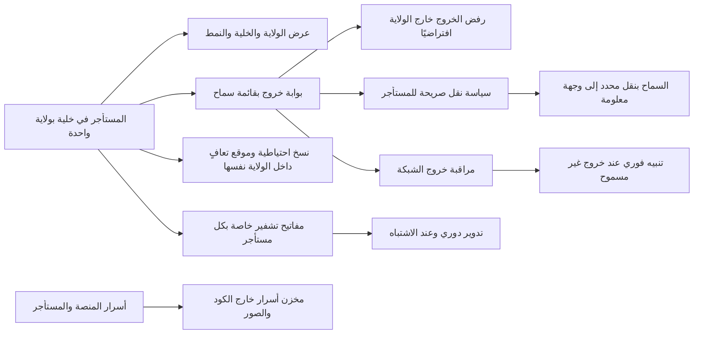

# إقامة البيانات وسيادتها

<!-- BEGIN GENERATED: doc -->
| البند | القيمة |
|---|---|
| المعرّف | FEAT-GOV-DATA-RESIDENCY |
| الإصدار | 0.1 |
| الحالة | مسودة |
| القدرة | CAP-13 الحوكمة والأمن والامتثال |
| القدرة الفرعية | CAP-13.04 السيادة وإقامة البيانات (R1) |
| الأدوار | مسؤول الأمن؛ مشغّل المنصة؛ النظام |
| الشاشات | SCR-60 المستأجر والحصص (واجهة المشغل) |
| حالات الاستخدام | — |
| القصص | 8: 0 من المواصفة، و8 جديدة |
<!-- END GENERATED: doc -->

## 1. نظرة عامة

### 1.1 القيمة

يضمن بقاء جميع بيانات الجهة داخل نطاقها الجغرافي والقانوني المحدد وعدم نقلها خارجه إلا بسياسة صريحة من المستأجر.

### 1.2 النطاق

| البند | القيمة |
|---|---|
| المستخدمون | مشغّل المنصة؛ مسؤول الأمن؛ فريق التشغيل أو الأمن؛ النظام |
| الشاشات | SCR-60 المستأجر والحصص (واجهة المشغل) |
| حالات الاستخدام | عرض ولاية المستأجر وخليته؛ ضمان بقاء بياناته ونسخه وموقع تعافيه داخل تلك الولاية؛ منع خروجها إلا بسياسة صريحة |
| المتطلبات | بقاء كل بيانات المستأجر داخل ولايته المهيأة، ومنع نقلها خارجها إلا بسياسة صريحة من المستأجر (REQ-GOV-005) |
| خارج النطاق | تحديد الولاية نفسها عند تهيئة المستأجر لأول مرة (ميزة تهيئة المستأجر)؛ تصنيف البيانات وتصاريح الاطلاع عليها (ميزات أخرى في هذه القدرة) |

### 1.3 خريطة الميزة

**الشكل 1: إقامة البيانات وسيادتها**



## 2. القواعد المشتركة

تنطبق على كل قصص الميزة، فلا تتكرر داخل القصص. وكل قصة تذكر ما يخصها فقط.

### 2.1 السياق المشترك

كل قصة تبدأ من ثلاثة شروط: مستأجر نشط، وحزمة السياسات الأساسية مفعّلة، ومستخدم مسجّل الدخول ومخوَّل. وتشير إليها القصص بخطوة واحدة: «بفرض السياق المشترك للميزة».

### 2.2 الصلاحية وعدم الإفصاح

- من لا يحق له رؤية العنصر يتلقى ردًا بشكل «غير متاح» تمامًا، فلا يعرف أنه موجود.
- من يرى العنصر ولا يحق له الإجراء يتلقى «لا تملك صلاحية هذا الإجراء».

### 2.3 أوامر تغيير الحالة

- **منع التكرار:** يُرسل كل أمر بمفتاح فريد، فإعادة الطلب نفسه لا تُنفَّذ مرتين.
- **حماية التعديل المتزامن:** يُرسل كل أمر بإصدار البيانات الذي يراه المستخدم. فإن عدّلها غيره في الأثناء، يُرفض الأمر.
- **السجل:** إن نجح الأمر، يُكتب حدثه وسجل التدقيق في المعاملة نفسها.

### 2.4 الرفض المشترك

```gherkin
# language: ar
خاصية: الرفض المشترك لأوامر الميزة

  سيناريو مخطط: رفض مشترك لكل أمر في الميزة
    بفرض السياق المشترك للميزة
    و <الحالة>
    عندما يُرسل المستخدم أي أمر من أوامر الميزة
    اذاً يُرفض برمز <الرمز> ويرى "<الرسالة>"
    و لا يتغير شيء

    امثلة:
      | الحالة                                  | الرمز                  | الرسالة                                                 |
      | العنصر خارج صلاحياته                    | NOT_FOUND              | غير متاح                                                |
      | العنصر مرئي له ولا يحق له الإجراء       | AUTHZ_DENIED           | لا تملك صلاحية هذا الإجراء                              |
      | غيره عدّل العنصر بعد أن فتحه            | VERSION_CONFLICT       | تغيّرت البيانات منذ فتحتها. راجع التغييرات ثم أعد المحاولة |
      | أعاد مفتاح منع التكرار بمحتوى مختلف     | IDEMPOTENCY_KEY_REUSED | طلب مكرر بمحتوى مختلف                                   |
      | البيانات ناقصة أو غير صحيحة             | VALIDATION_FAILED      | بعض البيانات ناقصة أو غير صحيحة. راجع الحقول المعلَّمة      |

  سيناريو: إعادة الطلب نفسه لا تُنفَّذ مرتين
    بفرض السياق المشترك للميزة
    و أمر نجح بمفتاح منع تكرار
    عندما يُعاد الطلب نفسه بالمفتاح نفسه
    اذاً تُعاد النتيجة الأولى ولا يُكتب حدث ثانٍ
```

## 3. الجودة وتعريف الاكتمال

### 3.1 متطلبات الجودة

<!-- BEGIN GENERATED: quality -->
لا متطلبات جودة مرتبطة بمتطلبات هذه الميزة مباشرة. تنطبق متطلبات المنصة العامة (`FEAT-PLT-*`).
<!-- END GENERATED: quality -->

### 3.2 تعريف الاكتمال

القصة مكتملة حين تتحقق الشروط الخمسة:

1. سيناريوهاتها والقواعد المشتركة تمر في الاختبار الآلي.
2. فحوص البنية المعمارية تمر.
3. نصوص الواجهة والرسائل موجودة بالعربية والإنجليزية.
4. مراجعة الكود مكتملة.
5. ما تضيفه القصة نفسها في قسم «القواعد» تحقق.

## 4. فهرس القصص

<!-- BEGIN GENERATED: story-index -->
| المعرّف | القصة | النوع | الحالة |
|---|---|---|---|
| `US-UI-SCR60-RESIDENCY` | عرض ولاية المستأجر وخليته ونمطها | واجهة | مسودة |
| `US-PLT-RESIDENCY-EGRESS-DENY` | منع خروج البيانات خارج الولاية افتراضيًا | منصة | مسودة |
| `US-PLT-RESIDENCY-TRANSFER-POLICY` | السماح بالنقل الخارجي بسياسة صريحة فقط | منصة | مسودة |
| `US-OPS-KEYS-ROTATION` | تدوير المفاتيح دوريًا وعند الاشتباه | تشغيل | مسودة |
| `US-OPS-KEYS-TENANT-HIERARCHY` | مفاتيح تشفير خاصة بكل مستأجر | تشغيل | مسودة |
| `US-OPS-RESIDENCY-DR-SITE` | بقاء النسخ وموقع التعافي داخل الولاية | تشغيل | مسودة |
| `US-OPS-RESIDENCY-EGRESS-ALERT` | مراقبة خروج الشبكة والتنبيه الفوري | تشغيل | مسودة |
| `US-OPS-SECRETS-STORE` | حفظ الأسرار خارج الكود والصور | تشغيل | مسودة |
<!-- END GENERATED: story-index -->

## 5. القصص

### 5.1 US-UI-SCR60-RESIDENCY — عرض ولاية المستأجر وخليته ونمطها

| النوع | الإصدار | الأولوية | دون اتصال | الحالة |
|---|---|---|---|---|
| واجهة | R1 | Must | لا | مسودة |

> **كـ** مشغّل المنصة، **أريد** أن أرى ولاية المستأجر وخليته ونمط خليته (مشتركة أو مخصصة أو سيادية)، **حتى** أتأكد من إقامة بياناته قبل أي تغيير أو دعم.

**باختصار:** تعرض شاشة المستأجر والحصص الولاية المهيأة للمستأجر، والخلية التي يقع فيها، ونمط تلك الخلية. **[Derived]** لغياب تفصيل حقول الشاشة في المصدر.

#### معايير القبول

```gherkin
# language: ar
خاصية: عرض ولاية المستأجر وخليته ونمطها

  سيناريو: عرض بيانات الإقامة
    بفرض السياق المشترك للميزة
    و مستأجر مهيّأ بولاية وخلية معروفتين
    عندما يفتح مشغّل المنصة شاشة المستأجر
    اذاً يرى ولايته وخليته ونمط الخلية (مشتركة أو مخصصة أو سيادية)
```

<details><summary>المراجع التقنية والتتبع</summary>

<!-- BEGIN GENERATED: refs US-UI-SCR60-RESIDENCY -->
| البند | المعرّف | المعنى |
|---|---|---|
| الشاشة | SCR-60 | شاشة المستأجر والحصص (واجهة المشغل) |
| المصدر | `[Derived]` | — |
| المتطلب | REQ-GOV-005 | The system shall keep all data of a deployment within its configured jurisdiction and shall not transfer data… |
<!-- END GENERATED: refs US-UI-SCR60-RESIDENCY -->

</details>

### 5.2 US-PLT-RESIDENCY-EGRESS-DENY — منع خروج البيانات خارج الولاية افتراضيًا

| النوع | الإصدار | الأولوية | دون اتصال | الحالة |
|---|---|---|---|---|
| منصة | R1 | Must | لا ينطبق | مسودة |

> **كـ** فريق المنصة، **أريد** أن يُرفض افتراضيًا أي خروج بيانات من الخلية إلى خارج ولايتها، **حتى** لا تعبر بيانات المستأجر حدود ولايته القانونية دون قرار صريح.

**باختصار:** كل خروج شبكي يمر ببوابة خروج بقائمة سماح؛ وما ليس في القائمة يُرفض افتراضيًا دون حاجة إلى سياسة تمنعه صراحة.

#### معايير القبول

```gherkin
# language: ar
خاصية: منع خروج البيانات خارج الولاية افتراضيًا

  سيناريو: خروج غير مدرج في قائمة السماح
    بفرض السياق المشترك للميزة
    عندما تحاول وحدة إرسال بيانات إلى وجهة خارج قائمة السماح
    اذاً تُرفض المحاولة عند بوابة الخروج

  سيناريو: خروج مدرج في قائمة السماح
    بفرض السياق المشترك للميزة
    عندما ترسل وحدة بيانات إلى وجهة مدرجة في قائمة السماح
    اذاً تمر عبر بوابة الخروج
```

<details><summary>المراجع التقنية والتتبع</summary>

<!-- BEGIN GENERATED: refs US-PLT-RESIDENCY-EGRESS-DENY -->
| البند | المعرّف | المعنى |
|---|---|---|
| المصدر | `17-security-design.md §8` | — |
| المصدر | `22-deployment-design.md §9` | — |
| المتطلب | REQ-GOV-005 | The system shall keep all data of a deployment within its configured jurisdiction and shall not transfer data… |
<!-- END GENERATED: refs US-PLT-RESIDENCY-EGRESS-DENY -->

</details>

### 5.3 US-PLT-RESIDENCY-TRANSFER-POLICY — السماح بالنقل الخارجي بسياسة صريحة فقط

| النوع | الإصدار | الأولوية | دون اتصال | الحالة |
|---|---|---|---|---|
| منصة | R1 | Must | لا ينطبق | مسودة |

> **كـ** فريق المنصة، **أريد** ألا يُسمح بنقل بيانات مستأجر خارج ولايته إلا بسياسة صريحة لذلك المستأجر، **حتى** يبقى قرار النقل الخارجي بيد المستأجر لا بيد إعداد عام.

**باختصار:** إضافة وجهة إلى قائمة السماح للخروج من ولاية مستأجر لا تتم إلا بسياسة صريحة لذلك المستأجر تحدد الوجهة. **[Derived]** لغياب تفصيل آلية الموافقة على السياسة في المصدر.

#### معايير القبول

```gherkin
# language: ar
خاصية: السماح بالنقل الخارجي بسياسة صريحة فقط

  سيناريو: سياسة صريحة تسمح بوجهة محددة
    بفرض السياق المشترك للميزة
    و سياسة المستأجر تسمح صراحةً بوجهة خارج ولايته
    عندما تُرسل بيانات هذا المستأجر إلى تلك الوجهة
    اذاً يُسمح بالخروج إليها وحدها

  سيناريو: غياب سياسة صريحة يمنع كل خروج
    بفرض السياق المشترك للميزة
    و لا سياسة صريحة للمستأجر تسمح بأي وجهة خارج ولايته
    عندما تُحاول بيانات هذا المستأجر الخروج خارج ولايته
    اذاً تُرفض المحاولة
```

<details><summary>المراجع التقنية والتتبع</summary>

<!-- BEGIN GENERATED: refs US-PLT-RESIDENCY-TRANSFER-POLICY -->
| البند | المعرّف | المعنى |
|---|---|---|
| المصدر | `[Derived]` | — |
| المتطلب | REQ-GOV-005 | The system shall keep all data of a deployment within its configured jurisdiction and shall not transfer data… |
<!-- END GENERATED: refs US-PLT-RESIDENCY-TRANSFER-POLICY -->

</details>

### 5.4 US-OPS-KEYS-ROTATION — تدوير المفاتيح دوريًا وعند الاشتباه

| النوع | الإصدار | الأولوية | دون اتصال | الحالة |
|---|---|---|---|---|
| تشغيل | R1 | Should | لا ينطبق | مسودة |

> **كـ** فريق التشغيل أو الأمن، **أريد** تدوير مفاتيح التشفير دوريًا، وفورًا عند الاشتباه بتسريبها، **حتى** تبقى نافذة أي تسريب محدودة.

**باختصار:** تُدوَّر مفاتيح التشفير دوريًا بجدول ثابت، وتُعاد لفّ البيانات فورًا عند الاشتباه بتسريب مفتاح، دون انتظار الجدول الدوري.

#### القواعد

- **متى يحدث:** دوريًا بجدول ثابت، أو فورًا عند الاشتباه بتسريب مفتاح.
- **الأثر:** يُستبدل المفتاح بمفتاح جديد، وتُعاد لفّ البيانات المشفرة بالمفتاح القديم إلى المفتاح الجديد، ويُسجَّل حدث التدوير.

#### معايير القبول

```gherkin
# language: ar
خاصية: تدوير المفاتيح دوريًا وعند الاشتباه

  سيناريو: التدوير الدوري
    بفرض أن جدول التدوير وصل موعده
    عندما يحين وقت التدوير
    اذاً يُستبدل المفتاح بمفتاح جديد وتُعاد البيانات المشفرة به إليه
    و يُسجَّل حدث التدوير

  سيناريو: تدوير فوري عند الاشتباه
    بفرض أن مفتاحًا اشتُبه بتسريبه
    عندما يُبلَّغ فريق الأمن بالاشتباه
    اذاً يُدوَّر المفتاح فورًا دون انتظار الجدول
```

<details><summary>المراجع التقنية والتتبع</summary>

<!-- BEGIN GENERATED: refs US-OPS-KEYS-ROTATION -->
| البند | المعرّف | المعنى |
|---|---|---|
| المصدر | `17-security-design.md §6.1` | — |
<!-- END GENERATED: refs US-OPS-KEYS-ROTATION -->

</details>

### 5.5 US-OPS-KEYS-TENANT-HIERARCHY — مفاتيح تشفير خاصة بكل مستأجر

| النوع | الإصدار | الأولوية | دون اتصال | الحالة |
|---|---|---|---|---|
| تشغيل | R1 | Should | لا ينطبق | مسودة |

> **كـ** فريق التشغيل أو الأمن، **أريد** أن يكون لكل مستأجر مفتاح تشفير رئيسي خاص به، تتفرع منه مفاتيح أدنى لكل فئة وموضوع، **حتى** لا يكشف تسريب مفتاح مستأجر بيانات مستأجر آخر، ولا يكشف مفتاح واحد كل بياناته.

**باختصار:** مفتاح المستأجر الرئيسي محفوظ في جهاز أمن العتاد، وتحته مفتاح لكل فئة-حاوية (للإتلاف) ومفتاح لكل موضوع (للمحو)، فإتلاف أحدهما يكفي لمحو ما يخصه دون غيره.

#### معايير القبول

```gherkin
# language: ar
خاصية: مفاتيح تشفير خاصة بكل مستأجر

  سيناريو: عزل المفاتيح بين المستأجرين
    بفرض السياق المشترك للميزة
    و مستأجران بياناتهما مشفرة كل بمفتاحه الرئيسي الخاص
    عندما يُتلف مفتاح أحد المستأجرين
    اذاً تبقى بيانات المستأجر الآخر قابلة للقراءة بمفتاحه

  سيناريو: هرمية المفاتيح داخل المستأجر الواحد
    بفرض السياق المشترك للميزة
    و بيانات شخصية مشفرة بمفتاح الموضوع وبمفتاح الفئة-الحاوية معًا
    عندما يُتلف أحد المفتاحين
    اذاً تصبح البيانات غير قابلة للقراءة
```

<details><summary>المراجع التقنية والتتبع</summary>

<!-- BEGIN GENERATED: refs US-OPS-KEYS-TENANT-HIERARCHY -->
| البند | المعرّف | المعنى |
|---|---|---|
| القرار التقني | TD-07 | OpenBao (MPL, open fork of Vault) Transit engine for envelope encryption; KEKs in site HSM via PKCS#11; DEKs… |
| المصدر | `17-security-design.md §6` | — |
<!-- END GENERATED: refs US-OPS-KEYS-TENANT-HIERARCHY -->

</details>

### 5.6 US-OPS-RESIDENCY-DR-SITE — بقاء النسخ وموقع التعافي داخل الولاية

| النوع | الإصدار | الأولوية | دون اتصال | الحالة |
|---|---|---|---|---|
| تشغيل | R1 | Must | لا ينطبق | مسودة |

> **كـ** فريق التشغيل أو الأمن، **أريد** أن تبقى النسخ الاحتياطية وموقع التعافي داخل ولاية المستأجر نفسها، **حتى** لا يخرق التعافي من كارثة حدود الولاية التي يلتزم بها النظام.

**باختصار:** موقع التعافي ونسخ قاعدة البيانات والمواضيع الحرجة المنسوخة إليه يبقيان داخل ولاية خلية المستأجر نفسها، والنسخ مشفرة بمفاتيح المستأجرين.

#### القواعد

- **متى يحدث:** عند كل نسخ احتياطي دوري، وعند أي تمرين تعافٍ أو تنفيذ فعلي له.
- **الأثر:** لا يُنشأ موقع تعافٍ أو نسخة احتياطية خارج ولاية الخلية؛ ومحاولة ذلك تُرفض عند التهيئة.

#### معايير القبول

```gherkin
# language: ar
خاصية: بقاء النسخ وموقع التعافي داخل الولاية

  سيناريو: موقع التعافي داخل الولاية
    بفرض السياق المشترك للميزة
    و خلية مستأجر مهيّأة بولاية محددة
    عندما يُحدَّد موقع التعافي لهذه الخلية
    اذاً يكون داخل الولاية نفسها

  سيناريو مخطط: رفض موقع خارج الولاية
    بفرض <الحالة>
    عندما يُحاول تحديد موقع تعافٍ أو نسخ احتياطي خارج ولاية الخلية
    اذاً تُرفض المحاولة

    امثلة:
      | الحالة                                 |
      | تهيئة موقع تعافٍ جديد لخلية مستأجر     |
      | إعداد نسخ احتياطي دوري جديد             |
```

<details><summary>المراجع التقنية والتتبع</summary>

<!-- BEGIN GENERATED: refs US-OPS-RESIDENCY-DR-SITE -->
| البند | المعرّف | المعنى |
|---|---|---|
| المصدر | `23-crosscutting.md §1.2` | — |
| المصدر | `22-deployment-design.md §5` | — |
| المتطلب | REQ-GOV-005 | The system shall keep all data of a deployment within its configured jurisdiction and shall not transfer data… |
<!-- END GENERATED: refs US-OPS-RESIDENCY-DR-SITE -->

</details>

### 5.7 US-OPS-RESIDENCY-EGRESS-ALERT — مراقبة خروج الشبكة والتنبيه الفوري

| النوع | الإصدار | الأولوية | دون اتصال | الحالة |
|---|---|---|---|---|
| تشغيل | R1 | Must | لا ينطبق | مسودة |

> **كـ** فريق التشغيل أو الأمن، **أريد** أن تُراقَب حركة الخروج من الشبكة باستمرار وأن أُنبَّه فورًا عند أي خروج غير مسموح، **حتى** أتدخل خلال دقائق لا بعد أن تكون البيانات قد خرجت فعلًا.

**باختصار:** كل حركة خروج شبكي من الخلية مراقبة؛ وأي خروج ترفضه بوابة الخروج أو يقع خارج قائمة السماح يرفع تنبيهًا بأعلى درجة خطورة فورًا.

#### القواعد

- **متى يحدث:** عند أي محاولة خروج شبكي من الخلية، وخاصة ما تُرفضه بوابة الخروج أو يقع خارج قائمة السماح.
- **الأثر:** تنبيه بأعلى درجة خطورة يصل فريق التشغيل أو الأمن فورًا.

#### معايير القبول

```gherkin
# language: ar
خاصية: مراقبة خروج الشبكة والتنبيه الفوري

  سيناريو: خروج مرفوض يرفع تنبيهًا فوريًا
    بفرض السياق المشترك للميزة
    عندما تُرفض محاولة خروج شبكي عند بوابة الخروج
    اذاً يُرفع تنبيه بأعلى درجة خطورة فورًا إلى فريق التشغيل أو الأمن

  سيناريو: الخروج المسموح لا يرفع تنبيهًا
    بفرض السياق المشترك للميزة
    عندما يمر خروج شبكي مسموح به عبر بوابة الخروج
    اذاً لا يُرفع أي تنبيه
```

<details><summary>المراجع التقنية والتتبع</summary>

<!-- BEGIN GENERATED: refs US-OPS-RESIDENCY-EGRESS-ALERT -->
| البند | المعرّف | المعنى |
|---|---|---|
| المصدر | `22-deployment-design.md §3` | — |
| المتطلب | REQ-GOV-005 | The system shall keep all data of a deployment within its configured jurisdiction and shall not transfer data… |
<!-- END GENERATED: refs US-OPS-RESIDENCY-EGRESS-ALERT -->

</details>

### 5.8 US-OPS-SECRETS-STORE — حفظ الأسرار خارج الكود والصور

| النوع | الإصدار | الأولوية | دون اتصال | الحالة |
|---|---|---|---|---|
| تشغيل | R1 | Should | لا ينطبق | مسودة |

> **كـ** فريق التشغيل أو الأمن، **أريد** أن تُحفظ كل الأسرار في مخزن أسرار مخصص، لا في الكود أو صور الحاويات، **حتى** لا يكشف تسريب صورة أو مستودع كود أي سر.

**باختصار:** الأسرار كلها في مخزن أسرار مخصص، ولا يُحفظ أي سر في Git أو في صور الحاويات، فتغييرها لا يحتاج إصدارًا جديدًا من الصورة.

#### القواعد

- **متى يحدث:** عند كل تهيئة أو تغيير لسر من أسرار المنصة أو المستأجر.
- **الأثر:** يُحفظ السر في مخزن الأسرار فقط، وتقرأه الوحدات عند التشغيل دون أن يظهر في الكود أو الصورة.

#### معايير القبول

```gherkin
# language: ar
خاصية: حفظ الأسرار خارج الكود والصور

  سيناريو: قراءة السر من مخزن الأسرار
    بفرض السياق المشترك للميزة
    و سر محفوظ في مخزن الأسرار
    عندما تبدأ الوحدة التي تحتاجه
    اذاً تقرؤه من مخزن الأسرار وقت التشغيل

  سيناريو مخطط: رفض حفظ سر خارج المخزن
    بفرض <الحالة>
    عندما يُحاول حفظ سر في موضع غير مخزن الأسرار
    اذاً تُرفض عملية البناء أو النشر

    امثلة:
      | الحالة                            |
      | سر مكتوب داخل ملف في مستودع الكود |
      | سر مضمَّن داخل صورة حاوية          |
```

<details><summary>المراجع التقنية والتتبع</summary>

<!-- BEGIN GENERATED: refs US-OPS-SECRETS-STORE -->
| البند | المعرّف | المعنى |
|---|---|---|
| المصدر | `23-crosscutting.md §8` | — |
| المصدر | `12-solution/release-configuration-migration.md §2` | — |
<!-- END GENERATED: refs US-OPS-SECRETS-STORE -->

</details>

## 6. التتبع

<!-- BEGIN GENERATED: trace -->
| المتطلب | المعنى | القصص | الاختبار |
|---|---|---|---|
| REQ-GOV-005 | The system shall keep all data of a deployment within its configured jurisdiction and shall not transfer data… | `US-OPS-RESIDENCY-DR-SITE`، `US-OPS-RESIDENCY-EGRESS-ALERT`، `US-PLT-RESIDENCY-EGRESS-DENY`، `US-PLT-RESIDENCY-TRANSFER-POLICY`، `US-UI-SCR60-RESIDENCY` | — |
<!-- END GENERATED: trace -->

## 7. سجل التغييرات

| الإصدار | التاريخ | التغيير |
|---|---|---|
| 0.1 | — | هيكل مولَّد من خريطة الميزات |
