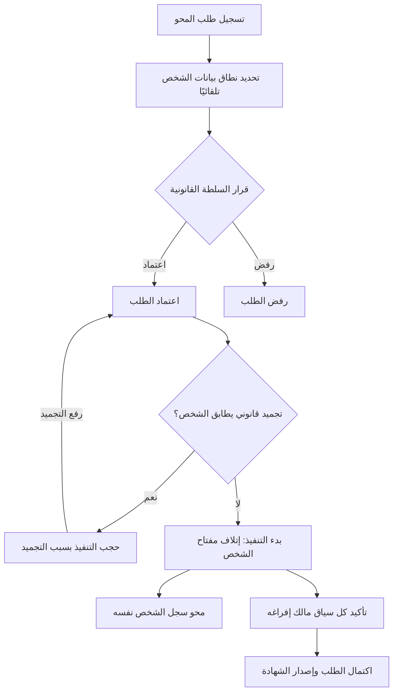
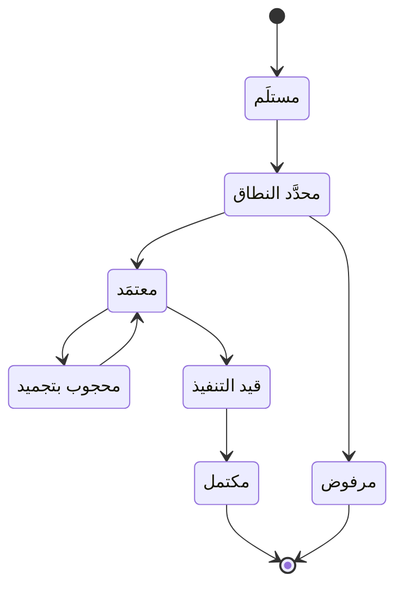

# محو البيانات الشخصية

<!-- BEGIN GENERATED: doc -->
| البند | القيمة |
|---|---|
| المعرّف | FEAT-GOV-ERASURE |
| الإصدار | 0.2 |
| الحالة | مسودة |
| القدرة | CAP-13 الحوكمة والأمن والامتثال |
| القدرة الفرعية | CAP-13.03 الخصوصية والاحتفاظ (R1) |
| الأدوار | السلطة القانونية والامتثال؛ مسؤول الإدارة؛ المدقِّق؛ النظام |
| الشاشات | SCR-70 الاحتفاظ والحجز القانوني والإتلاف والمحو |
| حالات الاستخدام | UC-103، UC-084 |
| القصص | 14: 10 من المواصفة، و4 جديدة |
<!-- END GENERATED: doc -->

## 1. نظرة عامة

### 1.1 القيمة

يتيح لمسؤول الخصوصية تسجيل طلب محو بيانات شخص يعتمده مرجع قانوني مستقل، ثم يمحوها من كل أجزاء المنصة مع إصدار شهادة دون فقدان حقائق التدقيق.

### 1.2 النطاق

| البند | القيمة |
|---|---|
| المستخدمون | السلطة القانونية والامتثال (تسجيل طلب المحو، واعتماده أو رفضه)؛ مسؤول الإدارة (محو سجل الشخص نفسه)؛ المدقِّق (المتابعة دون بيانات شخصية)؛ النظام (تحديد النطاق، وحسم التجميد القانوني، والتنفيذ، والإكمال) |
| الشاشات | SCR-70 الاحتفاظ والحجز القانوني والإتلاف والمحو |
| حالات الاستخدام (بالكلمات) | تسجيل طلب محو بيانات شخص بسند قانوني، واعتماده أو رفضه، ومتابعة تنفيذه حتى صدور شهادته؛ تنفيذ المحو فعليًا على سجل الشخص نفسه بعد الاعتماد |
| المتطلبات (بالكلمات) | محو البيانات الشخصية بحيث يتعذر استرجاعها من المخازن التشغيلية والإسقاطات والنسخ الاحتياطية والأرشيف، مع بقاء حقائق التدقيق غير الشخصية؛ إفراغ كل سياق مالك نسخه الواضحة خلال 24 ساعة من بدء التنفيذ |
| خارج النطاق | السند القانوني للمحو نفسه يأتي جاهزًا من جهة خارجية ولا تُنتجه الميزة؛ التجميد القانوني نفسه (تغطيه ميزة الاحتفاظ والتجميد)؛ تفاصيل هرمية مفاتيح التشفير في طبقة المنصة بما يتجاوز أثرها على المحو |

### 1.3 خريطة الميزة

**الشكل 1: تدفق طلب المحو من التسجيل إلى الشهادة**



**الشكل 2: حالات طلب المحو**



## 2. القواعد المشتركة

تنطبق على كل قصص الميزة، فلا تتكرر داخل القصص. وكل قصة تذكر ما يخصها فقط.

### 2.1 السياق المشترك

كل قصة تبدأ من ثلاثة شروط: مستأجر نشط، وحزمة السياسات الأساسية مفعّلة، ومستخدم مسجّل الدخول ومخوَّل. وتشير إليها القصص بخطوة واحدة: «بفرض السياق المشترك للميزة».

### 2.2 الصلاحية وعدم الإفصاح

- من لا يحق له رؤية العنصر يتلقى ردًا بشكل «غير متاح» تمامًا، فلا يعرف أنه موجود.
- من يرى العنصر ولا يحق له الإجراء يتلقى «لا تملك صلاحية هذا الإجراء».

### 2.3 أوامر تغيير الحالة

- **منع التكرار:** يُرسل كل أمر بمفتاح فريد، فإعادة الطلب نفسه لا تُنفَّذ مرتين.
- **حماية التعديل المتزامن:** يُرسل كل أمر بإصدار البيانات الذي يراه المستخدم. فإن عدّلها غيره في الأثناء، يُرفض الأمر.
- **السجل:** إن نجح الأمر، يُكتب حدثه وسجل التدقيق في المعاملة نفسها.

### 2.4 الرفض المشترك

```gherkin
# language: ar
خاصية: الرفض المشترك لأوامر الميزة

  سيناريو مخطط: رفض مشترك لكل أمر في الميزة
    بفرض السياق المشترك للميزة
    و <الحالة>
    عندما يُرسل المستخدم أي أمر من أوامر الميزة
    اذاً يُرفض برمز <الرمز> ويرى "<الرسالة>"
    و لا يتغير شيء

    امثلة:
      | الحالة                                  | الرمز                  | الرسالة                                                 |
      | العنصر خارج صلاحياته                    | NOT_FOUND              | غير متاح                                                |
      | العنصر مرئي له ولا يحق له الإجراء       | AUTHZ_DENIED           | لا تملك صلاحية هذا الإجراء                              |
      | غيره عدّل العنصر بعد أن فتحه            | VERSION_CONFLICT       | تغيّرت البيانات منذ فتحتها. راجع التغييرات ثم أعد المحاولة |
      | أعاد مفتاح منع التكرار بمحتوى مختلف     | IDEMPOTENCY_KEY_REUSED | طلب مكرر بمحتوى مختلف                                   |
      | البيانات ناقصة أو غير صحيحة             | VALIDATION_FAILED      | بعض البيانات ناقصة أو غير صحيحة. راجع الحقول المعلَّمة      |

  سيناريو: إعادة الطلب نفسه لا تُنفَّذ مرتين
    بفرض السياق المشترك للميزة
    و أمر نجح بمفتاح منع تكرار
    عندما يُعاد الطلب نفسه بالمفتاح نفسه
    اذاً تُعاد النتيجة الأولى ولا يُكتب حدث ثانٍ
```

### 2.5 تأكيد الهوية لكل أمر

كل أمر في هذه الميزة (تسجيل طلب المحو، اعتماده، رفضه، ومحو الشخص نفسه) يحتاج تأكيد هوية معززًا (MFA) قبل تنفيذه. فإن كانت قوة مصادقة الجلسة أقل من المطلوب، يُرفض الأمر برمز `MFA_STEP_UP_REQUIRED` (HTTP 401) ويرى المستخدم «هذا الإجراء يحتاج تأكيد هويتك مرة أخرى»، ثم يُعاد الطلب بعد المصادقة المعززة بنفس مفتاح منع التكرار.

## 3. الجودة وتعريف الاكتمال

### 3.1 متطلبات الجودة

<!-- BEGIN GENERATED: quality -->
| المرجع | الموقف | المطلوب |
|---|---|---|
| QAS-PRV-001 | orders erasure of a data subject | operational & projections ≤ 24 h; backups unrecoverable immediately via key destruction |
<!-- END GENERATED: quality -->

### 3.2 تعريف الاكتمال

القصة مكتملة حين تتحقق الشروط الخمسة:

1. سيناريوهاتها والقواعد المشتركة تمر في الاختبار الآلي.
2. فحوص البنية المعمارية تمر.
3. نصوص الواجهة والرسائل موجودة بالعربية والإنجليزية.
4. مراجعة الكود مكتملة.
5. ما تضيفه القصة نفسها في قسم «القواعد» تحقق.

## 4. فهرس القصص

<!-- BEGIN GENERATED: story-index -->
| المعرّف | القصة | النوع | الحالة |
|---|---|---|---|
| `US-BC01-PER-ERASE` | محو الشخص | أمر | مسودة |
| `US-BC08-ERS-APPROVE` | اعتماد طلب المحو | أمر | مسودة |
| `US-BC08-ERS-REGISTER` | تسجيل طلب المحو | أمر | مسودة |
| `US-BC08-ERS-REJECT` | رفض طلب المحو | أمر | مسودة |
| `US-BC08-Q-ERS-GET` | جلب: Request with scope counts, confirmations and certificate (no personal data) | جلب | مسودة |
| `US-BC08-S-ERASURE-REQUEST-01` | تلقائي: subject scope resolved (طلب المحو) | نظام | مسودة |
| `US-BC08-S-ERASURE-REQUEST-02` | تلقائي: hold matches subject (طلب المحو) | نظام | مسودة |
| `US-BC08-S-ERASURE-REQUEST-03` | تلقائي: hold released (طلب المحو) | نظام | مسودة |
| `US-BC08-S-ERASURE-REQUEST-04` | تلقائي: execution started (طلب المحو) | نظام | مسودة |
| `US-BC08-S-ERASURE-REQUEST-05` | تلقائي: all contexts confirmed (طلب المحو) | نظام | مسودة |
| `US-UI-SCR70-ERASURE-PROGRESS` | متابعة تأكيدات المحو وشهادته | واجهة | مسودة |
| `US-PLT-ERASURE-CONTEXT-PURGE` | إفراغ كل جزء نسخه الواضحة خلال يوم | منصة | مسودة |
| `US-PLT-ERASURE-KEY-SHRED` | محو البيانات الشخصية بإتلاف مفتاح صاحبها | منصة | مسودة |
| `US-OPS-ERASURE-DEADLINE-ALERT` | تنبيه عند تأخر تأكيد المحو | تشغيل | مسودة |
<!-- END GENERATED: story-index -->

## 5. القصص

### 5.1 US-BC01-PER-ERASE — محو الشخص

| النوع | الإصدار | الأولوية | دون اتصال | الحالة |
|---|---|---|---|---|
| أمر | R1 | Must | لا | مسودة |

> **كـ** مسؤول الإدارة الذي يشمل نطاقه التنظيمي وحدة الشخص، **أريد** محو سجل الشخص نفسه بعد اعتماد طلب محوه، **حتى** يتعذر استرجاع بياناته من أي مخزن.

**باختصار:** بعد اعتماد طلب المحو، يمحو مسؤول الإدارة سجل الشخص فتصبح حالته «محذوفة» ويُتلف مفتاح تشفير بياناته الشخصية.

#### القواعد

- **متى يُسمح:** الشخص في حالة «غير نشط»، وله مرجع أمر محو معتمد، ولا تجميد قانوني يشمله.
- **من يُسمح له:** مسؤول الإدارة الذي يشمل نطاقه التنظيمي وحدة الشخص.
- **البيانات:** مرجع أمر المحو المعتمد (إلزامي).
- **الأثر:** تصبح حالة الشخص «محذوفة»، ويُتلف مفتاح تشفير بياناته الشخصية فتصير غير قابلة للاسترجاع من كل مخزن تشغيلي وإسقاط ونسخة احتياطية وأرشيف، ويُسجَّل حدث «مُحي الشخص» يصل إلى إسقاط البحث والدليل.

#### معايير القبول

```gherkin
# language: ar
خاصية: محو الشخص

  سيناريو: مسؤول الإدارة يمحو شخصًا غير نشط بأمر محو معتمد
    بفرض السياق المشترك للميزة
    و شخص في حالة "غير نشط" له مرجع أمر محو معتمد ولا تجميد قانوني يشمله
    عندما يمحو مسؤول الإدارة سجل الشخص
    اذاً تصبح حالته "محذوفة"
    و يُتلف مفتاح تشفير بياناته الشخصية
    و يُسجَّل حدث "مُحي الشخص"

  سيناريو مخطط: رفض خاص بمحو الشخص
    بفرض السياق المشترك للميزة
    و <الحالة>
    عندما يحاول مسؤول الإدارة محو الشخص
    اذاً يُرفض برمز <الرمز> ويرى <الرسالة>
    و لا يتغير شيء

    امثلة:
      | الحالة                           | الرمز                            | الرسالة                                              |
      | يوجد تجميد قانوني يشمل الشخص     | LEGAL_HOLD_ACTIVE                | يوجد تجميد قانوني يمنع هذا الإجراء                   |
      | الشخص ليس في حالة "غير نشط"      | PERSON_INVALID_STATE_TRANSITION  | الوضع الحالي للشخص لا يسمح بهذا الإجراء             |
      | مرجع أمر المحو مفقود             | VALIDATION_FAILED                | مرجع أمر المحو مطلوب                                 |
```

<details><summary>المراجع التقنية والتتبع</summary>

<!-- BEGIN GENERATED: refs US-BC01-PER-ERASE -->
| البند | المعرّف | المعنى |
|---|---|---|
| الواجهة البرمجية | `POST /api/v1/foundation/persons/{id}/actions/erase` | — |
| الأمر | `CMD-PER-ERASE` | محو الشخص |
| السياسة | `POL-PER-ERASE` | Administrator with org scope ⊇ person's unit؛ tenant match; subject ACTIVE; tenant ACTIVE (except TEN operati… |
| الحدث | `EVT-PER-ERASED` | يصل إلى: Search/Directory projection (BC01 read model) |
| الكيان | `AGG-PERSON` | الشخص |
| الجدول | `foundation.persons` | الجدول الرئيسي للشخص |
| وحدة النشر | DU-02 | — |
| المتطلب | REQ-GOV-008 | When the personal data of a data subject must be erased, the system shall make it unrecoverable in operationa… |
| حالة الاستخدام | UC-103 | Apply Retention & Legal Hold |
| الاختبار | TST-PERSON-SM، TST-SLC01-INVARIANTS | دورة حالات الشخص، وثوابت الشريحة SLC-01 |
<!-- END GENERATED: refs US-BC01-PER-ERASE -->

</details>

### 5.2 US-BC08-ERS-APPROVE — اعتماد طلب المحو

| النوع | الإصدار | الأولوية | دون اتصال | الحالة |
|---|---|---|---|---|
| أمر | R1 | Must | لا | مسودة |

> **كـ** السلطة القانونية والامتثال، **أريد** اعتماد طلب محو بعد تحديد نطاقه، **حتى** يتجه للتنفيذ ويُتلف مفتاح صاحب البيانات.

**باختصار:** بعد تحديد نطاق الطلب، يعتمده ممثل عن السلطة القانونية غير من سجّله بملاحظة قرار، فتصبح حالته «معتمدة» ويتجه للتنفيذ ما لم يحجبه تجميد قانوني.

#### القواعد

- **متى يُسمح:** الطلب في حالة «محدد النطاق».
- **من يُسمح له:** السلطة القانونية والامتثال، بشرط ألا يكون من سجّل الطلب (فصل المهام).
- **البيانات:** ملاحظة القرار (إلزامية).
- **الأثر:** تصبح حالة الطلب «معتمدة»، ويُسجَّل حدث «اعتُمد طلب المحو» يصل إلى مدير المفاتيح لإتلاف مفتاح الموضوع، وإلى السياقات المالكة لتحديد النطاق والتأكيد والإفراغ.

#### معايير القبول

```gherkin
# language: ar
خاصية: اعتماد طلب المحو

  سيناريو: اعتماد طلب محدَّد النطاق
    بفرض السياق المشترك للميزة
    و طلب محو في حالة "محدد النطاق"
    عندما تعتمده السلطة القانونية والامتثال بملاحظة قرار وهي غير من سجّله
    اذاً تصبح حالته "معتمدة"
    و يُسجَّل حدث "اعتُمد طلب المحو"

  سيناريو مخطط: رفض خاص باعتماد طلب المحو
    بفرض السياق المشترك للميزة
    و <الحالة>
    عندما يحاول اعتماد الطلب
    اذاً يُرفض برمز <الرمز> ويرى <الرسالة>
    و لا يتغير شيء

    امثلة:
      | الحالة                                   | الرمز                                      | الرسالة                                              |
      | الطلب ليس في حالة "محدد النطاق"          | ERASURE_REQUEST_INVALID_STATE_TRANSITION   | الوضع الحالي لطلب المحو لا يسمح بهذا الإجراء        |
      | المعتمِد هو من سجّل الطلب نفسه            | SEGREGATION_OF_DUTIES                      | لا يجوز أن يعتمد الشخص نفسه ما قدّمه أو طلبه       |
      | ملاحظة القرار مفقودة                      | VALIDATION_FAILED                          | ملاحظة القرار مطلوبة                                 |
```

<details><summary>المراجع التقنية والتتبع</summary>

<!-- BEGIN GENERATED: refs US-BC08-ERS-APPROVE -->
| البند | المعرّف | المعنى |
|---|---|---|
| الواجهة البرمجية | `POST /api/v1/governance/erasure-requests/{id}/actions/approve` | — |
| الأمر | `CMD-ERS-APPROVE` | اعتماد طلب المحو |
| السياسة | `POL-ERS-APPROVE` | Privacy officer / Legal (register) · Legal authority ≠ registrar (approve, reject)؛ tenant match |
| الحدث | `EVT-ERS-APPROVED` | يصل إلى: Key manager (subject key destruction); BC01 / BC02 / BC05 (scope + confirmation); Projections (purge) |
| الكيان | `AGG-ERASURE-REQUEST` | طلب المحو |
| الجدول | `governance.erasure_requests` | الجدول الرئيسي لطلب المحو |
| وحدة النشر | DU-03 | — |
| المتطلب | REQ-GOV-008 | When the personal data of a data subject must be erased, the system shall make it unrecoverable in operationa… |
| حالة الاستخدام | UC-103 | Apply Retention & Legal Hold |
| الاختبار | TST-ERASURE-REQUEST-SM | دورة حالات طلب المحو، وثوابت الشريحة SLC-12a |
<!-- END GENERATED: refs US-BC08-ERS-APPROVE -->

</details>

### 5.3 US-BC08-ERS-REGISTER — تسجيل طلب المحو

| النوع | الإصدار | الأولوية | دون اتصال | الحالة |
|---|---|---|---|---|
| أمر | R1 | Must | لا | مسودة |

> **كـ** السلطة القانونية والامتثال، **أريد** تسجيل طلب محو بيانات شخص بسند قانوني وتحديد واضح لهويته، **حتى** يبدأ النظام تحديد نطاق بياناته تمهيدًا للاعتماد.

**باختصار:** يسجَّل الطلب بسند قانوني وتحديد واضح لصاحب البيانات (سجل الشخص في المنصة، أو كيانات معلومات من نوعه، أو كلاهما)، فيصبح «مستلَمًا» ويبدأ النظام تحديد نطاقه.

#### القواعد

- **متى يُسمح:** لا يوجد طلب سابق بعد، وتتوفر السند القانوني وتحديد صاحب البيانات ومقدّم الطلب.
- **من يُسمح له:** السلطة القانونية والامتثال.
- **البيانات:** السند القانوني (إلزامي)، وتحديد صاحب البيانات (سجل الشخص و/أو كيانات المعلومات التي تخصه)، ومقدّم الطلب (إلزامي).
- **الأثر:** تصبح حالة الطلب «مستلمة»، ويُسجَّل حدث «ورد طلب المحو»، ويبدأ النظام تحديد نطاق بيانات الشخص تلقائيًا.

#### معايير القبول

```gherkin
# language: ar
خاصية: تسجيل طلب المحو

  سيناريو: تسجيل طلب بسند قانوني وتحديد واضح للشخص
    بفرض السياق المشترك للميزة
    و سند قانوني وتحديد واضح لصاحب البيانات ومقدّم الطلب
    عندما تسجّل السلطة القانونية والامتثال طلب المحو
    اذاً تصبح حالته "مستلمة"
    و يُسجَّل حدث "ورد طلب المحو"

  سيناريو مخطط: رفض خاص بتسجيل طلب المحو
    بفرض السياق المشترك للميزة
    و <الحالة>
    عندما يحاول تسجيل الطلب
    اذاً يُرفض برمز <الرمز> ويرى <الرسالة>
    و لا يتغير شيء

    امثلة:
      | الحالة                           | الرمز              | الرسالة                                                 |
      | لا سند قانوني ولا تحديد للشخص   | ERASURE_INVALID    | طلب المحو يحتاج سندًا قانونيًا وتحديدًا واضحًا للشخص   |
      | السند القانوني مفقود             | VALIDATION_FAILED  | السند القانوني مطلوب                                    |
      | مقدّم الطلب مفقود                | VALIDATION_FAILED  | مقدّم الطلب مطلوب                                        |
```

<details><summary>المراجع التقنية والتتبع</summary>

<!-- BEGIN GENERATED: refs US-BC08-ERS-REGISTER -->
| البند | المعرّف | المعنى |
|---|---|---|
| الواجهة البرمجية | `POST /api/v1/governance/erasure-requests` | — |
| الأمر | `CMD-ERS-REGISTER` | تسجيل طلب المحو |
| السياسة | `POL-ERS-REGISTER` | Privacy officer / Legal (register) · Legal authority ≠ registrar (approve, reject)؛ tenant match |
| الحدث | `EVT-ERS-RECEIVED` | يصل إلى: Key manager (subject key destruction); BC01 / BC02 / BC05 (scope + confirmation); Projections (purge) |
| الكيان | `AGG-ERASURE-REQUEST` | طلب المحو |
| الجدول | `governance.erasure_requests` | الجدول الرئيسي لطلب المحو |
| وحدة النشر | DU-03 | — |
| المتطلب | REQ-GOV-008 | When the personal data of a data subject must be erased, the system shall make it unrecoverable in operationa… |
| حالة الاستخدام | UC-103 | Apply Retention & Legal Hold |
| الاختبار | TST-ERASURE-REQUEST-SM | دورة حالات طلب المحو، وثوابت الشريحة SLC-12a |
<!-- END GENERATED: refs US-BC08-ERS-REGISTER -->

</details>

### 5.4 US-BC08-ERS-REJECT — رفض طلب المحو

| النوع | الإصدار | الأولوية | دون اتصال | الحالة |
|---|---|---|---|---|
| أمر | R1 | Must | لا | مسودة |

> **كـ** السلطة القانونية والامتثال، **أريد** رفض طلب المحو بسبب واضح، **حتى** يُحفظ سبب الرفض ولا يُنفَّذ المحو.

**باختصار:** بعد تحديد نطاق الطلب، ترفضه السلطة القانونية والامتثال بسبب (مثل التزام قانوني بالاحتفاظ)، فتصبح حالته «مرفوضة» نهائيًا.

#### القواعد

- **متى يُسمح:** الطلب في حالة «محدد النطاق».
- **من يُسمح له:** السلطة القانونية والامتثال.
- **البيانات:** سبب الرفض (إلزامي).
- **الأثر:** تصبح حالة الطلب «مرفوضة»، وهي حالة نهائية لا يُقبل بعدها أي تغيير، ويُسجَّل حدث «رُفض طلب المحو».

#### معايير القبول

```gherkin
# language: ar
خاصية: رفض طلب المحو

  سيناريو: رفض طلب محدَّد النطاق بسبب
    بفرض السياق المشترك للميزة
    و طلب محو في حالة "محدد النطاق"
    عندما ترفضه السلطة القانونية والامتثال بسبب
    اذاً تصبح حالته "مرفوضة"
    و يُسجَّل حدث "رُفض طلب المحو"

  سيناريو مخطط: رفض خاص برفض طلب المحو
    بفرض السياق المشترك للميزة
    و <الحالة>
    عندما يحاول رفض الطلب
    اذاً يُرفض برمز <الرمز> ويرى <الرسالة>
    و لا يتغير شيء

    امثلة:
      | الحالة                           | الرمز                                      | الرسالة                                        |
      | الطلب ليس في حالة "محدد النطاق" | ERASURE_REQUEST_INVALID_STATE_TRANSITION   | الوضع الحالي لطلب المحو لا يسمح بهذا الإجراء  |
      | سبب الرفض مفقود                  | REASON_REQUIRED                            | اذكر السبب                                      |
      | سبب الرفض غير صحيح                | VALIDATION_FAILED                          | السبب غير صحيح                                  |
```

<details><summary>المراجع التقنية والتتبع</summary>

<!-- BEGIN GENERATED: refs US-BC08-ERS-REJECT -->
| البند | المعرّف | المعنى |
|---|---|---|
| الواجهة البرمجية | `POST /api/v1/governance/erasure-requests/{id}/actions/reject` | — |
| الأمر | `CMD-ERS-REJECT` | رفض طلب المحو |
| السياسة | `POL-ERS-REJECT` | Privacy officer / Legal (register) · Legal authority ≠ registrar (approve, reject)؛ tenant match |
| الحدث | `EVT-ERS-REJECTED` | يصل إلى: Key manager (subject key destruction); BC01 / BC02 / BC05 (scope + confirmation); Projections (purge) |
| الكيان | `AGG-ERASURE-REQUEST` | طلب المحو |
| الجدول | `governance.erasure_requests` | الجدول الرئيسي لطلب المحو |
| وحدة النشر | DU-03 | — |
| المتطلب | REQ-GOV-008 | When the personal data of a data subject must be erased, the system shall make it unrecoverable in operationa… |
| حالة الاستخدام | UC-103 | Apply Retention & Legal Hold |
| الاختبار | TST-ERASURE-REQUEST-SM | دورة حالات طلب المحو، وثوابت الشريحة SLC-12a |
<!-- END GENERATED: refs US-BC08-ERS-REJECT -->

</details>

### 5.5 US-BC08-Q-ERS-GET — جلب: Request with scope counts, confirmations and certificate (no personal data)

| النوع | الإصدار | الأولوية | دون اتصال | الحالة |
|---|---|---|---|---|
| جلب | R1 | Must | لا | مسودة |

> **كـ** السلطة القانونية والامتثال أو المدقِّق، **أريد** جلب بيانات طلب المحو بعدّادات النطاق وتأكيداته وشهادته، **حتى** أتابع تقدم تنفيذه وأتحقق من اكتماله دون رؤية بيانات شخصية.

**باختصار:** تُعاد بيانات الطلب بعدّادات نطاقه وتأكيدات السياقات المالكة وشهادة المحو إن اكتمل، دون أي بيانات شخصية لصاحب الطلب.

#### القواعد

- **من يرى ماذا:** السلطة القانونية والامتثال والمدقِّق يريان كل طلب محو؛ ومن سواهما يتلقى «غير متاح».

#### معايير القبول

```gherkin
# language: ar
خاصية: جلب طلب المحو

  سيناريو: جلب طلب يحق للمستخدم رؤيته
    بفرض السياق المشترك للميزة
    و طلب محو يحق للمستخدم رؤيته
    عندما يطلب بياناته
    اذاً تُعاد عدّادات نطاقه وتأكيدات السياقات المالكة، وشهادته إن اكتمل
    و لا تُعاد أي بيانة شخصية لصاحب الطلب
```

<details><summary>المراجع التقنية والتتبع</summary>

<!-- BEGIN GENERATED: refs US-BC08-Q-ERS-GET -->
| البند | المعرّف | المعنى |
|---|---|---|
| الواجهة البرمجية | `GET /api/v1/governance/erasure-requests/{request_id}` | — |
| الاستعلام | `QRY-ERS-GET` | Request with scope counts, confirmations and certificate (no personal data) |
| السياسة | `POL-ERS-GET` | Legal, Auditor |
| الكيان | `AGG-ERASURE-REQUEST` | طلب المحو |
| الجدول | `governance.erasure_requests` | الجدول الرئيسي لطلب المحو |
| وحدة النشر | DU-03 | — |
| المتطلب | REQ-GOV-008 | When the personal data of a data subject must be erased, the system shall make it unrecoverable in operationa… |
| حالة الاستخدام | UC-103 | Apply Retention & Legal Hold |
| الاختبار | TST-ERASURE-REQUEST-SM | دورة حالات طلب المحو، وثوابت الشريحة SLC-12a |
<!-- END GENERATED: refs US-BC08-Q-ERS-GET -->

</details>

### 5.6 US-BC08-S-ERASURE-REQUEST-01 — تلقائي: subject scope resolved (طلب المحو)

| النوع | الإصدار | الأولوية | دون اتصال | الحالة |
|---|---|---|---|---|
| نظام | R1 | Must | لا ينطبق | مسودة |

> **كـ** النظام، **أريد** تحديد نطاق بيانات الشخص تلقائيًا بعد استلام طلب المحو، **حتى** يعرف المعتمِد حجم ما سيُمحى قبل اعتماده.

**باختصار:** بعد استلام الطلب، يحدد النظام مواضع مفتاح الشخص في كل سياق مالك (سجل الشخص، وكيانات المعلومات الحاملة لبيانات شخصية، وسجلات التأهيل) وعدد سجلات كل سياق، فتصبح حالة الطلب «محددة النطاق».

#### القواعد

- **متى يحدث:** بعد استلام طلب المحو، وتحديد مواضع مفتاح الشخص في كل سياق مالك.
- **الأثر:** تصبح حالة الطلب «محددة النطاق»، ويُسجَّل حدث «حُدد نطاق طلب المحو» وسجل تدقيق بهوية النظام.

#### معايير القبول

```gherkin
# language: ar
خاصية: تحديد نطاق طلب المحو

  سيناريو: اكتمل تحديد نطاق طلب مستلَم
    بفرض طلب محو في حالة "مستلمة"
    عندما يحدد النظام مواضع مفتاح الشخص في كل سياق مالك
    اذاً تصبح حالته "محددة النطاق"
    و يُسجَّل حدث "حُدد نطاق طلب المحو" وسجل تدقيق بهوية النظام

  سيناريو: لا يتغير شيء قبل اكتمال التحديد
    بفرض طلب محو في حالة "مستلمة" ولم يكتمل تحديد نطاقه بعد
    عندما يفحص النظام الطلب
    اذاً تبقى حالته "مستلمة"
    و لا يُسجَّل أي حدث
```

<details><summary>المراجع التقنية والتتبع</summary>

<!-- BEGIN GENERATED: refs US-BC08-S-ERASURE-REQUEST-01 -->
| البند | المعرّف | المعنى |
|---|---|---|
| المحفِّز | `SYS:subject scope resolved` | subject keys located in BC01 (persons), BC02 (entities with personal_data claims) and BC05 (qualification rec… |
| الانتقال | RECEIVED ← SCOPED | — |
| الحدث | `EVT-ERS-SCOPED` | يصل إلى: Key manager (subject key destruction); BC01 / BC02 / BC05 (scope + confirmation); Projections (purge) |
| الكيان | `AGG-ERASURE-REQUEST` | طلب المحو |
| الجدول | `governance.erasure_requests` | الجدول الرئيسي لطلب المحو |
| وحدة النشر | DU-03 | — |
| المتطلب | REQ-GOV-008 | When the personal data of a data subject must be erased, the system shall make it unrecoverable in operationa… |
| حالة الاستخدام | UC-103 | Apply Retention & Legal Hold |
| الاختبار | TST-ERASURE-REQUEST-SM | دورة حالات طلب المحو، وثوابت الشريحة SLC-12a |
<!-- END GENERATED: refs US-BC08-S-ERASURE-REQUEST-01 -->

</details>

### 5.7 US-BC08-S-ERASURE-REQUEST-02 — تلقائي: hold matches subject (طلب المحو)

| النوع | الإصدار | الأولوية | دون اتصال | الحالة |
|---|---|---|---|---|
| نظام | R1 | Must | لا ينطبق | مسودة |

> **كـ** النظام، **أريد** حجب تنفيذ طلب معتمد تبيَّن له تجميد قانوني يطابق صاحبه، **حتى** لا يُتلف مفتاح شخص بياناته محجوزة قانونيًا.

**باختصار:** إذا طابق فحص التجميد القانوني صاحب طلب معتمد، يحجب النظام تنفيذه دون أن يغيّر اعتماده، فتصير حالته «محجوبة بتجميد».

#### القواعد

- **متى يحدث:** على طلب معتمد، عند تبيّن تجميد قانوني يطابق صاحبه.
- **الأثر:** تصبح حالة الطلب «محجوبة بتجميد»، ويُسجَّل حدث «حُجب طلب المحو» وسجل تدقيق بهوية النظام.

#### معايير القبول

```gherkin
# language: ar
خاصية: حجب طلب المحو بتجميد قانوني

  سيناريو: تجميد قانوني يطابق طلبًا معتمدًا
    بفرض طلب محو في حالة "معتمدة" وتجميد قانوني يطابق صاحبه
    عندما يفحص النظام تطابق التجميد
    اذاً تصبح حالته "محجوبة بتجميد"
    و يُسجَّل حدث "حُجب طلب المحو" وسجل تدقيق بهوية النظام

  سيناريو: لا تجميد يطابق الطلب
    بفرض طلب محو في حالة "معتمدة" ولا تجميد قانوني يطابق صاحبه
    عندما يفحص النظام تطابق التجميد
    اذاً تبقى حالته "معتمدة"
    و لا يُسجَّل أي حدث
```

<details><summary>المراجع التقنية والتتبع</summary>

<!-- BEGIN GENERATED: refs US-BC08-S-ERASURE-REQUEST-02 -->
| البند | المعرّف | المعنى |
|---|---|---|
| المحفِّز | `SYS:hold matches subject` | HoldCheck positive |
| الانتقال | APPROVED ← BLOCKED_BY_HOLD | — |
| الحدث | `EVT-ERS-BLOCKED` | يصل إلى: Key manager (subject key destruction); BC01 / BC02 / BC05 (scope + confirmation); Projections (purge) |
| الكيان | `AGG-ERASURE-REQUEST` | طلب المحو |
| الجدول | `governance.erasure_requests` | الجدول الرئيسي لطلب المحو |
| وحدة النشر | DU-03 | — |
| المتطلب | REQ-GOV-008 | When the personal data of a data subject must be erased, the system shall make it unrecoverable in operationa… |
| حالة الاستخدام | UC-103 | Apply Retention & Legal Hold |
| الاختبار | TST-ERASURE-REQUEST-SM | دورة حالات طلب المحو، وثوابت الشريحة SLC-12a |
<!-- END GENERATED: refs US-BC08-S-ERASURE-REQUEST-02 -->

</details>

### 5.8 US-BC08-S-ERASURE-REQUEST-03 — تلقائي: hold released (طلب المحو)

| النوع | الإصدار | الأولوية | دون اتصال | الحالة |
|---|---|---|---|---|
| نظام | R1 | Must | لا ينطبق | مسودة |

> **كـ** النظام، **أريد** إعادة الطلب المحجوب إلى الاعتماد حين يُرفع التجميد الذي حجبه، **حتى** يستمر تنفيذ المحو.

**باختصار:** حين يُرفع التجميد القانوني الذي حجب طلبًا، يعيده النظام إلى حالة «معتمدة» ليستمر تنفيذه.

#### القواعد

- **متى يحدث:** على طلب محجوب بتجميد، عند تبيّن أن التجميد الذي حجبه رُفع.
- **الأثر:** تعود حالة الطلب إلى «معتمدة»، ويُسجَّل حدث «رُفع حجب طلب المحو» وسجل تدقيق بهوية النظام.

#### معايير القبول

```gherkin
# language: ar
خاصية: رفع حجب طلب المحو

  سيناريو: رفع التجميد الذي حجب الطلب
    بفرض طلب محو في حالة "محجوبة بتجميد" ورُفع التجميد الذي حجبه
    عندما يفحص النظام تطابق التجميد
    اذاً تعود حالته إلى "معتمدة"
    و يُسجَّل حدث "رُفع حجب طلب المحو" وسجل تدقيق بهوية النظام

  سيناريو: التجميد لا يزال قائمًا
    بفرض طلب محو في حالة "محجوبة بتجميد" ولا يزال التجميد الذي حجبه قائمًا
    عندما يفحص النظام تطابق التجميد
    اذاً تبقى حالته "محجوبة بتجميد"
    و لا يُسجَّل أي حدث
```

<details><summary>المراجع التقنية والتتبع</summary>

<!-- BEGIN GENERATED: refs US-BC08-S-ERASURE-REQUEST-03 -->
| البند | المعرّف | المعنى |
|---|---|---|
| المحفِّز | `SYS:hold released` | HoldCheck negative |
| الانتقال | BLOCKED_BY_HOLD ← APPROVED | — |
| الحدث | `EVT-ERS-UNBLOCKED` | يصل إلى: Key manager (subject key destruction); BC01 / BC02 / BC05 (scope + confirmation); Projections (purge) |
| الكيان | `AGG-ERASURE-REQUEST` | طلب المحو |
| الجدول | `governance.erasure_requests` | الجدول الرئيسي لطلب المحو |
| وحدة النشر | DU-03 | — |
| المتطلب | REQ-GOV-008 | When the personal data of a data subject must be erased, the system shall make it unrecoverable in operationa… |
| حالة الاستخدام | UC-103 | Apply Retention & Legal Hold |
| الاختبار | TST-ERASURE-REQUEST-SM | دورة حالات طلب المحو، وثوابت الشريحة SLC-12a |
<!-- END GENERATED: refs US-BC08-S-ERASURE-REQUEST-03 -->

</details>

### 5.9 US-BC08-S-ERASURE-REQUEST-04 — تلقائي: execution started (طلب المحو)

| النوع | الإصدار | الأولوية | دون اتصال | الحالة |
|---|---|---|---|---|
| نظام | R1 | Must | لا ينطبق | مسودة |

> **كـ** النظام، **أريد** بدء تنفيذ الطلب المعتمد غير المحجوب بإتلاف مفاتيح الشخص، **حتى** تصبح بياناته غير قابلة للاسترجاع من كل مخزن.

**باختصار:** يُتلف النظام مفاتيح تشفير بيانات الشخص (DEKs) ويطلب من كل سياق مالك إفراغ نسخه الواضحة، مع بقاء مرجع مجهول الهوية لحقائق التدقيق، فتصبح حالة الطلب «قيد التنفيذ».

#### القواعد

- **متى يحدث:** على طلب معتمد غير محجوب بتجميد، عند بدء التنفيذ.
- **الأثر:** تصبح حالة الطلب «قيد التنفيذ»، وتُتلف مفاتيح الشخص، ويُطلب من كل سياق مالك إفراغ نسخه الواضحة، ويُسجَّل حدث «بدأ تنفيذ طلب المحو» وسجل تدقيق بهوية النظام.

#### معايير القبول

```gherkin
# language: ar
خاصية: بدء تنفيذ طلب المحو

  سيناريو: بدء تنفيذ طلب معتمد غير محجوب
    بفرض طلب محو في حالة "معتمدة" ولا تجميد قانوني يحجبه
    عندما يبدأ النظام تنفيذه
    اذاً تُتلف مفاتيح تشفير بيانات الشخص
    و تصبح حالة الطلب "قيد التنفيذ"
    و يُسجَّل حدث "بدأ تنفيذ طلب المحو" وسجل تدقيق بهوية النظام

  سيناريو: لا يبدأ التنفيذ على طلب محجوب
    بفرض طلب محو في حالة "محجوبة بتجميد"
    عندما يفحص النظام الطلب
    اذاً تبقى حالته "محجوبة بتجميد"
    و لا يُسجَّل أي حدث
```

<details><summary>المراجع التقنية والتتبع</summary>

<!-- BEGIN GENERATED: refs US-BC08-S-ERASURE-REQUEST-04 -->
| البند | المعرّف | المعنى |
|---|---|---|
| المحفِّز | `SYS:execution started` | subject DEKs destroyed; owners purge plaintext caches/projections; pseudonymous reference kept for audit facts |
| الانتقال | APPROVED ← EXECUTING | — |
| الحدث | `EVT-ERS-EXECUTING` | يصل إلى: Key manager (subject key destruction); BC01 / BC02 / BC05 (scope + confirmation); Projections (purge) |
| الكيان | `AGG-ERASURE-REQUEST` | طلب المحو |
| الجدول | `governance.erasure_requests` | الجدول الرئيسي لطلب المحو |
| وحدة النشر | DU-03 | — |
| المتطلب | REQ-GOV-008 | When the personal data of a data subject must be erased, the system shall make it unrecoverable in operationa… |
| حالة الاستخدام | UC-103 | Apply Retention & Legal Hold |
| الاختبار | TST-ERASURE-REQUEST-SM | دورة حالات طلب المحو، وثوابت الشريحة SLC-12a |
<!-- END GENERATED: refs US-BC08-S-ERASURE-REQUEST-04 -->

</details>

### 5.10 US-BC08-S-ERASURE-REQUEST-05 — تلقائي: all contexts confirmed (طلب المحو)

| النوع | الإصدار | الأولوية | دون اتصال | الحالة |
|---|---|---|---|---|
| نظام | R1 | Must | لا ينطبق | مسودة |

> **كـ** النظام، **أريد** إغلاق طلب المحو بعد تأكيد كل سياق مالك إفراغه، **حتى** تصدر شهادة المحو.

**باختصار:** عند تأكيد كل السياقات المالكة إفراغ نسخها الواضحة خلال 24 ساعة من بدء التنفيذ (QAS-PRV-001)، يصدر النظام شهادة المحو وتصبح حالة الطلب «مكتملة».

#### القواعد

- **متى يحدث:** على طلب قيد التنفيذ، عند تأكيد كل السياقات المالكة إفراغها خلال 24 ساعة من بدء التنفيذ.
- **الأثر:** تصبح حالة الطلب «مكتملة»، وتصدر شهادة المحو، ويُسجَّل حدث «اكتمل طلب المحو» وسجل تدقيق بهوية النظام.

#### معايير القبول

```gherkin
# language: ar
خاصية: اكتمال طلب المحو

  سيناريو: كل السياقات أكدت الإفراغ خلال الهدف
    بفرض طلب محو في حالة "قيد التنفيذ" وكل السياقات المالكة أكدت إفراغها خلال 24 ساعة من بدء التنفيذ
    عندما يفحص النظام التأكيدات
    اذاً تصبح حالته "مكتملة"
    و تصدر شهادة المحو
    و يُسجَّل حدث "اكتمل طلب المحو" وسجل تدقيق بهوية النظام

  سيناريو: لم تؤكد كل السياقات بعد
    بفرض طلب محو في حالة "قيد التنفيذ" ولم تؤكد كل السياقات المالكة إفراغها بعد
    عندما يفحص النظام التأكيدات
    اذاً تبقى حالته "قيد التنفيذ"
    و لا يُسجَّل أي حدث
```

<details><summary>المراجع التقنية والتتبع</summary>

<!-- BEGIN GENERATED: refs US-BC08-S-ERASURE-REQUEST-05 -->
| البند | المعرّف | المعنى |
|---|---|---|
| المحفِّز | `SYS:all contexts confirmed` | confirmation from each owning context ≤ 24 h (QAS-PRV-001); certificate issued |
| الانتقال | EXECUTING ← COMPLETED | — |
| الحدث | `EVT-ERS-COMPLETED` | يصل إلى: Key manager (subject key destruction); BC01 / BC02 / BC05 (scope + confirmation); Projections (purge) |
| الكيان | `AGG-ERASURE-REQUEST` | طلب المحو |
| الجدول | `governance.erasure_requests` | الجدول الرئيسي لطلب المحو |
| وحدة النشر | DU-03 | — |
| المتطلب | REQ-GOV-008 | When the personal data of a data subject must be erased, the system shall make it unrecoverable in operationa… |
| حالة الاستخدام | UC-103 | Apply Retention & Legal Hold |
| الاختبار | TST-ERASURE-REQUEST-SM | دورة حالات طلب المحو، وثوابت الشريحة SLC-12a |
<!-- END GENERATED: refs US-BC08-S-ERASURE-REQUEST-05 -->

</details>

### 5.11 US-UI-SCR70-ERASURE-PROGRESS — متابعة تأكيدات المحو وشهادته

| النوع | الإصدار | الأولوية | دون اتصال | الحالة |
|---|---|---|---|---|
| واجهة | R1 | Must | لا | مسودة |

> **كـ** السلطة القانونية والامتثال أو المدقِّق، **أريد** متابعة تقدم تنفيذ طلب المحو وتأكيدات كل سياق وشهادته على شاشة واحدة، **حتى** أتحقق من اكتماله دون أن أرى أي بيانات شخصية لصاحبه.

**باختصار:** تعرض الشاشة حالة الطلب وعدّاد النطاق لكل سياق مالك وتأكيداته، وتُظهر شهادة المحو بعد الاكتمال، دون عرض أي بيانات شخصية لصاحب الطلب في أي وقت.

#### القواعد

- **من يُسمح له:** السلطة القانونية والامتثال والمدقِّق.
- **البيانات:** عدّاد النطاق وتأكيدات كل سياق مالك، وشهادة المحو بعد الاكتمال؛ لا تُعرض أي بيانة شخصية لصاحب الطلب أبدًا.

#### معايير القبول

```gherkin
# language: ar
خاصية: متابعة تأكيدات المحو وشهادته

  سيناريو: متابعة طلب قيد التنفيذ
    بفرض السياق المشترك للميزة
    و طلب محو في حالة "قيد التنفيذ" وبعض السياقات أكدت إفراغها
    عندما يفتح المستخدم شاشة متابعة المحو
    اذاً يرى عدّاد النطاق وتأكيدات كل سياق حتى الآن
    و لا يرى أي بيانة شخصية لصاحب الطلب

  سيناريو: عرض الشهادة بعد الاكتمال
    بفرض السياق المشترك للميزة
    و طلب محو في حالة "مكتملة" وله شهادة محو
    عندما يفتح المستخدم شاشة متابعة المحو
    اذاً تُعرض شهادة المحو
```

<details><summary>المراجع التقنية والتتبع</summary>

<!-- BEGIN GENERATED: refs US-UI-SCR70-ERASURE-PROGRESS -->
| البند | المعرّف | المعنى |
|---|---|---|
| حالة الاستخدام | UC-103 | Apply Retention & Legal Hold |
| الشاشة | SCR-70 | شاشة الاحتفاظ والحجز القانوني والإتلاف والمحو |
| المصدر | `[Derived]` | — |
| المتطلب | REQ-GOV-008 | When the personal data of a data subject must be erased, the system shall make it unrecoverable in operationa… |
| حالة الاستخدام | UC-103 | Apply Retention & Legal Hold |
<!-- END GENERATED: refs US-UI-SCR70-ERASURE-PROGRESS -->

</details>

### 5.12 US-PLT-ERASURE-CONTEXT-PURGE — إفراغ كل جزء نسخه الواضحة خلال يوم

| النوع | الإصدار | الأولوية | دون اتصال | الحالة |
|---|---|---|---|---|
| منصة | R1 | Must | لا ينطبق | مسودة |

> **كـ** فريق المنصة، **أريد** أن يفرغ كل سياق مالك نسخه الواضحة من بيانات الشخص خلال 24 ساعة من بدء التنفيذ، **حتى** يتحقق المحو في التشغيلي والإسقاطات معًا لا في المفتاح فقط.

**باختصار:** بعد إتلاف مفتاح الشخص، يفرغ كل سياق مالك (سجل الشخص، كيانات المعلومات، سجلات التأهيل) نسخه الواضحة من التخزين التشغيلي والإسقاطات خلال 24 ساعة، ويؤكد ذلك لطلب المحو (QAS-PRV-001).

#### معايير القبول

```gherkin
# language: ar
خاصية: إفراغ السياقات المالكة بعد إتلاف المفتاح

  سيناريو: الإفراغ يكتمل خلال الهدف
    بفرض بدء تنفيذ طلب محو بإتلاف مفتاح الشخص
    عندما يفرغ كل سياق مالك نسخه الواضحة
    اذاً يكتمل الإفراغ خلال 24 ساعة
    و يؤكد كل سياق إفراغه لطلب المحو
```

<details><summary>المراجع التقنية والتتبع</summary>

<!-- BEGIN GENERATED: refs US-PLT-ERASURE-CONTEXT-PURGE -->
| البند | المعرّف | المعنى |
|---|---|---|
| الجودة | QAS-PRV-001 | orders erasure of a data subject → operational & projections ≤ 24 h; backups unrecoverable immediately via ke… |
| المتطلب | REQ-GOV-008 | When the personal data of a data subject must be erased, the system shall make it unrecoverable in operationa… |
| حالة الاستخدام | UC-103 | Apply Retention & Legal Hold |
<!-- END GENERATED: refs US-PLT-ERASURE-CONTEXT-PURGE -->

</details>

### 5.13 US-PLT-ERASURE-KEY-SHRED — محو البيانات الشخصية بإتلاف مفتاح صاحبها

| النوع | الإصدار | الأولوية | دون اتصال | الحالة |
|---|---|---|---|---|
| منصة | R1 | Must | لا ينطبق | مسودة |

> **كـ** فريق المنصة، **أريد** أن يكون محو البيانات الشخصية بإتلاف مفتاح صاحبها لا بحذف سجلاته، **حتى** تبقى الأحداث والتدقيق سليمة وتصبح بياناته الشخصية غير قابلة للقراءة في كل مكان فورًا.

**باختصار:** بيانات صاحب طلب المحو الشخصية مشفّرة بمفتاح خاص به (ADR-P08)، وإتلاف هذا المفتاح يجعلها غير قابلة للقراءة فورًا في كل مخزن تشغيلي وإسقاط، وفي النسخ الاحتياطية بمجرد ما يُتلف المفتاح معها، مع بقاء مرجع مجهول الهوية لحقائق التدقيق.

#### معايير القبول

```gherkin
# language: ar
خاصية: محو البيانات بإتلاف المفتاح

  سيناريو: إتلاف المفتاح يجعل البيانات غير قابلة للقراءة
    بفرض شخصًا بياناته الشخصية مشفّرة بمفتاحه الخاص
    عندما يُتلف مفتاحه عند تنفيذ طلب المحو
    اذاً تصبح بياناته غير قابلة للقراءة في كل مخزن تشغيلي وإسقاط فورًا
    و يبقى مرجع مجهول الهوية لحقائق التدقيق
```

<details><summary>المراجع التقنية والتتبع</summary>

<!-- BEGIN GENERATED: refs US-PLT-ERASURE-KEY-SHRED -->
| البند | المعرّف | المعنى |
|---|---|---|
| القرار المعماري | ADR-P08 | Erasure vs Immutability |
| المصدر | `17-security-design.md §6` | — |
| المتطلب | REQ-GOV-008 | When the personal data of a data subject must be erased, the system shall make it unrecoverable in operationa… |
| حالة الاستخدام | UC-103 | Apply Retention & Legal Hold |
<!-- END GENERATED: refs US-PLT-ERASURE-KEY-SHRED -->

</details>

### 5.14 US-OPS-ERASURE-DEADLINE-ALERT — تنبيه عند تأخر تأكيد المحو

| النوع | الإصدار | الأولوية | دون اتصال | الحالة |
|---|---|---|---|---|
| تشغيل | R1 | Should | لا ينطبق | مسودة |

> **كـ** فريق التشغيل أو الأمن، **أريد** تنبيهًا حين يتأخر تأكيد أحد السياقات المالكة عن هدف 24 ساعة، **حتى** أتدخل قبل أن يفوت موعد المحو.

**باختصار:** إن لم يؤكد سياق مالك إفراغه خلال 24 ساعة من بدء تنفيذ طلب المحو (QAS-PRV-001)، يصل تنبيه لفريق التشغيل أو الأمن بالسياق المتأخر. **[Derived]**: لا مصدر يحدد قناة التنبيه أو من يستقبله بالاسم، وهذا مستنتج من هدف الـ24 ساعة نفسه.

#### معايير القبول

```gherkin
# language: ar
خاصية: تنبيه تأخر تأكيد المحو

  سيناريو: تأخر تأكيد سياق عن الهدف
    بفرض طلب محو قيد التنفيذ تجاوز بدء تنفيذه 24 ساعة ولم يؤكد أحد السياقات المالكة إفراغه
    عندما يفحص النظام المواعيد
    اذاً يصل تنبيه لفريق التشغيل أو الأمن بالسياق المتأخر

  سيناريو: لا تنبيه قبل فوات الموعد
    بفرض طلب محو قيد التنفيذ لم يتجاوز بدء تنفيذه 24 ساعة
    عندما يفحص النظام المواعيد
    اذاً لا يصل أي تنبيه
```

<details><summary>المراجع التقنية والتتبع</summary>

<!-- BEGIN GENERATED: refs US-OPS-ERASURE-DEADLINE-ALERT -->
| البند | المعرّف | المعنى |
|---|---|---|
| الجودة | QAS-PRV-001 | orders erasure of a data subject → operational & projections ≤ 24 h; backups unrecoverable immediately via ke… |
| المصدر | `[Derived]` | — |
<!-- END GENERATED: refs US-OPS-ERASURE-DEADLINE-ALERT -->

</details>

## 6. التتبع

<!-- BEGIN GENERATED: trace -->
| المتطلب | المعنى | القصص | الاختبار |
|---|---|---|---|
| REQ-GOV-008 | When the personal data of a data subject must be erased, the system shall make it unrecoverable in operationa… | `US-BC01-PER-ERASE`، `US-BC08-ERS-APPROVE`، `US-BC08-ERS-REGISTER`، `US-BC08-ERS-REJECT`، `US-BC08-Q-ERS-GET`، `US-BC08-S-ERASURE-REQUEST-01`، `US-BC08-S-ERASURE-REQUEST-02`، `US-BC08-S-ERASURE-REQUEST-03`، `US-BC08-S-ERASURE-REQUEST-04`، `US-BC08-S-ERASURE-REQUEST-05`، `US-PLT-ERASURE-CONTEXT-PURGE`، `US-PLT-ERASURE-KEY-SHRED`، `US-UI-SCR70-ERASURE-PROGRESS` | TST-ATTACHMENT-SM، TST-ERASURE-REQUEST-SM، TST-PERSON-SM، TST-SLC12A-INVARIANTS |
<!-- END GENERATED: trace -->

## 7. سجل التغييرات

| الإصدار | التاريخ | التغيير |
|---|---|---|
| 0.1 | — | هيكل مولَّد من خريطة الميزات |
| 0.2 | 2026-10-13 | كتابة القصص كاملة بمعيار القصص |
