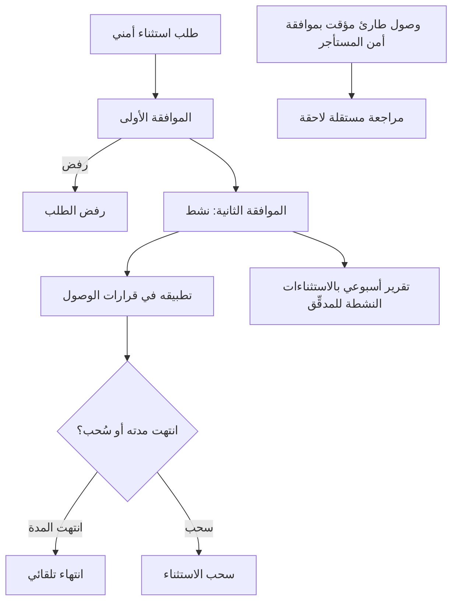
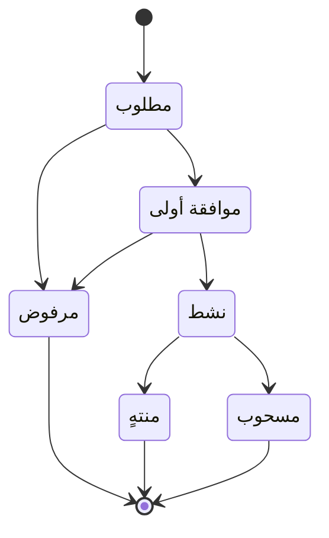

# الاستثناءات الأمنية المؤقتة

<!-- BEGIN GENERATED: doc -->
| البند | القيمة |
|---|---|
| المعرّف | FEAT-GOV-EXCEPTIONS |
| الإصدار | 0.2 |
| الحالة | مسودة |
| القدرة | CAP-13 الحوكمة والأمن والامتثال |
| القدرة الفرعية | CAP-13.01 التصنيف والسياسات (R1) |
| الأدوار | أي مستخدم مخوَّل؛ مسؤول الأمن؛ المدقِّق؛ النظام |
| الشاشات | SCR-67 التصنيف والتصاريح والاستثناءات |
| حالات الاستخدام | UC-088 |
| القصص | 11: 6 من المواصفة، و5 جديدة |
<!-- END GENERATED: doc -->

## 1. نظرة عامة

### 1.1 القيمة

يتيح للمستخدم طلب استثناء أمني مؤقت بمبرر واضح يعتمده شخصان مخولان، ويُسحب تلقائيًا عند انتهاء مدته.

### 1.2 النطاق

| البند | القيمة |
|---|---|
| المستخدمون | أي مستخدم مخوَّل (طلب الاستثناء)؛ مسؤول الأمن (الموافقتان، والرفض، والسحب، وموافقة الوصول الطارئ)؛ المدقِّق (المتابعة والتقرير الأسبوعي والمراجعة المستقلة)؛ مشغّل المنصة (طلب الوصول الطارئ)؛ النظام (الانتهاء التلقائي وتطبيق الاستثناء في قرار الوصول) |
| الشاشات | SCR-67 التصنيف والتصاريح والاستثناءات |
| حالات الاستخدام (بالكلمات) | طلب استثناء مؤقت من قاعدة سياسة المستأجر، واعتماده بموافقتين متمايزتين أو رفضه أو سحبه، وتطبيقه في قرارات الوصول ما دام نشطًا، وانتهاؤه تلقائيًا بانتهاء مدته؛ ومنح وصول طارئ مؤقت لمشغّل المنصة بموافقة أمن المستأجر، ومراجعة مستقلة لاحقة له |
| المتطلبات (بالكلمات) | أي استثناء أمني يحتاج موافقة شخصين مخوَّلين متمايزين، ويُسحب تلقائيًا عند انتهاء مدته |
| خارج النطاق | تعريف قواعد سياسة المستأجر نفسها وتصنيفها (تغطيها ميزة التصنيف والسياسات)؛ آلية مخزن الأسرار التي يصدر منها اعتماد الوصول الطارئ |

### 1.3 خريطة الميزة

**الشكل 1: تدفق الاستثناء الأمني من الطلب إلى انتهائه**



**الشكل 2: حالات الاستثناء الأمني**



## 2. القواعد المشتركة

تنطبق على كل قصص الميزة، فلا تتكرر داخل القصص. وكل قصة تذكر ما يخصها فقط.

### 2.1 السياق المشترك

كل قصة تبدأ من ثلاثة شروط: مستأجر نشط، وحزمة السياسات الأساسية مفعّلة، ومستخدم مسجّل الدخول ومخوَّل. وتشير إليها القصص بخطوة واحدة: «بفرض السياق المشترك للميزة».

### 2.2 الصلاحية وعدم الإفصاح

- من لا يحق له رؤية العنصر يتلقى ردًا بشكل «غير متاح» تمامًا، فلا يعرف أنه موجود.
- من يرى العنصر ولا يحق له الإجراء يتلقى «لا تملك صلاحية هذا الإجراء».

### 2.3 أوامر تغيير الحالة

- **منع التكرار:** يُرسل كل أمر بمفتاح فريد، فإعادة الطلب نفسه لا تُنفَّذ مرتين.
- **حماية التعديل المتزامن:** يُرسل كل أمر بإصدار البيانات الذي يراه المستخدم. فإن عدّلها غيره في الأثناء، يُرفض الأمر.
- **السجل:** إن نجح الأمر، يُكتب حدثه وسجل التدقيق في المعاملة نفسها.

### 2.4 الرفض المشترك

```gherkin
# language: ar
خاصية: الرفض المشترك لأوامر الميزة

  سيناريو مخطط: رفض مشترك لكل أمر في الميزة
    بفرض السياق المشترك للميزة
    و <الحالة>
    عندما يُرسل المستخدم أي أمر من أوامر الميزة
    اذاً يُرفض برمز <الرمز> ويرى "<الرسالة>"
    و لا يتغير شيء

    امثلة:
      | الحالة                                  | الرمز                  | الرسالة                                                 |
      | العنصر خارج صلاحياته                    | NOT_FOUND              | غير متاح                                                |
      | العنصر مرئي له ولا يحق له الإجراء       | AUTHZ_DENIED           | لا تملك صلاحية هذا الإجراء                              |
      | غيره عدّل العنصر بعد أن فتحه            | VERSION_CONFLICT       | تغيّرت البيانات منذ فتحتها. راجع التغييرات ثم أعد المحاولة |
      | أعاد مفتاح منع التكرار بمحتوى مختلف     | IDEMPOTENCY_KEY_REUSED | طلب مكرر بمحتوى مختلف                                   |
      | البيانات ناقصة أو غير صحيحة             | VALIDATION_FAILED      | بعض البيانات ناقصة أو غير صحيحة. راجع الحقول المعلَّمة      |

  سيناريو: إعادة الطلب نفسه لا تُنفَّذ مرتين
    بفرض السياق المشترك للميزة
    و أمر نجح بمفتاح منع تكرار
    عندما يُعاد الطلب نفسه بالمفتاح نفسه
    اذاً تُعاد النتيجة الأولى ولا يُكتب حدث ثانٍ
```

## 3. الجودة وتعريف الاكتمال

### 3.1 متطلبات الجودة

<!-- BEGIN GENERATED: quality -->
لا متطلبات جودة مرتبطة بمتطلبات هذه الميزة مباشرة. تنطبق متطلبات المنصة العامة (`FEAT-PLT-*`).
<!-- END GENERATED: quality -->

### 3.2 تعريف الاكتمال

القصة مكتملة حين تتحقق الشروط الخمسة:

1. سيناريوهاتها والقواعد المشتركة تمر في الاختبار الآلي.
2. فحوص البنية المعمارية تمر.
3. نصوص الواجهة والرسائل موجودة بالعربية والإنجليزية.
4. مراجعة الكود مكتملة.
5. ما تضيفه القصة نفسها في قسم «القواعد» تحقق.

## 4. فهرس القصص

<!-- BEGIN GENERATED: story-index -->
| المعرّف | القصة | النوع | الحالة |
|---|---|---|---|
| `US-BC08-EXC-APPROVE` | اعتماد الاستثناء الأمني | أمر | مسودة |
| `US-BC08-EXC-REJECT` | رفض الاستثناء الأمني | أمر | مسودة |
| `US-BC08-EXC-REQUEST` | طلب الاستثناء الأمني | أمر | مسودة |
| `US-BC08-EXC-REVOKE` | سحب الاستثناء الأمني | أمر | مسودة |
| `US-BC08-Q-EXC-LIST` | جلب: Exceptions by state | جلب | مسودة |
| `US-BC08-S-SECURITY-EXCEPTION-01` | تلقائي: end reached (الاستثناء الأمني) | نظام | مسودة |
| `US-UI-SCR67-EXCEPTIONS` | متابعة الاستثناءات وموعد انتهائها ومعتمديها | واجهة | مسودة |
| `US-PLT-EXC-PDP-APPLY` | تطبيق الاستثناء النشط في قرار الوصول | منصة | مسودة |
| `US-OPS-BREAKGLASS-REVIEW` | مراجعة مستقلة لكل وصول طارئ | تشغيل | مسودة |
| `US-OPS-BREAKGLASS-TENANT-ACCESS` | وصول طارئ مؤقت للمشغل بموافقة الأمن | تشغيل | مسودة |
| `US-OPS-EXC-WEEKLY-REPORT` | تقرير أسبوعي بالاستثناءات النشطة للمدقق | تشغيل | مسودة |
<!-- END GENERATED: story-index -->

## 5. القصص

### 5.1 US-BC08-EXC-APPROVE — اعتماد الاستثناء الأمني

| النوع | الإصدار | الأولوية | دون اتصال | الحالة |
|---|---|---|---|---|
| أمر | R1 | Must | لا | مسودة |

> **كـ** مسؤول الأمن، **أريد** اعتماد الاستثناء الأمني بموافقتين متمايزتين، **حتى** يصبح نافذًا في قرارات الوصول بعد التحقق من استقلال المعتمدين.

**باختصار:** يعتمد مسؤول الأمن الطلب مرتين من شخصين متمايزين: الأولى تنقله إلى «موافقة أولى»، والثانية ممن ليس الطالب ولا المعتمِد الأول تنقله إلى «نشط».

#### القواعد

- **متى يُسمح:** من «مطلوب» إلى «موافقة أولى» إن كان المعتمِد غير الطالب؛ ومن «موافقة أولى» إلى «نشط» إن كان المعتمِد غير الطالب وغير المعتمِد الأول.
- **من يُسمح له:** مسؤول الأمن.
- **الأثر:** الموافقة الأولى تُسجِّل حدث «اعتُمد الاستثناء أول مرة»؛ والموافقة الثانية تنشِّط الاستثناء، وتُسجِّل حدث «نُشِّط الاستثناء» الذي يرفع إصدار الأمان فتُبطَل ذاكرة القرارات فورًا في كل نقاط الفرض.

#### معايير القبول

```gherkin
# language: ar
خاصية: اعتماد الاستثناء الأمني

  سيناريو مخطط: الموافقة تنقل الاستثناء إلى حالته التالية
    بفرض السياق المشترك للميزة
    و استثناء أمني في حالة <من> والمعتمِد يحقق شرط الموافقة لهذا الانتقال
    عندما يعتمده مسؤول الأمن
    اذاً تصبح حالته <إلى>
    و يُسجَّل حدث <الحدث>

    امثلة:
      | من             | إلى             | الحدث                        |
      | "مطلوب"        | "موافقة أولى"   | "اعتُمد الاستثناء أول مرة"   |
      | "موافقة أولى"  | "نشط"           | "نُشِّط الاستثناء"            |

  سيناريو مخطط: رفض خاص باعتماد الاستثناء
    بفرض السياق المشترك للميزة
    و <الحالة>
    عندما يحاول اعتماد الاستثناء
    اذاً يُرفض برمز <الرمز> ويرى <الرسالة>
    و لا يتغير شيء

    امثلة:
      | الحالة                                           | الرمز                                        | الرسالة                                              |
      | الاستثناء ليس في حالة "مطلوب" أو "موافقة أولى"  | SECURITY_EXCEPTION_INVALID_STATE_TRANSITION  | الوضع الحالي للاستثناء الأمني لا يسمح بهذا الإجراء  |
      | المعتمِد هو الطالب أو المعتمِد الأول نفسه        | SEGREGATION_OF_DUTIES                        | لا يجوز أن يعتمد الشخص نفسه ما قدّمه أو طلبه       |
      | قوة مصادقة الجلسة أقل من المطلوب                 | MFA_STEP_UP_REQUIRED                         | هذا الإجراء يحتاج تأكيد هويتك مرة أخرى               |
```

<details><summary>المراجع التقنية والتتبع</summary>

<!-- BEGIN GENERATED: refs US-BC08-EXC-APPROVE -->
| البند | المعرّف | المعنى |
|---|---|---|
| الواجهة البرمجية | `POST /api/v1/governance/security-exceptions/{id}/actions/approve` | — |
| الأمر | `CMD-EXC-APPROVE` | اعتماد الاستثناء الأمني |
| السياسة | `POL-EXC-APPROVE` | authenticated user (request) \| Security Officer (approve/reject/revoke)؛ tenant match; subject ACTIVE; tenant… |
| الحدث | `EVT-EXC-ACTIVATED` | يصل إلى: Security-version service (EVT-SEC-VERSION-INCREMENTED); PEP decision caches; Projection security-ver… |
| الحدث | `EVT-EXC-FIRST-APPROVED` | يصل إلى: Search/Directory projection (BC01 read model) |
| الكيان | `AGG-SECURITY-EXCEPTION` | الاستثناء الأمني |
| الجدول | `governance.security_exceptions` | الجدول الرئيسي للاستثناء الأمني |
| وحدة النشر | DU-03 | — |
| المتطلب | REQ-FND-017 | When a security exception is requested, the system shall require approval by two distinct authorized persons… |
| حالة الاستخدام | UC-088 | Request & Approve Security Exception |
| الاختبار | TST-SECURITY-EXCEPTION-SM، TST-SLC01-INVARIANTS | دورة حالات الاستثناء الأمني، وثوابت الشريحة SLC-01 |
<!-- END GENERATED: refs US-BC08-EXC-APPROVE -->

</details>

### 5.2 US-BC08-EXC-REJECT — رفض الاستثناء الأمني

| النوع | الإصدار | الأولوية | دون اتصال | الحالة |
|---|---|---|---|---|
| أمر | R1 | Must | لا | مسودة |

> **كـ** مسؤول الأمن، **أريد** رفض طلب الاستثناء الأمني بسبب، **حتى** لا يصبح نافذًا.

**باختصار:** يرفض مسؤول الأمن طلبًا لم يُنشَّط بعد (مطلوبًا أو بموافقة أولى) بسبب، فتصبح حالته «مرفوض» نهائيًا.

#### القواعد

- **متى يُسمح:** الاستثناء في حالة «مطلوب» أو «موافقة أولى».
- **من يُسمح له:** مسؤول الأمن.
- **البيانات:** سبب الرفض (إلزامي).
- **الأثر:** تصبح حالته «مرفوض»، وهي حالة نهائية لا يُقبل بعدها أي تغيير، ويُسجَّل حدث «رُفض الاستثناء».

#### معايير القبول

```gherkin
# language: ar
خاصية: رفض الاستثناء الأمني

  سيناريو: رفض استثناء لم يُنشَّط بعد
    بفرض السياق المشترك للميزة
    و استثناء أمني في حالة "مطلوب" أو "موافقة أولى"
    عندما يرفضه مسؤول الأمن بسبب
    اذاً تصبح حالته "مرفوض"
    و يُسجَّل حدث "رُفض الاستثناء"

  سيناريو مخطط: رفض خاص برفض الاستثناء
    بفرض السياق المشترك للميزة
    و <الحالة>
    عندما يحاول رفض الاستثناء
    اذاً يُرفض برمز <الرمز> ويرى <الرسالة>
    و لا يتغير شيء

    امثلة:
      | الحالة                                             | الرمز                                        | الرسالة                                              |
      | الاستثناء ليس في حالة "مطلوب" أو "موافقة أولى"    | SECURITY_EXCEPTION_INVALID_STATE_TRANSITION  | الوضع الحالي للاستثناء الأمني لا يسمح بهذا الإجراء  |
      | سبب الرفض مفقود                                    | REASON_REQUIRED                              | اذكر السبب                                            |
      | سبب الرفض غير صحيح                                  | VALIDATION_FAILED                            | السبب غير صحيح                                        |
```

<details><summary>المراجع التقنية والتتبع</summary>

<!-- BEGIN GENERATED: refs US-BC08-EXC-REJECT -->
| البند | المعرّف | المعنى |
|---|---|---|
| الواجهة البرمجية | `POST /api/v1/governance/security-exceptions/{id}/actions/reject` | — |
| الأمر | `CMD-EXC-REJECT` | رفض الاستثناء الأمني |
| السياسة | `POL-EXC-REJECT` | authenticated user (request) \| Security Officer (approve/reject/revoke)؛ tenant match; subject ACTIVE; tenant… |
| الحدث | `EVT-EXC-REJECTED` | يصل إلى: Search/Directory projection (BC01 read model) |
| الكيان | `AGG-SECURITY-EXCEPTION` | الاستثناء الأمني |
| الجدول | `governance.security_exceptions` | الجدول الرئيسي للاستثناء الأمني |
| وحدة النشر | DU-03 | — |
| المتطلب | REQ-FND-017 | When a security exception is requested, the system shall require approval by two distinct authorized persons… |
| حالة الاستخدام | UC-088 | Request & Approve Security Exception |
| الاختبار | TST-SECURITY-EXCEPTION-SM، TST-SLC01-INVARIANTS | دورة حالات الاستثناء الأمني، وثوابت الشريحة SLC-01 |
<!-- END GENERATED: refs US-BC08-EXC-REJECT -->

</details>

### 5.3 US-BC08-EXC-REQUEST — طلب الاستثناء الأمني

| النوع | الإصدار | الأولوية | دون اتصال | الحالة |
|---|---|---|---|---|
| أمر | R1 | Must | لا | مسودة |

> **كـ** أي مستخدم مخوَّل، **أريد** طلب استثناء مؤقت من قاعدة سياسة في مستأجري بمبرر ومدة محددة، **حتى** أنفّذ ما تمنعه السياسة لحاجة عمل موثقة.

**باختصار:** يطلب المستخدم استثناءً لقاعدة من سياسات المستأجر لا من حزمة السياسات الأساسية، بمبرر ومدة لا تتجاوز 30 يومًا ونطاق موضوع، فيصبح «مطلوبًا» بانتظار موافقتين.

#### القواعد

- **متى يُسمح:** القاعدة المستهدفة من سياسات المستأجر لا من حزمة السياسات الأساسية، والمدة لا تتجاوز 30 يومًا، والمبرر مذكور.
- **من يُسمح له:** أي مستخدم مخوَّل.
- **البيانات:** قاعدة السياسة، ونطاق الموضوع، والمبرر، وتاريخا البداية والنهاية (كلها إلزامية).
- **الأثر:** تصبح حالته «مطلوب»، ويُسجَّل حدث «طُلب الاستثناء».

#### معايير القبول

```gherkin
# language: ar
خاصية: طلب الاستثناء الأمني

  سيناريو: طلب استثناء لقاعدة سياسة مستأجر بمبرر ومدة صحيحة
    بفرض السياق المشترك للميزة
    و قاعدة من سياسات المستأجر، ومبرر، ومدة لا تتجاوز 30 يومًا
    عندما يطلب المستخدم الاستثناء
    اذاً تصبح حالته "مطلوب"
    و يُسجَّل حدث "طُلب الاستثناء"

  سيناريو مخطط: رفض خاص بطلب الاستثناء
    بفرض السياق المشترك للميزة
    و <الحالة>
    عندما يحاول طلب الاستثناء
    اذاً يُرفض برمز <الرمز> ويرى <الرسالة>
    و لا يتغير شيء

    امثلة:
      | الحالة                                                        | الرمز               | الرسالة                                                     |
      | القاعدة من حزمة السياسات الأساسية أو المدة أطول من 30 يومًا  | EXCEPTION_NOT_ALLOWED | الاستثناء غير مسموح: قواعد المستأجر فقط، ولمدة لا تتجاوز 30 يومًا |
      | قاعدة السياسة مفقودة                                          | VALIDATION_FAILED     | قاعدة السياسة مطلوبة                                          |
      | المبرر مفقود                                                  | VALIDATION_FAILED     | المبرر مطلوب                                                   |
```

<details><summary>المراجع التقنية والتتبع</summary>

<!-- BEGIN GENERATED: refs US-BC08-EXC-REQUEST -->
| البند | المعرّف | المعنى |
|---|---|---|
| الواجهة البرمجية | `POST /api/v1/governance/security-exceptions` | — |
| الأمر | `CMD-EXC-REQUEST` | طلب الاستثناء الأمني |
| السياسة | `POL-EXC-REQUEST` | authenticated user (request) \| Security Officer (approve/reject/revoke)؛ tenant match; subject ACTIVE; tenant… |
| الحدث | `EVT-EXC-REQUESTED` | يصل إلى: Search/Directory projection (BC01 read model) |
| الكيان | `AGG-SECURITY-EXCEPTION` | الاستثناء الأمني |
| الجدول | `governance.security_exceptions` | الجدول الرئيسي للاستثناء الأمني |
| وحدة النشر | DU-03 | — |
| المتطلب | REQ-FND-017 | When a security exception is requested, the system shall require approval by two distinct authorized persons… |
| حالة الاستخدام | UC-088 | Request & Approve Security Exception |
| الاختبار | TST-SECURITY-EXCEPTION-SM، TST-SLC01-INVARIANTS | دورة حالات الاستثناء الأمني، وثوابت الشريحة SLC-01 |
<!-- END GENERATED: refs US-BC08-EXC-REQUEST -->

</details>

### 5.4 US-BC08-EXC-REVOKE — سحب الاستثناء الأمني

| النوع | الإصدار | الأولوية | دون اتصال | الحالة |
|---|---|---|---|---|
| أمر | R1 | Must | لا | مسودة |

> **كـ** مسؤول الأمن، **أريد** سحب الاستثناء النشط بسبب، **حتى** يتوقف أثره فورًا في قرارات الوصول.

**باختصار:** يسحب مسؤول الأمن استثناءً نشطًا بسبب، فتصبح حالته «مسحوب» نهائيًا ويتوقف تطبيقه فورًا في كل قرار وصول.

#### القواعد

- **متى يُسمح:** الاستثناء في حالة «نشط».
- **من يُسمح له:** مسؤول الأمن.
- **البيانات:** سبب السحب (إلزامي).
- **الأثر:** تصبح حالته «مسحوب»، وهي حالة نهائية، ويرتفع إصدار الأمان فتُبطَل ذاكرة القرارات فورًا في كل نقاط الفرض والإسقاطات، ويُسجَّل حدث «سُحب الاستثناء».

#### معايير القبول

```gherkin
# language: ar
خاصية: سحب الاستثناء الأمني

  سيناريو: سحب استثناء نشط بسبب
    بفرض السياق المشترك للميزة
    و استثناء أمني في حالة "نشط"
    عندما يسحبه مسؤول الأمن بسبب
    اذاً تصبح حالته "مسحوب"
    و يُسجَّل حدث "سُحب الاستثناء"

  سيناريو مخطط: رفض خاص بسحب الاستثناء
    بفرض السياق المشترك للميزة
    و <الحالة>
    عندما يحاول سحب الاستثناء
    اذاً يُرفض برمز <الرمز> ويرى <الرسالة>
    و لا يتغير شيء

    امثلة:
      | الحالة                       | الرمز                                        | الرسالة                                              |
      | الاستثناء ليس في حالة "نشط" | SECURITY_EXCEPTION_INVALID_STATE_TRANSITION  | الوضع الحالي للاستثناء الأمني لا يسمح بهذا الإجراء  |
      | سبب السحب مفقود              | REASON_REQUIRED                              | اذكر السبب                                            |
      | سبب السحب غير صحيح           | VALIDATION_FAILED                            | السبب غير صحيح                                        |
```

<details><summary>المراجع التقنية والتتبع</summary>

<!-- BEGIN GENERATED: refs US-BC08-EXC-REVOKE -->
| البند | المعرّف | المعنى |
|---|---|---|
| الواجهة البرمجية | `POST /api/v1/governance/security-exceptions/{id}/actions/revoke` | — |
| الأمر | `CMD-EXC-REVOKE` | سحب الاستثناء الأمني |
| السياسة | `POL-EXC-REVOKE` | authenticated user (request) \| Security Officer (approve/reject/revoke)؛ tenant match; subject ACTIVE; tenant… |
| الحدث | `EVT-EXC-REVOKED` | يصل إلى: Security-version service (EVT-SEC-VERSION-INCREMENTED); PEP decision caches; Projection security-ver… |
| الكيان | `AGG-SECURITY-EXCEPTION` | الاستثناء الأمني |
| الجدول | `governance.security_exceptions` | الجدول الرئيسي للاستثناء الأمني |
| وحدة النشر | DU-03 | — |
| المتطلب | REQ-FND-017 | When a security exception is requested, the system shall require approval by two distinct authorized persons… |
| حالة الاستخدام | UC-088 | Request & Approve Security Exception |
| الاختبار | TST-SECURITY-EXCEPTION-SM، TST-SLC01-INVARIANTS | دورة حالات الاستثناء الأمني، وثوابت الشريحة SLC-01 |
<!-- END GENERATED: refs US-BC08-EXC-REVOKE -->

</details>

### 5.5 US-BC08-Q-EXC-LIST — جلب: Exceptions by state

| النوع | الإصدار | الأولوية | دون اتصال | الحالة |
|---|---|---|---|---|
| جلب | R1 | Must | لا | مسودة |

> **كـ** مسؤول الأمن أو المدقِّق، **أريد** استعراض الاستثناءات الأمنية بحالتها، **حتى** أتابع ما هو نشط أو قيد الموافقة ضمن نطاقي.

**باختصار:** تُعاد الاستثناءات التي يحق للمستخدم رؤيتها ضمن نطاق أدوار الموضوع وقاعدة التصنيف، صفحةً بعد صفحة بمؤشر.

#### القواعد

- **من يرى ماذا:** مسؤول الأمن والمدقِّق يريان الاستثناءات ضمن نطاق أدوار الموضوع المتقاطع مع قاعدة التصنيف؛ ومن سواهما يتلقى «غير متاح».
- **البيانات:** المرشحات: الحالة. والترقيم بالمؤشر والحد.

#### معايير القبول

```gherkin
# language: ar
خاصية: قائمة الاستثناءات الأمنية

  سيناريو: يرى المستخدم استثناءات نطاقه فقط
    بفرض السياق المشترك للميزة
    و استثناءات أمنية داخل نطاق المستخدم وأخرى خارجه
    عندما يطلب قائمة الاستثناءات بحالة معيّنة
    اذاً تُعاد الاستثناءات داخل نطاقه فقط المطابقة للحالة
    و لا يكشف أي عدد أو اقتراح وجود استثناء محجوب

  سيناريو: الصفحة التالية
    بفرض السياق المشترك للميزة
    و استثناءات أكثر من صفحة
    عندما يطلب الصفحة التالية بالمؤشر
    اذاً تُعاد الاستثناءات التالية دون تكرار ولا فجوة
```

<details><summary>المراجع التقنية والتتبع</summary>

<!-- BEGIN GENERATED: refs US-BC08-Q-EXC-LIST -->
| البند | المعرّف | المعنى |
|---|---|---|
| الواجهة البرمجية | `GET /api/v1/governance/security-exceptions` | — |
| الاستعلام | `QRY-EXC-LIST` | Exceptions by state |
| السياسة | `POL-EXC-LIST` | org scope of subject roles ∩ classification rule |
| الكيان | `AGG-SECURITY-EXCEPTION` | الاستثناء الأمني |
| الجدول | `governance.security_exceptions` | الجدول الرئيسي للاستثناء الأمني |
| وحدة النشر | DU-03 | — |
| المتطلب | REQ-FND-017 | When a security exception is requested, the system shall require approval by two distinct authorized persons… |
| حالة الاستخدام | UC-088 | Request & Approve Security Exception |
| الاختبار | TST-SECURITY-EXCEPTION-SM، TST-SLC01-INVARIANTS | دورة حالات الاستثناء الأمني، وثوابت الشريحة SLC-01 |
<!-- END GENERATED: refs US-BC08-Q-EXC-LIST -->

</details>

### 5.6 US-BC08-S-SECURITY-EXCEPTION-01 — تلقائي: end reached (الاستثناء الأمني)

| النوع | الإصدار | الأولوية | دون اتصال | الحالة |
|---|---|---|---|---|
| نظام | R1 | Must | لا ينطبق | مسودة |

> **كـ** النظام، **أريد** إنهاء الاستثناء الأمني تلقائيًا عند بلوغ موعد انتهائه، **حتى** يتوقف أثره دون تدخل بشري.

**باختصار:** يفحص المجدول مواعيد الاستثناءات النشطة، فإذا بلغ استثناء موعد انتهائه تنتقل حالته إلى «منتهٍ» تلقائيًا ويرتفع إصدار الأمان.

#### القواعد

- **متى يحدث:** على استثناء نشط، عند بلوغ موعد انتهائه.
- **الأثر:** تصبح حالته «منتهٍ»، ويرتفع إصدار الأمان فتُبطَل ذاكرة القرارات فورًا، ويُسجَّل حدث «انتهى الاستثناء» وسجل تدقيق بهوية النظام.

#### معايير القبول

```gherkin
# language: ar
خاصية: انتهاء الاستثناء الأمني تلقائيًا

  سيناريو: بلوغ موعد انتهاء استثناء نشط
    بفرض استثناء أمني في حالة "نشط" بلغ موعد انتهائه
    عندما يحين وقت فحص المجدول
    اذاً تصبح حالته "منتهٍ"
    و يُسجَّل حدث "انتهى الاستثناء" وسجل تدقيق بهوية النظام

  سيناريو: لم يبلغ الموعد بعد
    بفرض استثناء أمني في حالة "نشط" لم يبلغ موعد انتهائه
    عندما يحين وقت فحص المجدول
    اذاً تبقى حالته "نشط"
    و لا يُسجَّل أي حدث
```

<details><summary>المراجع التقنية والتتبع</summary>

<!-- BEGIN GENERATED: refs US-BC08-S-SECURITY-EXCEPTION-01 -->
| البند | المعرّف | المعنى |
|---|---|---|
| المحفِّز | `SYS:end reached` | scheduler |
| الانتقال | ACTIVE ← EXPIRED | — |
| الحدث | `EVT-EXC-EXPIRED` | يصل إلى: Security-version service (EVT-SEC-VERSION-INCREMENTED); PEP decision caches; Projection security-ver… |
| الكيان | `AGG-SECURITY-EXCEPTION` | الاستثناء الأمني |
| الجدول | `governance.security_exceptions` | الجدول الرئيسي للاستثناء الأمني |
| وحدة النشر | DU-03 | — |
| المتطلب | REQ-FND-017 | When a security exception is requested, the system shall require approval by two distinct authorized persons… |
| حالة الاستخدام | UC-088 | Request & Approve Security Exception |
| الاختبار | TST-SECURITY-EXCEPTION-SM، TST-SLC01-INVARIANTS | دورة حالات الاستثناء الأمني، وثوابت الشريحة SLC-01 |
<!-- END GENERATED: refs US-BC08-S-SECURITY-EXCEPTION-01 -->

</details>

### 5.7 US-UI-SCR67-EXCEPTIONS — متابعة الاستثناءات وموعد انتهائها ومعتمديها

| النوع | الإصدار | الأولوية | دون اتصال | الحالة |
|---|---|---|---|---|
| واجهة | R1 | Must | لا | مسودة |

> **كـ** مسؤول الأمن أو المدقِّق، **أريد** متابعة الاستثناءات وموعد انتهاء كل منها ومعتمديها على شاشة واحدة، **حتى** أراقب ما هو نشط وأتدخل قبل سوء استخدامه.

**باختصار:** تعرض الشاشة كل استثناء يحق للمستخدم رؤيته بحالته وموعد انتهائه وطالبه ومعتمديه.

#### القواعد

- **من يُسمح له من يرى ماذا:** مسؤول الأمن والمدقِّق، ضمن نطاق أدوار الموضوع المتقاطع مع قاعدة التصنيف (كما في قائمة الاستثناءات).
- **البيانات:** الحالة، وموعد الانتهاء، وطالب الاستثناء، ومعتمدوه.

#### معايير القبول

```gherkin
# language: ar
خاصية: متابعة الاستثناءات وموعد انتهائها ومعتمديها

  سيناريو: متابعة استثناءات نطاق المستخدم
    بفرض السياق المشترك للميزة
    و استثناءات أمنية بحالات مختلفة يحق للمستخدم رؤيتها
    عندما يفتح شاشة الاستثناءات
    اذاً يرى كل استثناء بحالته وموعد انتهائه وطالبه ومعتمديه
```

<details><summary>المراجع التقنية والتتبع</summary>

<!-- BEGIN GENERATED: refs US-UI-SCR67-EXCEPTIONS -->
| البند | المعرّف | المعنى |
|---|---|---|
| حالة الاستخدام | UC-088 | Request & Approve Security Exception |
| الشاشة | SCR-67 | شاشة التصنيف والتصاريح والاستثناءات |
| المصدر | `[Derived]` | — |
| المتطلب | REQ-FND-017 | When a security exception is requested, the system shall require approval by two distinct authorized persons… |
| حالة الاستخدام | UC-088 | Request & Approve Security Exception |
<!-- END GENERATED: refs US-UI-SCR67-EXCEPTIONS -->

</details>

### 5.8 US-PLT-EXC-PDP-APPLY — تطبيق الاستثناء النشط في قرار الوصول

| النوع | الإصدار | الأولوية | دون اتصال | الحالة |
|---|---|---|---|---|
| منصة | R1 | Must | لا ينطبق | مسودة |

> **كـ** فريق المنصة، **أريد** أن تطبّق نقطة تقييم السياسة الاستثناء النشط في قرار الوصول بدل القاعدة التي يستثنيها، **حتى** يُنفَّذ طلب كان مرفوضًا، وذلك طوال مدة الاستثناء فقط.

**باختصار:** ما دام الاستثناء «نشطًا» ويطابق الموضوع والمورد والفترة، يحل محل قاعدة السياسة المستهدفة في قرار الوصول؛ وبانتهائه أو سحبه تُبطَل ذاكرة القرارات فورًا فيعود تطبيق القاعدة الأصلية في الطلب التالي.

#### معايير القبول

```gherkin
# language: ar
خاصية: تطبيق الاستثناء النشط في قرار الوصول

  سيناريو: استثناء نشط يغيّر قرار الوصول
    بفرض استثناء أمني نشط يطابق الموضوع والمورد والفترة
    عندما يصدر قرار الوصول لهذا الموضوع والمورد
    اذاً يُطبَّق الاستثناء بدل قاعدة السياسة المستهدفة

  سيناريو: انتهاء الاستثناء يعيد تطبيق القاعدة الأصلية
    بفرض استثناء أمني أصبح "منتهيًا" أو "مسحوبًا"
    عندما يصدر قرار الوصول التالي لهذا الموضوع والمورد
    اذاً يُطبَّق قاعدة السياسة الأصلية
```

<details><summary>المراجع التقنية والتتبع</summary>

<!-- BEGIN GENERATED: refs US-PLT-EXC-PDP-APPLY -->
| البند | المعرّف | المعنى |
|---|---|---|
| المصدر | `17-security-design.md §3.1` | — |
| المصدر | `[Derived]` | — |
| المتطلب | REQ-FND-017 | When a security exception is requested, the system shall require approval by two distinct authorized persons… |
| حالة الاستخدام | UC-088 | Request & Approve Security Exception |
<!-- END GENERATED: refs US-PLT-EXC-PDP-APPLY -->

</details>

### 5.9 US-OPS-BREAKGLASS-REVIEW — مراجعة مستقلة لكل وصول طارئ

| النوع | الإصدار | الأولوية | دون اتصال | الحالة |
|---|---|---|---|---|
| تشغيل | R1 | Should | لا ينطبق | مسودة |

> **كـ** فريق التشغيل أو الأمن، **أريد** مراجعة مستقلة لكل وصول طارئ (Break-glass) خلال يوم عمل، **حتى** يتحقق أحد غير الطالب ولا المعتمِد من سلامة استخدامه.

**باختصار:** بعد انتهاء عقد كل وصول طارئ، يراجعه مراجع مستقل من الحوكمة (المدقِّق أو الأمن) غير الطالب وغير المعتمِد خلال يوم عمل، استنادًا إلى سجل التدقيق الكامل للجلسة. **[Derived]**: المصادر تختلف على حالة انقطاع مزوّد الهوية، فهذه القصة تغطي وصول المشغّل إلى بيانات مستأجر فقط.

#### القواعد

- **متى يحدث:** على كل وصول طارئ انتهى عقده.
- **من يُسمح له:** مراجع مستقل من الحوكمة (المدقِّق أو مسؤول الأمن)، غير من طلب الوصول وغير من اعتمده.
- **الأثر:** يُسجَّل قرار المراجعة خلال يوم عمل من انتهاء العقد.

#### معايير القبول

```gherkin
# language: ar
خاصية: مراجعة مستقلة للوصول الطارئ

  سيناريو: مراجعة وصول طارئ انتهى عقده
    بفرض وصولًا طارئًا انتهى عقده
    عندما يراجعه مراجع مستقل غير الطالب وغير المعتمِد
    اذاً يُسجَّل قرار المراجعة خلال يوم عمل من انتهاء العقد
```

<details><summary>المراجع التقنية والتتبع</summary>

<!-- BEGIN GENERATED: refs US-OPS-BREAKGLASS-REVIEW -->
| البند | المعرّف | المعنى |
|---|---|---|
| المصدر | `22-deployment-design.md §10` | — |
| المصدر | `[Derived]` | — |
<!-- END GENERATED: refs US-OPS-BREAKGLASS-REVIEW -->

</details>

### 5.10 US-OPS-BREAKGLASS-TENANT-ACCESS — وصول طارئ مؤقت للمشغل بموافقة الأمن

| النوع | الإصدار | الأولوية | دون اتصال | الحالة |
|---|---|---|---|---|
| تشغيل | R1 | Should | لا ينطبق | مسودة |

> **كـ** مشغّل المنصة، **أريد** وصولًا طارئًا مؤقتًا إلى بيانات مستأجر بموافقة مسؤول أمن ذلك المستأجر، **حتى** أعالج حادثة تحتاج تدخلي دون انتظار إجراء عادي.

**باختصار:** يطلب المشغّل وصولًا بسبب ونطاق ومستأجر ومدة لا تتجاوز 4 ساعات، فيعتمده مسؤول أمن المستأجر نفسه لا زميل مشغّل آخر، ويصدر اعتماد مؤقت بعقد إيجار ينتهي تلقائيًا بانتهاء مدته، دون استعمال مفاتيح المستأجر إلا بموافقة صريحة إضافية من مسؤول الأمن.

#### القواعد

- **متى يُسمح:** مدة الطلب لا تتجاوز 4 ساعات، وله سبب ونطاق ومستأجر محددون.
- **من يُسمح له:** مشغّل المنصة يطلب، ومسؤول أمن المستأجر المعني (لا زميل مشغّل آخر) يعتمد.
- **الأثر:** يصدر اعتماد مؤقت بعقد إيجار بالمدة المطلوبة، ولا يستعمل مفاتيح المستأجر إلا بموافقة صريحة إضافية؛ وينتهي الاعتماد تلقائيًا بانتهاء عقده ويخضع لمراجعة مستقلة لاحقة (القصة 5.9).

#### معايير القبول

```gherkin
# language: ar
خاصية: الوصول الطارئ المؤقت لبيانات مستأجر

  سيناريو: منح وصول طارئ بموافقة مسؤول أمن المستأجر
    بفرض طلب وصول طارئ بسبب ونطاق ومستأجر ومدة لا تتجاوز 4 ساعات
    عندما يوافق مسؤول أمن المستأجر المعني
    اذاً يصدر اعتماد مؤقت بعقد إيجار بالمدة المطلوبة
    و يُسجَّل حدث "مُنح وصول طارئ"

  سيناريو: انتهاء الوصول تلقائيًا
    بفرض وصولًا طارئًا ممنوحًا بلغ انتهاء عقده
    عندما ينتهي العقد
    اذاً يُسحب الاعتماد تلقائيًا
    و يُسجَّل حدث "انتهى الوصول الطارئ"
```

<details><summary>المراجع التقنية والتتبع</summary>

<!-- BEGIN GENERATED: refs US-OPS-BREAKGLASS-TENANT-ACCESS -->
| البند | المعرّف | المعنى |
|---|---|---|
| المصدر | `22-deployment-design.md §10` | — |
| المصدر | `17-security-design.md §1` | — |
| المصدر | `[Derived]` | — |
<!-- END GENERATED: refs US-OPS-BREAKGLASS-TENANT-ACCESS -->

</details>

### 5.11 US-OPS-EXC-WEEKLY-REPORT — تقرير أسبوعي بالاستثناءات النشطة للمدقق

| النوع | الإصدار | الأولوية | دون اتصال | الحالة |
|---|---|---|---|---|
| تشغيل | R1 | Should | لا ينطبق | مسودة |

> **كـ** المدقِّق، **أريد** تقريرًا أسبوعيًا بعدد الاستثناءات الأمنية النشطة في كل مستأجر، **حتى** أراقب تراكمها دون انتظار حادثة.

**باختصار:** يُرسل للمدقِّق أسبوعيًا عدد الاستثناءات النشطة في كل مستأجر، استنادًا إلى مؤشر مراقبة مخصص له.

#### معايير القبول

```gherkin
# language: ar
خاصية: التقرير الأسبوعي بالاستثناءات النشطة

  سيناريو: إرسال التقرير الأسبوعي
    بفرض مؤشر عدد الاستثناءات النشطة مسجَّلًا
    عندما يحين موعد التقرير الأسبوعي
    اذاً يصل للمدقِّق تقرير بعدد الاستثناءات النشطة في كل مستأجر
```

<details><summary>المراجع التقنية والتتبع</summary>

<!-- BEGIN GENERATED: refs US-OPS-EXC-WEEKLY-REPORT -->
| البند | المعرّف | المعنى |
|---|---|---|
| المصدر | `09-reliability/observability-slc01.md §signals` | — |
<!-- END GENERATED: refs US-OPS-EXC-WEEKLY-REPORT -->

</details>

## 6. التتبع

<!-- BEGIN GENERATED: trace -->
| المتطلب | المعنى | القصص | الاختبار |
|---|---|---|---|
| REQ-FND-017 | When a security exception is requested, the system shall require approval by two distinct authorized persons… | `US-BC08-EXC-APPROVE`، `US-BC08-EXC-REJECT`، `US-BC08-EXC-REQUEST`، `US-BC08-EXC-REVOKE`، `US-BC08-Q-EXC-LIST`، `US-BC08-S-SECURITY-EXCEPTION-01`، `US-PLT-EXC-PDP-APPLY`، `US-UI-SCR67-EXCEPTIONS` | TST-SECURITY-EXCEPTION-SM، TST-SLC01-INVARIANTS |
<!-- END GENERATED: trace -->

## 7. سجل التغييرات

| الإصدار | التاريخ | التغيير |
|---|---|---|
| 0.1 | — | هيكل مولَّد من خريطة الميزات |
| 0.2 | 2026-10-13 | كتابة القصص كاملة بمعيار القصص |
