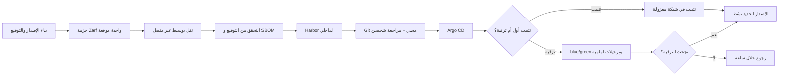

# التثبيت والترقية دون اتصال

<!-- BEGIN GENERATED: doc -->
| البند | القيمة |
|---|---|
| المعرّف | FEAT-PLT-AIRGAP-UPGRADE |
| الإصدار | 0.1 |
| الحالة | مسودة |
| القدرة | CAP-14 تشغيل المنصة |
| القدرة الفرعية | CAP-14.02 الاعتمادية والتعافي (R1) |
| الأدوار | مشغّل المنصة |
| الشاشات | — |
| حالات الاستخدام | — |
| القصص | 10: 0 من المواصفة، و10 جديدة |
<!-- END GENERATED: doc -->

## 1. نظرة عامة

### 1.1 القيمة

يتيح تثبيت المنصة وترقيتها وتشغيلها في بيئة معزولة عن الإنترنت مع بقاء الواجهات القديمة تعمل عند إصدار نسخ جديدة.

### 1.2 النطاق

| البند | القيمة |
|---|---|
| المستخدمون | فريق المنصة (ثبات عقود الواجهات والأحداث)؛ فريق التشغيل (البناء والتثبيت والترقية والرجوع وتغيير الإعدادات) |
| الشاشات | لا شاشة: قدرات تقنية وإجراءات تشغيل |
| حالات الاستخدام (بالكلمات) | بناء حزمة إصدار واحدة موقعة والتحقق منها؛ تثبيتها في شبكة معزولة؛ ترقيتها بين البيئات دون توقف مع رجوع خلال ساعة عند الفشل؛ تغيير إعدادات المنصة بمراجعة شخصين؛ ثبات عقود الواجهات (الترقيم بالمؤشر، نموذج الخطأ الموحد، تعايش الإصدارات) |
| المتطلبات (بالكلمات) | لا اعتماد على الإنترنت في البناء أو التشغيل؛ كل قائمة تُرقَّم بالمؤشر لا بالإزاحة؛ كل خطأ يعود بنموذج واحد؛ كل تغيير جوهري في عقد يصدر إصدارًا رئيسيًا جديدًا يتعايش مع السابق ستة أشهر على الأقل |
| خارج النطاق | تصميم الشبكة والخلايا التفصيلي (`22-deployment-design.md`)؛ متابعة العمليات الطويلة وتنبيهاتها (ميزة مستقلة)؛ نقل المستأجر بين الخلايا (ميزة مستقلة) |

### 1.3 خريطة الميزة

**الشكل 1: خط الإصدار من البناء إلى التثبيت أو الترقية**



## 2. القواعد المشتركة

تنطبق على كل قصص الميزة، فلا تتكرر داخل القصص. وكل قصة تذكر ما يخصها فقط.

### 2.1 السياق المشترك

كل قصة تبدأ من ثلاثة شروط: مستأجر نشط، وحزمة السياسات الأساسية مفعّلة، ومستخدم مسجّل الدخول ومخوَّل. وتشير إليها القصص بخطوة واحدة: «بفرض السياق المشترك للميزة».

### 2.2 الصلاحية وعدم الإفصاح

- من لا يحق له رؤية العنصر يتلقى ردًا بشكل «غير متاح» تمامًا، فلا يعرف أنه موجود.
- من يرى العنصر ولا يحق له الإجراء يتلقى «لا تملك صلاحية هذا الإجراء».

### 2.3 أوامر تغيير الحالة

- **منع التكرار:** يُرسل كل أمر بمفتاح فريد، فإعادة الطلب نفسه لا تُنفَّذ مرتين.
- **حماية التعديل المتزامن:** يُرسل كل أمر بإصدار البيانات الذي يراه المستخدم. فإن عدّلها غيره في الأثناء، يُرفض الأمر.
- **السجل:** إن نجح الأمر، يُكتب حدثه وسجل التدقيق في المعاملة نفسها.

### 2.4 الرفض المشترك

```gherkin
# language: ar
خاصية: الرفض المشترك لأوامر الميزة

  سيناريو مخطط: رفض مشترك لكل أمر في الميزة
    بفرض السياق المشترك للميزة
    و <الحالة>
    عندما يُرسل المستخدم أي أمر من أوامر الميزة
    اذاً يُرفض برمز <الرمز> ويرى "<الرسالة>"
    و لا يتغير شيء

    امثلة:
      | الحالة                                  | الرمز                  | الرسالة                                                 |
      | العنصر خارج صلاحياته                    | NOT_FOUND              | غير متاح                                                |
      | العنصر مرئي له ولا يحق له الإجراء       | AUTHZ_DENIED           | لا تملك صلاحية هذا الإجراء                              |
      | غيره عدّل العنصر بعد أن فتحه            | VERSION_CONFLICT       | تغيّرت البيانات منذ فتحتها. راجع التغييرات ثم أعد المحاولة |
      | أعاد مفتاح منع التكرار بمحتوى مختلف     | IDEMPOTENCY_KEY_REUSED | طلب مكرر بمحتوى مختلف                                   |
      | البيانات ناقصة أو غير صحيحة             | VALIDATION_FAILED      | بعض البيانات ناقصة أو غير صحيحة. راجع الحقول المعلَّمة      |

  سيناريو: إعادة الطلب نفسه لا تُنفَّذ مرتين
    بفرض السياق المشترك للميزة
    و أمر نجح بمفتاح منع تكرار
    عندما يُعاد الطلب نفسه بالمفتاح نفسه
    اذاً تُعاد النتيجة الأولى ولا يُكتب حدث ثانٍ
```

## 3. الجودة وتعريف الاكتمال

### 3.1 متطلبات الجودة

<!-- BEGIN GENERATED: quality -->
| المرجع | الموقف | المطلوب |
|---|---|---|
| QAS-EVO-001 | changes an API or event contract | previous major version supported ≥ 6 months after successor |
| QAS-OPS-001 | installs or upgrades in an air-gapped site | offline bundle only; rollback ≤ 1 h |
<!-- END GENERATED: quality -->

### 3.2 تعريف الاكتمال

القصة مكتملة حين تتحقق الشروط الخمسة:

1. سيناريوهاتها والقواعد المشتركة تمر في الاختبار الآلي.
2. فحوص البنية المعمارية تمر.
3. نصوص الواجهة والرسائل موجودة بالعربية والإنجليزية.
4. مراجعة الكود مكتملة.
5. ما تضيفه القصة نفسها في قسم «القواعد» تحقق.

## 4. فهرس القصص

<!-- BEGIN GENERATED: story-index -->
| المعرّف | القصة | النوع | الحالة |
|---|---|---|---|
| `US-PLT-AIRGAP-NO-INTERNET` | لا اعتماد على الإنترنت في البناء والتشغيل | منصة | مسودة |
| `US-PLT-API-CURSOR-PAGINATION` | ترقيم القوائم بالمؤشر فقط | منصة | مسودة |
| `US-PLT-API-ERROR-MODEL` | نموذج خطأ موحد في كل الاستجابات | منصة | مسودة |
| `US-PLT-CONTRACT-VERSIONING` | تعايش الإصدار الرئيسي السابق ستة أشهر | منصة | مسودة |
| `US-OPS-CONFIG-GITOPS` | تغيير إعدادات المنصة بمراجعة شخصين | تشغيل | مسودة |
| `US-OPS-ENV-PROMOTION` | ترقية الحزمة نفسها بين البيئات | تشغيل | مسودة |
| `US-OPS-INSTALL-AIRGAPPED` | تثبيت المنصة في شبكة معزولة | تشغيل | مسودة |
| `US-OPS-RELEASE-BUNDLE` | بناء حزمة إصدار واحدة موقعة | تشغيل | مسودة |
| `US-OPS-RELEASE-VERIFY` | التحقق من توقيع الحزمة قبل التثبيت | تشغيل | مسودة |
| `US-OPS-UPGRADE-ROLLBACK` | ترقية دون توقف مع رجوع خلال ساعة | تشغيل | مسودة |
<!-- END GENERATED: story-index -->

## 5. القصص

### 5.1 US-PLT-AIRGAP-NO-INTERNET — لا اعتماد على الإنترنت في البناء والتشغيل

| النوع | الإصدار | الأولوية | دون اتصال | الحالة |
|---|---|---|---|---|
| منصة | R1 | Must | لا ينطبق | مسودة |

> **كـ** فريق المنصة، **أريد** ألا يعتمد بناء النظام أو تشغيله على أي خدمة إنترنت خارجية، **حتى** يُثبَّت ويُرقَّى ويعمل بالكامل في موقع معزول عن الشبكة العامة.

**باختصار:** مرحلة بناء منفصلة بشبكة معزولة تمنع أي استدعاء خارجي من الدخول إلى حزمة الإصدار، فلا صورة ولا مكتبة ولا نموذج يُجلب في وقت التشغيل من الإنترنت.

#### القواعد

- **الأثر:** يفحص خط البناء الحزمة في مرحلة شبكتها معزولة؛ أي اعتماد خارجي يوقف البناء ولا تُصدر الحزمة (FIT-12، REQ-PLT-001).

#### معايير القبول

```gherkin
# language: ar
خاصية: لا اعتماد على الإنترنت في البناء والتشغيل

  سيناريو: فحص البناء في شبكة معزولة
    بفرض السياق المشترك للميزة
    و حزمة الإصدار جاهزة للفحص
    عندما يُشغَّل خط البناء في مرحلة شبكتها معزولة عن الإنترنت
    اذاً يكتمل البناء دون أي استدعاء خارجي
    و تُصدر الحزمة الموقعة

  سيناريو: اعتماد خارجي يوقف البناء
    بفرض السياق المشترك للميزة
    و خطوة في البناء تحاول الاتصال بخدمة خارجية
    عندما يُشغَّل خط البناء في مرحلة شبكتها معزولة
    اذاً يفشل الفحص ولا تُصدر الحزمة
    و لا يتغير شيء
```

<details><summary>المراجع التقنية والتتبع</summary>

<!-- BEGIN GENERATED: refs US-PLT-AIRGAP-NO-INTERNET -->
| البند | المعرّف | المعنى |
|---|---|---|
| فحص البنية | FIT-12 | No external network dependency at runtime or build (air-gapped) |
| المتطلب | REQ-PLT-001 | The system shall install, upgrade and operate in an air-gapped environment with no dependency on external net… |
<!-- END GENERATED: refs US-PLT-AIRGAP-NO-INTERNET -->

</details>

### 5.2 US-PLT-API-CURSOR-PAGINATION — ترقيم القوائم بالمؤشر فقط

| النوع | الإصدار | الأولوية | دون اتصال | الحالة |
|---|---|---|---|---|
| منصة | R1 | Must | لا ينطبق | مسودة |

> **كـ** فريق المنصة، **أريد** أن تستخدم كل واجهة قوائم الترقيم بالمؤشر، **حتى** تبقى القوائم الكبيرة سريعة ومتسقة بلا صفحات بالإزاحة.

**باختصار:** كل استعلام قوائم يعيد مؤشرًا للصفحة التالية، ولا تقبل أي واجهة قائمة ترقيمًا بالإزاحة.

#### القواعد

- **الأثر:** يرفض فحص العقود عند البناء أي واجهة قائمة تقبل الإزاحة، فتبقى كل القوائم متسقة بالمؤشر وحده (FIT-13، REQ-PLT-008).

#### معايير القبول

```gherkin
# language: ar
خاصية: ترقيم القوائم بالمؤشر فقط

  سيناريو: استعلام قائمة بالمؤشر
    بفرض السياق المشترك للميزة
    و قائمة بها أكثر من صفحة واحدة
    عندما يطلب المستخدم الصفحة التالية بالمؤشر الذي أعادته الصفحة السابقة
    اذاً تُعاد العناصر التالية دون تكرار ولا فجوة

  سيناريو: فحص العقود يرفض الإزاحة
    بفرض السياق المشترك للميزة
    و تعريف واجهة قائمة جديد يقبل معامل إزاحة
    عندما يُفحص عقد الواجهات عند البناء
    اذاً يفشل الفحص ولا يُقبل التعريف
    و لا يتغير شيء
```

<details><summary>المراجع التقنية والتتبع</summary>

<!-- BEGIN GENERATED: refs US-PLT-API-CURSOR-PAGINATION -->
| البند | المعرّف | المعنى |
|---|---|---|
| فحص البنية | FIT-13 | No list API with offset pagination |
| المتطلب | REQ-PLT-008 | The system shall use cursor-based pagination for every list API. |
<!-- END GENERATED: refs US-PLT-API-CURSOR-PAGINATION -->

</details>

### 5.3 US-PLT-API-ERROR-MODEL — نموذج خطأ موحد في كل الاستجابات

| النوع | الإصدار | الأولوية | دون اتصال | الحالة |
|---|---|---|---|---|
| منصة | R1 | Must | لا ينطبق | مسودة |

> **كـ** فريق المنصة، **أريد** أن تُعيد كل واجهة الخطأ بنموذج موحد، **حتى** يتعامل كل عميل مع كل خطأ بالشكل نفسه بلا استثناءات.

**باختصار:** كل استجابة خطأ تحمل الرمز والرسالة والتفاصيل ومعرّف الارتباط وعلامة قابلية الإعادة، وسبب السياسة عند الحاجة.

#### القواعد

- **الأثر:** كل استجابة خطأ من أي واجهة تطابق النموذج الموحد؛ ما لا يطابقه يفشل في فحص العقود (REQ-PLT-009).

#### معايير القبول

```gherkin
# language: ar
خاصية: نموذج خطأ موحد في كل الاستجابات

  سيناريو: استجابة خطأ بالنموذج الموحد
    بفرض السياق المشترك للميزة
    و طلب يُرفض لأي سبب
    عندما تُعاد استجابة الخطأ
    اذاً تحمل الرمز والرسالة ومعرّف الارتباط وعلامة قابلية الإعادة
    و تحمل سبب السياسة إن كان الرفض بسبب سياسة

  سيناريو: فحص العقود يرفض استجابة خطأ غير مطابقة
    بفرض السياق المشترك للميزة
    و تعريف واجهة جديد باستجابة خطأ لا تطابق النموذج الموحد
    عندما يُفحص عقد الواجهات عند البناء
    اذاً يفشل الفحص ولا يُقبل التعريف
    و لا يتغير شيء
```

<details><summary>المراجع التقنية والتتبع</summary>

<!-- BEGIN GENERATED: refs US-PLT-API-ERROR-MODEL -->
| البند | المعرّف | المعنى |
|---|---|---|
| المتطلب | REQ-PLT-009 | The system shall return errors in the standard error model with code, message, details, correlation id, retry… |
<!-- END GENERATED: refs US-PLT-API-ERROR-MODEL -->

</details>

### 5.4 US-PLT-CONTRACT-VERSIONING — تعايش الإصدار الرئيسي السابق ستة أشهر

| النوع | الإصدار | الأولوية | دون اتصال | الحالة |
|---|---|---|---|---|
| منصة | R1 | Must | لا ينطبق | مسودة |

> **كـ** فريق المنصة، **أريد** أن يتعايش الإصدار الرئيسي السابق من كل عقد مع الإصدار الجديد، **حتى** لا تنكسر الأجهزة الميدانية والعملاء القدامى عند كل ترقية.

**باختصار:** أي تغيير جوهري في عقد واجهة أو حدث يصدر كإصدار رئيسي جديد يتعايش مع السابق ستة أشهر على الأقل قبل إيقافه.

#### القواعد

- **الأثر:** يرفض فحص توافق العقود أي تغيير جوهري بلا إصدار رئيسي جديد؛ الإصدار الرئيسي السابق يبقى مدعومًا ستة أشهر على الأقل بعد نشر خلَفه (FIT-14، QAS-EVO-001، REQ-PLT-007).

#### معايير القبول

```gherkin
# language: ar
خاصية: تعايش الإصدار الرئيسي السابق ستة أشهر

  سيناريو: الإصدار السابق يبقى يعمل بعد نشر الجديد
    بفرض السياق المشترك للميزة
    و عقد واجهة له إصدار رئيسي جديد منشور منذ أقل من ستة أشهر
    عندما يستدعيه عميل بالإصدار الرئيسي السابق
    اذاً يُخدَّم الطلب بالإصدار السابق دون كسر

  سيناريو: تغيير جوهري بلا إصدار جديد يوقفه الفحص
    بفرض السياق المشترك للميزة
    و تغيير مقترح على عقد قائم يكسر التوافق دون رفع الإصدار الرئيسي
    عندما يُفحص توافق العقود عند البناء
    اذاً يفشل الفحص ولا يُقبل التغيير
    و لا يتغير شيء
```

<details><summary>المراجع التقنية والتتبع</summary>

<!-- BEGIN GENERATED: refs US-PLT-CONTRACT-VERSIONING -->
| البند | المعرّف | المعنى |
|---|---|---|
| الجودة | QAS-EVO-001 | changes an API or event contract → previous major version supported ≥ 6 months after successor |
| فحص البنية | FIT-14 | No breaking contract change without new major version |
| المتطلب | REQ-PLT-007 | The system shall version every API and event contract and shall introduce breaking changes only as a new majo… |
<!-- END GENERATED: refs US-PLT-CONTRACT-VERSIONING -->

</details>

### 5.5 US-OPS-CONFIG-GITOPS — تغيير إعدادات المنصة بمراجعة شخصين

| النوع | الإصدار | الأولوية | دون اتصال | الحالة |
|---|---|---|---|---|
| تشغيل | R1 | Should | لا ينطبق | مسودة |

> **كـ** فريق التشغيل، **أريد** أن يمر كل تغيير في إعدادات المنصة أو الخلية بمراجعة شخصين عبر Git داخل الموقع، **حتى** لا يُطبَّق تغيير غير مراجَع على بيئة حقيقية.

**باختصار:** إعدادات المنصة والخلية قيم تهيئة محفوظة في Git محلي، وتطبيقها على الخلية يحتاج مراجعة شخصين قبل أن تأخذها أداة النشر المستمر.

#### القواعد

- **الأثر:** يُكتب التغيير في Git داخل الموقع، ويحتاج مراجعة شخصين غير مؤلف التغيير قبل أن تطبّقه أداة النشر المستمر على الخلية؛ لا سر يُحفظ في Git أو في صورة الحزمة (مصدر: `23-crosscutting.md` §8، `release-configuration-migration.md` §2).

#### معايير القبول

```gherkin
# language: ar
خاصية: تغيير إعدادات المنصة بمراجعة شخصين

  سيناريو: تغيير مُراجَع يُطبَّق
    بفرض السياق المشترك للميزة
    و تغيير على إعدادات المنصة مكتوب في Git داخل الموقع
    عندما يراجعه شخص آخر غير مؤلفه ويوافق عليه
    اذاً تطبّقه أداة النشر المستمر على الخلية

  سيناريو: تغيير بلا مراجعة لا يُطبَّق
    بفرض السياق المشترك للميزة
    و تغيير على إعدادات المنصة لم يراجعه أحد بعد
    عندما تُفحص حالة التغيير
    اذاً لا تطبّقه أداة النشر المستمر
    و لا يتغير شيء
```

<details><summary>المراجع التقنية والتتبع</summary>

<!-- BEGIN GENERATED: refs US-OPS-CONFIG-GITOPS -->
| البند | المعرّف | المعنى |
|---|---|---|
| المصدر | `23-crosscutting.md §8` | — |
| القرار التقني | TD-17 | Signed images (cosign) + SBOM (Syft); offline bundles with Zarf (air-gapped install/upgrade/rollback); GitOps… |
| المصدر | `12-solution/release-configuration-migration.md §2` | — |
<!-- END GENERATED: refs US-OPS-CONFIG-GITOPS -->

</details>

### 5.6 US-OPS-ENV-PROMOTION — ترقية الحزمة نفسها بين البيئات

| النوع | الإصدار | الأولوية | دون اتصال | الحالة |
|---|---|---|---|---|
| تشغيل | R1 | Should | لا ينطبق | مسودة |

> **كـ** فريق التشغيل، **أريد** أن تنتقل حزمة الإصدار نفسها بين بيئة التكامل وما قبل الإنتاج والإنتاج دون إعادة بناء، **حتى** تكون البيئة التي اختُبرت هي نفسها التي تُنشر.

**باختصار:** وسم واحد يعني حزمة واحدة؛ ترقية البيئة تستبدل ملف قيم الخلية فقط، ولا تبني حزمة جديدة للإنتاج. **[Derived]**

#### القواعد

- **الأثر:** تُستخدم القطع الموقعة نفسها (الصور والمخططات والترحيلات) في كل بيئة؛ ما يتغير بين البيئات هو ملف قيم الخلية (مشتركة/مخصصة/سيادية) فقط، لا الكود (مصدر: `22-deployment-design.md` §8). **[Derived]**

#### معايير القبول

```gherkin
# language: ar
خاصية: ترقية الحزمة نفسها بين البيئات

  سيناريو: الحزمة نفسها تنتقل بين البيئات
    بفرض السياق المشترك للميزة
    و حزمة إصدار موقعة نجحت في بيئة التكامل
    عندما تُرقَّى إلى بيئة ما قبل الإنتاج ثم الإنتاج
    اذاً تُستخدم القطع الموقعة نفسها في كل بيئة دون إعادة بناء
    و يتغير ملف قيم الخلية فقط بين البيئات

  سيناريو: لا حزمة جديدة تُبنى للإنتاج
    بفرض السياق المشترك للميزة
    و حزمة اعتُمدت لبيئة ما قبل الإنتاج
    عندما يحين وقت نشرها على الإنتاج
    اذاً لا يُبنى وسم جديد، وتُستخدم الحزمة المعتمدة نفسها
    و لا يتغير شيء
```

<details><summary>المراجع التقنية والتتبع</summary>

<!-- BEGIN GENERATED: refs US-OPS-ENV-PROMOTION -->
| البند | المعرّف | المعنى |
|---|---|---|
| المصدر | `22-deployment-design.md §8` | — |
| المصدر | `[Derived]` | — |
<!-- END GENERATED: refs US-OPS-ENV-PROMOTION -->

</details>

### 5.7 US-OPS-INSTALL-AIRGAPPED — تثبيت المنصة في شبكة معزولة

| النوع | الإصدار | الأولوية | دون اتصال | الحالة |
|---|---|---|---|---|
| تشغيل | R1 | Must | لا ينطبق | مسودة |

> **كـ** فريق التشغيل، **أريد** أن أثبّت المنصة كاملة من حزمة واحدة في موقع بلا اتصال بالإنترنت، **حتى** تعمل في بيئة معزولة تمامًا منذ أول تشغيل.

**باختصار:** تُنقل حزمة Zarf الموقعة بوسيط غير متصل إلى الموقع المعزول، وتُثبَّت المنصة كاملة منها دون أي اعتماد على خدمة خارجية.

#### القواعد

- **الأثر:** يكتمل التثبيت الكامل من الحزمة غير المتصلة وحدها، وتعمل المنصة بعده دون أي اتصال بالإنترنت (QAS-OPS-001، REQ-PLT-001).

#### معايير القبول

```gherkin
# language: ar
خاصية: تثبيت المنصة في شبكة معزولة

  سيناريو: تثبيت كامل من الحزمة غير المتصلة
    بفرض السياق المشترك للميزة
    و حزمة Zarf موقعة مُنقولة إلى الموقع المعزول بوسيط غير متصل
    عندما يثبّت فريق التشغيل المنصة من الحزمة
    اذاً يكتمل التثبيت وتعمل المنصة دون أي اتصال بالإنترنت

  سيناريو: التثبيت لا يحتاج اتصالًا خارجيًا
    بفرض السياق المشترك للميزة
    و بيئة التثبيت بلا أي مسار إلى الإنترنت
    عندما يثبّت فريق التشغيل المنصة
    اذاً يكتمل التثبيت دون أي استدعاء خارجي
```

<details><summary>المراجع التقنية والتتبع</summary>

<!-- BEGIN GENERATED: refs US-OPS-INSTALL-AIRGAPPED -->
| البند | المعرّف | المعنى |
|---|---|---|
| الجودة | QAS-OPS-001 | installs or upgrades in an air-gapped site → offline bundle only; rollback ≤ 1 h |
| المتطلب | REQ-PLT-001 | The system shall install, upgrade and operate in an air-gapped environment with no dependency on external net… |
<!-- END GENERATED: refs US-OPS-INSTALL-AIRGAPPED -->

</details>

### 5.8 US-OPS-RELEASE-BUNDLE — بناء حزمة إصدار واحدة موقعة

| النوع | الإصدار | الأولوية | دون اتصال | الحالة |
|---|---|---|---|---|
| تشغيل | R1 | Should | لا ينطبق | مسودة |

> **كـ** فريق التشغيل، **أريد** أن يُبنى إصدار المنصة كحزمة واحدة موقعة تحمل كل ما يلزم التثبيت، **حتى** يكون وسم واحد مطابقًا لنسخة واحدة قابلة للتحقق في كل خلية.

**باختصار:** وسم واحد على المستودع يبني صورًا موقعة ومثبّتة بالـdigest مع فهرس مكونات (SBOM)، ويجمعها مع مخططات Helm والترحيلات وحزم السياسات الأساسية في حزمة Zarf واحدة.

#### القواعد

- **الأثر:** ينتج كل إصدار حزمة واحدة تحمل الصور الموقعة وSBOM ومخططات Helm وترحيلات قاعدة البيانات وحزم السياسات الأساسية (TD-17، ADR-P18، مصدر: `22-deployment-design.md` §7).

#### معايير القبول

```gherkin
# language: ar
خاصية: بناء حزمة إصدار واحدة موقعة

  سيناريو: وسم واحد يبني حزمة واحدة
    بفرض السياق المشترك للميزة
    و وسم إصدار جديد على المستودع
    عندما يُشغَّل خط البناء
    اذاً تُبنى حزمة واحدة تحمل الصور الموقعة وSBOM ومخططات Helm والترحيلات وحزم السياسات الأساسية

  سيناريو: حزمة بلا توقيع لا تُصدر
    بفرض السياق المشترك للميزة
    و صورة في الإصدار لم تُوقَّع
    عندما يُشغَّل خط البناء
    اذاً لا تُصدر الحزمة
    و لا يتغير شيء
```

<details><summary>المراجع التقنية والتتبع</summary>

<!-- BEGIN GENERATED: refs US-OPS-RELEASE-BUNDLE -->
| البند | المعرّف | المعنى |
|---|---|---|
| القرار المعماري | ADR-P18 | Repository and Module Structure (single repository, context packages composed into deployment units) |
| القرار التقني | TD-17 | Signed images (cosign) + SBOM (Syft); offline bundles with Zarf (air-gapped install/upgrade/rollback); GitOps… |
| المصدر | `22-deployment-design.md §7` | — |
<!-- END GENERATED: refs US-OPS-RELEASE-BUNDLE -->

</details>

### 5.9 US-OPS-RELEASE-VERIFY — التحقق من توقيع الحزمة قبل التثبيت

| النوع | الإصدار | الأولوية | دون اتصال | الحالة |
|---|---|---|---|---|
| تشغيل | R1 | Should | لا ينطبق | مسودة |

> **كـ** فريق التشغيل، **أريد** أن أتحقق من توقيع الحزمة وفهرس مكوناتها قبل تثبيتها في الموقع، **حتى** لا تُثبَّت حزمة مزوَّرة أو ناقصة.

**باختصار:** قبل إدخال الحزمة إلى سجل الصور الداخلي، يتحقق الموقع من توقيعها وتطابق فهرس مكوناتها، ويرفضها إن فشل أي منهما.

#### القواعد

- **الأثر:** لا تدخل الحزمة سجل Harbor الداخلي إلا بعد تحقق ناجح من التوقيع وSBOM (TD-12، TD-17، مصدر: `22-deployment-design.md` §7).

#### معايير القبول

```gherkin
# language: ar
خاصية: التحقق من توقيع الحزمة قبل التثبيت

  سيناريو: حزمة موقعة بشكل صحيح تدخل السجل
    بفرض السياق المشترك للميزة
    و حزمة موقعة ومكتملة الـSBOM نُقلت إلى الموقع
    عندما يتحقق فريق التشغيل من التوقيع والـSBOM
    اذاً تُقبل الحزمة وتدخل سجل Harbor الداخلي

  سيناريو: حزمة فاشلة التوقيع تُرفض
    بفرض السياق المشترك للميزة
    و حزمة توقيعها لا يطابق محتواها
    عندما يتحقق فريق التشغيل من التوقيع
    اذاً تُرفض الحزمة ولا تدخل السجل
    و لا يتغير شيء
```

<details><summary>المراجع التقنية والتتبع</summary>

<!-- BEGIN GENERATED: refs US-OPS-RELEASE-VERIFY -->
| البند | المعرّف | المعنى |
|---|---|---|
| القرار التقني | TD-12 | Kubernetes Jobs with Kueue (fair sharing, per-tenant quotas); images from internal Harbor registry, signed (c… |
| القرار التقني | TD-17 | Signed images (cosign) + SBOM (Syft); offline bundles with Zarf (air-gapped install/upgrade/rollback); GitOps… |
| المصدر | `22-deployment-design.md §7` | — |
<!-- END GENERATED: refs US-OPS-RELEASE-VERIFY -->

</details>

### 5.10 US-OPS-UPGRADE-ROLLBACK — ترقية دون توقف مع رجوع خلال ساعة

| النوع | الإصدار | الأولوية | دون اتصال | الحالة |
|---|---|---|---|---|
| تشغيل | R1 | Should | لا ينطبق | مسودة |

> **كـ** فريق التشغيل، **أريد** أن أرقّي المنصة دون توقف الخدمة وأرجع إلى الإصدار السابق خلال ساعة إذا فشلت الترقية، **حتى** يبقى المستخدمون يعملون دون انقطاع طويل.

**باختصار:** الترقية تستبدل الوحدات بلا حالة بنمط التبديل الأزرق/الأخضر وتطبّق ترحيلات قاعدة البيانات الأمامية فقط، فيعمل الإصدار القديم على المخطط الجديد حتى اكتمال التبديل، ويمكن الرجوع من الحزمة وحدها خلال ساعة.

#### القواعد

- **الأثر:** تستبدل الترقية الناجحة الإصدار دون توقف؛ الرجوع عند الفشل يتم من الحزمة نفسها خلال ساعة على الأكثر، دون فقد بيانات (QAS-OPS-001، TD-17، مصدر: `release-configuration-migration.md` §1).

#### معايير القبول

```gherkin
# language: ar
خاصية: ترقية دون توقف مع رجوع خلال ساعة

  سيناريو: ترقية ناجحة دون توقف
    بفرض السياق المشترك للميزة
    و إصدار جديد جاهز بالتبديل الأزرق/الأخضر وترحيلات أمامية فقط
    عندما يرقّي فريق التشغيل الخلية
    اذاً تستمر الخدمة دون توقف
    و تصبح الوحدات على الإصدار الجديد

  سيناريو: رجوع خلال ساعة عند فشل الترقية
    بفرض السياق المشترك للميزة
    و ترقية بدأت ثم فشلت
    عندما يقرر فريق التشغيل الرجوع
    اذاً يعمل الإصدار السابق من الحزمة نفسها خلال ساعة على الأكثر
    و لا تفقد أي بيانات
```

<details><summary>المراجع التقنية والتتبع</summary>

<!-- BEGIN GENERATED: refs US-OPS-UPGRADE-ROLLBACK -->
| البند | المعرّف | المعنى |
|---|---|---|
| الجودة | QAS-OPS-001 | installs or upgrades in an air-gapped site → offline bundle only; rollback ≤ 1 h |
| القرار التقني | TD-17 | Signed images (cosign) + SBOM (Syft); offline bundles with Zarf (air-gapped install/upgrade/rollback); GitOps… |
| المصدر | `12-solution/release-configuration-migration.md §1` | — |
<!-- END GENERATED: refs US-OPS-UPGRADE-ROLLBACK -->

</details>

## 6. التتبع

<!-- BEGIN GENERATED: trace -->
| المتطلب | المعنى | القصص | الاختبار |
|---|---|---|---|
| REQ-PLT-001 | The system shall install, upgrade and operate in an air-gapped environment with no dependency on external net… | `US-OPS-INSTALL-AIRGAPPED`، `US-PLT-AIRGAP-NO-INTERNET` | — |
| REQ-PLT-007 | The system shall version every API and event contract and shall introduce breaking changes only as a new majo… | `US-PLT-CONTRACT-VERSIONING` | — |
| REQ-PLT-008 | The system shall use cursor-based pagination for every list API. | `US-PLT-API-CURSOR-PAGINATION` | — |
| REQ-PLT-009 | The system shall return errors in the standard error model with code, message, details, correlation id, retry… | `US-PLT-API-ERROR-MODEL` | — |
<!-- END GENERATED: trace -->

## 7. سجل التغييرات

| الإصدار | التاريخ | التغيير |
|---|---|---|
| 0.1 | — | هيكل مولَّد من خريطة الميزات |
| 0.2 | 2026-10-13 | كتابة القصص كاملة بمعيار القصص |
