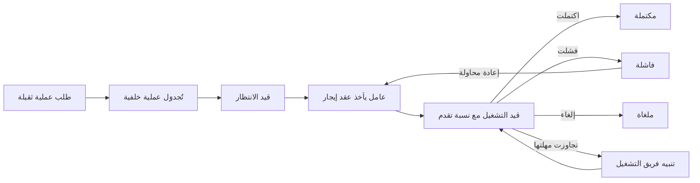
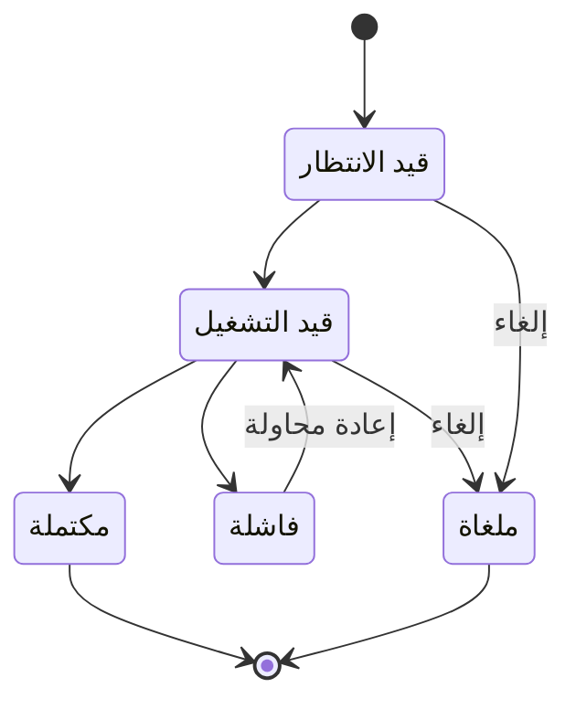

# متابعة العمليات الطويلة

<!-- BEGIN GENERATED: doc -->
| البند | القيمة |
|---|---|
| المعرّف | FEAT-PLT-BACKGROUND-JOBS |
| الإصدار | 0.2 |
| الحالة | مسودة |
| القدرة | CAP-14 تشغيل المنصة |
| القدرة الفرعية | CAP-14.02 الاعتمادية والتعافي (R1) |
| الأدوار | أي مستخدم مخوَّل؛ مشغّل المنصة؛ النظام |
| الشاشات | SCR-64 الاستيراد والحجر، SCR-30 الحالة التحليلية والتشغيلات، SCR-50 إعادة البناء التاريخي |
| حالات الاستخدام | — |
| القصص | 6: 0 من المواصفة، و6 جديدة |
<!-- END GENERATED: doc -->

## 1. نظرة عامة

### 1.1 القيمة

يتيح للمستخدم متابعة العمليات الثقيلة كالاستيراد الكبير والتقارير والتحليلات وهي تعمل في الخلفية وإعادة محاولتها أو إلغاءها.

### 1.2 النطاق

| البند | القيمة |
|---|---|
| المستخدمون | أي مستخدم مخوَّل (يبدأ العملية الثقيلة أو يتابعها)؛ فريق المنصة (بنية التشغيل الخلفي والمكوّن الموحد)؛ فريق التشغيل (تنبيه التعليق)؛ النظام (المؤقتات والعمّال) |
| الشاشات | شاشة الاستيراد والحجر؛ شاشة الحالة التحليلية والتشغيلات؛ شاشة إعادة البناء التاريخي |
| حالات الاستخدام (بالكلمات) | تشغيل كل عملية ثقيلة (معالجة الصور، الاستيراد الكبير، تشغيلات التحليل، إعادة البناء التاريخي، توليد التقارير) في الخلفية فقط؛ متابعة حالتها وتقدمها؛ إعادة محاولتها أو إلغاؤها؛ تنبيه فريق التشغيل إذا تجاوزت مهلتها |
| المتطلبات (بالكلمات) | لا عملية ثقيلة تُنفَّذ مزامنة داخل استدعاء واجهة؛ مؤقتات وعمال بعقود إيجار موثوقة دون محرك سير عمل منفصل؛ تجاوز المهمة موعدها يُصعَّد خلال 60 ثانية |
| خارج النطاق | تفصيل كل نوع عملية ثقيلة بذاته (الاستيراد، التحليل، إعادة البناء) يغطيه ميزة ذلك المجال؛ لوحات المراقبة العامة للمنصة (ميزة المراقبة) |

### 1.3 خريطة الميزة

**الشكل 1: مسار العملية الخلفية من الطلب إلى الاكتمال**



**الشكل 2: حالات العملية الخلفية**



## 2. القواعد المشتركة

تنطبق على كل قصص الميزة، فلا تتكرر داخل القصص. وكل قصة تذكر ما يخصها فقط.

### 2.1 السياق المشترك

كل قصة تبدأ من ثلاثة شروط: مستأجر نشط، وحزمة السياسات الأساسية مفعّلة، ومستخدم مسجّل الدخول ومخوَّل. وتشير إليها القصص بخطوة واحدة: «بفرض السياق المشترك للميزة».

### 2.2 الصلاحية وعدم الإفصاح

- من لا يحق له رؤية العنصر يتلقى ردًا بشكل «غير متاح» تمامًا، فلا يعرف أنه موجود.
- من يرى العنصر ولا يحق له الإجراء يتلقى «لا تملك صلاحية هذا الإجراء».

### 2.3 أوامر تغيير الحالة

- **منع التكرار:** يُرسل كل أمر بمفتاح فريد، فإعادة الطلب نفسه لا تُنفَّذ مرتين.
- **حماية التعديل المتزامن:** يُرسل كل أمر بإصدار البيانات الذي يراه المستخدم. فإن عدّلها غيره في الأثناء، يُرفض الأمر.
- **السجل:** إن نجح الأمر، يُكتب حدثه وسجل التدقيق في المعاملة نفسها.

### 2.4 الرفض المشترك

```gherkin
# language: ar
خاصية: الرفض المشترك لأوامر الميزة

  سيناريو مخطط: رفض مشترك لكل أمر في الميزة
    بفرض السياق المشترك للميزة
    و <الحالة>
    عندما يُرسل المستخدم أي أمر من أوامر الميزة
    اذاً يُرفض برمز <الرمز> ويرى "<الرسالة>"
    و لا يتغير شيء

    امثلة:
      | الحالة                                  | الرمز                  | الرسالة                                                 |
      | العنصر خارج صلاحياته                    | NOT_FOUND              | غير متاح                                                |
      | العنصر مرئي له ولا يحق له الإجراء       | AUTHZ_DENIED           | لا تملك صلاحية هذا الإجراء                              |
      | غيره عدّل العنصر بعد أن فتحه            | VERSION_CONFLICT       | تغيّرت البيانات منذ فتحتها. راجع التغييرات ثم أعد المحاولة |
      | أعاد مفتاح منع التكرار بمحتوى مختلف     | IDEMPOTENCY_KEY_REUSED | طلب مكرر بمحتوى مختلف                                   |
      | البيانات ناقصة أو غير صحيحة             | VALIDATION_FAILED      | بعض البيانات ناقصة أو غير صحيحة. راجع الحقول المعلَّمة      |

  سيناريو: إعادة الطلب نفسه لا تُنفَّذ مرتين
    بفرض السياق المشترك للميزة
    و أمر نجح بمفتاح منع تكرار
    عندما يُعاد الطلب نفسه بالمفتاح نفسه
    اذاً تُعاد النتيجة الأولى ولا يُكتب حدث ثانٍ
```

## 3. الجودة وتعريف الاكتمال

### 3.1 متطلبات الجودة

<!-- BEGIN GENERATED: quality -->
| المرجع | الموقف | المطلوب |
|---|---|---|
| QAS-OPS-002 | task reaches due_at | escalation event ≤ 60 s after due |
<!-- END GENERATED: quality -->

### 3.2 تعريف الاكتمال

القصة مكتملة حين تتحقق الشروط الخمسة:

1. سيناريوهاتها والقواعد المشتركة تمر في الاختبار الآلي.
2. فحوص البنية المعمارية تمر.
3. نصوص الواجهة والرسائل موجودة بالعربية والإنجليزية.
4. مراجعة الكود مكتملة.
5. ما تضيفه القصة نفسها في قسم «القواعد» تحقق.

## 4. فهرس القصص

<!-- BEGIN GENERATED: story-index -->
| المعرّف | القصة | النوع | الحالة |
|---|---|---|---|
| `US-PLT-JOBS-ASYNC-ONLY` | تشغيل العمليات الثقيلة في الخلفية فقط | منصة | مسودة |
| `US-PLT-JOBS-RETRY-CANCEL` | إعادة العملية الطويلة أو إلغاؤها | منصة | مسودة |
| `US-PLT-JOBS-STATUS` | متابعة حالة العملية الطويلة وتقدمها | منصة | مسودة |
| `US-PLT-JOBS-TIMERS-LEASES` | مؤقتات وعمال موثوقون دون محرك سير عمل | منصة | مسودة |
| `US-PLT-JOBS-UI-PROGRESS` | مكوّن موحد لعرض تقدم العمليات | منصة | مسودة |
| `US-OPS-JOBS-STUCK-ALERT` | تنبيه عند تجاوز العملية مهلتها | تشغيل | مسودة |
<!-- END GENERATED: story-index -->

## 5. القصص

### 5.1 US-PLT-JOBS-ASYNC-ONLY — تشغيل العمليات الثقيلة في الخلفية فقط

| النوع | الإصدار | الأولوية | دون اتصال | الحالة |
|---|---|---|---|---|
| منصة | R1 | Must | لا ينطبق | مسودة |

> **كـ** فريق المنصة، **أريد** أن تعمل كل عملية ثقيلة (معالجة الصور الجوية، الاستيراد الكبير، تشغيلات التحليل، إعادة البناء التاريخي، توليد التقارير) كعملية خلفية غير متزامنة، **حتى** لا يحجز أي استدعاء واجهة مزامنًا وتبقى الواجهة سريعة الاستجابة.

**باختصار:** لا نداء متزامن ينفّذ عملية من العمليات الثقيلة الخمس؛ كل منها تُجدوَل كعملية خلفية لها حالة وإعادة محاولة وإلغاء.

#### القواعد

- **الأثر:** يُحوَّل أي استدعاء لعملية ثقيلة فورًا إلى عملية خلفية بمعرّف تتبع؛ لا استجابة متزامنة تحمل نتيجة العملية نفسها (REQ-PLT-005).

#### معايير القبول

```gherkin
# language: ar
خاصية: تشغيل العمليات الثقيلة في الخلفية فقط

  سيناريو: طلب عملية ثقيلة يُجدوَل في الخلفية
    بفرض السياق المشترك للميزة
    و طلب عملية من العمليات الثقيلة الخمس
    عندما يرسلها المستخدم
    اذاً تُجدوَل عملية خلفية فورًا
    و تُعاد استجابة تحمل معرّف العملية دون انتظار نتيجتها

  سيناريو: لا عملية ثقيلة تُنفَّذ مزامنة
    بفرض السياق المشترك للميزة
    و تصميم واجهة جديد ينفّذ عملية ثقيلة مباشرة داخل الطلب
    عندما يُفحص تصميم الواجهة قبل الإصدار
    اذاً يُرفض التصميم
    و لا يتغير شيء
```

<details><summary>المراجع التقنية والتتبع</summary>

<!-- BEGIN GENERATED: refs US-PLT-JOBS-ASYNC-ONLY -->
| البند | المعرّف | المعنى |
|---|---|---|
| المتطلب | REQ-PLT-005 | The system shall run heavy operations (raster processing, bulk import, analysis runs, reconstruction, report… |
<!-- END GENERATED: refs US-PLT-JOBS-ASYNC-ONLY -->

</details>

### 5.2 US-PLT-JOBS-RETRY-CANCEL — إعادة العملية الطويلة أو إلغاؤها

| النوع | الإصدار | الأولوية | دون اتصال | الحالة |
|---|---|---|---|---|
| منصة | R1 | Must | لا ينطبق | مسودة |

> **كـ** فريق المنصة، **أريد** أن توفر كل عملية خلفية طويلة أمرين: إعادة المحاولة والإلغاء، **حتى** يستطيع من بدأها معالجة فشلها أو التراجع عنها دون انتظار انتهائها من نفسه.

**باختصار:** كل عملية خلفية طويلة تدعم إعادة المحاولة بعد الفشل والإلغاء قبل الاكتمال، دون أن تتأثر عملية أخرى.

#### القواعد

- **الأثر:** تُعيد إعادة المحاولة تشغيل العملية من حيث أمكن دون تكرار ما اكتمل؛ يوقف الإلغاء العملية ويحفظ سبب الإيقاف، ولا يؤثر في عمليات أخرى (REQ-PLT-005).

#### معايير القبول

```gherkin
# language: ar
خاصية: إعادة العملية الطويلة أو إلغاؤها

  سيناريو: إعادة محاولة عملية فشلت
    بفرض السياق المشترك للميزة
    و عملية خلفية فشلت بخطأ عابر
    عندما يطلب من بدأها إعادة المحاولة
    اذاً تُعاد العملية ولا يتكرر ما اكتمل منها

  سيناريو: إلغاء عملية قيد التشغيل
    بفرض السياق المشترك للميزة
    و عملية خلفية قيد التشغيل
    عندما يطلب من بدأها إلغاءها
    اذاً تتوقف العملية ويُحفظ سبب الإيقاف
    و لا تتأثر عمليات أخرى
```

<details><summary>المراجع التقنية والتتبع</summary>

<!-- BEGIN GENERATED: refs US-PLT-JOBS-RETRY-CANCEL -->
| البند | المعرّف | المعنى |
|---|---|---|
| المتطلب | REQ-PLT-005 | The system shall run heavy operations (raster processing, bulk import, analysis runs, reconstruction, report… |
<!-- END GENERATED: refs US-PLT-JOBS-RETRY-CANCEL -->

</details>

### 5.3 US-PLT-JOBS-STATUS — متابعة حالة العملية الطويلة وتقدمها

| النوع | الإصدار | الأولوية | دون اتصال | الحالة |
|---|---|---|---|---|
| منصة | R1 | Must | لا ينطبق | مسودة |

> **كـ** فريق المنصة، **أريد** أن تعرض كل عملية خلفية حالتها ونسبة تقدمها، **حتى** يعرف المستخدم ما يحدث دون أن يعيد السؤال مرارًا.

**باختصار:** لكل عملية خلفية حالة واحدة من مجموعة ثابتة (قيد الانتظار، قيد التشغيل، مكتملة، فاشلة، ملغاة) ونسبة تقدم تُحدَّث أثناء تشغيلها.

#### القواعد

- **الأثر:** تُحدَّث حالة العملية ونسبة تقدمها مع تقدمها الفعلي، ويستطيع من يملك صلاحية عليها الاستعلام عنها في أي وقت (REQ-PLT-005). نسبة التقدم تقريبية لا دقيقة في كل نوع عملية. **[Derived]**

#### معايير القبول

```gherkin
# language: ar
خاصية: متابعة حالة العملية الطويلة وتقدمها

  سيناريو: استعلام حالة عملية قيد التشغيل
    بفرض السياق المشترك للميزة
    و عملية خلفية قيد التشغيل بنسبة تقدم معروفة
    عندما يستعلم من يملك صلاحية عليها عن حالتها
    اذاً تُعاد حالتها الحالية ونسبة تقدمها

  سيناريو: الحالة تصل إلى نهائية
    بفرض السياق المشترك للميزة
    و عملية خلفية اكتملت أو فشلت أو أُلغيت
    عندما يستعلم عنها صاحبها
    اذاً تُعاد حالتها النهائية ونتيجتها
```

<details><summary>المراجع التقنية والتتبع</summary>

<!-- BEGIN GENERATED: refs US-PLT-JOBS-STATUS -->
| البند | المعرّف | المعنى |
|---|---|---|
| المصدر | `[Derived]` | — |
| المتطلب | REQ-PLT-005 | The system shall run heavy operations (raster processing, bulk import, analysis runs, reconstruction, report… |
<!-- END GENERATED: refs US-PLT-JOBS-STATUS -->

</details>

### 5.4 US-PLT-JOBS-TIMERS-LEASES — مؤقتات وعمال موثوقون دون محرك سير عمل

| النوع | الإصدار | الأولوية | دون اتصال | الحالة |
|---|---|---|---|---|
| منصة | R1 | Should | لا ينطبق | مسودة |

> **كـ** فريق المنصة، **أريد** مؤقتات بدلاء زمنية في قاعدة البيانات وعمالًا بعقود إيجار، **حتى** تعمل العمليات المجدولة والطويلة بثقة دون الحاجة إلى محرك سير عمل منفصل.

**باختصار:** تُنفَّذ المؤقتات بدلاء زمنية في PostgreSQL، وكل عامل يأخذ عقد إيجار على مهمته فلا يعالجها عامل آخر في الوقت نفسه؛ انتهاء العقد دون إنجاز يعيد المهمة لعامل آخر.

#### القواعد

- **الأثر:** يحمل عامل واحد فقط عقد إيجار صالحًا على مهمة في لحظة واحدة؛ انتهاء مهلة العقد يعيدها إلى الطابور ليأخذها عامل آخر؛ تُعالَج المهمة التي يحين موعدها خلال 60 ثانية (QAS-OPS-002، TD-13، مصدر: `23-crosscutting.md` §2).

#### معايير القبول

```gherkin
# language: ar
خاصية: مؤقتات وعمال موثوقون دون محرك سير عمل

  سيناريو: عامل واحد يعالج المهمة
    بفرض السياق المشترك للميزة
    و مهمة حان وقتها في دلو زمني
    عندما يأخذ عامل عقد إيجار عليها
    اذاً لا يأخذها عامل آخر حتى ينتهي عقده أو يُنجزها

  سيناريو: انتهاء عقد الإيجار يعيد المهمة
    بفرض السياق المشترك للميزة
    و عامل حمل عقد إيجار على مهمة ثم توقف دون إنجازها
    عندما ينتهي عقد الإيجار
    اذاً تعود المهمة إلى الطابور
    و يأخذها عامل آخر
```

<details><summary>المراجع التقنية والتتبع</summary>

<!-- BEGIN GENERATED: refs US-PLT-JOBS-TIMERS-LEASES -->
| البند | المعرّف | المعنى |
|---|---|---|
| القرار التقني | TD-13 | PostgreSQL time buckets + leased workers inside owning units (no workflow engine) |
| المصدر | `23-crosscutting.md §2` | — |
| الجودة | QAS-OPS-002 | task reaches due_at → escalation event ≤ 60 s after due |
<!-- END GENERATED: refs US-PLT-JOBS-TIMERS-LEASES -->

</details>

### 5.5 US-PLT-JOBS-UI-PROGRESS — مكوّن موحد لعرض تقدم العمليات

| النوع | الإصدار | الأولوية | دون اتصال | الحالة |
|---|---|---|---|---|
| منصة | R1 | Must | لا ينطبق | مسودة |

> **كـ** فريق المنصة، **أريد** مكوّنًا واحدًا لعرض تقدم العمليات الخلفية تستخدمه شاشات الاستيراد والحجر، والحالة التحليلية والتشغيلات، وإعادة البناء التاريخي، **حتى** يرى المستخدم تقدم عمليته بالشكل نفسه في كل شاشة.

**باختصار:** مكوّن واحد يعرض حالة العملية ونسبة تقدمها وزرَّي إعادة المحاولة والإلغاء، تستخدمه الشاشات الثلاث دون تكرار تصميمه في كل شاشة. **[Derived]**

#### القواعد

- **الأثر:** تعرض الشاشات الثلاث تقدم عملياتها الخلفية بالمكوّن نفسه وبالحالات نفسها (REQ-PLT-005). شكل المكوّن نفسه غير موصوف في المصادر. **[Derived]**

#### معايير القبول

```gherkin
# language: ar
خاصية: مكوّن موحد لعرض تقدم العمليات

  سيناريو: عرض التقدم بالمكوّن نفسه في شاشات مختلفة
    بفرض السياق المشترك للميزة
    و عملية خلفية قيد التشغيل من شاشة الاستيراد والحجر، وأخرى من شاشة إعادة البناء التاريخي
    عندما يفتح المستخدم كل شاشة
    اذاً يرى حالة عمليته ونسبة تقدمها بالمكوّن نفسه في الشاشتين

  سيناريو: زرا إعادة المحاولة والإلغاء متاحان من المكوّن
    بفرض السياق المشترك للميزة
    و عملية خلفية ظاهرة في أحد الشاشات الثلاث
    عندما يستخدم المكوّن
    اذاً يستطيع إعادة محاولتها أو إلغاءها من الشاشة نفسها
```

<details><summary>المراجع التقنية والتتبع</summary>

<!-- BEGIN GENERATED: refs US-PLT-JOBS-UI-PROGRESS -->
| البند | المعرّف | المعنى |
|---|---|---|
| الشاشة | SCR-30 | شاشة الحالة التحليلية والتشغيلات |
| الشاشة | SCR-50 | شاشة إعادة البناء التاريخي |
| الشاشة | SCR-64 | شاشة الاستيراد والحجر |
| المصدر | `[Derived]` | — |
| المتطلب | REQ-PLT-005 | The system shall run heavy operations (raster processing, bulk import, analysis runs, reconstruction, report… |
<!-- END GENERATED: refs US-PLT-JOBS-UI-PROGRESS -->

</details>

### 5.6 US-OPS-JOBS-STUCK-ALERT — تنبيه عند تجاوز العملية مهلتها

| النوع | الإصدار | الأولوية | دون اتصال | الحالة |
|---|---|---|---|---|
| تشغيل | R1 | Must | لا ينطبق | مسودة |

> **كـ** فريق التشغيل، **أريد** تنبيهًا عند تجاوز عملية خلفية مهلتها الافتراضية، **حتى** أتدخل قبل أن تبقى عالقة دون أن يلاحظها أحد.

**باختصار:** عملية خلفية تتجاوز مهلتها الافتراضية (6 ساعات لتشغيل التحليل مثلًا) دون اكتمال أو فشل صريح تطلق تنبيهًا لفريق التشغيل. **[Derived]**

#### القواعد

- **الأثر:** يطلق تجاوز المهلة الافتراضية لعملية خلفية تنبيهًا يحمل نوع العملية ومعرّفها ومدة تجاوزها، دون إيقافها تلقائيًا (مصدر: `23-crosscutting.md` §6.2). عتبة المهلة لغير تشغيل التحليل غير محددة في المصادر. **[Derived]**

#### معايير القبول

```gherkin
# language: ar
خاصية: تنبيه عند تجاوز العملية مهلتها

  سيناريو: تجاوز المهلة يطلق تنبيهًا
    بفرض عملية خلفية قيد التشغيل منذ أكثر من مهلتها الافتراضية
    عندما يفحص النظام العمليات الجارية
    اذاً يُطلَق تنبيه لفريق التشغيل بنوع العملية ومدة تجاوزها
    و تبقى العملية قيد التشغيل

  سيناريو: عملية ضمن مهلتها لا تنبّه
    بفرض عملية خلفية قيد التشغيل ضمن مهلتها الافتراضية
    عندما يفحص النظام العمليات الجارية
    اذاً لا يُطلَق أي تنبيه
```

<details><summary>المراجع التقنية والتتبع</summary>

<!-- BEGIN GENERATED: refs US-OPS-JOBS-STUCK-ALERT -->
| البند | المعرّف | المعنى |
|---|---|---|
| المصدر | `23-crosscutting.md §6.2` | — |
| المصدر | `[Derived]` | — |
| المتطلب | REQ-PLT-005 | The system shall run heavy operations (raster processing, bulk import, analysis runs, reconstruction, report… |
<!-- END GENERATED: refs US-OPS-JOBS-STUCK-ALERT -->

</details>

## 6. التتبع

<!-- BEGIN GENERATED: trace -->
| المتطلب | المعنى | القصص | الاختبار |
|---|---|---|---|
| REQ-PLT-005 | The system shall run heavy operations (raster processing, bulk import, analysis runs, reconstruction, report… | `US-OPS-JOBS-STUCK-ALERT`، `US-PLT-JOBS-ASYNC-ONLY`، `US-PLT-JOBS-RETRY-CANCEL`، `US-PLT-JOBS-STATUS`، `US-PLT-JOBS-UI-PROGRESS` | — |
<!-- END GENERATED: trace -->

## 7. سجل التغييرات

| الإصدار | التاريخ | التغيير |
|---|---|---|
| 0.1 | — | هيكل مولَّد من خريطة الميزات |
| 0.2 | 2026-10-13 | كتابة القصص كاملة بمعيار القصص |
