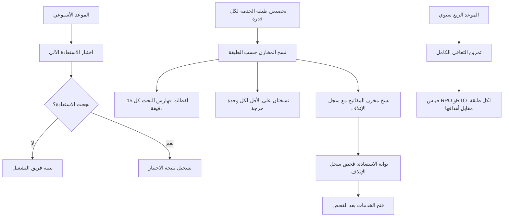

# النسخ الاحتياطي والاستعادة

<!-- BEGIN GENERATED: doc -->
| البند | القيمة |
|---|---|
| المعرّف | FEAT-PLT-BACKUP-RESTORE |
| الإصدار | 0.2 |
| الحالة | مسودة |
| القدرة | CAP-14 تشغيل المنصة |
| القدرة الفرعية | CAP-14.02 الاعتمادية والتعافي (R1) |
| الأدوار | مشغّل المنصة؛ النظام |
| الشاشات | — |
| حالات الاستخدام | — |
| القصص | 8: 0 من المواصفة، و8 جديدة |
<!-- END GENERATED: doc -->

## 1. نظرة عامة

### 1.1 القيمة

يضمن نسخ جميع البيانات احتياطيًا حسب أهميتها والتحقق آليًا من إمكانية استعادتها ضمن المدد المتفق عليها.

### 1.2 النطاق

| البند | القيمة |
|---|---|
| المستخدمون | فريق المنصة؛ فريق التشغيل أو الأمن؛ النظام (المجدول الدوري) |
| الشاشات | لا شاشة مخصصة؛ عمل داخلي تشغّله الجدولة |
| حالات الاستخدام (بالكلمات) | نسخ كل المخازن احتياطيًا حسب طبقة خدمتها؛ نسخ مخزن المفاتيح مع سجل إتلافه؛ أخذ لقطات دورية لفهارس البحث؛ اختبار الاستعادة آليًا كل أسبوع؛ منع عودة مفتاح أُتلف بعد أي استعادة؛ تنفيذ تمرين تعافٍ كامل كل ثلاثة أشهر؛ تحديد طبقة خدمة واحدة لكل قدرة من قدرات المنصة؛ ضمان نسختين على الأقل لكل وحدة نشر حرجة |
| المتطلبات (بالكلمات) | نسخ كل المخازن حسب طبقتها والتحقق آليًا من إمكان استعادتها (REQ-PLT-012)؛ تخصيص كل قدرة لطبقة خدمة واحدة تحدد هدف توفرها ونقطتي استعادتها (REQ-PLT-004) |
| خارج النطاق | كلفة النسخ والتخزين (تغطيها حصص المستأجر وكلفته في ميزة الحصص)؛ استعادة بيانات مستأجر واحد بعد تنفيذ طلب محو (تغطيها ميزات الحوكمة والمحو)؛ نقل بيانات بين خلايا مختلفة، فلا مسار بيانات بينها أصلًا |

### 1.3 خريطة الميزة

**الشكل 1: مسار النسخ الاحتياطي والاستعادة**




## 2. القواعد المشتركة

تنطبق على كل قصص الميزة، فلا تتكرر داخل القصص. وكل قصة تذكر ما يخصها فقط.

### 2.1 السياق المشترك

كل قصة تبدأ من ثلاثة شروط: مستأجر نشط، وحزمة السياسات الأساسية مفعّلة، ومستخدم مسجّل الدخول ومخوَّل. وتشير إليها القصص بخطوة واحدة: «بفرض السياق المشترك للميزة».

### 2.2 الصلاحية وعدم الإفصاح

- من لا يحق له رؤية العنصر يتلقى ردًا بشكل «غير متاح» تمامًا، فلا يعرف أنه موجود.
- من يرى العنصر ولا يحق له الإجراء يتلقى «لا تملك صلاحية هذا الإجراء».

### 2.3 أوامر تغيير الحالة

- **منع التكرار:** يُرسل كل أمر بمفتاح فريد، فإعادة الطلب نفسه لا تُنفَّذ مرتين.
- **حماية التعديل المتزامن:** يُرسل كل أمر بإصدار البيانات الذي يراه المستخدم. فإن عدّلها غيره في الأثناء، يُرفض الأمر.
- **السجل:** إن نجح الأمر، يُكتب حدثه وسجل التدقيق في المعاملة نفسها.

### 2.4 الرفض المشترك

```gherkin
# language: ar
خاصية: الرفض المشترك لأوامر الميزة

  سيناريو مخطط: رفض مشترك لكل أمر في الميزة
    بفرض السياق المشترك للميزة
    و <الحالة>
    عندما يُرسل المستخدم أي أمر من أوامر الميزة
    اذاً يُرفض برمز <الرمز> ويرى "<الرسالة>"
    و لا يتغير شيء

    امثلة:
      | الحالة                                  | الرمز                  | الرسالة                                                 |
      | العنصر خارج صلاحياته                    | NOT_FOUND              | غير متاح                                                |
      | العنصر مرئي له ولا يحق له الإجراء       | AUTHZ_DENIED           | لا تملك صلاحية هذا الإجراء                              |
      | غيره عدّل العنصر بعد أن فتحه            | VERSION_CONFLICT       | تغيّرت البيانات منذ فتحتها. راجع التغييرات ثم أعد المحاولة |
      | أعاد مفتاح منع التكرار بمحتوى مختلف     | IDEMPOTENCY_KEY_REUSED | طلب مكرر بمحتوى مختلف                                   |
      | البيانات ناقصة أو غير صحيحة             | VALIDATION_FAILED      | بعض البيانات ناقصة أو غير صحيحة. راجع الحقول المعلَّمة      |

  سيناريو: إعادة الطلب نفسه لا تُنفَّذ مرتين
    بفرض السياق المشترك للميزة
    و أمر نجح بمفتاح منع تكرار
    عندما يُعاد الطلب نفسه بالمفتاح نفسه
    اذاً تُعاد النتيجة الأولى ولا يُكتب حدث ثانٍ
```

## 3. الجودة وتعريف الاكتمال

### 3.1 متطلبات الجودة

<!-- BEGIN GENERATED: quality -->
| المرجع | الموقف | المطلوب |
|---|---|---|
| QAS-AVL-001 | normal operation over a month | ≥ 99.9 % monthly |
| QAS-AVL-002 | normal operation over a month | ≥ 99.5 % monthly |
| QAS-AVL-003 | normal operation over a month | ≥ 99 % monthly |
| QAS-PRV-002 | restore of a key-store backup older than a key destruction | destroyed keys unusable before any service reads data (restore gate) |
| QAS-REC-001 | primary site lost | RPO ≤ 5 min; RTO ≤ 1 h |
| QAS-REC-002 | primary site lost | RPO ≤ 15 min; RTO ≤ 4 h |
| QAS-REC-003 | primary site lost | RPO ≤ 24 h; RTO ≤ 24 h |
<!-- END GENERATED: quality -->

### 3.2 تعريف الاكتمال

القصة مكتملة حين تتحقق الشروط الخمسة:

1. سيناريوهاتها والقواعد المشتركة تمر في الاختبار الآلي.
2. فحوص البنية المعمارية تمر.
3. نصوص الواجهة والرسائل موجودة بالعربية والإنجليزية.
4. مراجعة الكود مكتملة.
5. ما تضيفه القصة نفسها في قسم «القواعد» تحقق.

## 4. فهرس القصص

<!-- BEGIN GENERATED: story-index -->
| المعرّف | القصة | النوع | الحالة |
|---|---|---|---|
| `US-PLT-BACKUP-KEYSTORE` | نسخ مخزن المفاتيح مع سجل الإتلاف | منصة | مسودة |
| `US-PLT-BACKUP-SEARCH-SNAPSHOTS` | لقطات فهارس البحث كل ربع ساعة | منصة | مسودة |
| `US-PLT-BACKUP-STORES` | نسخ كل المخازن حسب طبقة خدمتها | منصة | مسودة |
| `US-OPS-BACKUP-RESTORE-GATE` | منع عودة المفاتيح المتلفة بعد الاستعادة | تشغيل | مسودة |
| `US-OPS-BACKUP-RESTORE-TEST` | اختبار استعادة آلي أسبوعي | تشغيل | مسودة |
| `US-OPS-DR-QUARTERLY-DRILL` | تمرين تعافٍ ربع سنوي ضمن الأهداف | تشغيل | مسودة |
| `US-OPS-DR-TIER-ASSIGNMENT` | طبقة خدمة محددة لكل قدرة | تشغيل | مسودة |
| `US-OPS-HA-REDUNDANCY` | نسختان على الأقل لكل وحدة حرجة | تشغيل | مسودة |
<!-- END GENERATED: story-index -->

## 5. القصص

### 5.1 US-PLT-BACKUP-KEYSTORE — نسخ مخزن المفاتيح مع سجل الإتلاف

| النوع | الإصدار | الأولوية | دون اتصال | الحالة |
|---|---|---|---|---|
| منصة | R1 | Should | لا ينطبق | مسودة |

> **كـ** فريق المنصة، **أريد** أن يُنسخ مخزن المفاتيح مع سجل إتلاف مفاتيحه معًا في كل مرة، **حتى** تتوفر نسخة تتيح استعادة المفاتيح دون أن يعود للاستخدام مفتاح أُتلف من قبل.

**باختصار:** تؤخذ نسخة من مخزن المفاتيح مرتبطة بسجل الإتلاف نفسه، مشفَّرة بمفاتيح المستأجرين، ولا تُحفظ أكثر من 35 يومًا.

#### القواعد

- **الأثر:** تحمل كل نسخة سجل الإتلاف كما كان وقت أخذها، فلا تُفصل عنه؛ وهذا هو ما تعتمد عليه بوابة الاستعادة لاحقًا (القصة 5.4).
- **البيانات:** مدة الاحتفاظ بالنسخة 35 يومًا كحد أقصى، ثم تختفي فيزيائيًا.

#### معايير القبول

```gherkin
# language: ar
خاصية: نسخ مخزن المفاتيح مع سجل الإتلاف

  سيناريو: أخذ نسخة من مخزن المفاتيح
    بفرض أن مخزن المفاتيح وسجل الإتلاف في حالة متسقة
    عندما تُؤخذ نسخة احتياطية مجدولة
    اذاً تحمل النسخة مخزن المفاتيح وسجل الإتلاف معًا
    و تُشفَّر النسخة بمفاتيح المستأجرين

  سيناريو: انتهاء عمر النسخة
    بفرض نسخة بلغت 35 يومًا
    عندما يحين وقت الفحص الدوري
    اذاً تُمحى النسخة فيزيائيًا ولا تبقى قابلة للاستعادة
```

<details><summary>المراجع التقنية والتتبع</summary>

<!-- BEGIN GENERATED: refs US-PLT-BACKUP-KEYSTORE -->
| البند | المعرّف | المعنى |
|---|---|---|
| المصدر | `22-deployment-design.md §5` | — |
| المصدر | `17-security-design.md §6.1` | — |
<!-- END GENERATED: refs US-PLT-BACKUP-KEYSTORE -->

</details>

### 5.2 US-PLT-BACKUP-SEARCH-SNAPSHOTS — لقطات فهارس البحث كل ربع ساعة

| النوع | الإصدار | الأولوية | دون اتصال | الحالة |
|---|---|---|---|---|
| منصة | R1 | Should | لا ينطبق | مسودة |

> **كـ** فريق المنصة، **أريد** أن تُؤخذ لقطة لفهارس البحث كل 15 دقيقة وتُحفظ في مخزن الكائنات، **حتى** تُستعاد خلال أربع ساعات دون الاعتماد على إعادة بنائها الكاملة التي قد تصل إلى 24 ساعة.

**باختصار:** لقطة دورية كل 15 دقيقة تحل مكان إعادة البناء الكاملة لفهارس البحث من مالكي البيانات، التي يبقى زمنها أطول من هدف استعادة طبقة الخدمة «مهمة».

#### القواعد

- **الأثر:** عند الاستعادة تُستخدم أحدث لقطة ثم يُلحق الفرق من الأحداث حتى آخر نقطة معروفة؛ إعادة البناء الكاملة من المالكين تبقى لتغييرات مخطط الفهرس فقط.

#### معايير القبول

```gherkin
# language: ar
خاصية: لقطات فهارس البحث

  سيناريو: أخذ لقطة دورية
    بفرض أن 15 دقيقة مرّت منذ آخر لقطة
    عندما يحين وقت الجدولة
    اذاً تُحفظ لقطة جديدة لفهارس البحث في مخزن الكائنات

  سيناريو: الاستعادة من لقطة
    بفرض أن فهرس البحث تعطّل
    عندما تبدأ استعادته
    اذاً تُستعاد آخر لقطة ثم يُلحق الفرق من الأحداث حتى نقطة التعطل
    و تكتمل الاستعادة ضمن أربع ساعات
```

<details><summary>المراجع التقنية والتتبع</summary>

<!-- BEGIN GENERATED: refs US-PLT-BACKUP-SEARCH-SNAPSHOTS -->
| البند | المعرّف | المعنى |
|---|---|---|
| المصدر | `09-reliability/dr-and-continuity.md §3` | — |
| الجودة | QAS-REC-002 | primary site lost → RPO ≤ 15 min; RTO ≤ 4 h |
<!-- END GENERATED: refs US-PLT-BACKUP-SEARCH-SNAPSHOTS -->

</details>

### 5.3 US-PLT-BACKUP-STORES — نسخ كل المخازن حسب طبقة خدمتها

| النوع | الإصدار | الأولوية | دون اتصال | الحالة |
|---|---|---|---|---|
| منصة | R1 | Must | لا ينطبق | مسودة |

> **كـ** فريق المنصة، **أريد** أن تُنسخ كل المخازن (قاعدة البيانات، الأحداث، مخزن الكائنات، مخزن المفاتيح) احتياطيًا بوتيرة تناسب طبقة خدمتها، **حتى** يتحقق هدف نقطة الاستعادة المعتمد لكل طبقة.

**باختصار:** كل مخزن يُنسخ بالطريقة التي تناسبه، وتختلف وتيرة النسخ باختلاف طبقة الخدمة: حرجة أو مهمة أو عادية.

#### القواعد

- **الأثر:** المخزن في الطبقة الحرجة يُنسخ بتأخر لا يتجاوز خمس دقائق عن آخر تحديث مع نسخة كاملة يومية؛ وفي الطبقة المهمة بلقطات كل 15 دقيقة؛ وفي الطبقة العادية بوتيرة أبطأ ضمن هدفها.
- **البيانات:** كل نسخة مشفَّرة بمفاتيح المستأجرين.

#### معايير القبول

```gherkin
# language: ar
خاصية: نسخ المخازن حسب طبقة الخدمة

  سيناريو: نسخ مخزن في الطبقة الحرجة
    بفرض مخزن بيانات في الطبقة الحرجة
    عندما يحين وقت النسخ
    اذاً يُنسخ بتأخر لا يتجاوز خمس دقائق عن آخر تحديث
    و تُشفَّر النسخة بمفاتيح المستأجرين

  سيناريو: نسخ مخزن في طبقة أخرى
    بفرض مخزن بيانات في الطبقة المهمة أو العادية
    عندما يحين وقت النسخ المحدد لطبقته
    اذاً يُنسخ ضمن هدف نقطة الاستعادة لتلك الطبقة
```

<details><summary>المراجع التقنية والتتبع</summary>

<!-- BEGIN GENERATED: refs US-PLT-BACKUP-STORES -->
| البند | المعرّف | المعنى |
|---|---|---|
| المصدر | `22-deployment-design.md §5` | — |
| المصدر | `09-reliability/dr-and-continuity.md §2` | — |
| المتطلب | REQ-PLT-012 | The system shall back up all stores according to their service tier and shall verify restores automatically. |
<!-- END GENERATED: refs US-PLT-BACKUP-STORES -->

</details>

### 5.4 US-OPS-BACKUP-RESTORE-GATE — منع عودة المفاتيح المتلفة بعد الاستعادة

| النوع | الإصدار | الأولوية | دون اتصال | الحالة |
|---|---|---|---|---|
| تشغيل | R1 | Should | لا ينطبق | مسودة |

> **كـ** فريق التشغيل أو الأمن، **أريد** أن تُطبَّق بوابة فحص قبل أن تبدأ أي خدمة قراءة البيانات بعد استعادة مخزن المفاتيح، **حتى** لا يعود مفتاح أُتلف من قبل إلى الاستخدام.

**باختصار:** بعد أي استعادة لمخزن المفاتيح، يُعاد تطبيق سجل الإتلاف فيصبح كل مفتاح فيه غير قابل للاستخدام، قبل فتح أي خدمة على البيانات.

#### القواعد

- **الأثر:** تمنع البوابة إحياء بيانات أُتلفت مفاتيحها عمدًا (كاستجابة لطلب محو) حتى لو كانت نسخة مخزن المفاتيح المستعادة أقدم من تاريخ الإتلاف.

#### معايير القبول

```gherkin
# language: ar
خاصية: بوابة الاستعادة لمخزن المفاتيح

  سيناريو: استعادة نسخة تسبق إتلاف مفتاح
    بفرض نسخة مخزن المفاتيح تسبق تاريخ إتلاف أحد مفاتيحه
    عندما تُستعاد النسخة
    اذاً يُعاد تطبيق سجل الإتلاف فيصبح المفتاح غير قابل للاستخدام
    و لا تبدأ أي خدمة قراءة البيانات قبل اكتمال الفحص

  سيناريو: استعادة نسخة لا تتعارض مع الإتلاف
    بفرض نسخة مخزن المفاتيح لا تحمل مفتاحًا أُتلف بعد أخذها
    عندما تُستعاد النسخة
    اذاً لا يتغير شيء في سجل الإتلاف
```

<details><summary>المراجع التقنية والتتبع</summary>

<!-- BEGIN GENERATED: refs US-OPS-BACKUP-RESTORE-GATE -->
| البند | المعرّف | المعنى |
|---|---|---|
| فحص البنية | FIT-19 | Restore gate: after any key-store restore, every key in the destruction log is unusable before services start |
| الجودة | QAS-PRV-002 | restore of a key-store backup older than a key destruction → destroyed keys unusable before any service reads… |
| المصدر | `17-security-design.md §6` | — |
<!-- END GENERATED: refs US-OPS-BACKUP-RESTORE-GATE -->

</details>

### 5.5 US-OPS-BACKUP-RESTORE-TEST — اختبار استعادة آلي أسبوعي

| النوع | الإصدار | الأولوية | دون اتصال | الحالة |
|---|---|---|---|---|
| تشغيل | R1 | Must | لا ينطبق | مسودة |

> **كـ** فريق التشغيل أو الأمن، **أريد** أن تُختبر استعادة كل مخزن أسبوعيًا بشكل آلي، **حتى** نكتشف عطل النسخ الاحتياطية قبل الحاجة الفعلية إليها.

**باختصار:** كل أسبوع تُستعاد نسخة من كل مخزن إلى بيئة اختبار، ويُتحقق آليًا من سلامتها، ويُسجَّل نجاح أو فشل الاختبار.

#### القواعد

- **الأثر:** فشل اختبار الاستعادة يُنبّه فريق التشغيل فورًا، لأنه يعني أن هدف نقطة ومدة الاستعادة المعتمدين لن يتحققا فعليًا عند الحاجة.

#### معايير القبول

```gherkin
# language: ar
خاصية: اختبار الاستعادة الأسبوعي

  سيناريو: الاستعادة تنجح
    بفرض حلول الموعد الأسبوعي للاختبار
    عندما تُستعاد نسخة كل مخزن إلى بيئة الاختبار
    اذاً يُتحقق آليًا من سلامة البيانات ويُسجَّل نجاح الاختبار

  سيناريو: الاستعادة تفشل
    بفرض حلول الموعد الأسبوعي للاختبار
    عندما تفشل استعادة أحد المخازن أو يفشل التحقق من سلامته
    اذاً يُسجَّل فشل الاختبار ويُنبَّه فريق التشغيل فورًا
```

<details><summary>المراجع التقنية والتتبع</summary>

<!-- BEGIN GENERATED: refs US-OPS-BACKUP-RESTORE-TEST -->
| البند | المعرّف | المعنى |
|---|---|---|
| الجودة | QAS-REC-001 | primary site lost → RPO ≤ 5 min; RTO ≤ 1 h |
| المصدر | `09-reliability/dr-and-continuity.md §2` | — |
| المتطلب | REQ-PLT-012 | The system shall back up all stores according to their service tier and shall verify restores automatically. |
<!-- END GENERATED: refs US-OPS-BACKUP-RESTORE-TEST -->

</details>

### 5.6 US-OPS-DR-QUARTERLY-DRILL — تمرين تعافٍ ربع سنوي ضمن الأهداف

| النوع | الإصدار | الأولوية | دون اتصال | الحالة |
|---|---|---|---|---|
| تشغيل | R1 | Must | لا ينطبق | مسودة |

> **كـ** فريق التشغيل أو الأمن، **أريد** أن يُنفَّذ تمرين تعافٍ كامل كل ثلاثة أشهر يقيس الانتقال الفعلي إلى موقع التعافي، **حتى** نتأكد أن أهداف الاستعادة لكل طبقة خدمة تتحقق عمليًا لا نظريًا فقط.

**باختصار:** التمرين ينقل الحمل فعليًا إلى موقع التعافي ويقيس زمن فقد البيانات وزمن الاستعادة لكل طبقة خدمة، ويقارنهما بالهدف المعتمد لها.

#### القواعد

- **الأثر:** نتيجة التمرين تقاس مقابل الأهداف المعتمدة لكل طبقة: الحرجة بحد أعلى خمس دقائق لفقد البيانات وساعة للاستعادة، والمهمة بحد أعلى 15 دقيقة وأربع ساعات، والعادية بحد أعلى 24 ساعة لكل منهما.
- تجاوز أي طبقة لهدفها يُسجَّل ويُتابع حتى يُحسم.

#### معايير القبول

```gherkin
# language: ar
خاصية: تمرين التعافي الربع سنوي

  سيناريو: التمرين يحقق الأهداف
    بفرض حلول موعد التمرين الربع سنوي
    عندما يُنفَّذ الانتقال إلى موقع التعافي لكل طبقة خدمة
    اذاً تُقاس فترة فقد البيانات ومدة الاستعادة لكل طبقة
    و تكون كل طبقة ضمن هدفها المعتمد

  سيناريو: طبقة لا تحقق هدفها
    بفرض حلول موعد التمرين الربع سنوي
    عندما تتجاوز إحدى الطبقات حد فقد البيانات أو مدة الاستعادة الخاص بها
    اذاً يُسجَّل تجاوز الهدف ويُتابع حتى يُحسم
```

<details><summary>المراجع التقنية والتتبع</summary>

<!-- BEGIN GENERATED: refs US-OPS-DR-QUARTERLY-DRILL -->
| البند | المعرّف | المعنى |
|---|---|---|
| الجودة | QAS-REC-001 | primary site lost → RPO ≤ 5 min; RTO ≤ 1 h |
| الجودة | QAS-REC-002 | primary site lost → RPO ≤ 15 min; RTO ≤ 4 h |
| الجودة | QAS-REC-003 | primary site lost → RPO ≤ 24 h; RTO ≤ 24 h |
| المتطلب | REQ-PLT-004 | The system shall assign every capability to one of the service tiers defined in QAS-AVL-001..003 (critical, i… |
<!-- END GENERATED: refs US-OPS-DR-QUARTERLY-DRILL -->

</details>

### 5.7 US-OPS-DR-TIER-ASSIGNMENT — طبقة خدمة محددة لكل قدرة

| النوع | الإصدار | الأولوية | دون اتصال | الحالة |
|---|---|---|---|---|
| تشغيل | R1 | Must | لا ينطبق | مسودة |

> **كـ** فريق التشغيل أو الأمن، **أريد** أن تُحدَّد لكل قدرة من قدرات المنصة طبقة خدمة واحدة من الثلاث، **حتى** يُعرف هدف التوفر ونقطة ومدة الاستعادة المطلوبين لكل جزء من النظام.

**باختصار:** كل وحدة نشر تنتمي إلى طبقة خدمة واحدة تحدد توفرها المستهدف وحدي فقد البيانات ومدة الاستعادة لها، ولا تبقى قدرة بلا طبقة محددة.

#### القواعد

- **البيانات:** الطبقة الحرجة توفرها 99.9% بحد أعلى خمس دقائق لفقد البيانات وساعة للاستعادة؛ المهمة 99.5% بحد أعلى 15 دقيقة وأربع ساعات؛ العادية 99% بحد أعلى 24 ساعة لكل منهما.
- **الأثر:** تخصيص القدرة لطبقتها يحدد وتيرة نسخها الاحتياطي ومستوى تكرارها (القصة 5.3).

#### معايير القبول

```gherkin
# language: ar
خاصية: تخصيص طبقة الخدمة لكل قدرة

  سيناريو: كل قدرة لها طبقة واحدة
    بفرض قائمة قدرات المنصة
    عندما تُراجع تخصيصات الطبقات
    اذاً تنتمي كل قدرة إلى طبقة واحدة من الثلاث: حرجة أو مهمة أو عادية
    و لا تبقى قدرة بلا طبقة محددة
```

<details><summary>المراجع التقنية والتتبع</summary>

<!-- BEGIN GENERATED: refs US-OPS-DR-TIER-ASSIGNMENT -->
| البند | المعرّف | المعنى |
|---|---|---|
| المصدر | `09-reliability/dr-and-continuity.md §1` | — |
| المتطلب | REQ-PLT-004 | The system shall assign every capability to one of the service tiers defined in QAS-AVL-001..003 (critical, i… |
<!-- END GENERATED: refs US-OPS-DR-TIER-ASSIGNMENT -->

</details>

### 5.8 US-OPS-HA-REDUNDANCY — نسختان على الأقل لكل وحدة حرجة

| النوع | الإصدار | الأولوية | دون اتصال | الحالة |
|---|---|---|---|---|
| تشغيل | R1 | Should | لا ينطبق | مسودة |

> **كـ** فريق التشغيل أو الأمن، **أريد** أن تعمل كل وحدة نشر حرجة بنسختين على الأقل في أوقات التشغيل العادية، **حتى** لا يوقف فقد نسخة واحدة الخدمة.

**باختصار:** كل مخزن أو خدمة في الطبقة الحرجة يحافظ على نسخة تعمل بالتوازي مع الأصل، فتستمر الخدمة عند فقد نسخة واحدة دون انتظار استعادة.

#### القواعد

- **الأثر:** فقد نسخة واحدة من وحدة حرجة لا يوقف الخدمة ولا يخفض توفرها عن هدف طبقتها (99.9%). **[Derived]** لأن المصدر يصف التكرار لكل خدمة ذات حالة على حدة (قاعدة بيانات، أحداث، مخزن مفاتيح) ولا يذكر رقم النسخ الأدنى لكل وحدة نشر صريحًا.

#### معايير القبول

```gherkin
# language: ar
خاصية: التكرار لكل وحدة حرجة

  سيناريو: فقد نسخة واحدة لا يوقف الخدمة
    بفرض وحدة نشر حرجة تعمل بنسختين على الأقل
    عندما تتعطل نسخة واحدة
    اذاً تستمر الخدمة من النسخة الأخرى دون توقف
    و يبقى توفرها ضمن هدف الطبقة الحرجة
```

<details><summary>المراجع التقنية والتتبع</summary>

<!-- BEGIN GENERATED: refs US-OPS-HA-REDUNDANCY -->
| البند | المعرّف | المعنى |
|---|---|---|
| الجودة | QAS-AVL-001 | normal operation over a month → ≥ 99.9 % monthly |
| المصدر | `22-deployment-design.md §3` | — |
| المصدر | `[Derived]` | — |
<!-- END GENERATED: refs US-OPS-HA-REDUNDANCY -->

</details>

## 6. التتبع

<!-- BEGIN GENERATED: trace -->
| المتطلب | المعنى | القصص | الاختبار |
|---|---|---|---|
| REQ-PLT-004 | The system shall assign every capability to one of the service tiers defined in QAS-AVL-001..003 (critical, i… | `US-OPS-DR-QUARTERLY-DRILL`، `US-OPS-DR-TIER-ASSIGNMENT` | — |
| REQ-PLT-012 | The system shall back up all stores according to their service tier and shall verify restores automatically. | `US-OPS-BACKUP-RESTORE-TEST`، `US-PLT-BACKUP-STORES` | — |
<!-- END GENERATED: trace -->

## 7. سجل التغييرات

| الإصدار | التاريخ | التغيير |
|---|---|---|
| 0.1 | — | هيكل مولَّد من خريطة الميزات |
| 0.2 | 2026-10-13 | كتابة القصص كاملة بمعيار القصص |
