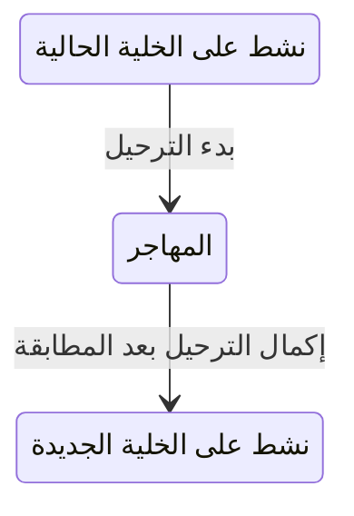

# نقل المستأجر بين خلايا التشغيل

<!-- BEGIN GENERATED: doc -->
| البند | القيمة |
|---|---|
| المعرّف | FEAT-PLT-CELL-MIGRATION |
| الإصدار | 0.1 |
| الحالة | مسودة |
| القدرة | CAP-14 تشغيل المنصة |
| القدرة الفرعية | CAP-14.03 تهيئة المستأجرين والحصص (R1) |
| الأدوار | مشغّل المنصة؛ النظام |
| الشاشات | SCR-60 المستأجر والحصص (واجهة المشغل) |
| حالات الاستخدام | UC-080 |
| القصص | 7: 2 من المواصفة، و5 جديدة |
<!-- END GENERATED: doc -->

## 1. نظرة عامة

### 1.1 القيمة

يتيح لمشغل المنصة نقل مستأجر إلى خلية تشغيل أخرى (مشتركة أو مخصصة أو سيادية) دون فقدان بيانات، بنفس نسخة البرنامج في كل البيئات.

### 1.2 النطاق

| البند | القيمة |
|---|---|
| المستخدمون | مشغّل المنصة (يبدأ الترحيل ويتابعه ويحوّل المستخدمين)؛ فريق المنصة (آلية التصدير والاستيراد)؛ فريق التشغيل (إعادة معايرة السعة، والتحويل، واختبار القبول)؛ النظام (إكمال الترحيل بعد المطابقة) |
| الشاشات | شاشة المستأجر والحصص (واجهة المشغل) |
| حالات الاستخدام (بالكلمات) | بدء ترحيل مستأجر نشط إلى خلية هدف لديها سعة؛ متابعة تقدم الترحيل ونتيجة المطابقة؛ إكمال الترحيل بعد نجاح مطابقة التصدير والاستيراد؛ تحويل المستخدمين والأجهزة الميدانية إلى الخلية الجديدة |
| المتطلبات (بالكلمات) | نفس القطع الموزَّعة تعمل على أنماط الخلايا الثلاثة (مشتركة، مخصصة، سيادية)؛ فرض حصص المستأجر والمعدل على الطلبات والتخزين والأحداث والمهام |
| خارج النطاق | تهيئة مستأجر جديد من الصفر وإخراجه من الخدمة (ميزة تهيئة المستأجرين)؛ تصميم الخلية والشبكة التفصيلي (`22-deployment-design.md`) |

### 1.3 خريطة الميزة

**الشكل 1: مسار ترحيل المستأجر بين الخلايا**


**الشكل 2: حالة المستأجر عبر الترحيل**



## 2. القواعد المشتركة

تنطبق على كل قصص الميزة، فلا تتكرر داخل القصص. وكل قصة تذكر ما يخصها فقط.

### 2.1 السياق المشترك

كل قصة تبدأ من ثلاثة شروط: مستأجر نشط، وحزمة السياسات الأساسية مفعّلة، ومستخدم مسجّل الدخول ومخوَّل. وتشير إليها القصص بخطوة واحدة: «بفرض السياق المشترك للميزة».

### 2.2 الصلاحية وعدم الإفصاح

- من لا يحق له رؤية العنصر يتلقى ردًا بشكل «غير متاح» تمامًا، فلا يعرف أنه موجود.
- من يرى العنصر ولا يحق له الإجراء يتلقى «لا تملك صلاحية هذا الإجراء».

### 2.3 أوامر تغيير الحالة

- **منع التكرار:** يُرسل كل أمر بمفتاح فريد، فإعادة الطلب نفسه لا تُنفَّذ مرتين.
- **حماية التعديل المتزامن:** يُرسل كل أمر بإصدار البيانات الذي يراه المستخدم. فإن عدّلها غيره في الأثناء، يُرفض الأمر.
- **السجل:** إن نجح الأمر، يُكتب حدثه وسجل التدقيق في المعاملة نفسها.

### 2.4 الرفض المشترك

```gherkin
# language: ar
خاصية: الرفض المشترك لأوامر الميزة

  سيناريو مخطط: رفض مشترك لكل أمر في الميزة
    بفرض السياق المشترك للميزة
    و <الحالة>
    عندما يُرسل المستخدم أي أمر من أوامر الميزة
    اذاً يُرفض برمز <الرمز> ويرى "<الرسالة>"
    و لا يتغير شيء

    امثلة:
      | الحالة                                  | الرمز                  | الرسالة                                                 |
      | العنصر خارج صلاحياته                    | NOT_FOUND              | غير متاح                                                |
      | العنصر مرئي له ولا يحق له الإجراء       | AUTHZ_DENIED           | لا تملك صلاحية هذا الإجراء                              |
      | غيره عدّل العنصر بعد أن فتحه            | VERSION_CONFLICT       | تغيّرت البيانات منذ فتحتها. راجع التغييرات ثم أعد المحاولة |
      | أعاد مفتاح منع التكرار بمحتوى مختلف     | IDEMPOTENCY_KEY_REUSED | طلب مكرر بمحتوى مختلف                                   |
      | البيانات ناقصة أو غير صحيحة             | VALIDATION_FAILED      | بعض البيانات ناقصة أو غير صحيحة. راجع الحقول المعلَّمة      |

  سيناريو: إعادة الطلب نفسه لا تُنفَّذ مرتين
    بفرض السياق المشترك للميزة
    و أمر نجح بمفتاح منع تكرار
    عندما يُعاد الطلب نفسه بالمفتاح نفسه
    اذاً تُعاد النتيجة الأولى ولا يُكتب حدث ثانٍ
```

## 3. الجودة وتعريف الاكتمال

### 3.1 متطلبات الجودة

<!-- BEGIN GENERATED: quality -->
| المرجع | الموقف | المطلوب |
|---|---|---|
| QAS-SCAL-001 | load rises from pilot (100 concurrent) to 10× (1,000) and then to design (5,000) | 0 architectural or schema changes needed |
| QAS-SCAL-005 | exceeds its quota by 10× | other tenants stay within QAS-PERF-001 |
<!-- END GENERATED: quality -->

### 3.2 تعريف الاكتمال

القصة مكتملة حين تتحقق الشروط الخمسة:

1. سيناريوهاتها والقواعد المشتركة تمر في الاختبار الآلي.
2. فحوص البنية المعمارية تمر.
3. نصوص الواجهة والرسائل موجودة بالعربية والإنجليزية.
4. مراجعة الكود مكتملة.
5. ما تضيفه القصة نفسها في قسم «القواعد» تحقق.

## 4. فهرس القصص

<!-- BEGIN GENERATED: story-index -->
| المعرّف | القصة | النوع | الحالة |
|---|---|---|---|
| `US-BC01-TEN-COMPLETE-CELL-MIGRATION` | إكمال ترحيل المستأجر إلى خلية أخرى | أمر | مسودة |
| `US-BC01-TEN-START-CELL-MIGRATION` | بدء ترحيل المستأجر إلى خلية أخرى | أمر | مسودة |
| `US-UI-SCR60-MIGRATION-PROGRESS` | متابعة نقل المستأجر ونتيجة المطابقة | واجهة | مسودة |
| `US-PLT-CELL-EXPORT-IMPORT` | نقل بيانات المستأجر بالتصدير والمطابقة | منصة | مسودة |
| `US-OPS-CELL-CAPACITY-RECALIBRATE` | إعادة معايرة سعة الخلية عند تجاوز النصف | تشغيل | مسودة |
| `US-OPS-CELL-MIGRATION-CUTOVER` | تحويل المستخدمين والأجهزة إلى الخلية الجديدة | تشغيل | مسودة |
| `US-OPS-CELL-PROFILE-ACCEPTANCE` | اختبار القبول نفسه على أنماط الخلايا الثلاثة | تشغيل | مسودة |
<!-- END GENERATED: story-index -->

## 5. القصص

### 5.1 US-BC01-TEN-COMPLETE-CELL-MIGRATION — إكمال ترحيل المستأجر إلى خلية أخرى

| النوع | الإصدار | الأولوية | دون اتصال | الحالة |
|---|---|---|---|---|
| أمر | R1 | Must | لا | مسودة |

> **كـ** النظام، **أريد** أن أكمل ترحيل المستأجر إلى الخلية الجديدة بعد مطابقة التصدير والاستيراد، **حتى** يعاود المستأجر العمل من خليته الجديدة دون أن يفقد بيانات.

**باختصار:** بعد أن يبلّغ مسار الترحيل أن مطابقة التصدير والاستيراد اكتملت، يعيد النظام حالة المستأجر «المهاجر» إلى «نشطة» على الخلية الجديدة.

#### القواعد

- **متى يُسمح:** المستأجر في حالة «المهاجر»، وتقرير مطابقة التصدير والاستيراد مكتمل.
- **من يُسمح له:** هوية النظام الداخلية (مسار الترحيل)، لا مستخدم بشري.
- **البيانات:** تقرير المطابقة (إلزامي).
- **الأثر:** تصبح حالة المستأجر «نشطة»، ويُسجَّل حدث «هاجر المستأجر» يصل إلى فهرس البحث والدليل ومسار التهيئة.

#### معايير القبول

```gherkin
# language: ar
خاصية: إكمال ترحيل المستأجر إلى خلية أخرى

  سيناريو: إكمال الترحيل بعد مطابقة ناجحة
    بفرض السياق المشترك للميزة
    و مستأجر في حالة "المهاجر" وتقرير مطابقة التصدير والاستيراد مكتمل
    عندما يرسل النظام تقرير المطابقة
    اذاً تصبح حالة المستأجر "نشطة"
    و يُسجَّل حدث "هاجر المستأجر"

  سيناريو مخطط: رفض خاص بإكمال الترحيل
    بفرض السياق المشترك للميزة
    و <الحالة>
    عندما يحاول النظام إكمال الترحيل
    اذاً يُرفض برمز <الرمز> ويرى <الرسالة>
    و لا يتغير شيء

    امثلة:
      | الحالة                                   | الرمز                          | الرسالة                                    |
      | مطابقة التصدير والاستيراد لم تكتمل       | MIGRATION_NOT_RECONCILED       | لم تكتمل مطابقة البيانات المنقولة          |
      | المستأجر ليس في حالة "المهاجر"          | TENANT_INVALID_STATE_TRANSITION | الوضع الحالي للمستأجر لا يسمح بهذا الإجراء |
      | تقرير المطابقة فارغ                      | VALIDATION_FAILED               | تقرير المطابقة مطلوب                        |
```

<details><summary>المراجع التقنية والتتبع</summary>

<!-- BEGIN GENERATED: refs US-BC01-TEN-COMPLETE-CELL-MIGRATION -->
| البند | المعرّف | المعنى |
|---|---|---|
| الواجهة البرمجية | `POST /api/v1/foundation/tenants/{id}/actions/complete-cell-migration` | — |
| الأمر | `CMD-TEN-COMPLETE-CELL-MIGRATION` | إكمال ترحيل المستأجر إلى خلية أخرى |
| السياسة | `POL-TEN-COMPLETE-CELL-MIGRATION` | workload identity: scheduler / provisioning saga؛ tenant match; subject ACTIVE; tenant ACTIVE (except TEN ope… |
| الحدث | `EVT-TEN-MIGRATED` | يصل إلى: Search/Directory projection (BC01 read model); Provisioning saga / cell controller |
| الكيان | `AGG-TENANT` | المستأجر |
| الجدول | `foundation.tenants` | الجدول الرئيسي للمستأجر |
| وحدة النشر | DU-02 | — |
| المتطلب | REQ-FND-018 | The system shall enforce per-tenant quotas and rate limits for requests, storage, events and jobs. |
| حالة الاستخدام | UC-105 | Manage Tenant Quotas |
| الاختبار | TST-TENANT-SM، TST-SLC01-INVARIANTS | دورة حالات المستأجر، وثوابت الشريحة SLC-01 |
<!-- END GENERATED: refs US-BC01-TEN-COMPLETE-CELL-MIGRATION -->

</details>

### 5.2 US-BC01-TEN-START-CELL-MIGRATION — بدء ترحيل المستأجر إلى خلية أخرى

| النوع | الإصدار | الأولوية | دون اتصال | الحالة |
|---|---|---|---|---|
| أمر | R1 | Must | لا | مسودة |

> **كـ** مشغّل المنصة، **أريد** أن أبدأ ترحيل مستأجر نشط إلى خلية هدف لديها سعة، **حتى** أنقله دون تعديل الكود بين الخلايا المشتركة والمخصصة والسيادية.

**باختصار:** يبدأ مشغّل المنصة ترحيل مستأجر نشط إلى خلية هدف تتسع له، فتصبح حالته «المهاجر» بانتظار اكتمال مطابقة التصدير والاستيراد.

#### القواعد

- **متى يُسمح:** المستأجر في حالة «نشطة»، والخلية الهدف موجودة وتتسع للمستأجر.
- **من يُسمح له:** مشغّل المنصة فقط.
- **البيانات:** الخلية الهدف (إلزامي).
- **الأثر:** تصبح حالة المستأجر «المهاجر»، ويُسجَّل حدث «بدأ ترحيل المستأجر» يصل إلى فهرس البحث والدليل ومسار الترحيل الذي يتولى التصدير والاستيراد.

#### معايير القبول

```gherkin
# language: ar
خاصية: بدء ترحيل المستأجر إلى خلية أخرى

  سيناريو: بدء الترحيل إلى خلية تتسع له
    بفرض السياق المشترك للميزة
    و مستأجر نشط وخلية هدف لديها سعة كافية
    عندما يبدأ مشغّل المنصة ترحيله إلى الخلية الهدف
    اذاً تصبح حالة المستأجر "المهاجر"
    و يُسجَّل حدث "بدأ ترحيل المستأجر"

  سيناريو مخطط: رفض خاص ببدء الترحيل
    بفرض السياق المشترك للميزة
    و <الحالة>
    عندما يحاول مشغّل المنصة بدء الترحيل
    اذاً يُرفض برمز <الرمز> ويرى <الرسالة>
    و لا يتغير شيء

    امثلة:
      | الحالة                                | الرمز                          | الرسالة                                    |
      | الخلية الهدف غير موجودة أو لا تتسع    | CELL_UNAVAILABLE               | الخلية المستهدفة غير موجودة أو لا تتسع     |
      | المستأجر ليس في حالة "نشطة"          | TENANT_INVALID_STATE_TRANSITION | الوضع الحالي للمستأجر لا يسمح بهذا الإجراء |
      | الخلية الهدف فارغة                     | VALIDATION_FAILED               | الخلية الهدف مطلوبة                          |
```

<details><summary>المراجع التقنية والتتبع</summary>

<!-- BEGIN GENERATED: refs US-BC01-TEN-START-CELL-MIGRATION -->
| البند | المعرّف | المعنى |
|---|---|---|
| الواجهة البرمجية | `POST /api/v1/foundation/tenants/{id}/actions/start-cell-migration` | — |
| الأمر | `CMD-TEN-START-CELL-MIGRATION` | بدء ترحيل المستأجر إلى خلية أخرى |
| السياسة | `POL-TEN-START-CELL-MIGRATION` | Platform Operator (platform tenant) ; Tenant Administrator for quotas view only؛ tenant match; subject ACTIVE… |
| الحدث | `EVT-TEN-MIGRATION-STARTED` | يصل إلى: Search/Directory projection (BC01 read model); Provisioning saga / cell controller |
| الكيان | `AGG-TENANT` | المستأجر |
| الجدول | `foundation.tenants` | الجدول الرئيسي للمستأجر |
| وحدة النشر | DU-02 | — |
| المتطلب | REQ-FND-018 | The system shall enforce per-tenant quotas and rate limits for requests, storage, events and jobs. |
| حالة الاستخدام | UC-105 | Manage Tenant Quotas |
| الاختبار | TST-TENANT-SM، TST-SLC01-INVARIANTS | دورة حالات المستأجر، وثوابت الشريحة SLC-01 |
<!-- END GENERATED: refs US-BC01-TEN-START-CELL-MIGRATION -->

</details>

### 5.3 US-UI-SCR60-MIGRATION-PROGRESS — متابعة نقل المستأجر ونتيجة المطابقة

| النوع | الإصدار | الأولوية | دون اتصال | الحالة |
|---|---|---|---|---|
| واجهة | R1 | Should | لا | مسودة |

> **كـ** مشغّل المنصة، **أريد** أن أتابع تقدم ترحيل المستأجر ونتيجة مطابقة بياناته من شاشة المستأجر والحصص، **حتى** أعرف متى يمكن إكمال الترحيل أو أين تعطل.

**باختصار:** تعرض شاشة المستأجر والحصص حالة الترحيل الحالية («المهاجر» أو «نشطة») ونتيجة آخر مطابقة تصدير واستيراد، وتتحدث فور تغيّر الحالة. **[Derived]**

#### القواعد

- **العرض:** تعرض الشاشة حالة الترحيل الحالية ونتيجة آخر مطابقة تصدير واستيراد معروفة. **[Derived]**

#### معايير القبول

```gherkin
# language: ar
خاصية: متابعة نقل المستأجر ونتيجة المطابقة

  سيناريو: متابعة حالة الترحيل أثناء تقدمه
    بفرض السياق المشترك للميزة
    و مستأجر في حالة "المهاجر"
    عندما يفتح مشغّل المنصة شاشة المستأجر والحصص
    اذاً يرى حالة الترحيل الحالية وآخر نتيجة مطابقة معروفة

  سيناريو: اكتمال الترحيل يحدّث الشاشة
    بفرض السياق المشترك للميزة
    و مطابقة التصدير والاستيراد اكتملت وأصبح المستأجر "نشطًا" على الخلية الجديدة
    عندما يفتح مشغّل المنصة الشاشة
    اذاً يرى حالة "نشطة" واسم الخلية الجديدة
```

<details><summary>المراجع التقنية والتتبع</summary>

<!-- BEGIN GENERATED: refs US-UI-SCR60-MIGRATION-PROGRESS -->
| البند | المعرّف | المعنى |
|---|---|---|
| حالة الاستخدام | UC-080 | Provision Tenant |
| الشاشة | SCR-60 | شاشة المستأجر والحصص (واجهة المشغل) |
| المصدر | `[Derived]` | — |
<!-- END GENERATED: refs US-UI-SCR60-MIGRATION-PROGRESS -->

</details>

### 5.4 US-PLT-CELL-EXPORT-IMPORT — نقل بيانات المستأجر بالتصدير والمطابقة

| النوع | الإصدار | الأولوية | دون اتصال | الحالة |
|---|---|---|---|---|
| منصة | R1 | Should | لا ينطبق | مسودة |

> **كـ** فريق المنصة، **أريد** آلية تصدير مستأجر من خليته الحالية واستيراده في الخلية الهدف دون تغيير كود، **حتى** ينتقل بياناته كاملة بين أي أنماط خلايا دون فقد.

**باختصار:** يتمان تصدير المستأجر من الخلية الحالية ومطابقته عند الاستيراد في الخلية الهدف بالكود نفسه في كل أنماط الخلايا (مشتركة، مخصصة، سيادية)، وبدونهما لا تكتمل عملية الترحيل.

#### القواعد

- **الأثر:** تُصدَّر كل بيانات المستأجر المعزولة من خليته الحالية، وتُستورد وتُطابَق في الخلية الهدف دون أي تعديل في الكود بين أنماط الخلايا الثلاثة؛ نجاح المطابقة شرط لإكمال الترحيل (ADR-P04، مصدر: `23-crosscutting.md` §1.2).

#### معايير القبول

```gherkin
# language: ar
خاصية: نقل بيانات المستأجر بالتصدير والمطابقة

  سيناريو: تصدير واستيراد دون تغيير كود
    بفرض السياق المشترك للميزة
    و مستأجر في حالة "المهاجر"
    عندما يُصدَّر من خليته الحالية ويُستورد في الخلية الهدف
    اذاً تُطابَق بياناته بالكود نفسه بين أي أنماط خلايا

  سيناريو: مطابقة ناقصة لا تكمل الترحيل
    بفرض السياق المشترك للميزة
    و استيراد بيانات مستأجر لم يكتمل تطابقه مع التصدير
    عندما يُفحص تقرير المطابقة
    اذاً لا يُعلَن اكتمال الترحيل
    و لا يتغير شيء
```

<details><summary>المراجع التقنية والتتبع</summary>

<!-- BEGIN GENERATED: refs US-PLT-CELL-EXPORT-IMPORT -->
| البند | المعرّف | المعنى |
|---|---|---|
| القرار المعماري | ADR-P04 | Tenant Isolation |
| المصدر | `23-crosscutting.md §1.2` | — |
<!-- END GENERATED: refs US-PLT-CELL-EXPORT-IMPORT -->

</details>

### 5.5 US-OPS-CELL-CAPACITY-RECALIBRATE — إعادة معايرة سعة الخلية عند تجاوز النصف

| النوع | الإصدار | الأولوية | دون اتصال | الحالة |
|---|---|---|---|---|
| تشغيل | R1 | Should | لا ينطبق | مسودة |

> **كـ** فريق التشغيل، **أريد** أن أعيد معايرة سعة الخلية إذا تجاوز حملها الفعلي نصف نطاق التصميم، **حتى** تبقى الأرقام التصميمية مطابقة للواقع قبل أن تضيق السعة على مستأجريها.

**باختصار:** كل رقم في تصميم الخلية فرضية حتى اختبار الأداء، وتجاوز الحمل الفعلي 50 % من نطاق التصميم يستوجب إعادة معايرتها.

#### القواعد

- **الأثر:** يفتح تجاوز الحمل الفعلي نصف نطاق التصميم مراجعة لإعادة معايرة سعة الخلية، دون الحاجة إلى تغيير معماري أو في المخطط حتى عشرة أمثال حمل البداية (22-deployment-design.md §2.2، QAS-SCAL-001).

#### معايير القبول

```gherkin
# language: ar
خاصية: إعادة معايرة سعة الخلية عند تجاوز النصف

  سيناريو: تجاوز النصف يفتح إعادة المعايرة
    بفرض حمل الخلية الفعلي أقل من نصف نطاق التصميم
    عندما يتجاوز الحمل الفعلي نصف نطاق التصميم
    اذاً تُفتح مراجعة إعادة معايرة سعة الخلية
    و لا يحتاج الأمر تغييرًا معماريًا أو في المخطط

  سيناريو: حمل ضمن النصف لا يستوجب معايرة
    بفرض حمل الخلية الفعلي ضمن نصف نطاق التصميم
    عندما يُراجَع حملها الدوري
    اذاً لا تُفتح مراجعة إعادة معايرة
```

<details><summary>المراجع التقنية والتتبع</summary>

<!-- BEGIN GENERATED: refs US-OPS-CELL-CAPACITY-RECALIBRATE -->
| البند | المعرّف | المعنى |
|---|---|---|
| المصدر | `22-deployment-design.md §2.2` | — |
| الجودة | QAS-SCAL-001 | load rises from pilot (100 concurrent) to 10× (1,000) and then to design (5,000) → 0 architectural or schema… |
<!-- END GENERATED: refs US-OPS-CELL-CAPACITY-RECALIBRATE -->

</details>

### 5.6 US-OPS-CELL-MIGRATION-CUTOVER — تحويل المستخدمين والأجهزة إلى الخلية الجديدة

| النوع | الإصدار | الأولوية | دون اتصال | الحالة |
|---|---|---|---|---|
| تشغيل | R1 | Should | لا ينطبق | مسودة |

> **كـ** فريق التشغيل، **أريد** أن أحوّل المستخدمين والأجهزة الميدانية إلى نقطة نهاية الخلية الجديدة بعد ترحيل المستأجر، **حتى** يستمر عملهم دون أن يحاول أحدهم الكتابة على الخلية القديمة.

**باختصار:** بعد إكمال الترحيل تُحدَّث نقطة النهاية بعد مدة قصيرة لصلاحية اسم النطاق قبل قطع القديمة، وتستلم الأجهزة الميدانية نقطة النهاية الجديدة في رد المزامنة التالي، مع نقل سجل الأوامر المطبَّقة حتى لا يُطبَّق أمر ميداني قديم مرتين. **[Derived]**

#### القواعد

- **الأثر:** تنتقل نقطة نهاية المستخدمين إلى الخلية الجديدة بعد مدة قصيرة لصلاحية اسم النطاق؛ تستلم الأجهزة التي كانت دون اتصال أثناء الترحيل نقطة النهاية الجديدة في أول رد مزامنة، وينتقل معها سجل الأوامر المطبَّقة فلا يُطبَّق أمر قديم مرتين (مصدر: `22-deployment-design.md` §2.1). **[Derived]**

#### معايير القبول

```gherkin
# language: ar
خاصية: تحويل المستخدمين والأجهزة إلى الخلية الجديدة

  سيناريو: تحويل نقطة النهاية بعد اكتمال الترحيل
    بفرض أن ترحيل المستأجر اكتمل وأصبح "نشطًا" على الخلية الجديدة
    عندما ينتهي وقت صلاحية اسم النطاق القصير للخلية القديمة
    اذاً يستخدم المستخدمون نقطة نهاية الخلية الجديدة فقط

  سيناريو: جهاز كان دون اتصال يستلم نقطة النهاية الجديدة
    بفرض أن جهازًا ميدانيًا كان دون اتصال أثناء الترحيل
    عندما يتصل الجهاز ويزامن
    اذاً يستلم نقطة النهاية الجديدة في رد المزامنة
    و لا يُطبَّق أي أمر سابق مرتين
```

<details><summary>المراجع التقنية والتتبع</summary>

<!-- BEGIN GENERATED: refs US-OPS-CELL-MIGRATION-CUTOVER -->
| البند | المعرّف | المعنى |
|---|---|---|
| المصدر | `22-deployment-design.md §2.1` | — |
| المصدر | `[Derived]` | — |
<!-- END GENERATED: refs US-OPS-CELL-MIGRATION-CUTOVER -->

</details>

### 5.7 US-OPS-CELL-PROFILE-ACCEPTANCE — اختبار القبول نفسه على أنماط الخلايا الثلاثة

| النوع | الإصدار | الأولوية | دون اتصال | الحالة |
|---|---|---|---|---|
| تشغيل | R1 | Must | لا ينطبق | مسودة |

> **كـ** فريق التشغيل، **أريد** أن تُشغَّل مجموعة اختبارات القبول نفسها على ملفات الخلايا الثلاثة (مشتركة، مخصصة، سيادية) قبل اعتماد كل إصدار، **حتى** أتأكد أن القطع الموزَّعة نفسها تعمل في كل نمط خلية.

**باختصار:** يمر الإصدار الواحد بمجموعة القبول نفسها على ملفات الخلية الثلاثة قبل أن يُعتمد، فلا يفترق الكود بين الأنماط ولا يُعتمد إصدار نجح في نمط وفشل في آخر.

#### القواعد

- **الأثر:** يحتاج اعتماد الإصدار نجاح مجموعة القبول نفسها على الملفات الثلاثة؛ فشلها في أي ملف يوقف اعتماد الإصدار لكل الأنماط (REQ-PLT-002، مصدر: `12-solution/release-configuration-migration.md` §1).

#### معايير القبول

```gherkin
# language: ar
خاصية: اختبار القبول نفسه على أنماط الخلايا الثلاثة

  سيناريو: نجاح مجموعة القبول على الأنماط الثلاثة
    بفرض السياق المشترك للميزة
    و حزمة إصدار واحدة جاهزة للاعتماد
    عندما تُشغَّل مجموعة القبول على ملفات الخلية المشتركة والمخصصة والسيادية
    اذاً تنجح المجموعة نفسها على الثلاثة
    و يُعتمد الإصدار

  سيناريو: فشل في نمط واحد يوقف الاعتماد
    بفرض السياق المشترك للميزة
    و مجموعة القبول نجحت على نمطين وفشلت في النمط الثالث
    عندما تُراجَع نتيجة الاعتماد
    اذاً لا يُعتمد الإصدار لأي نمط
    و لا يتغير شيء
```

<details><summary>المراجع التقنية والتتبع</summary>

<!-- BEGIN GENERATED: refs US-OPS-CELL-PROFILE-ACCEPTANCE -->
| البند | المعرّف | المعنى |
|---|---|---|
| المصدر | `12-solution/release-configuration-migration.md §1` | — |
| المتطلب | REQ-PLT-002 | The system shall use the same release artifacts for shared, dedicated and sovereign deployments. |
<!-- END GENERATED: refs US-OPS-CELL-PROFILE-ACCEPTANCE -->

</details>

## 6. التتبع

<!-- BEGIN GENERATED: trace -->
| المتطلب | المعنى | القصص | الاختبار |
|---|---|---|---|
| REQ-FND-018 | The system shall enforce per-tenant quotas and rate limits for requests, storage, events and jobs. | `US-BC01-TEN-COMPLETE-CELL-MIGRATION`، `US-BC01-TEN-START-CELL-MIGRATION` | TST-TENANT-SM |
| REQ-PLT-002 | The system shall use the same release artifacts for shared, dedicated and sovereign deployments. | `US-OPS-CELL-PROFILE-ACCEPTANCE` | — |
<!-- END GENERATED: trace -->

## 7. سجل التغييرات

| الإصدار | التاريخ | التغيير |
|---|---|---|
| 0.1 | — | هيكل مولَّد من خريطة الميزات |
| 0.2 | 2026-10-13 | كتابة القصص كاملة بمعيار القصص |
