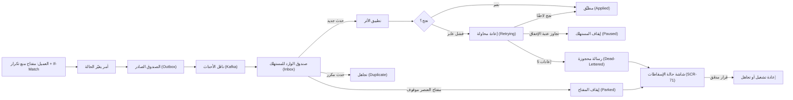
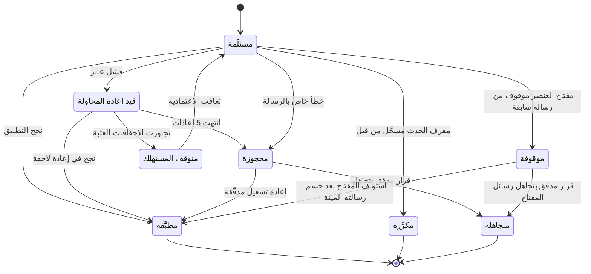

# موثوقية الأحداث والإسقاطات

<!-- BEGIN GENERATED: doc -->
| البند | القيمة |
|---|---|
| المعرّف | FEAT-PLT-EVENT-DELIVERY |
| الإصدار | 0.2 |
| الحالة | مسودة |
| القدرة | CAP-14 تشغيل المنصة |
| القدرة الفرعية | CAP-14.02 الاعتمادية والتعافي (R1) |
| الأدوار | مشغّل المنصة؛ النظام |
| الشاشات | SCR-71 حالة الإسقاطات (واجهة المشغل) |
| حالات الاستخدام | — |
| القصص | 14: 0 من المواصفة، و14 جديدة |
<!-- END GENERATED: doc -->

## 1. نظرة عامة

### 1.1 القيمة

يضمن وصول كل حدث مرة واحدة فعليًا إلى الأجزاء المعنية، ويحجز الرسائل التي يتعذر معالجتها حتى تُعالج، فلا يضيع أي تحديث.

### 1.2 النطاق

| البند | القيمة |
|---|---|
| المستخدمون | مشغّل المنصة (شاشة حالة الإسقاطات، SCR-71)؛ فريق التشغيل أو الأمن (التنبيه والتجاهل وإعادة التشغيل وتوسيع الأقسام)؛ فريق المنصة (الآليات الداخلية: الصندوق الصادر والوارد، قاطع الدائرة، مفاتيح منع التكرار)؛ والنظام (ناشر الأحداث والمستهلكون) |
| الشاشات | SCR-71 حالة الإسقاطات (واجهة المشغل)، بياناتها الوصفية فقط |
| حالات الاستخدام | لا حالة استخدام أعمال مباشرة. هذه قدرة تقنية أفقية يحتاجها كل أمر واستعلام ومستهلك حدث في المنصة، لا ميزة يستعملها مستخدم أعمال بذاتها |
| المتطلبات | نشر كل حدث عبر صندوق صادر ومعالجته دون تكرار عبر صندوق وارد في معاملة واحدة؛ عدم ضياع الأحداث ولا تكرار أثرها تحت انقطاع الناقل أو اندفاع الحمل؛ حماية التعديل المتزامن بمنع الكتابة الصامتة فوق إصدار سابق؛ حجز الرسائل التي يتعذر تطبيقها متابعتها دون إيقاف بقية المفاتيح أو الوحدات |
| خارج النطاق | محتوى الرسائل في شاشة التشغيل (لا تُعرض الحمولة، وهي مشفرة بمفاتيح المستأجر)؛ سحب المحوّلات من الأنظمة الخارجية (نطاقه في تصميم التكامل، وحالته `DEGRADED` لا رسائل محجوزة)؛ محرك السياسات والتدقيق ومزوّد الهوية (أنماط فشلهم في `23-crosscutting.md` §6.2، لا في هذه الميزة) |

### 1.3 خريطة الميزة

**الشكل 1: مسار الحدث من النشر إلى الحسم**



**الشكل 2: حالات الرسالة لدى المستهلك**



## 2. القواعد المشتركة

تنطبق على كل قصص الميزة، فلا تتكرر داخل القصص. وكل قصة تذكر ما يخصها فقط.

### 2.1 السياق المشترك

كل قصة تبدأ من ثلاثة شروط: مستأجر نشط، وحزمة السياسات الأساسية مفعّلة، ومستخدم مسجّل الدخول ومخوَّل. وتشير إليها القصص بخطوة واحدة: «بفرض السياق المشترك للميزة».

### 2.2 الصلاحية وعدم الإفصاح

- من لا يحق له رؤية العنصر يتلقى ردًا بشكل «غير متاح» تمامًا، فلا يعرف أنه موجود.
- من يرى العنصر ولا يحق له الإجراء يتلقى «لا تملك صلاحية هذا الإجراء».

### 2.3 أوامر تغيير الحالة

- **منع التكرار:** يُرسل كل أمر بمفتاح فريد، فإعادة الطلب نفسه لا تُنفَّذ مرتين.
- **حماية التعديل المتزامن:** يُرسل كل أمر بإصدار البيانات الذي يراه المستخدم. فإن عدّلها غيره في الأثناء، يُرفض الأمر.
- **السجل:** إن نجح الأمر، يُكتب حدثه وسجل التدقيق في المعاملة نفسها.

### 2.4 الرفض المشترك

```gherkin
# language: ar
خاصية: الرفض المشترك لأوامر الميزة

  سيناريو مخطط: رفض مشترك لكل أمر في الميزة
    بفرض السياق المشترك للميزة
    و <الحالة>
    عندما يُرسل المستخدم أي أمر من أوامر الميزة
    اذاً يُرفض برمز <الرمز> ويرى "<الرسالة>"
    و لا يتغير شيء

    امثلة:
      | الحالة                                  | الرمز                  | الرسالة                                                 |
      | العنصر خارج صلاحياته                    | NOT_FOUND              | غير متاح                                                |
      | العنصر مرئي له ولا يحق له الإجراء       | AUTHZ_DENIED           | لا تملك صلاحية هذا الإجراء                              |
      | غيره عدّل العنصر بعد أن فتحه            | VERSION_CONFLICT       | تغيّرت البيانات منذ فتحتها. راجع التغييرات ثم أعد المحاولة |
      | أعاد مفتاح منع التكرار بمحتوى مختلف     | IDEMPOTENCY_KEY_REUSED | طلب مكرر بمحتوى مختلف                                   |
      | البيانات ناقصة أو غير صحيحة             | VALIDATION_FAILED      | بعض البيانات ناقصة أو غير صحيحة. راجع الحقول المعلَّمة      |

  سيناريو: إعادة الطلب نفسه لا تُنفَّذ مرتين
    بفرض السياق المشترك للميزة
    و أمر نجح بمفتاح منع تكرار
    عندما يُعاد الطلب نفسه بالمفتاح نفسه
    اذاً تُعاد النتيجة الأولى ولا يُكتب حدث ثانٍ
```

## 3. الجودة وتعريف الاكتمال

### 3.1 متطلبات الجودة

<!-- BEGIN GENERATED: quality -->
| المرجع | الموقف | المطلوب |
|---|---|---|
| QAS-REL-001 | event bus unavailable for 30 min | 0 lost events; 0 duplicates with effect |
| QAS-REL-003 | update the same object from the same version | 0 silent overwrites |
| QAS-SCAL-002 | event burst of 50,000/s for 60 s | 0 lost events; critical alert p95 ≤ 30 s during burst; back within QAS-PERF-005 ≤ 5 min after |
<!-- END GENERATED: quality -->

### 3.2 تعريف الاكتمال

القصة مكتملة حين تتحقق الشروط الخمسة:

1. سيناريوهاتها والقواعد المشتركة تمر في الاختبار الآلي.
2. فحوص البنية المعمارية تمر.
3. نصوص الواجهة والرسائل موجودة بالعربية والإنجليزية.
4. مراجعة الكود مكتملة.
5. ما تضيفه القصة نفسها في قسم «القواعد» تحقق.

## 4. فهرس القصص

<!-- BEGIN GENERATED: story-index -->
| المعرّف | القصة | النوع | الحالة |
|---|---|---|---|
| `US-UI-SCR71-DEAD-LETTERS` | عرض الرسائل المحجوزة للمشغل دون محتواها | واجهة | مسودة |
| `US-PLT-EVENT-BACKPRESSURE` | تحمل اندفاع الأحداث دون فقد | منصة | مسودة |
| `US-PLT-EVENT-CIRCUIT-BREAKER` | إيقاف المستهلك مؤقتًا عند تعطل اعتمادياته | منصة | مسودة |
| `US-PLT-EVENT-DERIVED-KEYS` | مفتاح حتمي للأوامر الناتجة عن الأحداث | منصة | مسودة |
| `US-PLT-EVENT-INBOX-DEDUP` | معالجة الحدث المكرر مرة واحدة فقط | منصة | مسودة |
| `US-PLT-EVENT-OUTBOX` | نشر الحدث مع التغيير في معاملة واحدة | منصة | مسودة |
| `US-PLT-EVENT-PARKED-KEYS` | إيقاف رسائل المفتاح المتعثر وحده | منصة | مسودة |
| `US-PLT-EVENT-RETRY-DLQ` | إعادة المحاولة ثم حجز الرسالة الفاشلة | منصة | مسودة |
| `US-PLT-IDEMPOTENCY-KEY-STORE` | منع تنفيذ الأمر نفسه مرتين | منصة | مسودة |
| `US-PLT-UI-COMMAND-SUBMIT` | إرسال الأوامر من الواجهة دون تكرار | منصة | مسودة |
| `US-OPS-EVENT-DLQ-ALERT` | تنبيه لكل رسالة محجوزة حسب الطبقة | تشغيل | مسودة |
| `US-OPS-EVENT-DLQ-DISCARD` | تجاهل رسالة محجوزة بقرار مدقق | تشغيل | مسودة |
| `US-OPS-EVENT-DLQ-REPLAY` | إعادة تشغيل الرسائل المحجوزة بتدقيق | تشغيل | مسودة |
| `US-OPS-EVENT-PARTITIONS` | زيادة أقسام الأحداث دون فقد الترتيب | تشغيل | مسودة |
<!-- END GENERATED: story-index -->

## 5. القصص

### 5.1 US-UI-SCR71-DEAD-LETTERS — عرض الرسائل المحجوزة للمشغل دون محتواها

| النوع | الإصدار | الأولوية | دون اتصال | الحالة |
|---|---|---|---|---|
| واجهة | R1 | Should | لا | مسودة |

> **كـ** مشغّل المنصة، **أريد** أرى عدد الرسائل المحجوزة والمفاتيح المتعثرة لكل مستهلك وطبقته ببياناتها الوصفية فقط، **حتى** أقرر إعادة تشغيلها أو تجاهلها دون الوصول إلى محتوى حساس.

**باختصار:** شاشة حالة الإسقاطات تعرض لكل مستهلك رسائله المحجوزة ومفاتيحه المتعثرة بعددها وطبقتها (حرجة أو غيرها) ووقت أقدمها، دون حمولة الرسالة التي تبقى مشفرة بمفاتيح المستأجر.

#### القواعد

- **متى يظهر:** حين توجد لمستهلك واحد على الأقل رسالة محجوزة أو مفتاح متعثر.
- **من يراه:** مشغّل المنصة فقط، من واجهة المشغل.
- **البيانات:** اسم المستهلك، الطبقة (حرجة أو غيرها)، عدد الرسائل المحجوزة، عدد المفاتيح المتعثرة، وقت أقدم رسالة؛ بلا حمولة الرسالة ولا محتواها.
- **الأثر:** لا أثر على البيانات؛ قراءة تمهّد لقرار التجاهل أو إعادة التشغيل (القصتان 5.12 و5.13).

#### معايير القبول

```gherkin
# language: ar
خاصية: عرض الرسائل المحجوزة للمشغل دون محتواها

  سيناريو: مشغل يرى حالة الإسقاطات وفيها رسائل محجوزة
    بفرض السياق المشترك للميزة
    و لمستهلك "تقييمات التحليل" ثلاث رسائل محجوزة منذ ساعتين
    عندما يفتح المشغل شاشة حالة الإسقاطات
    اذاً يرى اسم المستهلك وطبقته وعدد رسائله المحجوزة ووقت أقدمها
    و لا تُعرض حمولة أي رسالة

  سيناريو: لا رسائل محجوزة
    بفرض السياق المشترك للميزة
    و كل المستهلكين بلا رسائل محجوزة ولا مفاتيح متعثرة
    عندما يفتح المشغل شاشة حالة الإسقاطات
    اذاً يرى أن كل المستهلكين سليمون دون أي رسالة محجوزة
```

<details><summary>المراجع التقنية والتتبع</summary>

<!-- BEGIN GENERATED: refs US-UI-SCR71-DEAD-LETTERS -->
| البند | المعرّف | المعنى |
|---|---|---|
| المصدر | `21-ui-design.md §2` | — |
| القرار المعماري | ADR-P20 | Event Consumer Retry and Dead-Letter Policy |
| الشاشة | SCR-71 | شاشة حالة الإسقاطات (واجهة المشغل) |
| المصدر | `[Derived]` | — |
<!-- END GENERATED: refs US-UI-SCR71-DEAD-LETTERS -->

</details>

### 5.2 US-PLT-EVENT-BACKPRESSURE — تحمل اندفاع الأحداث دون فقد

| النوع | الإصدار | الأولوية | دون اتصال | الحالة |
|---|---|---|---|---|
| منصة | R1 | Should | لا ينطبق | مسودة |

> **كـ** فريق المنصة، **أريد** أن يتحمل ناقل الأحداث اندفاعًا يصل إلى 50,000 حدث في الثانية لمدة دقيقة دون فقد، **حتى** لا تضيع حالة حرجة في الذروة ولا تتأخر التنبيهات الحرجة عن حدها.

**باختصار:** عند اندفاع الأحداث يستمر الناقل والمستهلكون دون فقد رسالة، ويبقى زمن تنبيه الحالة الحرجة ضمن حده خلال الاندفاع نفسه، وتعود بقية المؤشرات إلى حدها المعتاد خلال خمس دقائق من انتهائه.

#### معايير القبول

```gherkin
# language: ar
خاصية: تحمل اندفاع الأحداث دون فقد

  سيناريو: اندفاع أحداث يصل إلى الحد المصمَّم
    بفرض اندفاع أحداث بمعدل 50,000 حدث في الثانية لمدة 60 ثانية
    عندما يستمر الناقل والمستهلكون في العمل
    اذاً لا يُفقد أي حدث
    و يبقى زمن تنبيه الحالة الحرجة 30 ثانية أو أقل عند المئين 95 خلال الاندفاع

  سيناريو: العودة إلى الحد المعتاد بعد الاندفاع
    بفرض أن الاندفاع انتهى
    عندما تمر خمس دقائق
    اذاً تعود بقية المؤشرات إلى حدها المعتاد (QAS-PERF-005)
```

<details><summary>المراجع التقنية والتتبع</summary>

<!-- BEGIN GENERATED: refs US-PLT-EVENT-BACKPRESSURE -->
| البند | المعرّف | المعنى |
|---|---|---|
| الجودة | QAS-SCAL-002 | event burst of 50,000/s for 60 s → 0 lost events; critical alert p95 ≤ 30 s during burst; back within QAS-PER… |
<!-- END GENERATED: refs US-PLT-EVENT-BACKPRESSURE -->

</details>

### 5.3 US-PLT-EVENT-CIRCUIT-BREAKER — إيقاف المستهلك مؤقتًا عند تعطل اعتمادياته

| النوع | الإصدار | الأولوية | دون اتصال | الحالة |
|---|---|---|---|---|
| منصة | R1 | Should | لا ينطبق | مسودة |

> **كـ** فريق المنصة، **أريد** أن يتوقف المستهلك عن سحب الرسائل ويعلن عدم جاهزيته إذا تجاوزت إخفاقاته العابرة العتبة، بدل أن يملأ طبقة الرسائل المحجوزة، **حتى** لا يتحول عطل مؤقت في اعتمادية إلى آلاف الرسائل المحجوزة التي يصعب حسمها لاحقًا.

**باختصار:** إذا تجاوزت الإخفاقات العابرة نصف رسائل آخر دقيقة، يتوقف المستهلك عن السحب ويعلن عدم جاهزيته، ثم يستأنف تلقائيًا بعد تعافي اعتمادياته دون أن يحجز الرسائل التي كان يعالجها.

#### معايير القبول

```gherkin
# language: ar
خاصية: إيقاف المستهلك مؤقتًا عند تعطل اعتمادياته

  سيناريو: تجاوز عتبة الإخفاق العابر
    بفرض أن اعتمادية المستهلك تفشل، وأن إخفاقاته العابرة تجاوزت نصف رسائل آخر دقيقة
    عندما يحاول معالجة رسالة جديدة
    اذاً يتوقف عن سحب الرسائل ويعلن عدم جاهزيته
    و لا تُحجز الرسائل التي كان يعالجها

  سيناريو: الاستئناف بعد تعافي الاعتمادية
    بفرض أن المستهلك متوقف وأن اعتماديته تعافت
    عندما يُعاد فحص الجاهزية
    اذاً يستأنف المستهلك سحب الرسائل من حيث توقف
```

<details><summary>المراجع التقنية والتتبع</summary>

<!-- BEGIN GENERATED: refs US-PLT-EVENT-CIRCUIT-BREAKER -->
| البند | المعرّف | المعنى |
|---|---|---|
| القرار المعماري | ADR-P20 | Event Consumer Retry and Dead-Letter Policy |
| المصدر | `23-crosscutting.md §6.1` | — |
| المصدر | `[Derived]` | — |
<!-- END GENERATED: refs US-PLT-EVENT-CIRCUIT-BREAKER -->

</details>

### 5.4 US-PLT-EVENT-DERIVED-KEYS — مفتاح حتمي للأوامر الناتجة عن الأحداث

| النوع | الإصدار | الأولوية | دون اتصال | الحالة |
|---|---|---|---|---|
| منصة | R1 | Should | لا ينطبق | مسودة |

> **كـ** فريق المنصة، **أريد** أن يحمل كل أمر داخلي ناتج عن معالجة حدث مفتاح منع تكرار مشتقًا حتميًا من معرّف الحدث ومعرّف المعالج، **حتى** لا تنتج إعادة تسليم الحدث نفسه أثرًا ثانيًا حين يصل الأمر الداخلي إلى وحدة أخرى لا تشارك معاملة صندوق الوارد.

**باختصار:** حين تولّد معالجة حدث أمرًا داخليًا لوحدة أخرى، يُحسب مفتاح منع تكرار ذلك الأمر حتميًا من معرّف الحدث ومعرّف المعالج، فإعادة تسليم الحدث نفسه تولّد المفتاح نفسه وتُنتج النتيجة نفسها. **[Derived]**

#### معايير القبول

```gherkin
# language: ar
خاصية: مفتاح حتمي للأوامر الناتجة عن الأحداث

  سيناريو: حدث يولّد أمرًا داخليًا لوحدة أخرى
    بفرض معالجة حدث نجحت وولّدت أمرًا داخليًا لوحدة أخرى
    عندما يُحسب مفتاح منع تكرار الأمر
    اذاً يُشتق المفتاح حتميًا من معرّف الحدث ومعرّف المعالج

  سيناريو: إعادة تسليم الحدث نفسه بعد أيام
    بفرض أن الحدث نفسه أُعيد تسليمه بعد أيام من إعادة تشغيل مدقَّقة
    عندما يُولَّد الأمر الداخلي من جديد
    اذاً يحمل المفتاح نفسه
    و تُعاد النتيجة نفسها دون أثر ثانٍ
```

<details><summary>المراجع التقنية والتتبع</summary>

<!-- BEGIN GENERATED: refs US-PLT-EVENT-DERIVED-KEYS -->
| البند | المعرّف | المعنى |
|---|---|---|
| المصدر | `23-crosscutting.md §3` | — |
| القرار المعماري | ADR-P17 | Internal Service Architecture (Hexagonal / Ports & Adapters) |
| المصدر | `[Derived]` | — |
<!-- END GENERATED: refs US-PLT-EVENT-DERIVED-KEYS -->

</details>

### 5.5 US-PLT-EVENT-INBOX-DEDUP — معالجة الحدث المكرر مرة واحدة فقط

| النوع | الإصدار | الأولوية | دون اتصال | الحالة |
|---|---|---|---|---|
| منصة | R1 | Must | لا ينطبق | مسودة |

> **كـ** فريق المنصة، **أريد** أن يسجّل كل مستهلك معرّف الحدث في صندوق وارد خاص به ضمن معاملة تطبيق الأثر نفسها، **حتى** لا يُطبَّق الحدث المكرر مرتين حتى إن أعاد الناقل تسليمه.

**باختصار:** كل حدث وارد يُفحص في صندوق الوارد `(tenant_id, consumer, event_id)` قبل تطبيقه؛ فإن كان موجودًا يُتجاهل دون أثر ثانٍ، وإن لم يكن يُطبَّق أثره ويُسجَّل في الصندوق في معاملة واحدة.

#### معايير القبول

```gherkin
# language: ar
خاصية: معالجة الحدث المكرر مرة واحدة فقط

  سيناريو: حدث جديد يُطبَّق ويُسجَّل
    بفرض أن معرّف الحدث غير موجود في صندوق وارد المستهلك
    عندما يستلم المستهلك الحدث
    اذاً يُطبَّق أثره ويُسجَّل معرّفه في الصندوق في معاملة واحدة

  سيناريو: إعادة تسليم الحدث نفسه
    بفرض أن معرّف الحدث موجود من قبل في صندوق وارد المستهلك
    عندما يستلم المستهلك الحدث نفسه مرة أخرى
    اذاً يُتجاهل الحدث
    و لا يتكرر أثره
```

<details><summary>المراجع التقنية والتتبع</summary>

<!-- BEGIN GENERATED: refs US-PLT-EVENT-INBOX-DEDUP -->
| البند | المعرّف | المعنى |
|---|---|---|
| المصدر | `23-crosscutting.md §3` | — |
| المتطلب | REQ-PLT-006 | The system shall publish domain events through a transactional outbox and shall process received events idemp… |
<!-- END GENERATED: refs US-PLT-EVENT-INBOX-DEDUP -->

</details>

### 5.6 US-PLT-EVENT-OUTBOX — نشر الحدث مع التغيير في معاملة واحدة

| النوع | الإصدار | الأولوية | دون اتصال | الحالة |
|---|---|---|---|---|
| منصة | R1 | Must | لا ينطبق | مسودة |

> **كـ** فريق المنصة، **أريد** أن يُكتب حدث كل تغيير حالة في صندوق صادر بالمعاملة نفسها التي تكتب الحالة والتاريخ وسجل التدقيق، **حتى** لا يُنشر حدث لتغيير لم يُحفظ، ولا يُحفظ تغيير دون أن يصل حدثه.

**باختصار:** نشر الحدث يتم عبر صندوق صادر (outbox) يُكتب في المعاملة نفسها مع الحالة الجديدة وتاريخها وسجل التدقيق ومنع التكرار؛ وناقل منفصل يقرأ الصندوق وينشر الحدث إلى الناقل حتى ينجح.

#### معايير القبول

```gherkin
# language: ar
خاصية: نشر الحدث مع التغيير في معاملة واحدة

  سيناريو: أمر ناجح يكتب حالته وحدثه معًا
    بفرض أمرًا ينجح ويغيّر حالة عنصر
    عندما يُحفظ الأمر
    اذاً تُكتب الحالة الجديدة وقيد التاريخ وسجل التدقيق وإدخال الصندوق الصادر في معاملة واحدة

  سيناريو: فشل الكتابة لا يترك حدثًا منشورًا بلا حالة
    بفرض أن كتابة المعاملة فشلت بعد حفظ الحالة الجديدة
    عندما تُسترجع المعاملة
    اذاً لا يُنشر أي حدث لهذا التغيير
    و تعيد المحاولة اللاحقة الحالة والحدث معًا
```

<details><summary>المراجع التقنية والتتبع</summary>

<!-- BEGIN GENERATED: refs US-PLT-EVENT-OUTBOX -->
| البند | المعرّف | المعنى |
|---|---|---|
| الجودة | QAS-REL-001 | event bus unavailable for 30 min → 0 lost events; 0 duplicates with effect |
| فحص البنية | FIT-04 | State change, audit record and outbox entry commit atomically |
| القرار المعماري | ADR-P02 | Persistence Style |
| المتطلب | REQ-PLT-006 | The system shall publish domain events through a transactional outbox and shall process received events idemp… |
<!-- END GENERATED: refs US-PLT-EVENT-OUTBOX -->

</details>

### 5.7 US-PLT-EVENT-PARKED-KEYS — إيقاف رسائل المفتاح المتعثر وحده

| النوع | الإصدار | الأولوية | دون اتصال | الحالة |
|---|---|---|---|---|
| منصة | R1 | Should | لا ينطبق | مسودة |

> **كـ** فريق المنصة، **أريد** أن يوقف المستهلك رسائل مفتاح واحد تعثّر فقط، ويستمر في معالجة بقية المفاتيح، **حتى** لا يوقف تعثّر عنصر واحد معالجة كل العناصر الأخرى في القسم نفسه.

**باختصار:** حين تصبح رسالة لمفتاح عنصر محجوزة، يوقف المستهلك مفتاح ذلك العنصر وحده فتذهب رسائله اللاحقة إلى مخزن الإيقاف بالترتيب، وتستمر بقية المفاتيح في القسم نفسه بلا تأثير.

#### معايير القبول

```gherkin
# language: ar
خاصية: إيقاف رسائل المفتاح المتعثر وحده

  سيناريو: رسالة محجوزة توقف مفتاحها فقط
    بفرض أن رسالة لمفتاح عنصر معيّن أصبحت محجوزة
    عندما تصل رسالة لاحقة بالمفتاح نفسه
    اذاً تذهب إلى مخزن الإيقاف بالترتيب
    و تستمر معالجة رسائل المفاتيح الأخرى في القسم نفسه دون تأثير

  سيناريو: استئناف المفتاح الموقوف بعد حسم رسالته الميتة
    بفرض أن الرسالة الميتة لمفتاح موقوف أُعيد تشغيلها أو تُجوهلت
    عندما تُراجع رسائل مخزن الإيقاف لهذا المفتاح
    اذاً تُطبَّق بالترتيب نفسه الذي وصلت به
```

<details><summary>المراجع التقنية والتتبع</summary>

<!-- BEGIN GENERATED: refs US-PLT-EVENT-PARKED-KEYS -->
| البند | المعرّف | المعنى |
|---|---|---|
| القرار المعماري | ADR-P20 | Event Consumer Retry and Dead-Letter Policy |
| المصدر | `23-crosscutting.md §6.1` | — |
<!-- END GENERATED: refs US-PLT-EVENT-PARKED-KEYS -->

</details>

### 5.8 US-PLT-EVENT-RETRY-DLQ — إعادة المحاولة ثم حجز الرسالة الفاشلة

| النوع | الإصدار | الأولوية | دون اتصال | الحالة |
|---|---|---|---|---|
| منصة | R1 | Should | لا ينطبق | مسودة |

> **كـ** فريق المنصة، **أريد** أن يعيد المستهلك محاولة معالجة الرسالة التي فشلت بخطأ عابر خمس مرات بتأخير متزايد قبل حجزها، **حتى** لا تُحجز رسالة كان يكفيها انتظار قصير حتى تعافت اعتماديتها.

**باختصار:** الفشل العابر يعيد المحاولة خمس مرات بتأخير متزايد (نحو 1، 2، 4، 8، 16 ثانية)؛ فإن نجحت تُطبَّق كالعادة، وإن استمر الفشل أو كان الخطأ خاصًا بالرسالة (مخطط غير صحيح أو إصدار حدث مجهول) تُحجز الرسالة دون إيقاف بقية المفاتيح.

#### معايير القبول

```gherkin
# language: ar
خاصية: إعادة المحاولة ثم حجز الرسالة الفاشلة

  سيناريو: نجاح في إعادة محاولة لاحقة
    بفرض أن معالجة الرسالة فشلت بخطأ عابر
    عندما يعيد المستهلك المحاولة بعد التأخير المحدد
    اذاً تُطبَّق الرسالة بنجاح ولا تُحجز

  سيناريو: استمرار الفشل حتى نهاية المحاولات
    بفرض أن معالجة الرسالة فشلت خمس مرات متتالية بعد المحاولة الأولى
    عندما تنفد المحاولات
    اذاً تُحجز الرسالة في طبقة الرسائل الميتة

  سيناريو: خطأ خاص بالرسالة يحجزها فورًا
    بفرض أن رسالة وصلت بمخطط غير صحيح أو إصدار حدث مجهول
    عندما يستلمها المستهلك
    اذاً تُحجز فورًا دون إعادة محاولة
```

<details><summary>المراجع التقنية والتتبع</summary>

<!-- BEGIN GENERATED: refs US-PLT-EVENT-RETRY-DLQ -->
| البند | المعرّف | المعنى |
|---|---|---|
| القرار المعماري | ADR-P20 | Event Consumer Retry and Dead-Letter Policy |
| المصدر | `23-crosscutting.md §6.1` | — |
<!-- END GENERATED: refs US-PLT-EVENT-RETRY-DLQ -->

</details>

### 5.9 US-PLT-IDEMPOTENCY-KEY-STORE — منع تنفيذ الأمر نفسه مرتين

| النوع | الإصدار | الأولوية | دون اتصال | الحالة |
|---|---|---|---|---|
| منصة | R1 | Should | لا ينطبق | مسودة |

> **كـ** فريق المنصة، **أريد** أن أحفظ مفتاح منع تكرار كل أمر مع المستأجر والمستخدم مدة 24 ساعة، **حتى** لا يُنفَّذ الأمر نفسه مرتين إذا أعاد العميل إرساله بعد انقطاع أو إعادة محاولة.

**باختصار:** كل أمر يحمل مفتاح منع تكرار (حتى 128 حرفًا) يُحفظ مع المستأجر والمستخدم والنتيجة لمدة 24 ساعة؛ تكرار المفتاح بالحمولة نفسها يُعيد النتيجة الأولى دون تنفيذ ثانٍ، وبحمولة مختلفة يُرفض.

#### معايير القبول

```gherkin
# language: ar
خاصية: منع تنفيذ الأمر نفسه مرتين

  سيناريو: إعادة الطلب نفسه بالمفتاح نفسه
    بفرض أمرًا نجح بمفتاح منع تكرار قبل أقل من 24 ساعة
    عندما يُعاد إرسال الطلب نفسه بالمفتاح نفسه والحمولة نفسها
    اذاً تُعاد النتيجة الأولى دون تنفيذ ثانٍ

  سيناريو: المفتاح نفسه بحمولة مختلفة
    بفرض أمرًا نجح بمفتاح منع تكرار قبل أقل من 24 ساعة
    عندما يُرسل طلب جديد بالمفتاح نفسه وحمولة مختلفة
    اذاً يُرفض برمز IDEMPOTENCY_KEY_REUSED ويرى "طلب مكرر بمحتوى مختلف"

  سيناريو: انتهاء مدة الاحتفاظ بالمفتاح
    بفرض أن أكثر من 24 ساعة مرت على نجاح الأمر
    عندما يُعاد إرسال الطلب بالمفتاح نفسه
    اذاً يُعامل كطلب جديد ويُنفَّذ من جديد
```

<details><summary>المراجع التقنية والتتبع</summary>

<!-- BEGIN GENERATED: refs US-PLT-IDEMPOTENCY-KEY-STORE -->
| البند | المعرّف | المعنى |
|---|---|---|
| المصدر | `23-crosscutting.md §3` | — |
| الجودة | QAS-REL-003 | update the same object from the same version → 0 silent overwrites |
<!-- END GENERATED: refs US-PLT-IDEMPOTENCY-KEY-STORE -->

</details>

### 5.10 US-PLT-UI-COMMAND-SUBMIT — إرسال الأوامر من الواجهة دون تكرار

| النوع | الإصدار | الأولوية | دون اتصال | الحالة |
|---|---|---|---|---|
| منصة | R1 | Should | لا ينطبق | مسودة |

> **كـ** فريق المنصة، **أريد** أن تولّد الواجهة مفتاح منع تكرار جديدًا (ULID) لكل حمولة أمر، وتعيد استعماله فقط لإعادة إرسال الحمولة نفسها، **حتى** لا يُنفَّذ أمر المستخدم مرتين عند انقطاع الشبكة أو مصادقة معززة، ويُرفض إرسال تعديل جديد بالمفتاح القديم.

**باختصار:** عند إرسال نموذج، تولّد الواجهة مفتاح منع تكرار ومعه إصدار العنصر المعروض (`If-Match`)؛ تكرار الإرسال بالحمولة نفسها (بعد انقطاع أو مصادقة معززة) يستعمل المفتاح نفسه، وأي تعديل في الحمولة يولّد مفتاحًا جديدًا.

#### معايير القبول

```gherkin
# language: ar
خاصية: إرسال الأوامر من الواجهة دون تكرار

  سيناريو: إعادة إرسال الحمولة نفسها بعد انقطاع
    بفرض أن المستخدم أرسل أمرًا ولم يصله رد بسبب انقطاع الشبكة
    عندما تعيد الواجهة إرسال الحمولة نفسها
    اذاً تستعمل الواجهة مفتاح منع التكرار نفسه والإصدار نفسه

  سيناريو: تعديل المستخدم للحمولة قبل الإرسال
    بفرض أن المستخدم عدّل بيانات النموذج قبل إعادة الإرسال
    عندما يرسل الأمر المعدَّل
    اذاً تولّد الواجهة مفتاح منع تكرار جديدًا
```

<details><summary>المراجع التقنية والتتبع</summary>

<!-- BEGIN GENERATED: refs US-PLT-UI-COMMAND-SUBMIT -->
| البند | المعرّف | المعنى |
|---|---|---|
| المصدر | `21-ui-design.md §6.1` | — |
| المصدر | `21-ui-design.md §6.2` | — |
| الجودة | QAS-REL-003 | update the same object from the same version → 0 silent overwrites |
<!-- END GENERATED: refs US-PLT-UI-COMMAND-SUBMIT -->

</details>

### 5.11 US-OPS-EVENT-DLQ-ALERT — تنبيه لكل رسالة محجوزة حسب الطبقة

| النوع | الإصدار | الأولوية | دون اتصال | الحالة |
|---|---|---|---|---|
| تشغيل | R1 | Should | لا ينطبق | مسودة |

> **كـ** فريق التشغيل أو الأمن، **أريد** أن يصلني تنبيه لكل رسالة تُحجز في طبقة الرسائل الميتة، بأولوية حسب طبقة المستهلك، **حتى** أتدخل بالسرعة التي تناسب أثر المستهلك المتعطل.

**باختصار:** كل رسالة تُحجز تولّد تنبيهًا: أولوية P1 لمستهلك على مسار من الطبقة الحرجة، وP2 لغيره، مع اسم المستهلك وعدد رسائله المحجوزة.

#### معايير القبول

```gherkin
# language: ar
خاصية: تنبيه لكل رسالة محجوزة حسب الطبقة

  سيناريو: رسالة محجوزة لمستهلك من الطبقة الحرجة
    بفرض أن مستهلكًا على مسار من الطبقة الحرجة حجز رسالة
    عندما تُحجز الرسالة
    اذاً يُرسل تنبيه بأولوية P1 يذكر اسم المستهلك وعدد رسائله المحجوزة

  سيناريو: رسالة محجوزة لمستهلك من طبقة أخرى
    بفرض أن مستهلكًا من غير الطبقة الحرجة حجز رسالة
    عندما تُحجز الرسالة
    اذاً يُرسل تنبيه بأولوية P2

  سيناريو: لا رسالة محجوزة فلا تنبيه
    بفرض أن كل الرسائل عولجت بنجاح أو ما زالت في إعادة محاولة
    عندما يفحص النظام حالة المستهلكين
    اذاً لا يُرسل أي تنبيه حجز
```

<details><summary>المراجع التقنية والتتبع</summary>

<!-- BEGIN GENERATED: refs US-OPS-EVENT-DLQ-ALERT -->
| البند | المعرّف | المعنى |
|---|---|---|
| القرار المعماري | ADR-P20 | Event Consumer Retry and Dead-Letter Policy |
| المصدر | `23-crosscutting.md §6.1` | — |
<!-- END GENERATED: refs US-OPS-EVENT-DLQ-ALERT -->

</details>

### 5.12 US-OPS-EVENT-DLQ-DISCARD — تجاهل رسالة محجوزة بقرار مدقق

| النوع | الإصدار | الأولوية | دون اتصال | الحالة |
|---|---|---|---|---|
| تشغيل | R1 | Should | لا ينطبق | مسودة |

> **كـ** فريق التشغيل أو الأمن، **أريد** أن أتجاهل رسالة محجوزة بقرار مدقَّق بعد مراجعتها، **حتى** لا تبقى رسالة لا يمكن تطبيقها تنتظر إلى الأبد وتعطّل متابعة المستهلك.

**باختصار:** يقرر مدقِّق بدور من المستأجر تجاهل رسالة محجوزة أو رسائل مفتاح موقوف بعد مراجعة بياناتها الوصفية؛ يُسجَّل القرار وسببه في سجل التدقيق، ولا تُطبَّق الرسالة ولا تُعاد لاحقًا.

#### معايير القبول

```gherkin
# language: ar
خاصية: تجاهل رسالة محجوزة بقرار مدقق

  سيناريو: تجاهل رسالة محجوزة بعد المراجعة
    بفرض السياق المشترك للميزة
    و رسالة محجوزة لمستهلك معيّن، ولمستخدم دور من المستأجر لتجاهل الرسائل المحجوزة
    عندما يقرر تجاهلها مع ذكر السبب
    اذاً تُسجَّل كـ"متجاهَلة" مع السبب في سجل التدقيق
    و لا تُطبَّق الرسالة لاحقًا

  سيناريو: تجاهل رسائل مفتاح موقوف
    بفرض السياق المشترك للميزة
    و مفتاح موقوف لديه رسائل منتظرة في مخزن الإيقاف
    عندما يقرر تجاهل رسائل ذلك المفتاح مع ذكر السبب
    اذاً تُسجَّل كـ"متجاهَلة" ويُطلق المفتاح لمعالجة ما بعدها
```

<details><summary>المراجع التقنية والتتبع</summary>

<!-- BEGIN GENERATED: refs US-OPS-EVENT-DLQ-DISCARD -->
| البند | المعرّف | المعنى |
|---|---|---|
| القرار المعماري | ADR-P20 | Event Consumer Retry and Dead-Letter Policy |
| المصدر | `23-crosscutting.md §6.1` | — |
<!-- END GENERATED: refs US-OPS-EVENT-DLQ-DISCARD -->

</details>

### 5.13 US-OPS-EVENT-DLQ-REPLAY — إعادة تشغيل الرسائل المحجوزة بتدقيق

| النوع | الإصدار | الأولوية | دون اتصال | الحالة |
|---|---|---|---|---|
| تشغيل | R1 | Should | لا ينطبق | مسودة |

> **كـ** فريق التشغيل أو الأمن، **أريد** أن أعيد تشغيل الرسائل المحجوزة بعد حسم سبب فشلها، وأرى بياناتها الوصفية فقط دون حمولتها أثناء المراجعة، **حتى** يستكمل المستهلك ما توقف عن تطبيقه دون أن يصل أحد إلى محتوى الرسالة الحساس.

**باختصار:** أداة إعادة التشغيل تعرض البيانات الوصفية فقط؛ وبعد تأكيد المدقق تُعاد الرسائل المحجوزة إلى المستهلك بالترتيب الذي وصلت به، فتُطبَّق أو تُحجز من جديد إن تكرر الفشل.

#### معايير القبول

```gherkin
# language: ar
خاصية: إعادة تشغيل الرسائل المحجوزة بتدقيق

  سيناريو: إعادة تشغيل بعد حسم سبب الفشل
    بفرض السياق المشترك للميزة
    و رسائل محجوزة لمستهلك حُسم سبب فشلها
    عندما يؤكد المدقق إعادة تشغيلها
    اذاً تُعاد إلى المستهلك بالترتيب الذي وصلت به وتُطبَّق

  سيناريو: الفشل يتكرر بعد إعادة التشغيل
    بفرض السياق المشترك للميزة
    و رسالة أُعيد تشغيلها
    عندما يفشل تطبيقها مرة أخرى
    اذاً تُحجز من جديد، ولا تُعرض حمولتها أثناء المراجعة
```

<details><summary>المراجع التقنية والتتبع</summary>

<!-- BEGIN GENERATED: refs US-OPS-EVENT-DLQ-REPLAY -->
| البند | المعرّف | المعنى |
|---|---|---|
| القرار المعماري | ADR-P20 | Event Consumer Retry and Dead-Letter Policy |
| المصدر | `22-deployment-design.md §6` | — |
<!-- END GENERATED: refs US-OPS-EVENT-DLQ-REPLAY -->

</details>

### 5.14 US-OPS-EVENT-PARTITIONS — زيادة أقسام الأحداث دون فقد الترتيب

| النوع | الإصدار | الأولوية | دون اتصال | الحالة |
|---|---|---|---|---|
| تشغيل | R1 | Should | لا ينطبق | مسودة |

> **كـ** فريق التشغيل أو الأمن، **أريد** أن أزيد عدد أقسام موضوع الأحداث دون أن أفقد ترتيب أي مفتاح، **حتى** يتحمل الموضوع حملًا تجاوز نطاق التصميم الأصلي دون أن تختلط رسائل العنصر الواحد.

**باختصار:** زيادة الأقسام تُنفَّذ بإيقاف المنتجين (ناقل الصندوق الصادر)، واستهلاك كل الأقسام الحالية حتى نهايتها، ثم زيادة العدد، ثم استئناف الاستهلاك؛ لأن تغيير عدد الأقسام يغيّر قسم المفتاح، فلا يُحفظ ترتيب كل مفتاح إلا بهذا الإجراء. **[Derived]**

> **ملاحظة:** العدد المستهدف للأقسام مقترح مبكرًا بهامش (24 لمواضيع عالية الحمل، 12 لغيرها)، لأن زيادته لاحقًا تحتاج هذا الإجراء الكامل. **[Derived]**

#### معايير القبول

```gherkin
# language: ar
خاصية: زيادة أقسام الأحداث دون فقد الترتيب

  سيناريو: زيادة الأقسام بالإجراء الكامل
    بفرض السياق المشترك للميزة
    و موضوعًا بلغ حمله الفعلي نصف نطاق التصميم (ASM-010)
    عندما يوقف فريق التشغيل المنتجين، ويستهلك كل الأقسام حتى نهايتها، ثم يزيد عددها، ثم يستأنف الاستهلاك
    اذاً يستمر ترتيب رسائل كل مفتاح كما كان
    و لا تُفقد أي رسالة خلال الإجراء
```

<details><summary>المراجع التقنية والتتبع</summary>

<!-- BEGIN GENERATED: refs US-OPS-EVENT-PARTITIONS -->
| البند | المعرّف | المعنى |
|---|---|---|
| المصدر | `22-deployment-design.md §6` | — |
| المصدر | `[Derived]` | — |
<!-- END GENERATED: refs US-OPS-EVENT-PARTITIONS -->

</details>

## 6. التتبع

<!-- BEGIN GENERATED: trace -->
| المتطلب | المعنى | القصص | الاختبار |
|---|---|---|---|
| REQ-PLT-006 | The system shall publish domain events through a transactional outbox and shall process received events idemp… | `US-PLT-EVENT-INBOX-DEDUP`، `US-PLT-EVENT-OUTBOX` | — |
<!-- END GENERATED: trace -->

## 7. سجل التغييرات

| الإصدار | التاريخ | التغيير |
|---|---|---|
| 0.1 | — | هيكل مولَّد من خريطة الميزات |
| 0.2 | 2026-10-13 | كتابة القصص كاملة بمعيار القصص |
