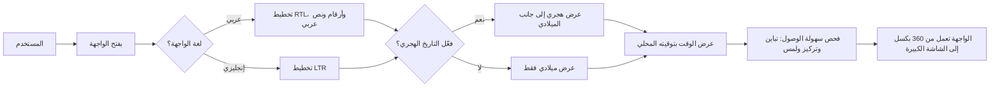

# واجهة عربية وإنجليزية

<!-- BEGIN GENERATED: doc -->
| البند | القيمة |
|---|---|
| المعرّف | FEAT-PLT-LOCALIZATION |
| الإصدار | 0.2 |
| الحالة | مسودة |
| القدرة | CAP-14 تشغيل المنصة |
| القدرة الفرعية | CAP-14.01 المراقبة (R1) |
| الأدوار | أي مستخدم مخوَّل |
| الشاشات | — |
| حالات الاستخدام | — |
| القصص | 11: 0 من المواصفة، و11 جديدة |
<!-- END GENERATED: doc -->

## 1. نظرة عامة

### 1.1 القيمة

يتيح لكل مستخدم العمل بالعربية أو الإنجليزية باتجاه الكتابة المناسب مع إمكانية عرض التاريخ الهجري.

### 1.2 النطاق

| البند | القيمة |
|---|---|
| المستخدمون | أي مستخدم مخوَّل، وفريق المنصة الذي يبني هذه القدرة |
| الشاشات | كل شاشات الويب والتطبيق الميداني، بلا شاشة مخصصة لها |
| حالات الاستخدام | اختيار المستخدم لغة الواجهة واتجاهها، وعرض الأرقام والتاريخ والوقت بما يناسبه، وعمل الواجهة على كل مقاس شاشة بسهولة وصول متوافقة مع WCAG 2.2 AA |
| المتطلبات | REQ-PLT-010 (العربية والإنجليزية باتجاهيهما RTL/LTR)، REQ-PLT-011 (واجهة متجاوبة وتطبيق ميداني) |
| خارج النطاق | نظام الرموز الخرائطية، وشريط التصنيف المجمّع لأعلى الصفحة، وتفضيل عرض الإحداثيات؛ ثلاثتها **[Missing]** في `21-ui-design.md` §7 و§11، وتُحسم مع نظام التصميم |

### 1.3 خريطة الميزة

**الشكل 1: رحلة المستخدم عبر إعدادات اللغة والعرض**



## 2. القواعد المشتركة

تنطبق على كل قصص الميزة، فلا تتكرر داخل القصص. وكل قصة تذكر ما يخصها فقط.

### 2.1 السياق المشترك

كل قصة تبدأ من ثلاثة شروط: مستأجر نشط، وحزمة السياسات الأساسية مفعّلة، ومستخدم مسجّل الدخول ومخوَّل. وتشير إليها القصص بخطوة واحدة: «بفرض السياق المشترك للميزة».

### 2.2 الصلاحية وعدم الإفصاح

- من لا يحق له رؤية العنصر يتلقى ردًا بشكل «غير متاح» تمامًا، فلا يعرف أنه موجود.
- من يرى العنصر ولا يحق له الإجراء يتلقى «لا تملك صلاحية هذا الإجراء».

### 2.3 أوامر تغيير الحالة

- **منع التكرار:** يُرسل كل أمر بمفتاح فريد، فإعادة الطلب نفسه لا تُنفَّذ مرتين.
- **حماية التعديل المتزامن:** يُرسل كل أمر بإصدار البيانات الذي يراه المستخدم. فإن عدّلها غيره في الأثناء، يُرفض الأمر.
- **السجل:** إن نجح الأمر، يُكتب حدثه وسجل التدقيق في المعاملة نفسها.

### 2.4 الرفض المشترك

```gherkin
# language: ar
خاصية: الرفض المشترك لأوامر الميزة

  سيناريو مخطط: رفض مشترك لكل أمر في الميزة
    بفرض السياق المشترك للميزة
    و <الحالة>
    عندما يُرسل المستخدم أي أمر من أوامر الميزة
    اذاً يُرفض برمز <الرمز> ويرى "<الرسالة>"
    و لا يتغير شيء

    امثلة:
      | الحالة                                  | الرمز                  | الرسالة                                                 |
      | العنصر خارج صلاحياته                    | NOT_FOUND              | غير متاح                                                |
      | العنصر مرئي له ولا يحق له الإجراء       | AUTHZ_DENIED           | لا تملك صلاحية هذا الإجراء                              |
      | غيره عدّل العنصر بعد أن فتحه            | VERSION_CONFLICT       | تغيّرت البيانات منذ فتحتها. راجع التغييرات ثم أعد المحاولة |
      | أعاد مفتاح منع التكرار بمحتوى مختلف     | IDEMPOTENCY_KEY_REUSED | طلب مكرر بمحتوى مختلف                                   |
      | البيانات ناقصة أو غير صحيحة             | VALIDATION_FAILED      | بعض البيانات ناقصة أو غير صحيحة. راجع الحقول المعلَّمة      |

  سيناريو: إعادة الطلب نفسه لا تُنفَّذ مرتين
    بفرض السياق المشترك للميزة
    و أمر نجح بمفتاح منع تكرار
    عندما يُعاد الطلب نفسه بالمفتاح نفسه
    اذاً تُعاد النتيجة الأولى ولا يُكتب حدث ثانٍ
```

## 3. الجودة وتعريف الاكتمال

### 3.1 متطلبات الجودة

<!-- BEGIN GENERATED: quality -->
| المرجع | الموقف | المطلوب |
|---|---|---|
| QAS-ACC-001 | uses R1 web screens | WCAG 2.2 level AA conformance (AR and EN) |
| QAS-USA-001 | records an observation with one photo on the mobile app | median ≤ 60 s in usability test with 10 field users |
<!-- END GENERATED: quality -->

### 3.2 تعريف الاكتمال

القصة مكتملة حين تتحقق الشروط الخمسة:

1. سيناريوهاتها والقواعد المشتركة تمر في الاختبار الآلي.
2. فحوص البنية المعمارية تمر.
3. نصوص الواجهة والرسائل موجودة بالعربية والإنجليزية.
4. مراجعة الكود مكتملة.
5. ما تضيفه القصة نفسها في قسم «القواعد» تحقق.

## 4. فهرس القصص

<!-- BEGIN GENERATED: story-index -->
| المعرّف | القصة | النوع | الحالة |
|---|---|---|---|
| `US-PLT-A11Y-FIELD-TOUCH` | أهداف لمس كبيرة للاستعمال بيد واحدة | منصة | مسودة |
| `US-PLT-A11Y-NOT-COLOR-ONLY` | الحالة والخطورة لا تعتمدان على اللون | منصة | مسودة |
| `US-PLT-A11Y-WCAG-AA` | توافق شاشات الويب مع WCAG 2.2 AA | منصة | مسودة |
| `US-PLT-L10N-BIDI-ISOLATION` | عرض النص المختلط دون انقلاب الجملة | منصة | مسودة |
| `US-PLT-L10N-EMBEDDED-FONT` | خط عربي ولاتيني مضمّن دون إنترنت | منصة | مسودة |
| `US-PLT-L10N-HIJRI-DATES` | عرض التاريخ الهجري اختياريًا | منصة | مسودة |
| `US-PLT-L10N-LANGUAGE-SWITCH` | تبديل لغة الواجهة لكل مستخدم | منصة | مسودة |
| `US-PLT-L10N-NUMERALS` | أرقام عربية أو لاتينية حسب التفضيل | منصة | مسودة |
| `US-PLT-L10N-RTL-LAYOUT` | اتجاه الصفحة الصحيح في كل الشاشات | منصة | مسودة |
| `US-PLT-L10N-TIME-ZONE` | عرض الوقت بتوقيت المستخدم المحلي | منصة | مسودة |
| `US-PLT-UI-RESPONSIVE` | الواجهة تعمل من عرض 360 بكسل | منصة | مسودة |
<!-- END GENERATED: story-index -->

## 5. القصص

### 5.1 US-PLT-A11Y-FIELD-TOUCH — أهداف لمس كبيرة للاستعمال بيد واحدة

| النوع | الإصدار | الأولوية | دون اتصال | الحالة |
|---|---|---|---|---|
| منصة | R1 | Should | لا ينطبق | مسودة |

> **كـ** فريق المنصة، **أريد** أن ألزم كل هدف لمس في التطبيق الميداني بحد أدنى للحجم، **حتى** يستعمل المستخدم الميداني الشاشة بيد واحدة أثناء الحركة دون أخطاء لمس.

**باختصار:** كل عنصر قابل للنقر في التطبيق الميداني لا يقل عن 44×44 بكسل، فوق الحد الأدنى العام لسهولة الوصول (24 بكسل)، لأن بيئة الميدان تستعمل بيد واحدة.

#### القواعد

- الحد الأدنى 44×44 بكسل لأي هدف لمس في التطبيق الميداني، و24×24 بكسل في شاشات الويب (**[Derived]** من بيئة اختبار الاستعمال في QAS-USA-001: الميدان، بيد واحدة).
- تنطبق القاعدة على كل عنصر قابل للنقر: الأزرار، الحقول، عناصر القوائم.

#### معايير القبول

```gherkin
# language: ar
خاصية: أهداف لمس كبيرة في التطبيق الميداني

  سيناريو: فحص حجم هدف اللمس
    بفرض السياق المشترك للميزة
    و المستخدم الميداني يفتح أي شاشة في التطبيق الميداني
    عندما يُقاس حجم أهداف اللمس فيها
    اذاً لا يقل أي هدف عن 44×44 بكسل
```

<details><summary>المراجع التقنية والتتبع</summary>

<!-- BEGIN GENERATED: refs US-PLT-A11Y-FIELD-TOUCH -->
| البند | المعرّف | المعنى |
|---|---|---|
| المصدر | `21-ui-design.md §10` | — |
| الجودة | QAS-USA-001 | records an observation with one photo on the mobile app → median ≤ 60 s in usability test with 10 field users |
| المصدر | `[Derived]` | — |
<!-- END GENERATED: refs US-PLT-A11Y-FIELD-TOUCH -->

</details>

### 5.2 US-PLT-A11Y-NOT-COLOR-ONLY — الحالة والخطورة لا تعتمدان على اللون

| النوع | الإصدار | الأولوية | دون اتصال | الحالة |
|---|---|---|---|---|
| منصة | R1 | Should | لا ينطبق | مسودة |

> **كـ** فريق المنصة، **أريد** أن تحمل كل شارة حالة أو خطورة نصًا أو أيقونة إلى جانب لونها، **حتى** يفهم المستخدم الذي لا يميز الألوان حالة العنصر وخطورته.

**باختصار:** كل شارة حالة أو خطورة تُعرض بلون ونص أو أيقونة ثابتة معًا، فلا يعتمد فهمها على اللون وحده.

#### القواعد

- كل شارة حالة أو خطورة تحمل تسمية نصية أو أيقونة ثابتة إلى جانب لونها.
- تنطبق على كل الشاشات التي تعرض حالة أو خطورة: المهام، التنبيهات، الحوادث، المخاطر.

#### معايير القبول

```gherkin
# language: ar
خاصية: الحالة والخطورة لا تعتمدان على اللون وحده

  سيناريو: عرض شارة الحالة
    بفرض السياق المشترك للميزة
    و عنصر له حالة أو درجة خطورة
    عندما تُعرض شارته
    اذاً تحمل الشارة نصًا أو أيقونة ثابتة إلى جانب لونها
```

<details><summary>المراجع التقنية والتتبع</summary>

<!-- BEGIN GENERATED: refs US-PLT-A11Y-NOT-COLOR-ONLY -->
| البند | المعرّف | المعنى |
|---|---|---|
| المصدر | `21-ui-design.md §10` | — |
| المصدر | `[Derived]` | — |
<!-- END GENERATED: refs US-PLT-A11Y-NOT-COLOR-ONLY -->

</details>

### 5.3 US-PLT-A11Y-WCAG-AA — توافق شاشات الويب مع WCAG 2.2 AA

| النوع | الإصدار | الأولوية | دون اتصال | الحالة |
|---|---|---|---|---|
| منصة | R1 | Should | لا ينطبق | مسودة |

> **كـ** فريق المنصة، **أريد** أن تحقق كل شاشات الويب مستوى WCAG 2.2 AA بالعربية والإنجليزية، **حتى** يصل إلى الخدمة كل مستخدم، بمن فيه من يستعمل قارئ شاشة أو لوحة مفاتيح فقط.

**باختصار:** شاشات الويب في الإصدار الأول تحقق WCAG 2.2 AA بلغتيها، بتباين لا يقل عن 4.5:1، ولوحة مفاتيح كاملة مع تركيز مرئي، وهدف لمس لا يقل عن 24 بكسل، بفحص آلي ويدوي.

#### القواعد

- التوافق مطلوب بالعربية والإنجليزية معًا، لا بلغة واحدة.
- الفحص آلي أولًا ثم يدوي قبل إطلاق كل شاشة جديدة.
- التطبيق الميداني يتبع معايير منصته (أندرويد أو iOS)، لا WCAG مباشرة.

#### معايير القبول

```gherkin
# language: ar
خاصية: توافق شاشات الويب مع WCAG 2.2 AA

  سيناريو: فحص شاشة ويب جديدة
    بفرض السياق المشترك للميزة
    و شاشة ويب جديدة بالعربية والإنجليزية
    عندما تُفحص آليًا ويدويًا
    اذاً تحقق مستوى WCAG 2.2 AA بكل اللغتين
```

<details><summary>المراجع التقنية والتتبع</summary>

<!-- BEGIN GENERATED: refs US-PLT-A11Y-WCAG-AA -->
| البند | المعرّف | المعنى |
|---|---|---|
| الجودة | QAS-ACC-001 | uses R1 web screens → WCAG 2.2 level AA conformance (AR and EN) |
| المصدر | `21-ui-design.md §10` | — |
<!-- END GENERATED: refs US-PLT-A11Y-WCAG-AA -->

</details>

### 5.4 US-PLT-L10N-BIDI-ISOLATION — عرض النص المختلط دون انقلاب الجملة

| النوع | الإصدار | الأولوية | دون اتصال | الحالة |
|---|---|---|---|---|
| منصة | R1 | Should | لا ينطبق | مسودة |

> **كـ** فريق المنصة، **أريد** أن تُعرض كل قيمة نصية مختلطة الاتجاه معزولة عن محيطها، **حتى** لا ينقلب ترتيب الجملة العربية إذا احتوت اسمًا أو رمزًا لاتينيًا.

**باختصار:** كل نص يأتي من مستخدم أو مصدر خارجي يُعرض بعزل اتجاهي (`dir="auto"` أو `<bdi>`)، فلا يقلب نص لاتيني داخله ترتيب الجملة العربية المحيطة (**[Derived]**).

#### القواعد

- يُطبَّق العزل الاتجاهي على كل قيمة نصية من مستخدم أو من مصدر خارجي، لا على نصوص الواجهة الثابتة.
- الأسماء والمعرّفات اللاتينية داخل جملة عربية تبقى بترتيبها الصحيح من اليسار إلى اليمين دون أن تعكس الجملة.

#### معايير القبول

```gherkin
# language: ar
خاصية: عرض النص المختلط دون انقلاب الجملة

  سيناريو: اسم لاتيني داخل جملة عربية
    بفرض السياق المشترك للميزة
    و عنصر يعرض نصًا عربيًا يحتوي اسمًا لاتينيًا
    عندما تُعرض الجملة
    اذاً يبقى ترتيب الكلمات العربية صحيحًا ولا ينعكس بسبب الاسم اللاتيني
```

<details><summary>المراجع التقنية والتتبع</summary>

<!-- BEGIN GENERATED: refs US-PLT-L10N-BIDI-ISOLATION -->
| البند | المعرّف | المعنى |
|---|---|---|
| المصدر | `21-ui-design.md §9` | — |
| المصدر | `[Derived]` | — |
<!-- END GENERATED: refs US-PLT-L10N-BIDI-ISOLATION -->

</details>

### 5.5 US-PLT-L10N-EMBEDDED-FONT — خط عربي ولاتيني مضمّن دون إنترنت

| النوع | الإصدار | الأولوية | دون اتصال | الحالة |
|---|---|---|---|---|
| منصة | R1 | Should | لا ينطبق | مسودة |

> **كـ** فريق المنصة، **أريد** خطًا يدعم العربية واللاتينية بأوزان متطابقة مضمَّنًا في كل إصدار، **حتى** تُعرض النصوص بشكل صحيح في البيئة المعزولة (air-gapped) دون اعتماد على الإنترنت.

**باختصار:** خط واحد يغطي العربية واللاتينية، مرفق مع كل إصدار من تطبيق الويب والتطبيق الميداني، فلا يُحمَّل من الإنترنت وقت التشغيل أو البناء (**[Derived]**).

#### القواعد

- الخط يُرفق داخل حزمة الإصدار، ولا يُطلب من خادم خطوط خارجي.
- يغطي الخط الأوزان المستخدمة في الواجهة بالعربية واللاتينية بتناسق بصري واحد.

#### معايير القبول

```gherkin
# language: ar
خاصية: خط عربي ولاتيني مضمّن دون إنترنت

  سيناريو: فتح الواجهة دون اتصال بالإنترنت
    بفرض السياق المشترك للميزة
    و جهاز العميل مقطوع عن الإنترنت العام (بيئة معزولة)
    عندما يُفتح تطبيق الويب أو التطبيق الميداني
    اذاً تُعرض كل النصوص العربية واللاتينية بالخط المضمَّن دون طلب شبكي خارجي
```

<details><summary>المراجع التقنية والتتبع</summary>

<!-- BEGIN GENERATED: refs US-PLT-L10N-EMBEDDED-FONT -->
| البند | المعرّف | المعنى |
|---|---|---|
| المصدر | `21-ui-design.md §9` | — |
| فحص البنية | FIT-12 | No external network dependency at runtime or build (air-gapped) |
| المصدر | `[Derived]` | — |
<!-- END GENERATED: refs US-PLT-L10N-EMBEDDED-FONT -->

</details>

### 5.6 US-PLT-L10N-HIJRI-DATES — عرض التاريخ الهجري اختياريًا

| النوع | الإصدار | الأولوية | دون اتصال | الحالة |
|---|---|---|---|---|
| منصة | R1 | Must | لا ينطبق | مسودة |

> **كـ** فريق المنصة، **أريد** أن توفر الواجهة عرضًا اختياريًا للتاريخ الهجري إلى جانب الميلادي، **حتى** يختار المستخدم أو المستأجر ما يناسبه دون تغيير التخزين الأساسي.

**باختصار:** التاريخ يُخزَّن ميلاديًا بالتوقيت العالمي المنسق دائمًا، وعرضه هجريًا اختياري يفعّله المستخدم أو إعداد المستأجر، محسوبًا بتقويم أم القرى أو حسابيًا حسب إعداد المستأجر.

#### القواعد

- التخزين ميلادي بالتوقيت العالمي المنسق في كل الأحوال، ولا يتغير بتفعيل العرض الهجري.
- العرض الهجري اختياري لكل مستخدم أو لكل مستأجر، ويظهر إلى جانب الميلادي لا بدلًا منه.

#### معايير القبول

```gherkin
# language: ar
خاصية: عرض التاريخ الهجري اختياريًا

  سيناريو: تفعيل العرض الهجري
    بفرض السياق المشترك للميزة
    و المستخدم فعّل عرض التاريخ الهجري
    عندما تُعرض له أي قيمة تاريخ
    اذاً تظهر القيمة الهجرية إلى جانب الميلادية
    و يبقى المخزَّن في قاعدة البيانات ميلاديًا
```

<details><summary>المراجع التقنية والتتبع</summary>

<!-- BEGIN GENERATED: refs US-PLT-L10N-HIJRI-DATES -->
| البند | المعرّف | المعنى |
|---|---|---|
| المصدر | `21-ui-design.md §9` | — |
| المصدر | `12-solution/ui-architecture.md` | — |
| المتطلب | REQ-PLT-010 | The system shall provide its user interfaces in Arabic and English with right-to-left and left-to-right layou… |
<!-- END GENERATED: refs US-PLT-L10N-HIJRI-DATES -->

</details>

### 5.7 US-PLT-L10N-LANGUAGE-SWITCH — تبديل لغة الواجهة لكل مستخدم

| النوع | الإصدار | الأولوية | دون اتصال | الحالة |
|---|---|---|---|---|
| منصة | R1 | Must | لا ينطبق | مسودة |

> **كـ** فريق المنصة، **أريد** أن يبدّل كل مستخدم لغة واجهته بين العربية والإنجليزية دون أن يؤثر على غيره، **حتى** يعمل كل مستخدم بلغته المفضلة بصرف النظر عن لغة زملائه أو المستأجر.

**باختصار:** تفضيل اللغة محفوظ لكل مستخدم على حدة، والتبديل فوري يغيّر النصوص والاتجاه والأرقام والتقويم في جلسته، ولا يغيّر لغة مستخدم آخر.

#### القواعد

- تفضيل اللغة خاص بالمستخدم، لا بالمستأجر أو الجلسة المشتركة.
- البنية تقبل إضافة لغات أخرى مستقبلًا دون تغيير جوهري.

#### معايير القبول

```gherkin
# language: ar
خاصية: تبديل لغة الواجهة لكل مستخدم

  سيناريو: مستخدم يبدّل لغته دون أن يتأثر زميله
    بفرض السياق المشترك للميزة
    و مستخدمان يعملان في المستأجر نفسه بلغتين مختلفتين
    عندما يبدّل أحدهما لغة واجهته
    اذاً تتغير نصوص واجهته واتجاهها فورًا
    و لا تتأثر لغة واجهة المستخدم الآخر
```

<details><summary>المراجع التقنية والتتبع</summary>

<!-- BEGIN GENERATED: refs US-PLT-L10N-LANGUAGE-SWITCH -->
| البند | المعرّف | المعنى |
|---|---|---|
| المصدر | `21-ui-design.md §9` | — |
| المصدر | `23-crosscutting.md §5` | — |
| المتطلب | REQ-PLT-010 | The system shall provide its user interfaces in Arabic and English with right-to-left and left-to-right layou… |
<!-- END GENERATED: refs US-PLT-L10N-LANGUAGE-SWITCH -->

</details>

### 5.8 US-PLT-L10N-NUMERALS — أرقام عربية أو لاتينية حسب التفضيل

| النوع | الإصدار | الأولوية | دون اتصال | الحالة |
|---|---|---|---|---|
| منصة | R1 | Should | لا ينطبق | مسودة |

> **كـ** فريق المنصة، **أريد** أن تعرض الواجهة أرقام النص بصيغة عربية-هندية أو لاتينية حسب تفضيل المستخدم، **حتى** يقرأ كل مستخدم الأرقام بالصيغة التي يعرفها.

**باختصار:** المعرّفات والإحداثيات والقيم التقنية تُعرض بأرقام لاتينية دائمًا، وبقية الأرقام في النص تتبع تفضيل المستخدم بين الصيغة العربية-الهندية واللاتينية (**[Derived]**).

#### القواعد

- الأرقام اللاتينية ثابتة في المعرّفات والإحداثيات والقيم التقنية، لا تتبع تفضيل العرض.
- أرقام النص العادي (الكميات والتواريخ المعروضة) تتبع تفضيل المستخدم.

#### معايير القبول

```gherkin
# language: ar
خاصية: أرقام عربية أو لاتينية حسب التفضيل

  سيناريو: مستخدم اختار الأرقام العربية-الهندية
    بفرض السياق المشترك للميزة
    و المستخدم اختار صيغة الأرقام العربية-الهندية
    عندما تُعرض له قيمة نصية فيها رقم
    اذاً يظهر الرقم بالصيغة العربية-الهندية
    و يبقى المعرّف التقني بأرقام لاتينية
```

<details><summary>المراجع التقنية والتتبع</summary>

<!-- BEGIN GENERATED: refs US-PLT-L10N-NUMERALS -->
| البند | المعرّف | المعنى |
|---|---|---|
| المصدر | `21-ui-design.md §9` | — |
| المصدر | `[Derived]` | — |
<!-- END GENERATED: refs US-PLT-L10N-NUMERALS -->

</details>

### 5.9 US-PLT-L10N-RTL-LAYOUT — اتجاه الصفحة الصحيح في كل الشاشات

| النوع | الإصدار | الأولوية | دون اتصال | الحالة |
|---|---|---|---|---|
| منصة | R1 | Must | لا ينطبق | مسودة |

> **كـ** فريق المنصة، **أريد** أن تلتزم كل الشاشات بخصائص CSS منطقية الاتجاه، **حتى** ينعكس تخطيط الصفحة بشكل صحيح من اليمين إلى اليسار بالعربية ومن اليسار إلى اليمين بالإنجليزية.

**باختصار:** التخطيط يستعمل خصائص CSS منطقية (`margin-inline-start` وما شابهها) بدل اتجاه ثابت، فتنعكس الأيقونات الاتجاهية مع تبديل اللغة، بينما لا تنعكس الخرائط والرسوم والأرقام (**[Derived]**).

#### القواعد

- كل شاشة جديدة تُبنى بخصائص CSS منطقية، لا بخصائص اتجاه ثابت (left/right).
- الخرائط والرسوم البيانية والأرقام تبقى بشكلها دون انعكاس عند تبديل الاتجاه.

#### معايير القبول

```gherkin
# language: ar
خاصية: اتجاه الصفحة الصحيح في كل الشاشات

  سيناريو: عرض الشاشة بالعربية
    بفرض السياق المشترك للميزة
    و المستخدم يستعمل الواجهة بالعربية
    عندما تُفتح أي شاشة
    اذاً يكون التخطيط من اليمين إلى اليسار وتنعكس الأيقونات الاتجاهية

  سيناريو: عرض الشاشة بالإنجليزية
    بفرض السياق المشترك للميزة
    و المستخدم يستعمل الواجهة بالإنجليزية
    عندما تُفتح الشاشة نفسها
    اذاً يكون التخطيط من اليسار إلى اليمين
    و لا تنعكس الخريطة ولا الرسم البياني ولا الأرقام
```

<details><summary>المراجع التقنية والتتبع</summary>

<!-- BEGIN GENERATED: refs US-PLT-L10N-RTL-LAYOUT -->
| البند | المعرّف | المعنى |
|---|---|---|
| القرار التقني | TD-16 | Web: React + MapLibre GL JS, i18n with ICU messages, RTL via CSS logical properties, Hijri display via Intl (… |
| المصدر | `21-ui-design.md §9` | — |
| المتطلب | REQ-PLT-010 | The system shall provide its user interfaces in Arabic and English with right-to-left and left-to-right layou… |
<!-- END GENERATED: refs US-PLT-L10N-RTL-LAYOUT -->

</details>

### 5.10 US-PLT-L10N-TIME-ZONE — عرض الوقت بتوقيت المستخدم المحلي

| النوع | الإصدار | الأولوية | دون اتصال | الحالة |
|---|---|---|---|---|
| منصة | R1 | Should | لا ينطبق | مسودة |

> **كـ** فريق المنصة، **أريد** أن تُعرض كل القيم الزمنية بتوقيت المستخدم المحلي مع التوقيت العالمي عند الحاجة، **حتى** يفهم المستخدم الوقت دون حساب يدوي للتحويل.

**باختصار:** التخزين بالتوقيت العالمي المنسق (UTC) في كل الأحوال، والعرض بالمنطقة الزمنية (IANA) من تفضيل المستخدم، وإلا منطقة المستأجر (**[Derived]**)، ويظهر التوقيت العالمي عند تمرير المؤشر على القيمة.

#### القواعد

- التخزين دائمًا بالتوقيت العالمي المنسق، والعرض فقط يتغير بالمنطقة الزمنية.
- منطقة العرض: تفضيل المستخدم إن وُجد، وإلا منطقة المستأجر.

#### معايير القبول

```gherkin
# language: ar
خاصية: عرض الوقت بتوقيت المستخدم المحلي

  سيناريو: مستخدم بمنطقة زمنية مختلفة عن المستأجر
    بفرض السياق المشترك للميزة
    و المستخدم ضبط منطقته الزمنية بخلاف منطقة المستأجر
    عندما تُعرض له قيمة زمنية
    اذاً تُعرض بمنطقته الزمنية
    و يظهر التوقيت العالمي عند تمرير المؤشر عليها
```

<details><summary>المراجع التقنية والتتبع</summary>

<!-- BEGIN GENERATED: refs US-PLT-L10N-TIME-ZONE -->
| البند | المعرّف | المعنى |
|---|---|---|
| المصدر | `21-ui-design.md §6.1` | — |
| المصدر | `23-crosscutting.md §4` | — |
| المصدر | `[Derived]` | — |
<!-- END GENERATED: refs US-PLT-L10N-TIME-ZONE -->

</details>

### 5.11 US-PLT-UI-RESPONSIVE — الواجهة تعمل من عرض 360 بكسل

| النوع | الإصدار | الأولوية | دون اتصال | الحالة |
|---|---|---|---|---|
| منصة | R1 | Must | لا ينطبق | مسودة |

> **كـ** فريق المنصة، **أريد** تصميمًا متجاوبًا لتطبيق الويب وتطبيقًا ميدانيًا يعمل على أندرويد و iOS، **حتى** يستعمل كل مستخدم الخدمة من هاتفه أو حاسوبه دون فقد وظيفة.

**باختصار:** تصميم متجاوب واحد في تطبيق الويب يغطي من عرض 360 بكسل إلى شاشة الحاسوب، وتطبيق ميداني مستقل يعمل على أندرويد و iOS دون اتصال.

#### القواعد

- تطبيق الويب يُبنى بتصميم واحد متجاوب، لا بإصدارين منفصلين للهاتف والحاسوب.
- التطبيق الميداني يُختبر على أندرويد و iOS معًا قبل كل إصدار.

#### معايير القبول

```gherkin
# language: ar
خاصية: الواجهة تعمل من عرض 360 بكسل

  سيناريو: فتح الواجهة على عرض هاتف صغير
    بفرض السياق المشترك للميزة
    و عرض الشاشة 360 بكسل
    عندما يفتح المستخدم أي شاشة من تطبيق الويب
    اذاً تُعرض الشاشة كاملة الوظائف دون قطع أو تمرير أفقي
```

<details><summary>المراجع التقنية والتتبع</summary>

<!-- BEGIN GENERATED: refs US-PLT-UI-RESPONSIVE -->
| البند | المعرّف | المعنى |
|---|---|---|
| القرار التقني | TD-16 | Web: React + MapLibre GL JS, i18n with ICU messages, RTL via CSS logical properties, Hijri display via Intl (… |
| المتطلب | REQ-PLT-011 | The system shall provide a responsive web application and a mobile field application. |
<!-- END GENERATED: refs US-PLT-UI-RESPONSIVE -->

</details>

## 6. التتبع

<!-- BEGIN GENERATED: trace -->
| المتطلب | المعنى | القصص | الاختبار |
|---|---|---|---|
| REQ-PLT-010 | The system shall provide its user interfaces in Arabic and English with right-to-left and left-to-right layou… | `US-PLT-L10N-HIJRI-DATES`، `US-PLT-L10N-LANGUAGE-SWITCH`، `US-PLT-L10N-RTL-LAYOUT` | — |
| REQ-PLT-011 | The system shall provide a responsive web application and a mobile field application. | `US-PLT-UI-RESPONSIVE` | — |
<!-- END GENERATED: trace -->

## 7. سجل التغييرات

| الإصدار | التاريخ | التغيير |
|---|---|---|
| 0.1 | — | هيكل مولَّد من خريطة الميزات |
| 0.2 | 2026-10-13 | كتابة القصص كاملة بمعيار القصص |
