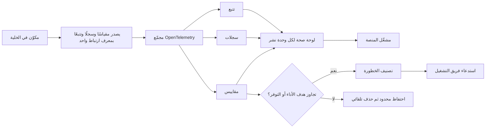

# مراقبة صحة المنصة

<!-- BEGIN GENERATED: doc -->
| البند | القيمة |
|---|---|
| المعرّف | FEAT-PLT-MONITORING |
| الإصدار | 0.1 |
| الحالة | مسودة |
| القدرة | CAP-14 تشغيل المنصة |
| القدرة الفرعية | CAP-14.01 المراقبة (R1) |
| الأدوار | مشغّل المنصة |
| الشاشات | SCR-71 حالة الإسقاطات (واجهة المشغل) |
| حالات الاستخدام | — |
| القصص | 11: 0 من المواصفة، و11 جديدة |
<!-- END GENERATED: doc -->

## 1. نظرة عامة

### 1.1 القيمة

يمكّن مشغل المنصة من رؤية صحة كل مكونات المنصة وأدائها وتتبع أي طلب عبرها، ومتابعة مؤشرات نتائج الأعمال.

### 1.2 النطاق

| البند | القيمة |
|---|---|
| المستخدمون | فريق المنصة، وفريق التشغيل والأمن، ومشغّل المنصة |
| الشاشات | SCR-71 حالة الإسقاطات (واجهة المشغل) |
| حالات الاستخدام | إصدار كل مكوّن مقاييسه وسجلاته وتتبعه بأداة واحدة موحّدة، وتتبع أي طلب فاشل من بدايته إلى نهايته، ومتابعة أهداف التوفر وزمن الاستجابة والتنبيه عند تجاوزها حسب خطورتها، والاستجابة للحوادث الأمنية الحرجة، وقياس مؤشرات نتائج الأعمال |
| المتطلبات | REQ-PLT-003 (مقاييس وسجلات وتتبع بمعرّف ارتباط موحّد، ومؤشرات نتائج الأعمال) |
| خارج النطاق | مدد الاحتفاظ النهائية وتصنيف الخطورة بالتفصيل (كلاهما **[Missing]** في المصادر، ومقترح يحتاج اعتماد المالك)، وتفاصيل آلية break-glass عند انقطاع مزوّد الهوية |

### 1.3 خريطة الميزة

**الشكل 1: من إصدار المكوّن إلى استدعاء فريق التشغيل**



## 2. القواعد المشتركة

تنطبق على كل قصص الميزة، فلا تتكرر داخل القصص. وكل قصة تذكر ما يخصها فقط.

### 2.1 السياق المشترك

كل قصة تبدأ من ثلاثة شروط: مستأجر نشط، وحزمة السياسات الأساسية مفعّلة، ومستخدم مسجّل الدخول ومخوَّل. وتشير إليها القصص بخطوة واحدة: «بفرض السياق المشترك للميزة».

### 2.2 الصلاحية وعدم الإفصاح

- من لا يحق له رؤية العنصر يتلقى ردًا بشكل «غير متاح» تمامًا، فلا يعرف أنه موجود.
- من يرى العنصر ولا يحق له الإجراء يتلقى «لا تملك صلاحية هذا الإجراء».

### 2.3 أوامر تغيير الحالة

- **منع التكرار:** يُرسل كل أمر بمفتاح فريد، فإعادة الطلب نفسه لا تُنفَّذ مرتين.
- **حماية التعديل المتزامن:** يُرسل كل أمر بإصدار البيانات الذي يراه المستخدم. فإن عدّلها غيره في الأثناء، يُرفض الأمر.
- **السجل:** إن نجح الأمر، يُكتب حدثه وسجل التدقيق في المعاملة نفسها.

### 2.4 الرفض المشترك

```gherkin
# language: ar
خاصية: الرفض المشترك لأوامر الميزة

  سيناريو مخطط: رفض مشترك لكل أمر في الميزة
    بفرض السياق المشترك للميزة
    و <الحالة>
    عندما يُرسل المستخدم أي أمر من أوامر الميزة
    اذاً يُرفض برمز <الرمز> ويرى "<الرسالة>"
    و لا يتغير شيء

    امثلة:
      | الحالة                                  | الرمز                  | الرسالة                                                 |
      | العنصر خارج صلاحياته                    | NOT_FOUND              | غير متاح                                                |
      | العنصر مرئي له ولا يحق له الإجراء       | AUTHZ_DENIED           | لا تملك صلاحية هذا الإجراء                              |
      | غيره عدّل العنصر بعد أن فتحه            | VERSION_CONFLICT       | تغيّرت البيانات منذ فتحتها. راجع التغييرات ثم أعد المحاولة |
      | أعاد مفتاح منع التكرار بمحتوى مختلف     | IDEMPOTENCY_KEY_REUSED | طلب مكرر بمحتوى مختلف                                   |
      | البيانات ناقصة أو غير صحيحة             | VALIDATION_FAILED      | بعض البيانات ناقصة أو غير صحيحة. راجع الحقول المعلَّمة      |

  سيناريو: إعادة الطلب نفسه لا تُنفَّذ مرتين
    بفرض السياق المشترك للميزة
    و أمر نجح بمفتاح منع تكرار
    عندما يُعاد الطلب نفسه بالمفتاح نفسه
    اذاً تُعاد النتيجة الأولى ولا يُكتب حدث ثانٍ
```

## 3. الجودة وتعريف الاكتمال

### 3.1 متطلبات الجودة

<!-- BEGIN GENERATED: quality -->
| المرجع | الموقف | المطلوب |
|---|---|---|
| QAS-AVL-001 | normal operation over a month | ≥ 99.9 % monthly |
| QAS-AVL-002 | normal operation over a month | ≥ 99.5 % monthly |
| QAS-AVL-003 | normal operation over a month | ≥ 99 % monthly |
| QAS-OBS-001 | investigates a failed request | 100 % of requests traceable end to end |
| QAS-PERF-001 | submits a state-changing command | p95 ≤ 300 ms; p99 ≤ 1 s |
| QAS-PERF-002 | reads a single object or a list page | single object p95 ≤ 300 ms; list page p95 ≤ 1 s |
<!-- END GENERATED: quality -->

### 3.2 تعريف الاكتمال

القصة مكتملة حين تتحقق الشروط الخمسة:

1. سيناريوهاتها والقواعد المشتركة تمر في الاختبار الآلي.
2. فحوص البنية المعمارية تمر.
3. نصوص الواجهة والرسائل موجودة بالعربية والإنجليزية.
4. مراجعة الكود مكتملة.
5. ما تضيفه القصة نفسها في قسم «القواعد» تحقق.

## 4. فهرس القصص

<!-- BEGIN GENERATED: story-index -->
| المعرّف | القصة | النوع | الحالة |
|---|---|---|---|
| `US-PLT-MON-BUSINESS-TELEMETRY` | قياس مؤشرات نتائج الأعمال | منصة | مسودة |
| `US-PLT-MON-CORRELATION-TRACE` | تتبع أي طلب من بدايته إلى نهايته | منصة | مسودة |
| `US-PLT-MON-LOG-HYGIENE` | سجلات تقنية بلا بيانات شخصية | منصة | مسودة |
| `US-PLT-MON-TELEMETRY` | مقاييس وسجلات موحدة لكل مكوّن | منصة | مسودة |
| `US-OPS-MON-ALERT-SEVERITY` | تصنيف التنبيهات حسب الخطورة والاستدعاء | تشغيل | مسودة |
| `US-OPS-MON-CLOCK-SYNC` | مزامنة ساعات الخلية والتنبيه للانحراف | تشغيل | مسودة |
| `US-OPS-MON-DASHBOARDS` | لوحات صحة لكل وحدة نشر | تشغيل | مسودة |
| `US-OPS-MON-LATENCY-SLO` | تنبيه عند تجاوز أهداف زمن الاستجابة | تشغيل | مسودة |
| `US-OPS-MON-RETENTION` | احتفاظ محدود بالسجلات والتتبع والمقاييس | تشغيل | مسودة |
| `US-OPS-MON-SECURITY-INCIDENT` | الاستجابة للحوادث الأمنية الحرجة | تشغيل | مسودة |
| `US-OPS-MON-SLO-BUDGET` | متابعة أهداف التوفر وميزانية الخطأ | تشغيل | مسودة |
<!-- END GENERATED: story-index -->

## 5. القصص

### 5.1 US-PLT-MON-BUSINESS-TELEMETRY — قياس مؤشرات نتائج الأعمال

| النوع | الإصدار | الأولوية | دون اتصال | الحالة |
|---|---|---|---|---|
| منصة | R1 | Must | لا ينطبق | مسودة |

> **كـ** فريق المنصة، **أريد** أن أقيس مؤشرات نتائج الأعمال لكل مستأجر، **حتى** يرى مالك المنتج أثر المنصة في العمل لا صحتها التقنية فقط.

**باختصار:** مؤشرات أعمال مجمَّعة لكل مستأجر: المستخدمون النشطون، وإسنادات الأدوار لكل وحدة، والسلطات الممنوحة والمفوَّضة الفعلية، والتصاريح الأمنية بعدد لكل مستوى، ولا يُعرض أي تجميع أقل من 5 سجلات.

#### القواعد

- المؤشرات تُحسب لكل مستأجر، ولا تخلط بيانات مستأجرين.
- أي مجموعة أصغر من 5 سجلات لا تُعرض، فلا تكشف عن فرد بعينه.

#### معايير القبول

```gherkin
# language: ar
خاصية: قياس مؤشرات نتائج الأعمال

  سيناريو: عرض مؤشرات مستأجر بعدد كافٍ من السجلات
    بفرض السياق المشترك للميزة
    و للمستأجر 20 مستخدمًا نشطًا هذا الشهر
    عندما يفتح فريق المنصة مؤشرات نتائج الأعمال لهذا المستأجر
    اذاً يُعرض عدد المستخدمين النشطين وإسنادات الأدوار والسلطات الفعلية

  سيناريو: مجموعة أصغر من الحد الأدنى لا تُعرض
    بفرض السياق المشترك للميزة
    و فئة تصاريح أمنية لا يحملها إلا 3 أشخاص في المستأجر
    عندما تُحسب مؤشرات التصاريح لهذا المستأجر
    اذاً لا يُعرض عدد هذه الفئة
```

<details><summary>المراجع التقنية والتتبع</summary>

<!-- BEGIN GENERATED: refs US-PLT-MON-BUSINESS-TELEMETRY -->
| البند | المعرّف | المعنى |
|---|---|---|
| المصدر | `09-reliability/observability-slc01.md §business_telemetry` | — |
| المتطلب | REQ-PLT-003 | The system shall emit metrics, logs and traces carrying a correlation id across every component, plus busines… |
<!-- END GENERATED: refs US-PLT-MON-BUSINESS-TELEMETRY -->

</details>

### 5.2 US-PLT-MON-CORRELATION-TRACE — تتبع أي طلب من بدايته إلى نهايته

| النوع | الإصدار | الأولوية | دون اتصال | الحالة |
|---|---|---|---|---|
| منصة | R1 | Must | لا ينطبق | مسودة |

> **كـ** فريق المنصة، **أريد** أن يحمل كل طلب معرّف ارتباط واحدًا عبر كل مكوناته، **حتى** يتتبع مشغّل المنصة أي طلب فاشل من بدايته إلى نهايته.

**باختصار:** البوابة تولّد معرّف ارتباط لكل طلب، وينتقل معه عبر مراحل المعالجة (فحص الصلاحية، معالجة الأمر، الكتابة في قاعدة البيانات) وفي ترويسة كل حدث ناتج، فتكون كل الطلبات قابلة للتتبع من الطرف إلى الطرف.

#### القواعد

- معرّف الارتباط يُولَّد مرة واحدة عند دخول الطلب من البوابة، ولا يُستبدل في أي مرحلة لاحقة.
- كل حدث ينتج عن الطلب يحمل معرّف ارتباطه في ترويسته، فيُتابَع أثر الطلب بعد انتهائه.

#### معايير القبول

```gherkin
# language: ar
خاصية: تتبع أي طلب من بدايته إلى نهايته

  سيناريو: تتبع طلب فاشل
    بفرض السياق المشترك للميزة
    و طلب دخل من البوابة وولَّد معرّف ارتباط
    عندما يفشل الطلب في أي مرحلة لاحقة
    اذاً يستطيع مشغّل المنصة تتبع كل مراحل الطلب بمعرّف الارتباط نفسه حتى نقطة الفشل
```

<details><summary>المراجع التقنية والتتبع</summary>

<!-- BEGIN GENERATED: refs US-PLT-MON-CORRELATION-TRACE -->
| البند | المعرّف | المعنى |
|---|---|---|
| الجودة | QAS-OBS-001 | investigates a failed request → 100 % of requests traceable end to end |
| المصدر | `23-crosscutting.md §7` | — |
| المتطلب | REQ-PLT-003 | The system shall emit metrics, logs and traces carrying a correlation id across every component, plus busines… |
<!-- END GENERATED: refs US-PLT-MON-CORRELATION-TRACE -->

</details>

### 5.3 US-PLT-MON-LOG-HYGIENE — سجلات تقنية بلا بيانات شخصية

| النوع | الإصدار | الأولوية | دون اتصال | الحالة |
|---|---|---|---|---|
| منصة | R1 | Should | لا ينطبق | مسودة |

> **كـ** فريق المنصة، **أريد** أن تخلو السجلات التقنية من محتوى الأعمال والبيانات الشخصية، **حتى** لا تتسرب بيانات حساسة عبر أدوات المراقبة.

**باختصار:** السجلات التقنية تحمل معرّفات ومسارات موارد (URN) فقط، بلا نص أعمال ولا بيانات شخصية، مع إخفاء آلي للحقول الحساسة قبل الكتابة.

#### القواعد

- لا يُكتب في السجل التقني أي نص أعمال أو حقل بيانات شخصية؛ المعرّفات والمسارات فقط.
- الحقول الحساسة المعروفة تُخفى آليًا قبل أن تصل إلى السجل، لا تُراجع لاحقًا فيه.

#### معايير القبول

```gherkin
# language: ar
خاصية: سجلات تقنية بلا بيانات شخصية

  سيناريو: معالجة أمر يحمل حقلًا حساسًا
    بفرض السياق المشترك للميزة
    و أمر يحمل حقل بيانات شخصية
    عندما يُكتب سجله التقني
    اذاً يظهر السجل بمعرّفات ومسارات موارد فقط
    و لا يظهر الحقل الحساس أو محتوى الأعمال في نصه
```

<details><summary>المراجع التقنية والتتبع</summary>

<!-- BEGIN GENERATED: refs US-PLT-MON-LOG-HYGIENE -->
| البند | المعرّف | المعنى |
|---|---|---|
| المصدر | `23-crosscutting.md §7` | — |
| المصدر | `17-security-design.md §6` | — |
<!-- END GENERATED: refs US-PLT-MON-LOG-HYGIENE -->

</details>

### 5.4 US-PLT-MON-TELEMETRY — مقاييس وسجلات موحدة لكل مكوّن

| النوع | الإصدار | الأولوية | دون اتصال | الحالة |
|---|---|---|---|---|
| منصة | R1 | Must | لا ينطبق | مسودة |

> **كـ** فريق المنصة، **أريد** أن يصدر كل مكوّن مقاييسه وسجلاته وتتبعه بأداة واحدة موحّدة، **حتى** يرى مشغّل المنصة صحة كل مكوّن بأسلوب واحد بدل أدوات متفرقة.

**باختصار:** كل مكوّن يصدّر مقاييسه وسجلاته وتتبعه عبر OpenTelemetry إلى مجمّع واحد لكل خلية، وتُخزَّن المقاييس والسجلات والتتبع بأدوات مخصصة ولوحات موحدة.

#### القواعد

- كل مكوّن جديد يُلزَم بإصدار إشاراته الثلاث (مقياس، سجل، تتبع) عبر العتاد الموحَّد قبل نشره.
- المجمّع والتخزين لا يخرجان من الخلية.

#### معايير القبول

```gherkin
# language: ar
خاصية: مقاييس وسجلات موحدة لكل مكوّن

  سيناريو: مكوّن جديد يصدر إشاراته
    بفرض السياق المشترك للميزة
    و مكوّن جديد يعالج طلبًا
    عندما يعالج الطلب
    اذاً يصدر مقياسًا وسجلًا وتتبعًا عبر العتاد الموحَّد
    و تظهر إشاراته في المجمّع نفسه الذي تظهر فيه إشارات بقية المكونات
```

<details><summary>المراجع التقنية والتتبع</summary>

<!-- BEGIN GENERATED: refs US-PLT-MON-TELEMETRY -->
| البند | المعرّف | المعنى |
|---|---|---|
| القرار التقني | TD-14 | OpenTelemetry SDK + Collector; VictoriaMetrics (metrics), VictoriaLogs (logs), Jaeger (traces), Grafana dashb… |
| المصدر | `23-crosscutting.md §7` | — |
| المتطلب | REQ-PLT-003 | The system shall emit metrics, logs and traces carrying a correlation id across every component, plus busines… |
<!-- END GENERATED: refs US-PLT-MON-TELEMETRY -->

</details>

### 5.5 US-OPS-MON-ALERT-SEVERITY — تصنيف التنبيهات حسب الخطورة والاستدعاء

| النوع | الإصدار | الأولوية | دون اتصال | الحالة |
|---|---|---|---|---|
| تشغيل | R1 | Should | لا ينطبق | مسودة |

> **كـ** فريق التشغيل، **أريد** أن يُصنَّف كل تنبيه بخطورة P0 أو P1 أو P2 وفق أثره، **حتى** أعرف هل أُستدعى فورًا أو أعالجه خلال يوم العمل.

**باختصار:** P0 خرق أمني ثابت أو فقد بيانات فيستدعي فورًا، P1 خدمة من الطبقة الحرجة خارج هدف توفرها أو تنبيه أمني فيستدعي فورًا، P2 تدهور بلا أثر فوري على المستخدم فيعالَج خلال يوم العمل (**[Derived]**، تعريف الخطورة مقترح ويحتاج اعتماد المالك).

#### القواعد

- التصنيف تلقائي عند إنشاء التنبيه حسب نوعه ومصدره، لا يدوي من المستجيب.
- P0 وP1 يستدعيان فريق التشغيل فورًا؛ P2 يُدرج في قائمة العمل اليومية.

#### معايير القبول

```gherkin
# language: ar
خاصية: تصنيف التنبيهات حسب الخطورة والاستدعاء

  سيناريو: فشل التحقق من سلسلة التدقيق يُصنَّف P0
    بفرض السياق المشترك للميزة
    و فحص سلسلة التدقيق فشل
    عندما يُنشأ التنبيه
    اذاً يُصنَّف P0 ويستدعي فريق التشغيل فورًا

  سيناريو: لا استدعاء عند تدهور بلا أثر فوري
    بفرض السياق المشترك للميزة
    و رسالة واحدة وصلت إلى قائمة الرسائل الميتة لمستهلك غير حرج
    عندما يُنشأ التنبيه
    اذاً يُصنَّف P2
    و لا يستدعي أحدًا فورًا، بل يُدرج في قائمة عمل اليوم
```

<details><summary>المراجع التقنية والتتبع</summary>

<!-- BEGIN GENERATED: refs US-OPS-MON-ALERT-SEVERITY -->
| البند | المعرّف | المعنى |
|---|---|---|
| المصدر | `23-crosscutting.md §7` | — |
| المصدر | `[Derived]` | — |
<!-- END GENERATED: refs US-OPS-MON-ALERT-SEVERITY -->

</details>

### 5.6 US-OPS-MON-CLOCK-SYNC — مزامنة ساعات الخلية والتنبيه للانحراف

| النوع | الإصدار | الأولوية | دون اتصال | الحالة |
|---|---|---|---|---|
| تشغيل | R1 | Should | لا ينطبق | مسودة |

> **كـ** فريق التشغيل، **أريد** أن تتزامن ساعات عقد كل خلية وأن أُنبَّه عند انحرافها، **حتى** يبقى ترتيب الأحداث وتسجيل الزمن صحيحًا رغم أن الخلية معزولة عن خوادم الوقت العامة.

**باختصار:** خادم NTP داخل كل خلية يزامن عقدها، وتنبيه عند انحراف عقدة أكثر من 100 ميلي ثانية (**[Derived]**، لأن ترتيب الأحداث وزمن تسجيلها يعتمدان على ساعة الخادم).

#### القواعد

- خادم NTP داخلي لكل خلية، بلا اعتماد على خوادم وقت عامة خارج الولاية.
- التنبيه يصدر عند تجاوز الانحراف 100 ميلي ثانية بين عقدة والمرجع الداخلي.

#### معايير القبول

```gherkin
# language: ar
خاصية: مزامنة ساعات الخلية والتنبيه للانحراف

  سيناريو: انحراف عقدة عن المرجع الداخلي
    بفرض السياق المشترك للميزة
    و انحراف ساعة عقدة عن خادم NTP الداخلي تجاوز 100 ميلي ثانية
    عندما يُفحص الانحراف
    اذاً يصدر تنبيه لفريق التشغيل بهوية العقدة ومقدار الانحراف

  سيناريو: لا تنبيه ضمن الحد المسموح
    بفرض السياق المشترك للميزة
    و انحراف ساعة عقدة 20 ميلي ثانية فقط
    عندما يُفحص الانحراف
    اذاً لا يصدر أي تنبيه
```

<details><summary>المراجع التقنية والتتبع</summary>

<!-- BEGIN GENERATED: refs US-OPS-MON-CLOCK-SYNC -->
| البند | المعرّف | المعنى |
|---|---|---|
| المصدر | `23-crosscutting.md §4` | — |
| المصدر | `[Derived]` | — |
<!-- END GENERATED: refs US-OPS-MON-CLOCK-SYNC -->

</details>

### 5.7 US-OPS-MON-DASHBOARDS — لوحات صحة لكل وحدة نشر

| النوع | الإصدار | الأولوية | دون اتصال | الحالة |
|---|---|---|---|---|
| تشغيل | R1 | Should | لا ينطبق | مسودة |

> **كـ** فريق التشغيل، **أريد** لوحة صحة لكل وحدة نشر تجمع معدل الطلبات والأخطاء وزمن الاستجابة وتأخر المستهلكين وحالة الإسقاطات والتدقيق، **حتى** أرى صحة كل وحدة في مكان واحد دون البحث في مصادر متفرقة.

**باختصار:** لوحة واحدة لكل وحدة نشر: معدل الطلبات والأخطاء حسب الرمز وزمن الاستجابة عند المئين 95، وتأخر المستهلكين والرسائل الميتة، وحالة بناء الإسقاطات والتدقيق، ولكل مستأجر لوحة حصصه وكلفته (**[Derived]**).

#### القواعد

- لوحة واحدة على الأقل لكل وحدة نشر، تُحدَّث من المقاييس والسجلات والتتبع الموحَّد نفسه.
- لوحة الحصص والكلفة تُعرض لكل مستأجر على حدة، لا مجمَّعة مع مستأجرين آخرين.

#### معايير القبول

```gherkin
# language: ar
خاصية: لوحات صحة لكل وحدة نشر

  سيناريو: فتح لوحة وحدة نشر
    بفرض السياق المشترك للميزة
    و وحدة نشر تعالج طلبات وتستهلك أحداثًا
    عندما يفتح فريق التشغيل لوحتها
    اذاً يرى معدل الطلبات والأخطاء وزمن الاستجابة وتأخر الاستهلاك وحالة الإسقاطات والتدقيق في مكان واحد

  سيناريو: وحدة نشر هادئة لا تحدث تغييرًا في اللوحة
    بفرض السياق المشترك للميزة
    و وحدة نشر لم تعالج طلبات ولم تستهلك أحداثًا خلال الفترة
    عندما يفتح فريق التشغيل لوحتها
    اذاً تُعرض اللوحة بقيم صفرية دون أي تنبيه
```

<details><summary>المراجع التقنية والتتبع</summary>

<!-- BEGIN GENERATED: refs US-OPS-MON-DASHBOARDS -->
| البند | المعرّف | المعنى |
|---|---|---|
| القرار التقني | TD-14 | OpenTelemetry SDK + Collector; VictoriaMetrics (metrics), VictoriaLogs (logs), Jaeger (traces), Grafana dashb… |
| المصدر | `23-crosscutting.md §7` | — |
| المصدر | `[Derived]` | — |
<!-- END GENERATED: refs US-OPS-MON-DASHBOARDS -->

</details>

### 5.8 US-OPS-MON-LATENCY-SLO — تنبيه عند تجاوز أهداف زمن الاستجابة

| النوع | الإصدار | الأولوية | دون اتصال | الحالة |
|---|---|---|---|---|
| تشغيل | R1 | Should | لا ينطبق | مسودة |

> **كـ** فريق التشغيل، **أريد** أن أُنبَّه عندما يتجاوز زمن تنفيذ أمر أو استعلام هدفه، **حتى** أتدخل قبل أن يشكو المستخدمون.

**باختصار:** تنبيه عند تجاوز زمن تنفيذ أمر 300 ميلي ثانية عند المئين 95، أو تجاوز فتح كائن أو صفحة قائمة هدفها، وفق أهداف الأداء المحددة لكل تفاعل (**[Derived]**).

#### القواعد

- العتبة لكل نوع تفاعل هي هدف الأداء المحدد له، لا عتبة واحدة لكل التفاعلات.
- القياس عند المئين 95 على نافذة متحركة، لا على طلب واحد.

#### معايير القبول

```gherkin
# language: ar
خاصية: تنبيه عند تجاوز أهداف زمن الاستجابة

  سيناريو: تجاوز هدف زمن تنفيذ الأمر
    بفرض السياق المشترك للميزة
    و زمن تنفيذ الأمر عند المئين 95 تجاوز 300 ميلي ثانية خلال النافذة المقاسة
    عندما تُفحص النافذة
    اذاً يصدر تنبيه لفريق التشغيل بالتفاعل المتأثر ومقدار التجاوز

  سيناريو: لا تنبيه ضمن الهدف
    بفرض السياق المشترك للميزة
    و زمن تنفيذ الأمر عند المئين 95 ضمن هدفه
    عندما تُفحص النافذة
    اذاً لا يصدر أي تنبيه
```

<details><summary>المراجع التقنية والتتبع</summary>

<!-- BEGIN GENERATED: refs US-OPS-MON-LATENCY-SLO -->
| البند | المعرّف | المعنى |
|---|---|---|
| الجودة | QAS-PERF-001 | submits a state-changing command → p95 ≤ 300 ms; p99 ≤ 1 s |
| الجودة | QAS-PERF-002 | reads a single object or a list page → single object p95 ≤ 300 ms; list page p95 ≤ 1 s |
| المصدر | `21-ui-design.md §13` | — |
| المصدر | `[Derived]` | — |
<!-- END GENERATED: refs US-OPS-MON-LATENCY-SLO -->

</details>

### 5.9 US-OPS-MON-RETENTION — احتفاظ محدود بالسجلات والتتبع والمقاييس

| النوع | الإصدار | الأولوية | دون اتصال | الحالة |
|---|---|---|---|---|
| تشغيل | R1 | Should | لا ينطبق | مسودة |

> **كـ** فريق التشغيل، **أريد** أن تُحذف السجلات والتتبع والمقاييس التقنية تلقائيًا بعد مدة محدودة، **حتى** لا يطول تعرّض بيانات تحمل معرّفات المستخدمين أكثر من اللازم.

**باختصار:** احتفاظ مقترح: سجلات تقنية 30 يومًا، وتتبع 7 أيام، ومقاييس 13 شهرًا للمقارنة السنوية؛ وتُحذف تلقائيًا بعد انتهاء مدتها دون جدول إتلاف مستقل، لأنها بلا محتوى أعمال (**[Derived]**، المدد مقترحة وتحتاج اعتماد المالك).

#### القواعد

- كل نوع إشارة له مدة احتفاظ ثابتة: 30 يومًا للسجلات، 7 أيام للتتبع، 13 شهرًا للمقاييس.
- الحذف تلقائي عند انتهاء المدة، بلا حاجة لاعتماد شخصين كجدول الاحتفاظ لبيانات الأعمال، لأن هذه إشارات تقنية فقط.
- سجل التدقيق منفصل عن هذا الاحتفاظ ويخضع لجدول احتفاظ البيانات.

#### معايير القبول

```gherkin
# language: ar
خاصية: احتفاظ محدود بالسجلات والتتبع والمقاييس

  سيناريو: حذف سجل تقني تجاوز 30 يومًا
    بفرض السياق المشترك للميزة
    و سجل تقني عمره أكثر من 30 يومًا
    عندما تعمل مهمة الاحتفاظ الدورية
    اذاً يُحذف السجل تلقائيًا

  سيناريو: لا حذف لسجل ضمن المدة
    بفرض السياق المشترك للميزة
    و سجل تقني عمره 10 أيام
    عندما تعمل مهمة الاحتفاظ الدورية
    اذاً يبقى السجل دون حذف
```

<details><summary>المراجع التقنية والتتبع</summary>

<!-- BEGIN GENERATED: refs US-OPS-MON-RETENTION -->
| البند | المعرّف | المعنى |
|---|---|---|
| المصدر | `22-deployment-design.md §11` | — |
| المصدر | `[Derived]` | — |
<!-- END GENERATED: refs US-OPS-MON-RETENTION -->

</details>

### 5.10 US-OPS-MON-SECURITY-INCIDENT — الاستجابة للحوادث الأمنية الحرجة

| النوع | الإصدار | الأولوية | دون اتصال | الحالة |
|---|---|---|---|---|
| تشغيل | R1 | Should | لا ينطبق | مسودة |

> **كـ** فريق التشغيل أو الأمن، **أريد** أن أُستدعى فورًا عند حادثة أمنية حرجة، **حتى** تُحَد الحادثة قبل أن تتسع.

**باختصار:** فشل التحقق من سلسلة التدقيق يصنَّف P0 ويستدعي فورًا، وأي خروج شبكة خارج قائمة السماح المعتمدة يُرفض تلقائيًا وينبه P1 فورًا.

#### القواعد

- فشل التحقق من سلسلة التدقيق حادثة P0 دائمًا، بلا استثناء.
- أي اتصال خارج بوابة الخروج وقائمة سماحها يُرفض تلقائيًا، ويولّد تنبيه P1 فورًا.

#### معايير القبول

```gherkin
# language: ar
خاصية: الاستجابة للحوادث الأمنية الحرجة

  سيناريو: فشل التحقق من سلسلة التدقيق
    بفرض السياق المشترك للميزة
    و فحص سلسلة التدقيق الدوري فشل
    عندما يُسجَّل الفشل
    اذاً يُصنَّف حادثة P0 ويستدعي فريق الأمن فورًا

  سيناريو: خروج شبكي داخل قائمة السماح لا يولّد حادثة
    بفرض السياق المشترك للميزة
    و اتصال خارجي داخل قائمة السماح المعتمدة
    عندما يحاول الاتصال الخروج
    اذاً يُسمح له
    و لا تُسجَّل حادثة أمنية
```

<details><summary>المراجع التقنية والتتبع</summary>

<!-- BEGIN GENERATED: refs US-OPS-MON-SECURITY-INCIDENT -->
| البند | المعرّف | المعنى |
|---|---|---|
| المصدر | `23-crosscutting.md §7` | — |
| المصدر | `17-security-design.md §8` | — |
| المصدر | `[Derived]` | — |
<!-- END GENERATED: refs US-OPS-MON-SECURITY-INCIDENT -->

</details>

### 5.11 US-OPS-MON-SLO-BUDGET — متابعة أهداف التوفر وميزانية الخطأ

| النوع | الإصدار | الأولوية | دون اتصال | الحالة |
|---|---|---|---|---|
| تشغيل | R1 | Should | لا ينطبق | مسودة |

> **كـ** فريق التشغيل، **أريد** أن أتابع نسبة التوفر الشهرية وميزانية الخطأ المتبقية لكل خدمة، **حتى** أقرر هل تُقدَّم الموثوقية على الميزات الجديدة في الإصدار التالي.

**باختصار:** أهداف التوفر الشهرية 99.9% للخدمات الحرجة، و99.5% للمهمة، و99% للعادية؛ وميزانية الخطأ المقابلة نحو 43 دقيقة أو 3.6 ساعات أو 7.2 ساعات شهريًا، وعند نفادها تُقدَّم الموثوقية على الميزات الجديدة (**[Derived]**، الميزانية محسوبة من نسب التوفر).

#### القواعد

- ميزانية الخطأ تُحسب شهريًا لكل خدمة من هدف توفرها.
- نفاد الميزانية يوقف إطلاق ميزات جديدة على تلك الخدمة حتى تتعافى، ويُقدَّم إصلاح الموثوقية.

#### معايير القبول

```gherkin
# language: ar
خاصية: متابعة أهداف التوفر وميزانية الخطأ

  سيناريو: نفاد ميزانية الخطأ لخدمة حرجة
    بفرض السياق المشترك للميزة
    و خدمة حرجة استهلكت كل ميزانية خطأها هذا الشهر (43 دقيقة)
    عندما تُفحص ميزانيتها
    اذاً تُقدَّم الموثوقية على الميزات الجديدة لهذه الخدمة في الإصدار التالي

  سيناريو: ميزانية الخطأ ضمن الحد
    بفرض السياق المشترك للميزة
    و خدمة حرجة استهلكت نصف ميزانية خطأها فقط
    عندما تُفحص ميزانيتها
    اذاً لا يتغير ترتيب الإصدار التالي
```

<details><summary>المراجع التقنية والتتبع</summary>

<!-- BEGIN GENERATED: refs US-OPS-MON-SLO-BUDGET -->
| البند | المعرّف | المعنى |
|---|---|---|
| الجودة | QAS-AVL-001 | normal operation over a month → ≥ 99.9 % monthly |
| الجودة | QAS-AVL-002 | normal operation over a month → ≥ 99.5 % monthly |
| الجودة | QAS-AVL-003 | normal operation over a month → ≥ 99 % monthly |
| المصدر | `23-crosscutting.md §7` | — |
| المصدر | `[Derived]` | — |
<!-- END GENERATED: refs US-OPS-MON-SLO-BUDGET -->

</details>

## 6. التتبع

<!-- BEGIN GENERATED: trace -->
| المتطلب | المعنى | القصص | الاختبار |
|---|---|---|---|
| REQ-PLT-003 | The system shall emit metrics, logs and traces carrying a correlation id across every component, plus busines… | `US-PLT-MON-BUSINESS-TELEMETRY`، `US-PLT-MON-CORRELATION-TRACE`، `US-PLT-MON-TELEMETRY` | — |
<!-- END GENERATED: trace -->

## 7. سجل التغييرات

| الإصدار | التاريخ | التغيير |
|---|---|---|
| 0.1 | — | هيكل مولَّد من خريطة الميزات |
| 0.2 | 2026-10-13 | كتابة القصص كاملة بمعيار القصص |
