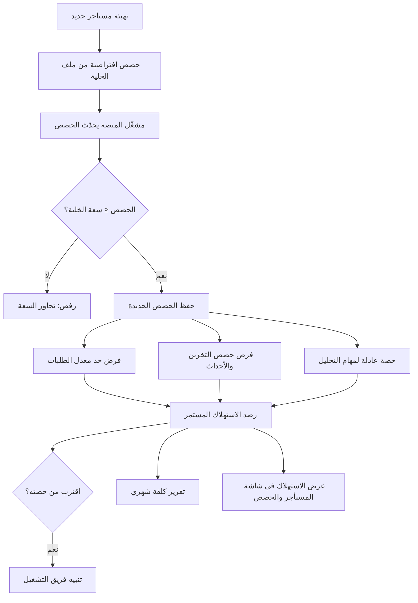

# حصص المستأجر وحدود الاستخدام

<!-- BEGIN GENERATED: doc -->
| البند | القيمة |
|---|---|
| المعرّف | FEAT-PLT-TENANT-QUOTAS |
| الإصدار | 0.1 |
| الحالة | مسودة |
| القدرة | CAP-14 تشغيل المنصة |
| القدرة الفرعية | CAP-14.03 تهيئة المستأجرين والحصص (R1) |
| الأدوار | مشغّل المنصة؛ مسؤول الإدارة؛ النظام |
| الشاشات | SCR-60 المستأجر والحصص (واجهة المشغل) |
| حالات الاستخدام | UC-105 |
| القصص | 9: 1 من المواصفة، و8 جديدة |
<!-- END GENERATED: doc -->

## 1. نظرة عامة

### 1.1 القيمة

يتيح لمشغل المنصة تحديد حصص كل مستأجر من الطلبات والتخزين والأحداث والمهام وفرضها، حتى لا يؤثر مستأجر على غيره.

### 1.2 النطاق

| البند | القيمة |
|---|---|
| المستخدمون | مشغّل المنصة؛ مسؤول الإدارة في المستأجر (عرض الحصص فقط)؛ النظام |
| الشاشات | SCR-60 المستأجر والحصص (واجهة المشغل) |
| حالات الاستخدام (بالكلمات) | تحديث حصص المستأجر الأربع مجتمعة؛ عرض استهلاك كل مستأجر مقابل حصصه وسعة الخلية؛ حساب كلفة شهرية لكل مستأجر من بيانات التيليمتري؛ ضبط حصص افتراضية من ملف الخلية عند تهيئة مستأجر جديد؛ توزيع حصة عادلة لمهام التحليل بين المستأجرين؛ فرض حد معدل الطلبات لكل مستأجر؛ فرض حصتي التخزين والأحداث؛ اختبار أثر مستأجر يتجاوز حصته على غيره؛ تنبيه عند اقتراب مستأجر من إحدى حصصه |
| المتطلبات (بالكلمات) | فرض حصص ومعدلات لكل مستأجر في الطلبات والتخزين والأحداث والمهام (REQ-FND-018)؛ حساب استهلاك وكلفة كل مستأجر من التيليمتري دون تدخل بشري (REQ-PLT-013) |
| خارج النطاق | إصدار الفواتير وعرضها للمستأجر؛ تغيير سعة الخلية نفسها (قرار بنية، ميزة أخرى) |

### 1.3 خريطة الميزة

**الشكل 1: من تهيئة المستأجر إلى فرض الحصص ومتابعتها**



## 2. القواعد المشتركة

تنطبق على كل قصص الميزة، فلا تتكرر داخل القصص. وكل قصة تذكر ما يخصها فقط.

### 2.1 السياق المشترك

كل قصة تبدأ من ثلاثة شروط: مستأجر نشط، وحزمة السياسات الأساسية مفعّلة، ومستخدم مسجّل الدخول ومخوَّل. وتشير إليها القصص بخطوة واحدة: «بفرض السياق المشترك للميزة».

### 2.2 الصلاحية وعدم الإفصاح

- من لا يحق له رؤية العنصر يتلقى ردًا بشكل «غير متاح» تمامًا، فلا يعرف أنه موجود.
- من يرى العنصر ولا يحق له الإجراء يتلقى «لا تملك صلاحية هذا الإجراء».

### 2.3 أوامر تغيير الحالة

- **منع التكرار:** يُرسل كل أمر بمفتاح فريد، فإعادة الطلب نفسه لا تُنفَّذ مرتين.
- **حماية التعديل المتزامن:** يُرسل كل أمر بإصدار البيانات الذي يراه المستخدم. فإن عدّلها غيره في الأثناء، يُرفض الأمر.
- **السجل:** إن نجح الأمر، يُكتب حدثه وسجل التدقيق في المعاملة نفسها.

### 2.4 الرفض المشترك

```gherkin
# language: ar
خاصية: الرفض المشترك لأوامر الميزة

  سيناريو مخطط: رفض مشترك لكل أمر في الميزة
    بفرض السياق المشترك للميزة
    و <الحالة>
    عندما يُرسل المستخدم أي أمر من أوامر الميزة
    اذاً يُرفض برمز <الرمز> ويرى "<الرسالة>"
    و لا يتغير شيء

    امثلة:
      | الحالة                                  | الرمز                  | الرسالة                                                 |
      | العنصر خارج صلاحياته                    | NOT_FOUND              | غير متاح                                                |
      | العنصر مرئي له ولا يحق له الإجراء       | AUTHZ_DENIED           | لا تملك صلاحية هذا الإجراء                              |
      | غيره عدّل العنصر بعد أن فتحه            | VERSION_CONFLICT       | تغيّرت البيانات منذ فتحتها. راجع التغييرات ثم أعد المحاولة |
      | أعاد مفتاح منع التكرار بمحتوى مختلف     | IDEMPOTENCY_KEY_REUSED | طلب مكرر بمحتوى مختلف                                   |
      | البيانات ناقصة أو غير صحيحة             | VALIDATION_FAILED      | بعض البيانات ناقصة أو غير صحيحة. راجع الحقول المعلَّمة      |

  سيناريو: إعادة الطلب نفسه لا تُنفَّذ مرتين
    بفرض السياق المشترك للميزة
    و أمر نجح بمفتاح منع تكرار
    عندما يُعاد الطلب نفسه بالمفتاح نفسه
    اذاً تُعاد النتيجة الأولى ولا يُكتب حدث ثانٍ
```

## 3. الجودة وتعريف الاكتمال

### 3.1 متطلبات الجودة

<!-- BEGIN GENERATED: quality -->
| المرجع | الموقف | المطلوب |
|---|---|---|
| QAS-COST-001 | requests monthly cost per tenant | computed from telemetry with no manual input |
| QAS-PERF-020 | tenant submits 100 runs | no tenant exceeds its concurrent-job quota; other tenants' start latency ≤ 30 s |
| QAS-SCAL-005 | exceeds its quota by 10× | other tenants stay within QAS-PERF-001 |
<!-- END GENERATED: quality -->

### 3.2 تعريف الاكتمال

القصة مكتملة حين تتحقق الشروط الخمسة:

1. سيناريوهاتها والقواعد المشتركة تمر في الاختبار الآلي.
2. فحوص البنية المعمارية تمر.
3. نصوص الواجهة والرسائل موجودة بالعربية والإنجليزية.
4. مراجعة الكود مكتملة.
5. ما تضيفه القصة نفسها في قسم «القواعد» تحقق.

## 4. فهرس القصص

<!-- BEGIN GENERATED: story-index -->
| المعرّف | القصة | النوع | الحالة |
|---|---|---|---|
| `US-BC01-TEN-UPDATE-QUOTAS` | تحديث حصص المستأجر | أمر | مسودة |
| `US-UI-SCR60-QUOTA-USAGE` | عرض الاستهلاك مقابل الحصص والسعة | واجهة | مسودة |
| `US-PLT-QUOTA-COST-REPORT` | تقرير كلفة شهري لكل مستأجر | منصة | مسودة |
| `US-PLT-QUOTA-DEFAULTS` | حصص افتراضية من ملف الخلية | منصة | مسودة |
| `US-PLT-QUOTA-JOB-FAIR-SHARE` | حصص عادلة للمهام بين المستأجرين | منصة | مسودة |
| `US-PLT-QUOTA-RATE-LIMIT` | حد معدل الطلبات لكل مستأجر | منصة | مسودة |
| `US-PLT-QUOTA-STORAGE-EVENTS` | فرض حصص التخزين والأحداث | منصة | مسودة |
| `US-OPS-QUOTA-NOISY-NEIGHBOR` | اختبار عدم تأثر المستأجرين بالمستأجر المزعج | تشغيل | مسودة |
| `US-OPS-QUOTA-USAGE-ALERT` | تنبيه عند اقتراب المستأجر من حصته | تشغيل | مسودة |
<!-- END GENERATED: story-index -->

## 5. القصص

### 5.1 US-BC01-TEN-UPDATE-QUOTAS — تحديث حصص المستأجر

| النوع | الإصدار | الأولوية | دون اتصال | الحالة |
|---|---|---|---|---|
| أمر | R1 | Must | لا | مسودة |

> **كـ** مشغّل المنصة، **أريد** أن أحدِّث حصص مستأجر من الطلبات والتخزين والأحداث والمهام المتزامنة معًا، **حتى** يبقى استخدامه ضمن سعة الخلية ولا يؤثر على مستأجرين آخرين.

**باختصار:** يحدِّث مشغّل المنصة حصص المستأجر الأربع مجتمعة، فتُقبل فقط إذا لم يتجاوز مجموعها سعة الخلية، ولا تتغير حالة المستأجر نفسه.

#### القواعد

- **متى يُسمح:** المستأجر في حالة «نشط» أو «معلّق»، ومجموع الحصص الجديدة لا يتجاوز سعة الخلية.
- **من يُسمح له:** مشغّل المنصة فقط ينفّذ التحديث؛ ويرى مسؤول الإدارة في المستأجر نفسه حصصه للعرض دون تعديلها.
- **البيانات:** الحصص الأربع معًا (الطلبات في الثانية، والتخزين، والأحداث في الثانية، والمهام المتزامنة)، وكلها إلزامية في الطلب.
- **الأثر:** يصل حدث «تحديث حصص المستأجر» إلى عرض الدليل والبحث، وإلى تهيئة المستأجر أو نقله بين الخلايا إن كان أحدهما جاريًا.

#### معايير القبول

```gherkin
# language: ar
خاصية: تحديث حصص المستأجر

  سيناريو: مشغّل المنصة يحدّث الحصص ضمن سعة الخلية
    بفرض السياق المشترك للميزة
    و مستأجر نشط وحصصه الجديدة لا تتجاوز سعة الخلية
    عندما يحدّث مشغّل المنصة الحصص
    اذاً تُحفظ الحصص الجديدة ولا تتغير حالة المستأجر
    و يُسجَّل حدث "تحديث حصص المستأجر"

  سيناريو مخطط: رفض خاص بتحديث الحصص
    بفرض السياق المشترك للميزة
    و <الحالة>
    عندما يحاول مشغّل المنصة تحديث الحصص
    اذاً يُرفض برمز <الرمز> ويرى <الرسالة>
    و لا يتغير شيء

    امثلة:
      | الحالة                                      | الرمز                          | الرسالة                                     |
      | مجموع الحصص الجديدة أكبر من سعة الخلية      | QUOTA_EXCEEDS_CAPACITY         | الحصص المطلوبة تتجاوز سعة الخلية            |
      | المستأجر بصدد التهيئة أو الإلغاء أو النقل    | TENANT_INVALID_STATE_TRANSITION | الوضع الحالي للمستأجر لا يسمح بهذا الإجراء |
      | حقل الحصص مفقود أو غير صحيح                 | VALIDATION_FAILED               | الحصص مطلوبة                                |
```

<details><summary>المراجع التقنية والتتبع</summary>

<!-- BEGIN GENERATED: refs US-BC01-TEN-UPDATE-QUOTAS -->
| البند | المعرّف | المعنى |
|---|---|---|
| الواجهة البرمجية | `POST /api/v1/foundation/tenants/{id}/actions/update-quotas` | — |
| الأمر | `CMD-TEN-UPDATE-QUOTAS` | تحديث حصص المستأجر |
| السياسة | `POL-TEN-UPDATE-QUOTAS` | Platform Operator (platform tenant) ; Tenant Administrator for quotas view only؛ tenant match; subject ACTIVE… |
| الحدث | `EVT-TEN-QUOTAS-UPDATED` | يصل إلى: Search/Directory projection (BC01 read model); Provisioning saga / cell controller |
| الكيان | `AGG-TENANT` | المستأجر |
| الجدول | `foundation.tenants` | الجدول الرئيسي للمستأجر |
| وحدة النشر | DU-02 | — |
| المتطلب | REQ-FND-018 | The system shall enforce per-tenant quotas and rate limits for requests, storage, events and jobs. |
| حالة الاستخدام | UC-105 | Manage Tenant Quotas |
| الاختبار | TST-TENANT-SM، TST-SLC01-INVARIANTS | دورة حالات المستأجر، وثوابت الشريحة SLC-01 |
<!-- END GENERATED: refs US-BC01-TEN-UPDATE-QUOTAS -->

</details>

### 5.2 US-UI-SCR60-QUOTA-USAGE — عرض الاستهلاك مقابل الحصص والسعة

| النوع | الإصدار | الأولوية | دون اتصال | الحالة |
|---|---|---|---|---|
| واجهة | R1 | Should | لا | مسودة |

> **كـ** مشغّل المنصة، **أريد** أن أرى استهلاك كل مستأجر الحالي مقابل حصصه وسعة الخلية في شاشة واحدة، **حتى** أعرف من اقترب من حده قبل أن يصل إليه.

**باختصار:** تعرض شاشة المستأجر والحصص لكل مستأجر حصصه واستهلاكه الحالي ونسبته من سعة الخلية، وتُميّز من اقترب من إحدى حصصه.

#### القواعد

- **البيانات:** الحصص الأربع واستهلاكها الحالي، ونسبة كل منها من سعة الخلية.

#### معايير القبول

```gherkin
# language: ar
خاصية: عرض الاستهلاك مقابل الحصص والسعة

  سيناريو: عرض استهلاك طبيعي
    بفرض السياق المشترك للميزة
    و مستأجرون باستهلاك ضمن حصصهم
    عندما يفتح مشغّل المنصة شاشة المستأجر والحصص
    اذاً تُعرض لكل مستأجر حصصه واستهلاكه الحالي ونسبته من سعة الخلية

  سيناريو: تمييز مستأجر قريب من حصته
    بفرض السياق المشترك للميزة
    و مستأجر استهلاكه قريب من إحدى حصصه
    عندما تُعرض الشاشة
    اذاً يُميَّز هذا المستأجر بوضوح عن غيره
```

<details><summary>المراجع التقنية والتتبع</summary>

<!-- BEGIN GENERATED: refs US-UI-SCR60-QUOTA-USAGE -->
| البند | المعرّف | المعنى |
|---|---|---|
| حالة الاستخدام | UC-105 | Manage Tenant Quotas |
| الشاشة | SCR-60 | شاشة المستأجر والحصص (واجهة المشغل) |
| المصدر | `[Derived]` | — |
<!-- END GENERATED: refs US-UI-SCR60-QUOTA-USAGE -->

</details>

### 5.3 US-PLT-QUOTA-COST-REPORT — تقرير كلفة شهري لكل مستأجر

| النوع | الإصدار | الأولوية | دون اتصال | الحالة |
|---|---|---|---|---|
| منصة | R1 | Must | لا ينطبق | مسودة |

> **كـ** فريق المنصة، **أريد** أن يُحسب استهلاك كل مستأجر وكلفته شهريًا من بيانات التيليمتري تلقائيًا، **حتى** يُعرف نصيب كل مستأجر من كلفة الخلية المشتركة دون تدخل بشري.

**باختصار:** تُستخدم تسمية المستأجر على أحمال المهام والتخزين لتوزيع الكلفة المشتركة، فيُحسب تقرير شهري لكل مستأجر دون مدخلات يدوية.

#### القواعد

- **الأثر:** يُبنى التقرير من بيانات التيليمتري فقط، فلا يحتاج أي إدخال يدوي شهري.

#### معايير القبول

```gherkin
# language: ar
خاصية: تقرير الكلفة الشهري

  سيناريو: حساب تقرير الكلفة
    بفرض شهرًا اكتمل
    عندما يُحسب تقرير الكلفة
    اذاً يُحسب استهلاك وكلفة كل مستأجر من التيليمتري فقط دون أي مدخل يدوي
```

<details><summary>المراجع التقنية والتتبع</summary>

<!-- BEGIN GENERATED: refs US-PLT-QUOTA-COST-REPORT -->
| البند | المعرّف | المعنى |
|---|---|---|
| الجودة | QAS-COST-001 | requests monthly cost per tenant → computed from telemetry with no manual input |
| المصدر | `22-deployment-design.md §12` | — |
| المتطلب | REQ-PLT-013 | The system shall compute resource consumption and cost per tenant from telemetry. |
<!-- END GENERATED: refs US-PLT-QUOTA-COST-REPORT -->

</details>

### 5.4 US-PLT-QUOTA-DEFAULTS — حصص افتراضية من ملف الخلية

| النوع | الإصدار | الأولوية | دون اتصال | الحالة |
|---|---|---|---|---|
| منصة | R1 | Should | لا ينطبق | مسودة |

> **كـ** فريق المنصة، **أريد** أن تُضبط حصص المستأجر الافتراضية من ملف الخلية عند تهيئته، **حتى** لا يبدأ مستأجر جديد بلا حدود معروفة.

**باختصار:** عند تهيئة مستأجر جديد، تُؤخذ قيم حصصه الابتدائية من ملف الخلية (مشتركة أو مخصصة أو سيادية)، ثم يعدّلها مشغّل المنصة لاحقًا عند الحاجة (القصة 5.1).

#### القواعد

- **الأثر:** **[Derived]** القيم الافتراضية الرقمية نفسها غير محددة في المصدر، فتبقى ملفات الخلية هي مصدر القيمة الابتدائية عند التهيئة لا قيمة مكتوبة في هذه الميزة.

#### معايير القبول

```gherkin
# language: ar
خاصية: حصص افتراضية من ملف الخلية

  سيناريو: تهيئة مستأجر جديد
    بفرض أن ملف الخلية يحمل قيم حصص ابتدائية
    عندما تبدأ تهيئة مستأجر جديد
    اذاً تُضبط حصصه الأربع من قيم ملف الخلية
```

<details><summary>المراجع التقنية والتتبع</summary>

<!-- BEGIN GENERATED: refs US-PLT-QUOTA-DEFAULTS -->
| البند | المعرّف | المعنى |
|---|---|---|
| المصدر | `23-crosscutting.md §1.3` | — |
| المصدر | `[Derived]` | — |
<!-- END GENERATED: refs US-PLT-QUOTA-DEFAULTS -->

</details>

### 5.5 US-PLT-QUOTA-JOB-FAIR-SHARE — حصص عادلة للمهام بين المستأجرين

| النوع | الإصدار | الأولوية | دون اتصال | الحالة |
|---|---|---|---|---|
| منصة | R1 | Must | لا ينطبق | مسودة |

> **كـ** فريق المنصة، **أريد** أن توزَّع سعة تشغيل مهام التحليل بالتناسب العادل بين المستأجرين، **حتى** لا يستهلك مستأجر واحد كل السعة ويؤخر بدء مهام الآخرين.

**باختصار:** تُجدوَل مهام كل مستأجر بحصته الخاصة من المهام المتزامنة، فإذا رفع مستأجر طلباته لا يتأخر بدء مهام الآخرين عن 30 ثانية.

#### القواعد

- **الأثر:** إذا رفع مستأجر عدد تشغيلاته إلى 100، لا يتجاوز حصته من المهام المتزامنة، ولا يتأخر بدء مهام المستأجرين الآخرين أكثر من 30 ثانية.

#### معايير القبول

```gherkin
# language: ar
خاصية: حصص عادلة للمهام

  سيناريو: مستأجر يرفع طلباته لا يؤخر غيره
    بفرض مستأجر رفع عدد تشغيلاته إلى 100
    عندما تُجدوَل مهامه
    اذاً لا يتجاوز حصته من المهام المتزامنة
    و يبدأ تشغيل مهام المستأجرين الآخرين خلال 30 ثانية أو أقل
```

<details><summary>المراجع التقنية والتتبع</summary>

<!-- BEGIN GENERATED: refs US-PLT-QUOTA-JOB-FAIR-SHARE -->
| البند | المعرّف | المعنى |
|---|---|---|
| الجودة | QAS-PERF-020 | tenant submits 100 runs → no tenant exceeds its concurrent-job quota; other tenants' start latency ≤ 30 s |
| القرار التقني | TD-12 | Kubernetes Jobs with Kueue (fair sharing, per-tenant quotas); images from internal Harbor registry, signed (c… |
| المتطلب | REQ-FND-018 | The system shall enforce per-tenant quotas and rate limits for requests, storage, events and jobs. |
| حالة الاستخدام | UC-105 | Manage Tenant Quotas |
<!-- END GENERATED: refs US-PLT-QUOTA-JOB-FAIR-SHARE -->

</details>

### 5.6 US-PLT-QUOTA-RATE-LIMIT — حد معدل الطلبات لكل مستأجر

| النوع | الإصدار | الأولوية | دون اتصال | الحالة |
|---|---|---|---|---|
| منصة | R1 | Must | لا ينطبق | مسودة |

> **كـ** فريق المنصة، **أريد** أن يُطبَّق حد لمعدل الطلبات في الثانية لكل مستأجر عند البوابة، **حتى** لا يستنزف مستأجر واحد سعة الخلية من الطلبات.

**باختصار:** كل طلب يتجاوز حد معدل المستأجر يُرفض عند البوابة فورًا، فلا يصل إلى الوحدات الداخلية.

#### القواعد

- **الأثر:** الطلب الذي يتجاوز حد المستأجر يُرفض عند البوابة قبل أي معالجة داخلية.

#### معايير القبول

```gherkin
# language: ar
خاصية: حد معدل الطلبات لكل مستأجر

  سيناريو: طلبات ضمن الحد
    بفرض السياق المشترك للميزة
    و مستأجر لم يبلغ حد معدل طلباته
    عندما يرسل طلبًا
    اذاً يُقبل الطلب ويُعالج عاديًا

  سيناريو: تجاوز حد المعدل
    بفرض السياق المشترك للميزة
    و مستأجر بلغ حد معدل طلباته في الثانية
    عندما يرسل طلبًا إضافيًا
    اذاً يُرفض عند البوابة برمز RATE_LIMITED ويرى "طلبات كثيرة في وقت قصير. انتظر قليلًا ثم أعد المحاولة"
```

<details><summary>المراجع التقنية والتتبع</summary>

<!-- BEGIN GENERATED: refs US-PLT-QUOTA-RATE-LIMIT -->
| البند | المعرّف | المعنى |
|---|---|---|
| المصدر | `23-crosscutting.md §1.3` | — |
| المصدر | `23-crosscutting.md §10` | — |
| المتطلب | REQ-FND-018 | The system shall enforce per-tenant quotas and rate limits for requests, storage, events and jobs. |
| حالة الاستخدام | UC-105 | Manage Tenant Quotas |
<!-- END GENERATED: refs US-PLT-QUOTA-RATE-LIMIT -->

</details>

### 5.7 US-PLT-QUOTA-STORAGE-EVENTS — فرض حصص التخزين والأحداث

| النوع | الإصدار | الأولوية | دون اتصال | الحالة |
|---|---|---|---|---|
| منصة | R1 | Must | لا ينطبق | مسودة |

> **كـ** فريق المنصة، **أريد** أن تُفرَض حصتا التخزين والأحداث في الثانية لكل مستأجر، **حتى** لا يستهلك مستأجر مساحة تخزين أو معدل أحداث يفوق المخصص له.

**باختصار:** كل مستأجر محدود بحجم تخزين وبمعدل أحداث في الثانية، وما يتجاوزهما يُرفض.

#### القواعد

- **الأثر:** **[Derived]** آلية الفرض التفصيلية لحصتي التخزين والأحداث غير مذكورة في المصدر (بخلاف حصة الطلبات المفروضة عند البوابة وحصة المهام في مجدول المهام)؛ المذكور صراحة هو الحد الأعلى لكل منهما فقط.

#### معايير القبول

```gherkin
# language: ar
خاصية: فرض حصص التخزين والأحداث

  سيناريو: الاستهلاك ضمن الحصة
    بفرض السياق المشترك للميزة
    و مستأجر تخزينه ومعدل أحداثه ضمن حصتيه
    عندما يضيف بيانات أو ينشر حدثًا
    اذاً يُقبل دون رفض

  سيناريو: تجاوز حصة التخزين أو الأحداث
    بفرض السياق المشترك للميزة
    و مستأجر بلغ حصته من التخزين أو الأحداث
    عندما يحاول تجاوزها
    اذاً يُرفض برمز QUOTA_EXCEEDED ويرى "بلغت الحد المسموح لجهتك"
```

<details><summary>المراجع التقنية والتتبع</summary>

<!-- BEGIN GENERATED: refs US-PLT-QUOTA-STORAGE-EVENTS -->
| البند | المعرّف | المعنى |
|---|---|---|
| المصدر | `[Derived]` | — |
| المتطلب | REQ-FND-018 | The system shall enforce per-tenant quotas and rate limits for requests, storage, events and jobs. |
| حالة الاستخدام | UC-105 | Manage Tenant Quotas |
<!-- END GENERATED: refs US-PLT-QUOTA-STORAGE-EVENTS -->

</details>

### 5.8 US-OPS-QUOTA-NOISY-NEIGHBOR — اختبار عدم تأثر المستأجرين بالمستأجر المزعج

| النوع | الإصدار | الأولوية | دون اتصال | الحالة |
|---|---|---|---|---|
| تشغيل | R1 | Should | لا ينطبق | مسودة |

> **كـ** فريق التشغيل أو الأمن، **أريد** أن أختبر دوريًا أن مستأجرًا يتجاوز حصته بعشرة أضعاف لا يخرج أداء المستأجرين الآخرين عن هدفه، **حتى** أتأكد من عزل الحصص عمليًا لا نظريًا فقط.

**باختصار:** يُحمَّل مستأجر اختباري بعشرة أضعاف حصته، ويُقاس زمن استجابة المستأجرين الآخرين، فيجب أن يبقى ضمن هدف الأداء المعتمد.

#### القواعد

- **الأثر:** تجاوز مستأجر لحصته بعشرة أضعاف لا يُخرج أداء غيره عن هدف الأداء المعتمد.

#### معايير القبول

```gherkin
# language: ar
خاصية: اختبار المستأجر المزعج

  سيناريو: التجاوز لا يؤثر في الآخرين
    بفرض مستأجرًا اختباريًا يتجاوز حصته بعشرة أضعاف
    عندما يُقاس زمن استجابة المستأجرين الآخرين خلال الاختبار
    اذاً يبقى ضمن هدف الأداء المعتمد
```

<details><summary>المراجع التقنية والتتبع</summary>

<!-- BEGIN GENERATED: refs US-OPS-QUOTA-NOISY-NEIGHBOR -->
| البند | المعرّف | المعنى |
|---|---|---|
| الجودة | QAS-SCAL-005 | exceeds its quota by 10× → other tenants stay within QAS-PERF-001 |
| المصدر | `22-deployment-design.md §2.2` | — |
<!-- END GENERATED: refs US-OPS-QUOTA-NOISY-NEIGHBOR -->

</details>

### 5.9 US-OPS-QUOTA-USAGE-ALERT — تنبيه عند اقتراب المستأجر من حصته

| النوع | الإصدار | الأولوية | دون اتصال | الحالة |
|---|---|---|---|---|
| تشغيل | R1 | Must | لا ينطبق | مسودة |

> **كـ** فريق التشغيل أو الأمن، **أريد** أن يصل تنبيه عند اقتراب استهلاك مستأجر من إحدى حصصه، **حتى** يتدخل مشغّل المنصة قبل أن يصل الاستهلاك إلى الحد ويُرفض.

**باختصار:** يُقارن الاستهلاك الحالي بالحصص دوريًا، وعند اقترابه من حد أي حصة يصل تنبيه إلى فريق التشغيل.

#### معايير القبول

```gherkin
# language: ar
خاصية: تنبيه اقتراب المستأجر من حصته

  سيناريو: الاستهلاك يقترب من الحصة
    بفرض أن استهلاك مستأجر اقترب من إحدى حصصه
    عندما تُفحص الحصص دوريًا
    اذاً يصل تنبيه إلى فريق التشغيل بالمستأجر والحصة المقتربة

  سيناريو: الاستهلاك بعيد عن الحصة
    بفرض أن استهلاك مستأجر بعيد عن كل حصصه
    عندما تُفحص الحصص دوريًا
    اذاً لا يُرسل أي تنبيه
```

<details><summary>المراجع التقنية والتتبع</summary>

<!-- BEGIN GENERATED: refs US-OPS-QUOTA-USAGE-ALERT -->
| البند | المعرّف | المعنى |
|---|---|---|
| المصدر | `23-crosscutting.md §7` | — |
| المصدر | `[Derived]` | — |
| المتطلب | REQ-FND-018 | The system shall enforce per-tenant quotas and rate limits for requests, storage, events and jobs. |
| حالة الاستخدام | UC-105 | Manage Tenant Quotas |
<!-- END GENERATED: refs US-OPS-QUOTA-USAGE-ALERT -->

</details>

## 6. التتبع

<!-- BEGIN GENERATED: trace -->
| المتطلب | المعنى | القصص | الاختبار |
|---|---|---|---|
| REQ-FND-018 | The system shall enforce per-tenant quotas and rate limits for requests, storage, events and jobs. | `US-BC01-TEN-UPDATE-QUOTAS`، `US-OPS-QUOTA-USAGE-ALERT`، `US-PLT-QUOTA-JOB-FAIR-SHARE`، `US-PLT-QUOTA-RATE-LIMIT`، `US-PLT-QUOTA-STORAGE-EVENTS` | TST-TENANT-SM |
| REQ-PLT-013 | The system shall compute resource consumption and cost per tenant from telemetry. | `US-PLT-QUOTA-COST-REPORT` | — |
<!-- END GENERATED: trace -->

## 7. سجل التغييرات

| الإصدار | التاريخ | التغيير |
|---|---|---|
| 0.1 | — | هيكل مولَّد من خريطة الميزات |
| 0.2 | 2026-10-13 | كتابة القصص كاملة بمعيار القصص |
